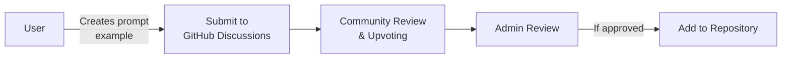
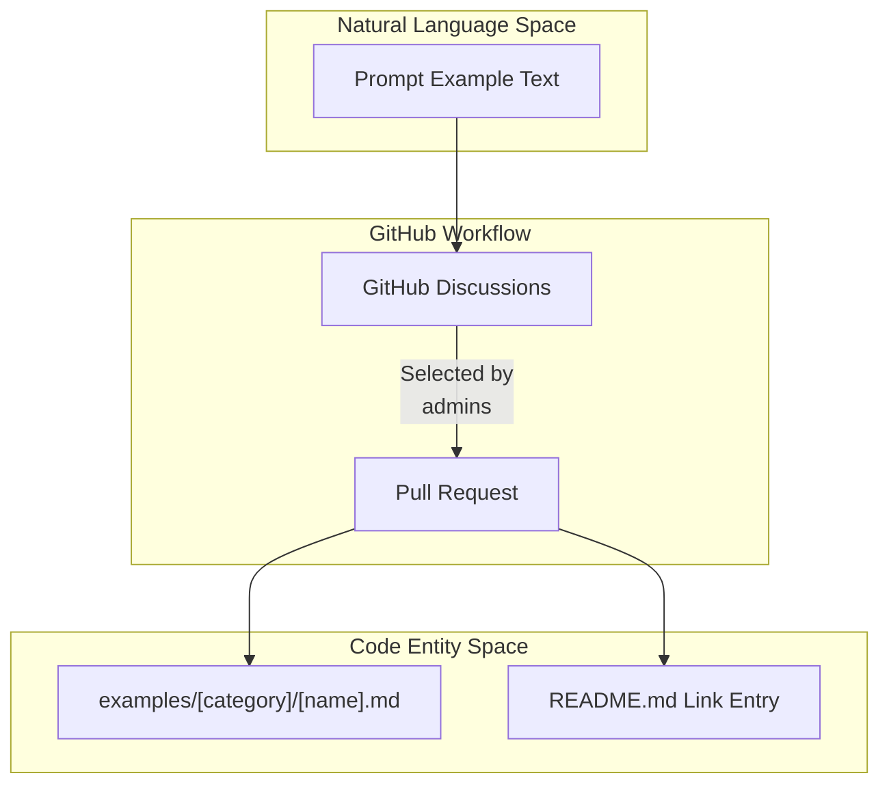
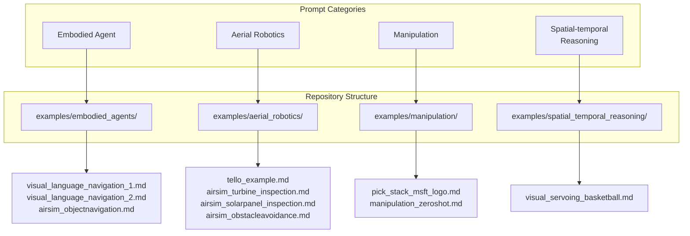
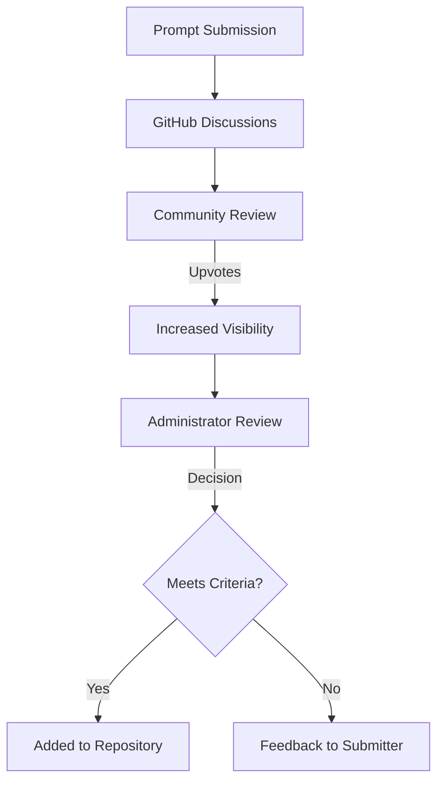
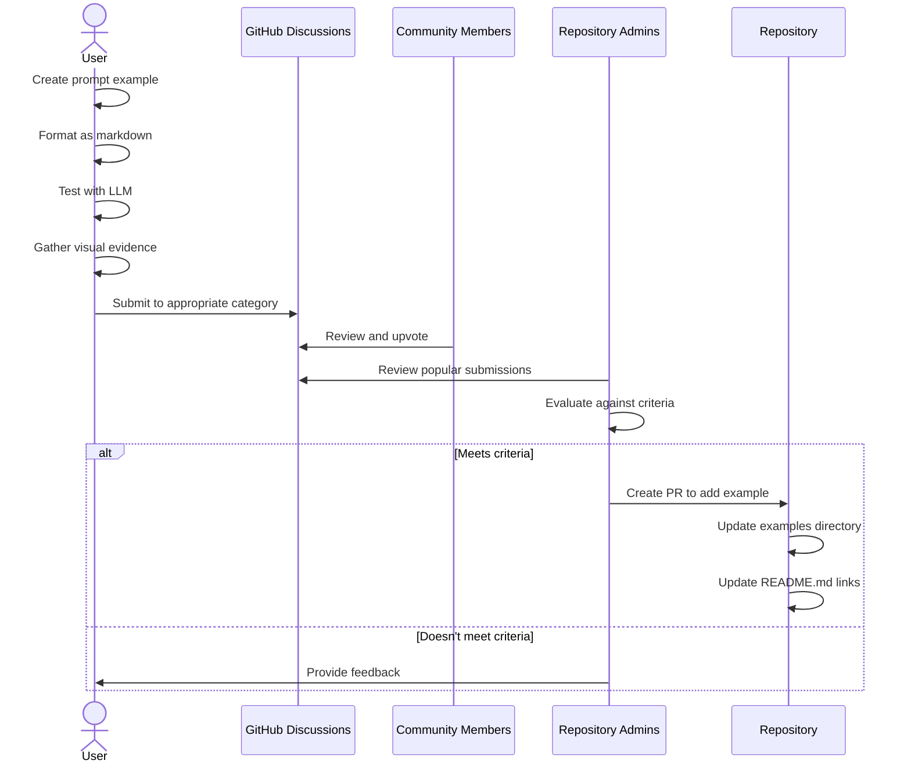

<!-- source: DeepWiki mcp.deepwiki.com · repo microsoft/PromptCraft-Robotics · page 2 Community Contribution Guidelines · fetched 2026-10-26 -->

# Community Contribution Guidelines

<details>
<summary>Relevant source files</summary>

The following files were used as context for generating this wiki page:

- [CODE_OF_CONDUCT.md](CODE_OF_CONDUCT.md)
- [README.md](README.md)
- [SECURITY.md](SECURITY.md)
- [SUPPORT.md](SUPPORT.md)

</details>


This document outlines the process for contributing to the PromptCraft-Robotics repository through prompt examples that showcase interesting applications of Large Language Models (LLMs) in robotics. For information about setting up and using the ChatGPT-AirSim integration, see [ChatGPT-AirSim Integration](#3).

Sources: [README.md:3-9]()

## Contribution Process Overview

PromptCraft-Robotics is built around community contributions of prompt examples that demonstrate creative uses of LLMs in robotics applications. The diagram below illustrates the complete contribution flow:



Sources: [README.md:7-8]()

## Where to Submit Contributions

All prompt examples should be submitted to the GitHub Discussions section of the repository. The diagram below shows how natural language contributions flow through GitHub into code entities:



Sources: [README.md:7-8]()

## Robotics Categories

When submitting your prompt, choose the appropriate category that best matches your example. The diagram below shows how natural language categories map to code paths in the repository:



Current categories include:

| Category | Description | Example Applications |
|----------|-------------|----------------------|
| Embodied Agent | Navigation and interaction with environments | Visual language navigation, object navigation |
| Aerial Robotics | Drone control and aerial tasks | Turbine inspection, obstacle avoidance |
| Manipulation | Robot arm movement and object handling | Picking, stacking, building |
| Spatial-temporal Reasoning | Understanding space and time | Visual servoing |

Sources: [README.md:37-52]()

## Submission Format Requirements

For your prompt example to be considered, please follow these formatting requirements:

1. **Format as Markdown**: All submissions should be in markdown format
2. **Specify LLM Used**: Indicate which language model you used (ChatGPT, GPT-3, Codex, etc.)
3. **Include Visual Evidence**: Where possible, provide videos or images demonstrating the results

### Recommended Structure

```markdown
# Title of Your Prompt Example

## LLM Used
- ChatGPT (or specific version)

## Environment
- Simulator: AirSim
- Robot: Drone (or other)

## Prompt
```
Your exact prompt text goes here
```

## Results
```
LLM response goes here
```

## Visual Evidence
- [Video link]
- [Images]

## Discussion
Brief explanation of what makes this example interesting or valuable
```

Sources: [README.md:11-12]()

## Review and Selection Process

### Community Review

After submitting your prompt to GitHub Discussions, the community will review it. High-quality submissions receive upvotes, which help administrators identify valuable contributions.



### Selection Criteria

Submissions are evaluated based on:

- **Interestingness**: Shows novel or creative use of LLMs
- **Usefulness**: Demonstrates practical applications for robotics
- **Technical Merit**: Quality of prompt engineering and results
- **Reproducibility**: Clear instructions that others can follow

Note that prompts don't need to be "perfect" or "optimal" to be included - we value creative and interesting approaches even if they have limitations.

Sources: [README.md:8-9]()

## Legal Aspects of Contribution

### Contributor License Agreement (CLA)

Most contributions require you to agree to a Contributor License Agreement (CLA) declaring that you have the right to, and actually do, grant us the rights to use your contribution. For details, visit https://cla.opensource.microsoft.com.

When you submit a pull request, a CLA bot will automatically determine whether you need to provide a CLA and guide you through the process.

### Code of Conduct

This project has adopted the [Microsoft Open Source Code of Conduct](https://opensource.microsoft.com/codeofconduct/). All participants are expected to follow this code in all interactions related to the project.

Sources: [README.md:71-81](), [CODE_OF_CONDUCT.md:1-9]()

## Example Contribution Workflow

The diagram below illustrates a complete contribution workflow from creation to inclusion:



Sources: [README.md:7-12]()

## Tips for Successful Submissions

1. **Be Specific**: Clearly define the robotics task you're addressing
2. **Show Your Work**: Include the complete prompt and response
3. **Document Limitations**: Note any constraints or challenges encountered
4. **Highlight Insights**: Explain what your example demonstrates about LLM capabilities
5. **Follow the Format**: Adhere to the recommended structure for consistency

Sources: [README.md:9-12]()

## Preferred LLMs

While the repository currently focuses on OpenAI's ChatGPT, we welcome examples from other LLMs including:

- OpenAI GPT models (via API)
- OpenAI Codex
- Open-source LLMs

For each submission, please specify which specific model and version you used.

Sources: [README.md:5]()

---

