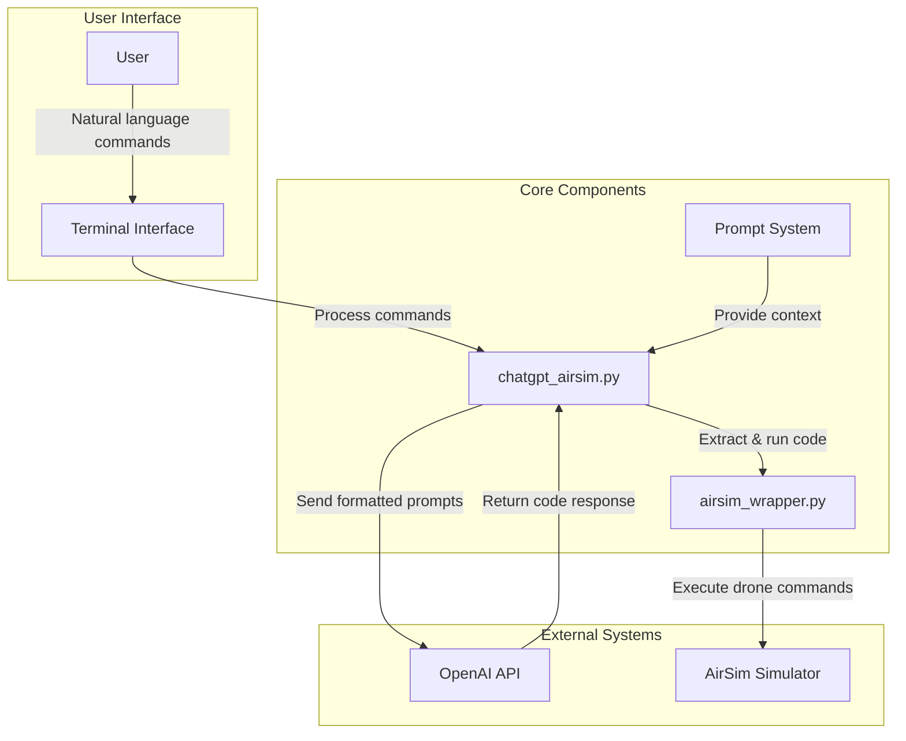
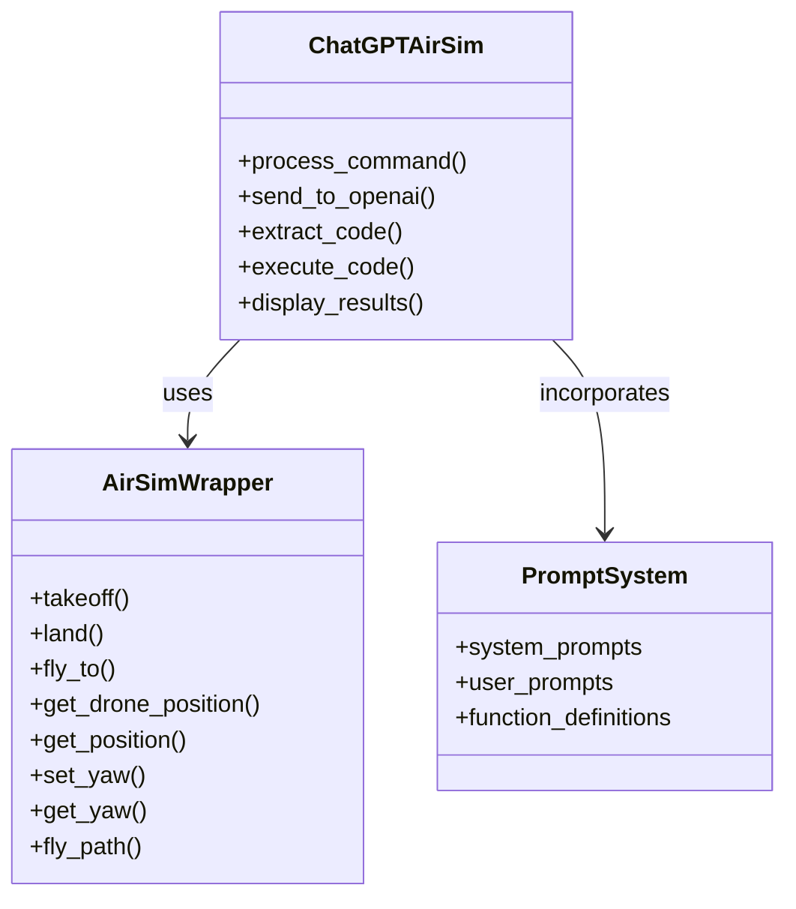
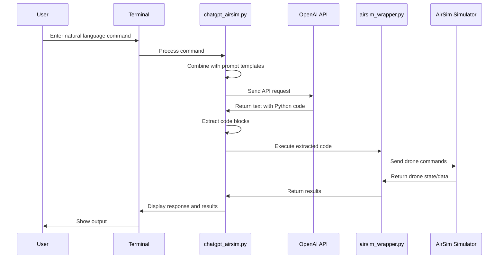
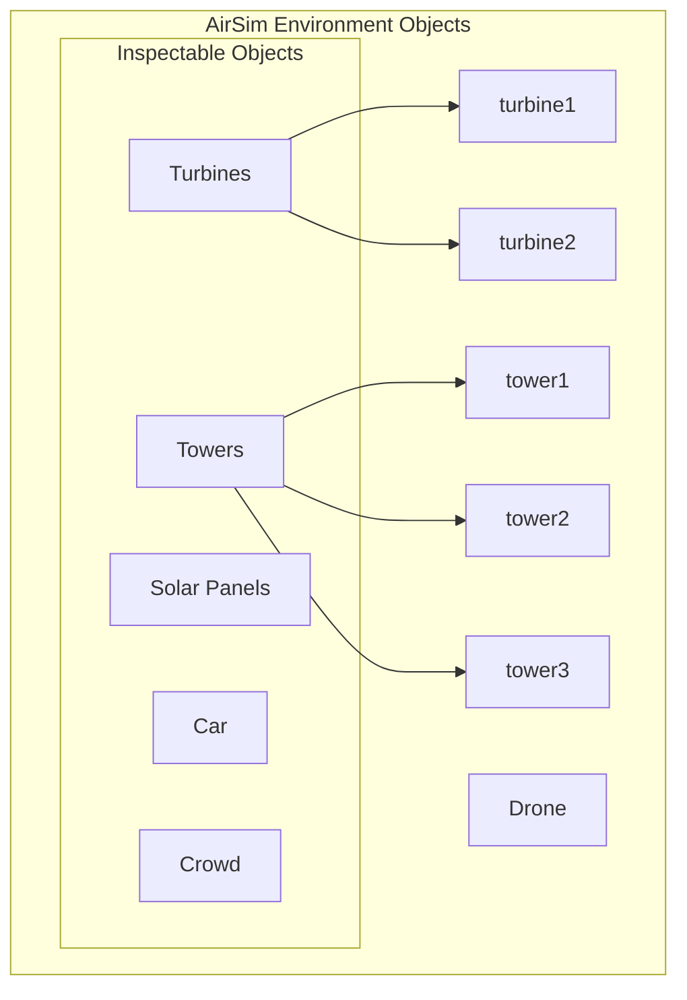
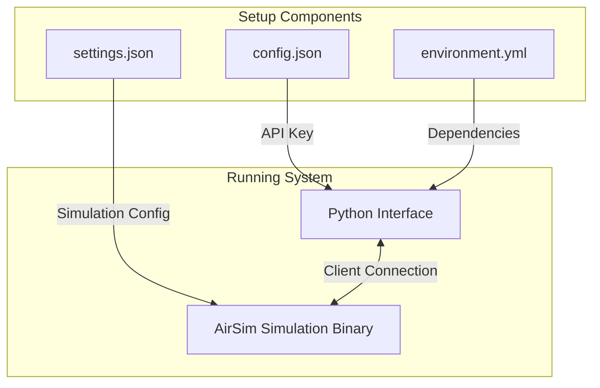
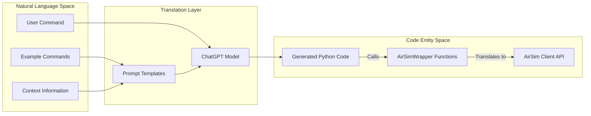
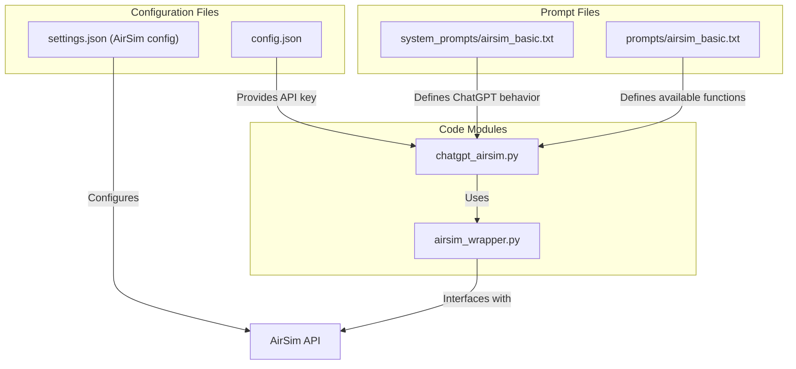

<!-- source: DeepWiki mcp.deepwiki.com · repo microsoft/PromptCraft-Robotics · page 3 ChatGPT-AirSim Integration · fetched 2026-10-26 -->

# ChatGPT-AirSim Integration

Relevant source files

The following files were used as context for generating this wiki page:

- [README.md](README.md)
- [chatgpt_airsim/README.md](chatgpt_airsim/README.md)

## Purpose and Scope

This document provides a technical overview of the ChatGPT-AirSim integration system, which enables users to control a drone in Microsoft AirSim simulation environments using natural language commands interpreted by OpenAI's ChatGPT. The system acts as a bridge between natural language understanding and robotic control, demonstrating how large language models (LLMs) can be applied to robotics tasks.

For detailed setup instructions, see [Installation and Setup](#3.1). For information about the underlying prompt system that enables the integration, see [Prompt System](#3.3).

## System Overview

The ChatGPT-AirSim integration consists of a Python-based interface that connects OpenAI's ChatGPT language model with the AirSim drone simulation environment. The system allows users to input natural language commands which are processed by ChatGPT to generate executable Python code. This code is automatically executed to control a drone within the simulation.

Sources: [chatgpt_airsim/README.md:3-5]()

## Core Components

The integration consists of three primary components working together:

1. **chatgpt_airsim.py** - The main script that handles user input, communicates with the OpenAI API, and manages code execution
2. **airsim_wrapper.py** - A wrapper library that provides high-level drone control functions and interfaces with the AirSim API
3. **Prompt System** - Text files containing carefully crafted prompts that describe available functions and set ChatGPT's behavior

Sources: [chatgpt_airsim/README.md:3-5]()

## Workflow and Data Flow

The integration follows a clear workflow to process user commands and control the drone:

Sources: [chatgpt_airsim/README.md:3-5](), [chatgpt_airsim/README.md:26-30]()

## Technical Implementation

### Command Processing

When a user inputs a natural language command at the `AirSim>` prompt, the system:

1. Takes the user input and combines it with pre-defined prompts that include function definitions
2. Sends this combined prompt to the OpenAI API
3. Receives a response containing explanations and Python code
4. Automatically extracts code blocks (content between triple backticks)
5. Executes the extracted code using the AirSim wrapper functions
6. Displays the results to the user

Sources: [chatgpt_airsim/README.md:26-30]()

### Available Drone Functions

The AirSim wrapper provides a set of high-level functions that can be used to control the drone. These functions are exposed to ChatGPT through the prompt templates.

| Function | Description |
|----------|-------------|
| `takeoff()` | Takes off the drone from the ground |
| `land()` | Lands the drone safely on the ground |
| `get_drone_position()` | Returns the current position of the drone |
| `fly_to(x, y, z)` | Flies the drone to the specified coordinates |
| `fly_path(path)` | Flies the drone along a specified path of coordinates |
| `set_yaw(angle)` | Sets the yaw angle of the drone |
| `get_yaw()` | Returns the current yaw angle of the drone |
| `get_position(object_name)` | Gets the position of a named object in the environment |

Sources: [chatgpt_airsim/README.md:3-5]()

### Environment Objects

The AirSim environment contains various objects that the drone can interact with. These objects can be referenced by name in commands.

Sources: [chatgpt_airsim/README.md:3-5]()

## Configuration and Setup

The system requires configuration of:

1. OpenAI API key in `config.json`
2. AirSim settings in the proper directory
3. Conda environment for dependencies

The actual simulation runs as a separate process, with the Python interface connecting to it via the AirSim client library.

Sources: [chatgpt_airsim/README.md:9-23]()

## Technical Limitations and Considerations

- The system executes generated code directly, which could lead to unpredictable behavior
- Response times depend on the OpenAI API latency
- The wrapper provides a limited set of functions compared to the full AirSim API
- Generated code quality depends on the quality of the prompts and ChatGPT's capabilities

Sources: [chatgpt_airsim/README.md:30-32]()

## Bridging Natural Language to Code Execution

The system bridges the gap between natural language and drone control through a multi-step translation process:

Sources: [chatgpt_airsim/README.md:3-5](), [chatgpt_airsim/README.md:26-30]()

## Technical Design Elements

The system's design separates concerns across different files:

Sources: [chatgpt_airsim/README.md:3-5](), [chatgpt_airsim/README.md:9-23]()

---

