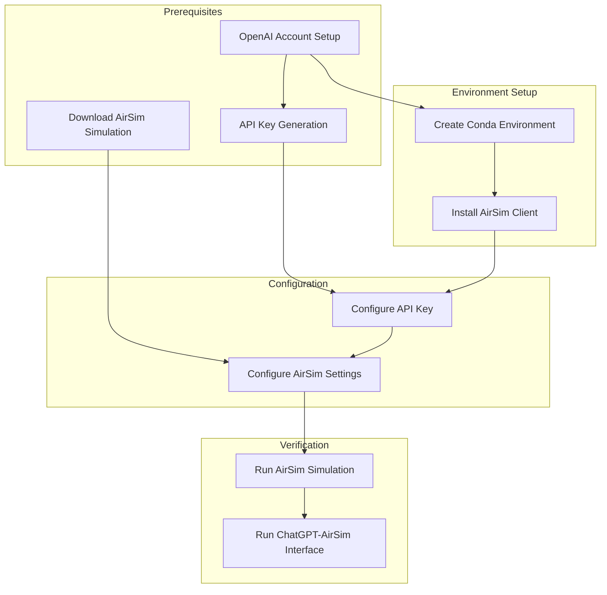
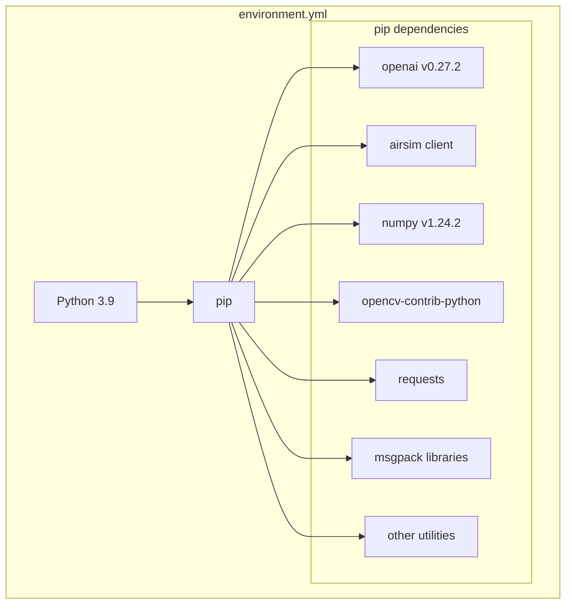
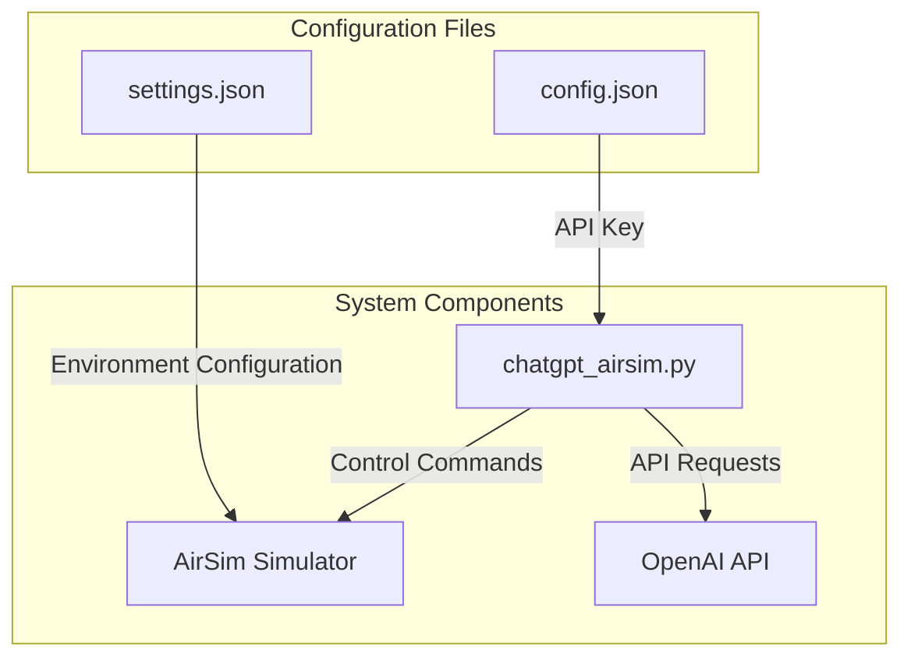
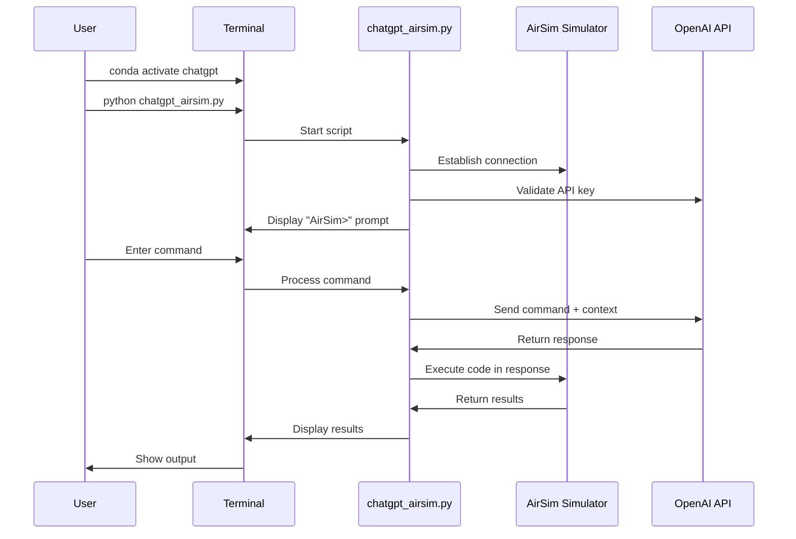

<!-- source: DeepWiki mcp.deepwiki.com · repo microsoft/PromptCraft-Robotics · page 3.1 Installation and Setup · fetched 2026-10-26 -->

# Installation and Setup

<details>
<summary>Relevant source files</summary>

The following files were used as context for generating this wiki page:

- [chatgpt_airsim/README.md](chatgpt_airsim/README.md)
- [chatgpt_airsim/config.json](chatgpt_airsim/config.json)
- [chatgpt_airsim/environment.yml](chatgpt_airsim/environment.yml)

</details>


This page provides comprehensive instructions for installing and configuring the ChatGPT-AirSim integration. The instructions will guide you through setting up the required environment, obtaining necessary API keys, configuring the simulation, and ensuring everything is working correctly. For information about the system's core architecture after installation, see [Core Architecture](#3.2). For details on how to use the system once installed, see [Using the System](#4).

## System Requirements

The current implementation of ChatGPT-AirSim supports Windows operating systems only. Future releases may include support for additional platforms.

- **Operating System**: Windows 10 or higher
- **Hardware**: System capable of running AirSim simulations (recommended: dedicated GPU)
- **Network**: Internet connection for OpenAI API access
- **Accounts**: OpenAI account with API access

Sources: [chatgpt_airsim/README.md:9-10]()

## Installation Process Overview

The installation involves several components working together. The following diagram illustrates the installation workflow:



Sources: [chatgpt_airsim/README.md:9-27]()

## 1. OpenAI Account Setup

Before installing the system, you need an OpenAI account with API access:

1. Visit https://platform.openai.com
2. Sign up for an account (or login if you already have one)
3. Navigate to the API section to generate an API key
4. Copy your API key for later use

Sources: [chatgpt_airsim/README.md:10](), [chatgpt_airsim/README.md:20]()

## 2. Environment Setup

The ChatGPT-AirSim integration requires a specific Python environment with several dependencies. The repository provides a conda environment file to simplify this setup.

### 2.1 Create Conda Environment

The `environment.yml` file defines all required dependencies for the ChatGPT-AirSim integration:



To create the environment:

1. Open a command prompt or terminal
2. Navigate to the repository directory containing the `environment.yml` file
3. Run the following command:
   ```
   conda env create -f environment.yml
   ```
4. Activate the newly created environment:
   ```
   conda activate chatgpt
   ```

Sources: [chatgpt_airsim/README.md:11-14](), [chatgpt_airsim/environment.yml:1-19]()

### 2.2 Install AirSim Client

After activating the conda environment, install the AirSim client:

```
pip install airsim
```

This Python client will communicate with the AirSim simulation.

Sources: [chatgpt_airsim/README.md:15-19]()

## 3. AirSim Simulator Setup

The AirSim simulator needs to be downloaded and configured properly to work with the ChatGPT integration.

### 3.1 Download AirSim Simulation

1. Download the AirSim zip file from the [Releases page](https://github.com/microsoft/PromptCraft-Robotics/releases)
2. Extract the zip file to a location of your choice

Sources: [chatgpt_airsim/README.md:21]()

### 3.2 Configure AirSim Settings

1. Locate the `settings.json` file in the extracted AirSim package
2. Copy this file to `C:\Users\<username>\Documents\AirSim\` (replace `<username>` with your Windows username)

This settings file configures the AirSim simulation environment that the ChatGPT integration will control.

Sources: [chatgpt_airsim/README.md:22]()

## 4. API Configuration

The system requires your OpenAI API key to function.

### 4.1 Configure OpenAI API Key

1. Open the `config.json` file in the repository
2. Replace the placeholder text in the `OPENAI_API_KEY` field with your actual API key:

```
{
    "OPENAI_API_KEY": "your_actual_api_key_here"
}
```

The relationship between configuration files and system components is illustrated below:



Sources: [chatgpt_airsim/README.md:20](), [chatgpt_airsim/config.json:1-3]()

## 5. Verification

After completing the installation and configuration steps, you should verify that everything is working correctly.

### 5.1 Run AirSim Simulation

1. Navigate to the extracted AirSim simulation folder
2. Run the simulation by executing:
   ```
   .\run.bat
   ```
3. Wait for the simulation environment to fully load

Sources: [chatgpt_airsim/README.md:25]()

### 5.2 Run ChatGPT-AirSim Interface

1. Open a command prompt or terminal
2. Ensure the conda environment is activated (`conda activate chatgpt`)
3. Navigate to the repository directory
4. Run the interface:
   ```
   python chatgpt_airsim.py
   ```
5. When the interface is ready, you'll see an `AirSim>` prompt



Sources: [chatgpt_airsim/README.md:24-28]()

## 6. Troubleshooting

Here are some common issues that may occur during installation and their solutions:

| Issue | Possible Cause | Solution |
|-------|----------------|----------|
| `conda env create` fails | Conda not installed or path issues | Verify conda is installed and in your PATH |
| AirSim client installation fails | Internet connectivity or permission issues | Try installing with admin privileges, check internet connection |
| "Invalid API key" error | Incorrect API key in config.json | Double-check the key and ensure it's properly copied |
| AirSim simulation crashes | Hardware limitations or incorrect settings | Verify your system meets the requirements, check settings.json |
| ChatGPT-AirSim fails to connect to AirSim | AirSim not running or network issues | Ensure AirSim is running before starting chatgpt_airsim.py |

**Note:** The ChatGPT-AirSim integration is experimental in nature. As mentioned in the README, ChatGPT-generated code may sometimes result in unexpected behavior or crashes, as the interface directly executes the commands generated by the AI.

Sources: [chatgpt_airsim/README.md:28-30]()

## Summary

After completing these installation and setup steps, you should have a functioning ChatGPT-AirSim integration that allows you to control a drone in the AirSim simulation environment using natural language commands processed by ChatGPT. The next step is to learn how to effectively use the system, which is covered in [Using the System](#4).

Sources: [chatgpt_airsim/README.md:1-7](), [chatgpt_airsim/README.md:28-32]()

---

