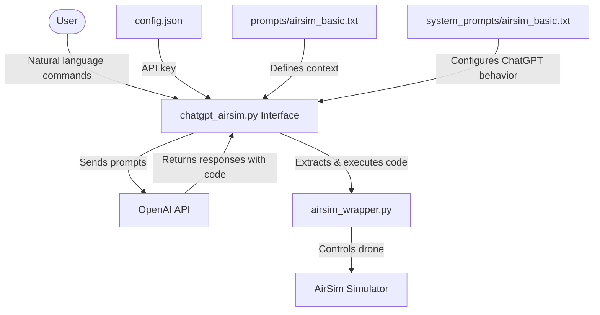
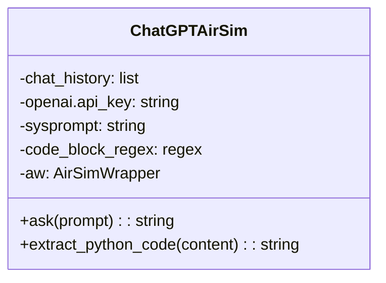
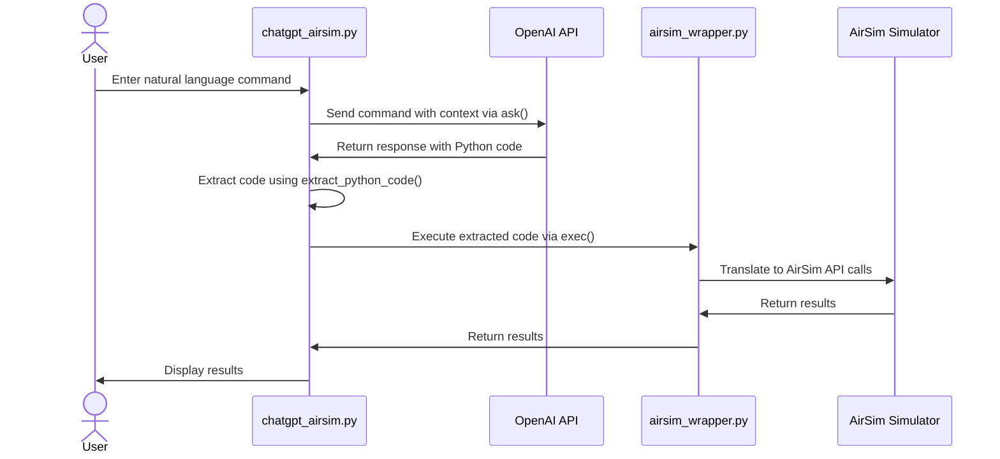
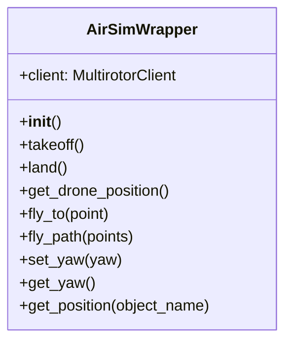
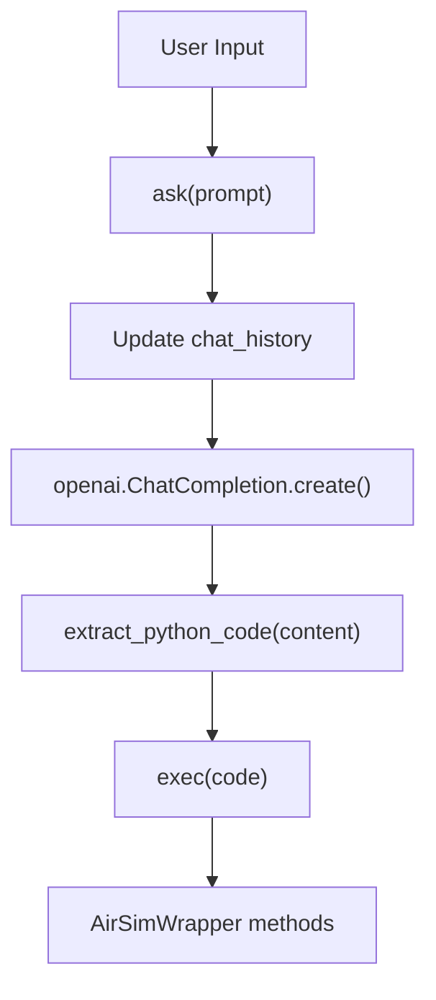
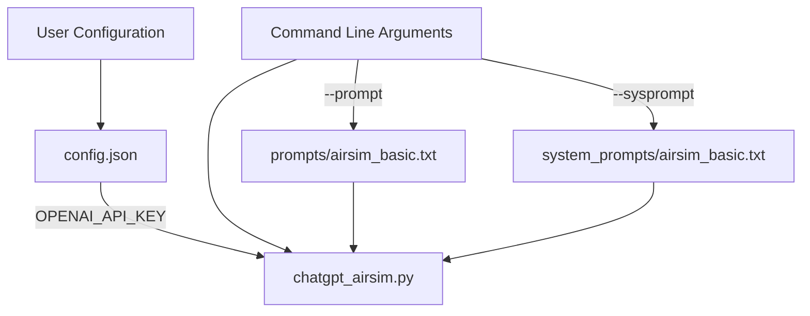
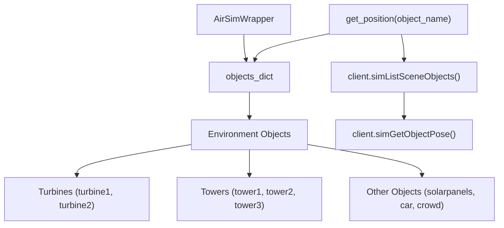
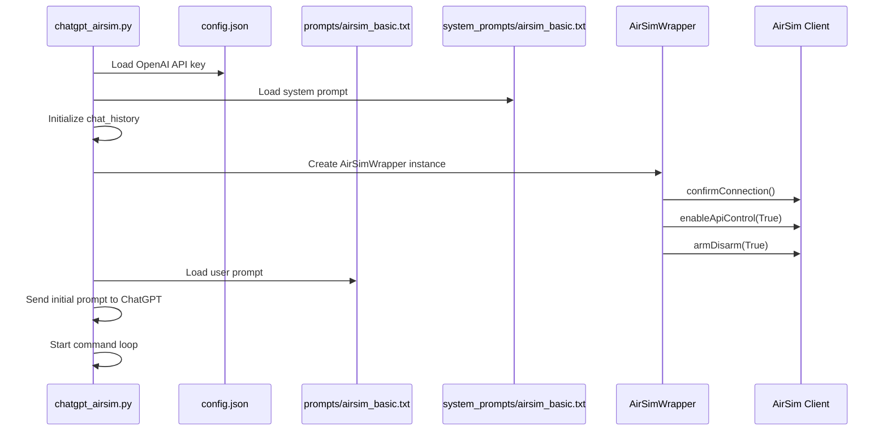

<!-- source: DeepWiki mcp.deepwiki.com · repo microsoft/PromptCraft-Robotics · page 3.2 Core Architecture · fetched 2026-10-26 -->

# Core Architecture

Relevant source files

The following files were used as context for generating this wiki page:

- [chatgpt_airsim/README.md](chatgpt_airsim/README.md)
- [chatgpt_airsim/airsim_wrapper.py](chatgpt_airsim/airsim_wrapper.py)
- [chatgpt_airsim/chatgpt_airsim.py](chatgpt_airsim/chatgpt_airsim.py)

This document describes the system architecture, components, and interactions in the ChatGPT-AirSim integration. It serves as a technical reference for understanding how natural language commands are processed, translated into code, and executed in the AirSim environment. For information about installing and setting up the system, see [Installation and Setup](#3.1). For details about the prompt system, see [Prompt System](#3.3).

## System Overview

The PromptCraft-Robotics architecture consists of three main components:

1. **Interface Layer**: `chatgpt_airsim.py` serves as the primary interface, managing user inputs, API communication, and code execution.
2. **Wrapper Layer**: `airsim_wrapper.py` provides a simplified interface to the AirSim API with high-level drone control functions.
3. **External Services**: OpenAI API for language processing and AirSim for simulation.

Sources: [chatgpt_airsim/README.md:5-5](), [chatgpt_airsim/chatgpt_airsim.py:1-121]()

## Interface Layer

The interface layer, implemented in `chatgpt_airsim.py`, handles the primary communication flow between the user, OpenAI API, and the AirSim wrapper.

The main components of the interface layer include:

| Component | Description | Code Location |
|-----------|-------------|---------------|
| Chat History | Maintains context for OpenAI API calls | [chatgpt_airsim.py:25-41]() |
| ask() Function | Sends prompts to OpenAI and records responses | [chatgpt_airsim.py:45-63]() |
| Code Extraction | Extracts executable Python code from responses | [chatgpt_airsim.py:68-81]() |
| Main Loop | Processes user input and executes code | [chatgpt_airsim.py:102-120]() |

### Communication Flow

The interface uses a clean command loop pattern:
1. Accepts user input via command line
2. Sends the input to OpenAI API along with conversation history
3. Extracts Python code blocks from the response
4. Executes the extracted code, which calls methods in the AirSim wrapper
5. Displays results and waits for next command

Sources: [chatgpt_airsim/chatgpt_airsim.py:45-63](), [chatgpt_airsim/chatgpt_airsim.py:68-81](), [chatgpt_airsim/chatgpt_airsim.py:102-120]()

## Wrapper Layer

The wrapper layer, implemented in `airsim_wrapper.py`, provides a simplified interface to the AirSim API with high-level drone control functions.

The `AirSimWrapper` class encapsulates the following functionality:

| Method | Description | Code Location |
|--------|-------------|---------------|
| __init__() | Initializes AirSim client and enables API control | [airsim_wrapper.py:17-22]() |
| takeoff() | Commands drone to take off | [airsim_wrapper.py:24-25]() |
| land() | Commands drone to land | [airsim_wrapper.py:27-28]() |
| get_drone_position() | Returns current drone position | [airsim_wrapper.py:30-32]() |
| fly_to() | Moves drone to specified coordinates | [airsim_wrapper.py:34-38]() |
| fly_path() | Moves drone along a specified path | [airsim_wrapper.py:40-47]() |
| set_yaw() | Sets drone yaw angle | [airsim_wrapper.py:49-50]() |
| get_yaw() | Gets current drone yaw angle | [airsim_wrapper.py:52-55]() |
| get_position() | Gets position of a named object in the environment | [airsim_wrapper.py:57-63]() |

The wrapper also maintains a dictionary of environment objects (`objects_dict`) that maps friendly names to internal object identifiers in AirSim.

Sources: [airsim_wrapper.py:5-63](), [chatgpt_airsim/README.md:5-5]()

## Code Execution Pipeline

The code execution pipeline follows these steps:

1. **Input Processing**: User input is captured in the main loop and passed to the `ask()` function
2. **Context Management**: The input is added to chat history to maintain context
3. **API Communication**: The `ask()` function sends the prompt to OpenAI API
4. **Response Processing**: The response is added to chat history and returned
5. **Code Extraction**: `extract_python_code()` extracts executable Python code using regex
6. **Code Execution**: The extracted code is executed using Python's `exec()` function
7. **Drone Control**: The executed code calls methods in the `AirSimWrapper` class

Sources: [chatgpt_airsim/chatgpt_airsim.py:45-63](), [chatgpt_airsim/chatgpt_airsim.py:68-81](), [chatgpt_airsim/chatgpt_airsim.py:102-120]()

## Configuration System

The system configuration is managed through:

1. **config.json**: Contains the OpenAI API key
2. **Command-line Arguments**: 
   - `--prompt`: Path to the user prompt file (default: `prompts/airsim_basic.txt`)
   - `--sysprompt`: Path to the system prompt file (default: `system_prompts/airsim_basic.txt`)

Sources: [chatgpt_airsim/chatgpt_airsim.py:11-20](), [chatgpt_airsim/README.md:20-20]()

## Environment Object Mapping

The `objects_dict` in `airsim_wrapper.py` maps user-friendly object names to internal AirSim object identifiers:

| User-friendly Name | AirSim Object Identifier |
|-------------------|--------------------------|
| turbine1 | BP_Wind_Turbines_C_1 |
| turbine2 | StaticMeshActor_2 |
| solarpanels | StaticMeshActor_146 |
| crowd | StaticMeshActor_6 |
| car | StaticMeshActor_10 |
| tower1 | SM_Electric_trellis_179 |
| tower2 | SM_Electric_trellis_7 |
| tower3 | SM_Electric_trellis_8 |

The `get_position()` method uses this dictionary to locate objects in the environment.

Sources: [airsim_wrapper.py:5-14](), [airsim_wrapper.py:57-63]()

## Initialization Sequence

The system initialization follows these steps:

1. Load configuration and API key
2. Load system prompt
3. Initialize chat history with system prompt and example
4. Initialize AirSim wrapper, which connects to the simulator
5. Load user prompt and send it to ChatGPT
6. Begin command loop for user interaction

Sources: [chatgpt_airsim/chatgpt_airsim.py:11-100](), [airsim_wrapper.py:17-22]()

## Error Handling

The system includes minimal error handling:

1. The `extract_python_code()` function returns `None` if no code blocks are found
2. The main loop checks if the extracted code is `None` before executing it
3. The `get_position()` method waits until objects are found in the scene

The interface executes code directly using Python's `exec()` function, which could lead to unexpected behavior or crashes if the generated code contains errors.

Sources: [chatgpt_airsim/chatgpt_airsim.py:68-81](), [chatgpt_airsim/chatgpt_airsim.py:116-120](), [chatgpt_airsim/README.md:30-30](), [airsim_wrapper.py:57-63]()

---

