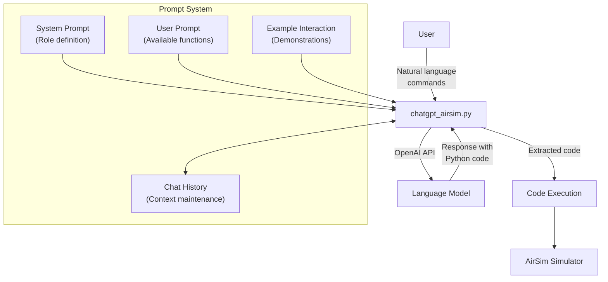
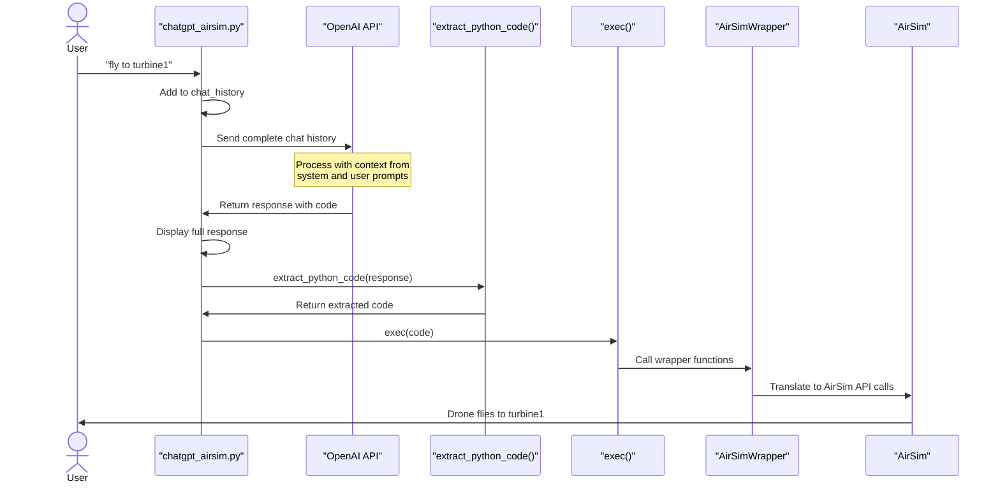
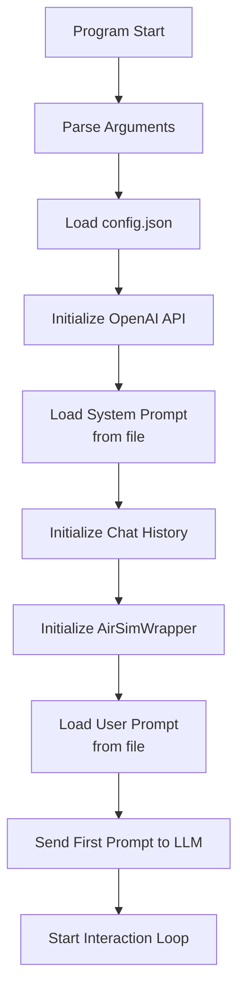
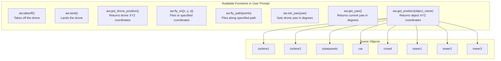
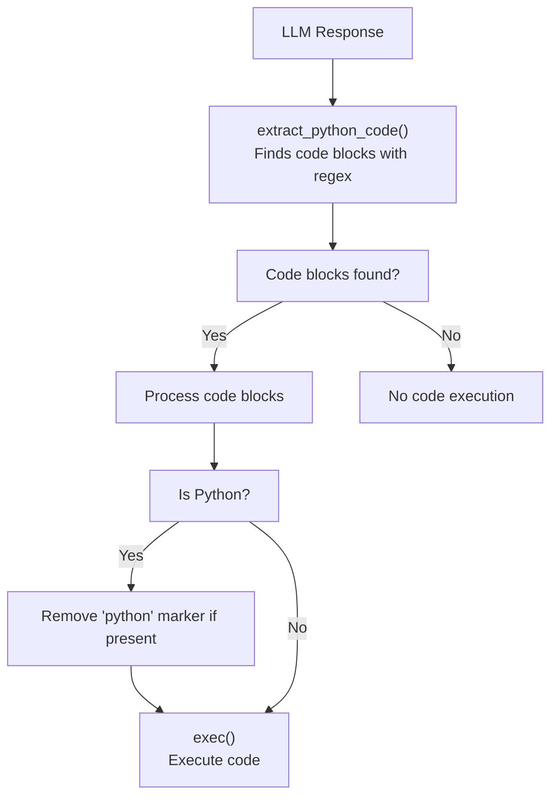

<!-- source: DeepWiki mcp.deepwiki.com · repo microsoft/PromptCraft-Robotics · page 3.3 Prompt System · fetched 2026-10-26 -->

# Prompt System

Relevant source files

The following files were used as context for generating this wiki page:

- [chatgpt_airsim/chatgpt_airsim.py](chatgpt_airsim/chatgpt_airsim.py)
- [chatgpt_airsim/prompts/airsim_basic.txt](chatgpt_airsim/prompts/airsim_basic.txt)
- [chatgpt_airsim/system_prompts/airsim_basic.txt](chatgpt_airsim/system_prompts/airsim_basic.txt)

## Purpose and Scope

This document explains the Prompt System used in PromptCraft-Robotics to enable natural language control of drones in the AirSim simulator. The Prompt System is the communication layer between user commands and drone actions, transforming natural language into executable code through structured prompts and interaction patterns.

For information about the overall architecture of the integration, see [Core Architecture](#3.2). For details about the available drone control functions, see [Drone Control API](#3.4).

## Overview of the Prompt System

The Prompt System in PromptCraft-Robotics consists of several key components that work together to enable effective communication between the user, the language model, and the AirSim environment.

Sources: [chatgpt_airsim/chatgpt_airsim.py:22-63](), [chatgpt_airsim/system_prompts/airsim_basic.txt:1-5](), [chatgpt_airsim/prompts/airsim_basic.txt:1-28]()

## Components of the Prompt System

### System Prompt

The system prompt defines the AI assistant's role and behavioral constraints. It is loaded at initialization and included in every API call to the language model.

The system prompt:
- Defines the AI's role as an assistant for AirSim simulator
- Instructs the AI to respond with Python code followed by explanations
- Restricts the AI to only use the explicitly defined functions
- Allows the use of simple Python functions from libraries like `math` and `numpy`

Sources: [chatgpt_airsim/system_prompts/airsim_basic.txt:1-5](), [chatgpt_airsim/chatgpt_airsim.py:22-29]()

### User Prompt

The user prompt provides detailed information about available functions, scene objects, and usage guidelines. This prompt is sent to the model at the beginning of each session to establish the context.

The user prompt includes:
- Available drone control functions with descriptions
- Usage guidelines and conventions
- Objects in the scene and how to reference them
- Axis conventions and directional references
- Guidelines for handling clarification questions

Sources: [chatgpt_airsim/prompts/airsim_basic.txt:1-28](), [chatgpt_airsim/chatgpt_airsim.py:96-99]()

### Example Interactions

The system includes pre-defined example interactions that demonstrate correct use patterns. These examples:
- Show proper function usage (using `fly_to()` to move the drone upward)
- Establish the expected response format (code block followed by explanation)
- Serve as few-shot learning examples for the language model

Sources: [chatgpt_airsim/chatgpt_airsim.py:30-41]()

### Chat History

The chat history maintains the context of the ongoing conversation, enabling more coherent and contextually appropriate responses throughout a session. The system:
- Initializes chat history with the system prompt and example interaction
- Appends each user query and AI response to maintain context
- Sends the complete history with each new API request

Sources: [chatgpt_airsim/chatgpt_airsim.py:25-41](), [chatgpt_airsim/chatgpt_airsim.py:45-63]()

## From Natural Language to Drone Control

The Prompt System creates a pipeline that transforms natural language commands into drone actions:

Sources: [chatgpt_airsim/chatgpt_airsim.py:45-63](), [chatgpt_airsim/chatgpt_airsim.py:68-81](), [chatgpt_airsim/chatgpt_airsim.py:102-120]()

## Code Components and Their Roles

### Prompt Loading and Initialization

The system loads prompts from files and initializes the chat history at startup:

Sources: [chatgpt_airsim/chatgpt_airsim.py:11-14](), [chatgpt_airsim/chatgpt_airsim.py:16-20](), [chatgpt_airsim/chatgpt_airsim.py:22-41](), [chatgpt_airsim/chatgpt_airsim.py:92-100]()

### Main Components and Their Interactions

The table below shows the key components involved in the Prompt System and their primary responsibilities:

| Component | File | Lines | Primary Responsibility |
|-----------|------|-------|------------------------|
| `chat_history` | chatgpt_airsim.py | 25-41 | Maintains conversation context |
| `ask()` function | chatgpt_airsim.py | 45-63 | Sends prompts to OpenAI API and updates history |
| `extract_python_code()` | chatgpt_airsim.py | 68-81 | Extracts executable code from LLM responses |
| System Prompt | system_prompts/airsim_basic.txt | 1-5 | Defines assistant role and behavior |
| User Prompt | prompts/airsim_basic.txt | 1-28 | Defines available functions and guidelines |
| Main Loop | chatgpt_airsim.py | 102-120 | Handles user input and executes responses |

Sources: [chatgpt_airsim/chatgpt_airsim.py:25-41](), [chatgpt_airsim/chatgpt_airsim.py:45-63](), [chatgpt_airsim/chatgpt_airsim.py:68-81](), [chatgpt_airsim/chatgpt_airsim.py:102-120]()

## Available Functions in User Prompt

The user prompt defines specific drone control functions that can be used by the language model:

Sources: [chatgpt_airsim/prompts/airsim_basic.txt:1-10](), [chatgpt_airsim/prompts/airsim_basic.txt:21-23]()

## Prompt Structure and Guidelines

The user prompt contains several types of information to guide the language model's responses:

1. **Function Definitions**: Lists available functions with their parameters and return values
2. **Usage Guidelines**: Advises on best practices (e.g., using `fly_to()` instead of `moveToPositionAsync()`)
3. **Clarification Protocol**: Defines how to handle ambiguous requests
4. **Scene Object Reference**: Lists available objects and naming conventions
5. **Coordinate System**: Explains the axis conventions (X=forward, Y=right, Z=up)

Sources: [chatgpt_airsim/prompts/airsim_basic.txt:1-28]()

## Code Extraction and Execution

A key part of the Prompt System is extracting and executing code from the language model's responses:

Sources: [chatgpt_airsim/chatgpt_airsim.py:68-81](), [chatgpt_airsim/chatgpt_airsim.py:116-120]()

## Best Practices for Prompt Engineering

Based on the implementation, these best practices are used in the Prompt System:

1. **Clear role definition**: The system prompt clearly defines what the assistant should and shouldn't do
2. **Function documentation**: The user prompt clearly documents available functions
3. **Example interactions**: The system includes example queries and responses
4. **Clarification guidelines**: The prompt instructs when to ask for clarification
5. **Domain-specific terminology**: The prompt defines axis conventions and object names

Sources: [chatgpt_airsim/system_prompts/airsim_basic.txt:1-5](), [chatgpt_airsim/prompts/airsim_basic.txt:1-28]()

## Conclusion

The Prompt System in PromptCraft-Robotics enables natural language control of drones by:
- Defining the assistant's role and behavior through system prompts
- Documenting available functions and scene objects through user prompts
- Providing examples of correct interactions
- Maintaining conversation context through chat history
- Extracting and executing code from language model responses

This system creates an intuitive interface for controlling drones in the AirSim simulator without requiring direct programming knowledge.

---

