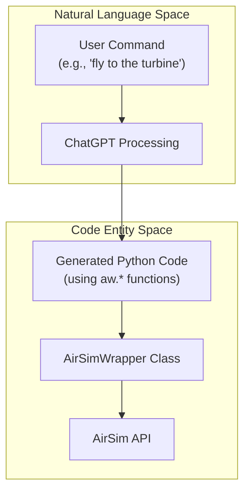
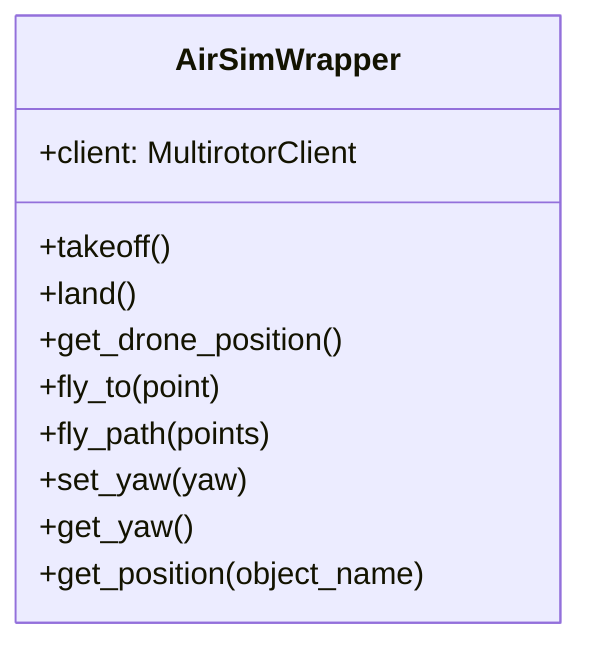
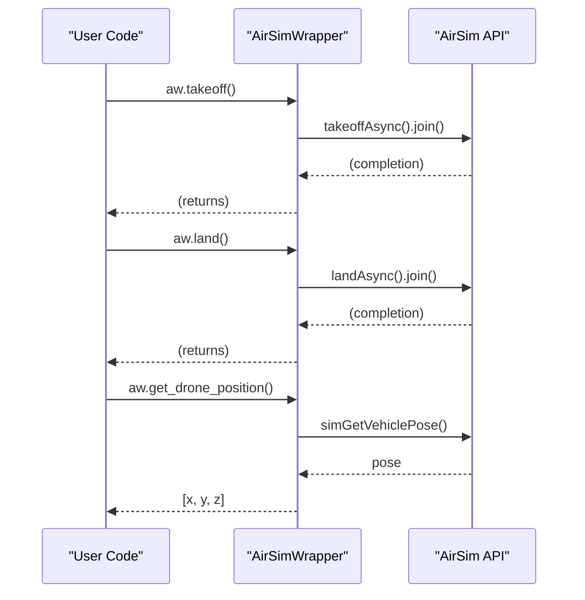
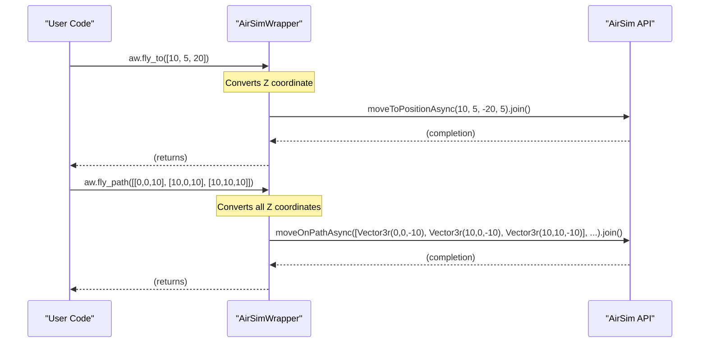
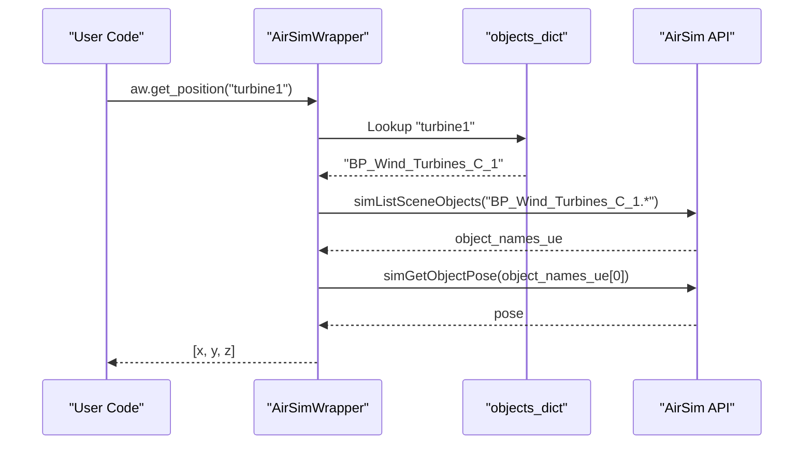
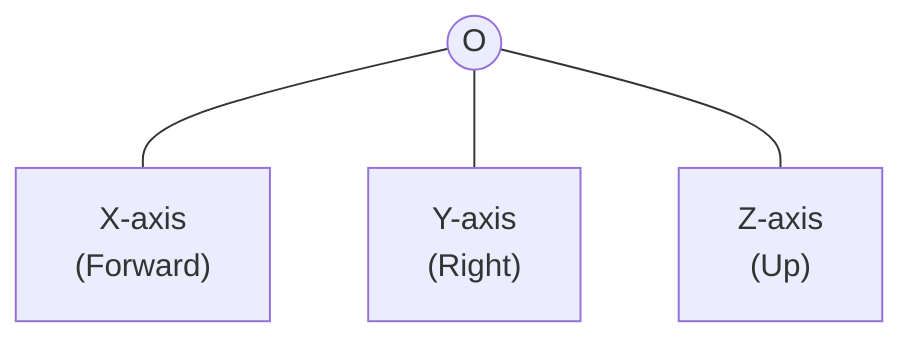

<!-- source: DeepWiki mcp.deepwiki.com · repo microsoft/PromptCraft-Robotics · page 3.4 Drone Control API · fetched 2026-10-26 -->

# Drone Control API

<details>
<summary>Relevant source files</summary>

The following files were used as context for generating this wiki page:

- [chatgpt_airsim/airsim_wrapper.py](chatgpt_airsim/airsim_wrapper.py)
- [chatgpt_airsim/prompts/airsim_basic.txt](chatgpt_airsim/prompts/airsim_basic.txt)

</details>


This page documents the Drone Control API for the PromptCraft-Robotics system. The API provides functions for controlling drones in the AirSim simulator through simple Python function calls.

For information about the broader system architecture, see [Core Architecture](#3.2). For details about the simulation environment and available objects, see [AirSim Environment Objects](#3.5).

## Overview

The Drone Control API is implemented as a wrapper around the AirSim API, providing a simplified interface for drone control operations. This API is referenced in the prompt system as `aw` (short for AirSim Wrapper) and allows for operations like takeoff, landing, movement, and orientation control.



Sources: [chatgpt_airsim/airsim_wrapper.py:17-64](), [chatgpt_airsim/prompts/airsim_basic.txt:1-28]()

## API Class Structure

The API is implemented by the `AirSimWrapper` class, which wraps the AirSim MultirotorClient to provide simplified drone control functionality.



Sources: [chatgpt_airsim/airsim_wrapper.py:17-64]()

## Available Functions

The following functions are available through the Drone Control API:

| Function | Description | Parameters | Return Value |
|----------|-------------|------------|--------------|
| `aw.takeoff()` | Takes off the drone | None | None |
| `aw.land()` | Lands the drone | None | None |
| `aw.get_drone_position()` | Gets the current position of the drone | None | List `[x, y, z]` |
| `aw.fly_to([x, y, z])` | Flies the drone to a specific position | List `[x, y, z]` | None |
| `aw.fly_path(points)` | Flies the drone along a path | List of points, each a list `[x, y, z]` | None |
| `aw.set_yaw(yaw)` | Sets the yaw of the drone | Float (degrees) | None |
| `aw.get_yaw()` | Gets the current yaw of the drone | None | Float (degrees) |
| `aw.get_position(object_name)` | Gets the position of an environment object | String (object name) | List `[x, y, z]` |

Sources: [chatgpt_airsim/prompts/airsim_basic.txt:3-10](), [chatgpt_airsim/airsim_wrapper.py:24-63]()

## Function Implementation Details

### Basic Movement Functions

The basic movement functions provide fundamental drone control capabilities:

- `takeoff()`: Calls the AirSim `takeoffAsync()` function and waits for completion
- `land()`: Calls the AirSim `landAsync()` function and waits for completion
- `get_drone_position()`: Retrieves the drone's position from the simulator



Sources: [chatgpt_airsim/airsim_wrapper.py:24-32]()

### Navigation Functions

The navigation functions allow controlling the drone's position and path:

- `fly_to([x, y, z])`: Moves the drone to the specified position
- `fly_path(points)`: Moves the drone along a path defined by waypoints

These functions handle coordinate system conversion automatically. In the user-facing API, positive Z is up, while in AirSim internally, negative Z is up.



Sources: [chatgpt_airsim/airsim_wrapper.py:34-47]()

### Orientation Functions

The orientation functions control the drone's heading:

- `set_yaw(yaw)`: Sets the drone's yaw (heading) in degrees
- `get_yaw()`: Gets the drone's current yaw in degrees

Sources: [chatgpt_airsim/airsim_wrapper.py:49-55]()

### Environment Interaction

The `get_position(object_name)` function allows retrieving the position of objects in the environment:



Sources: [chatgpt_airsim/airsim_wrapper.py:57-63](), [chatgpt_airsim/airsim_wrapper.py:5-14]()

## Coordinate System

The API uses a right-handed coordinate system:



- X-axis: Forward direction (positive X)
- Y-axis: Right direction (positive Y)
- Z-axis: Up direction (positive Z)

All position coordinates are represented as lists of 3 floats `[x, y, z]`.

Sources: [chatgpt_airsim/prompts/airsim_basic.txt:27-28]()

## Environment Objects

The API provides access to various objects in the simulation environment through the `get_position()` function. The available objects include:

| Object Name | Description |
|-------------|-------------|
| `turbine1` | First wind turbine |
| `turbine2` | Second wind turbine |
| `solarpanels` | Solar panels |
| `car` | A car |
| `crowd` | A crowd of people |
| `tower1` | First electric tower |
| `tower2` | Second electric tower |
| `tower3` | Third electric tower |

To retrieve an object's position:

```python
# Get the position of turbine1
turbine_position = aw.get_position("turbine1")  # Returns [x, y, z]
```

Sources: [chatgpt_airsim/airsim_wrapper.py:5-14](), [chatgpt_airsim/prompts/airsim_basic.txt:21-26]()

## Usage Guidelines

When working with the Drone Control API:

1. Always use the provided wrapper functions (e.g., `aw.fly_to()`) instead of direct AirSim API calls.
2. Use exact object names as specified in the Environment Objects section.
3. When referring to objects with multiple instances (e.g., turbines, towers), always specify which instance (e.g., `turbine1`, `tower2`).
4. Remember that coordinates are in the form `[x, y, z]` with positive Z representing up.

Sources: [chatgpt_airsim/prompts/airsim_basic.txt:12-26]()

---

