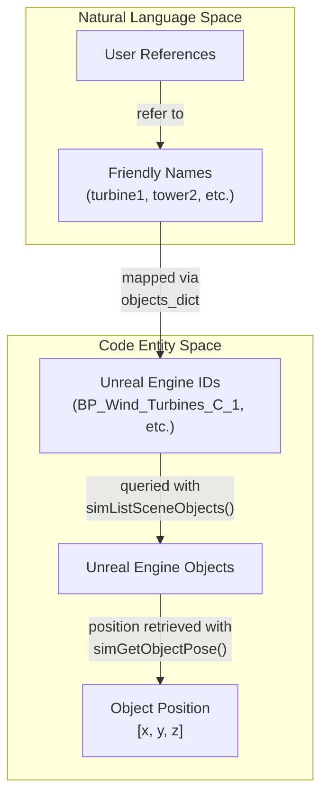
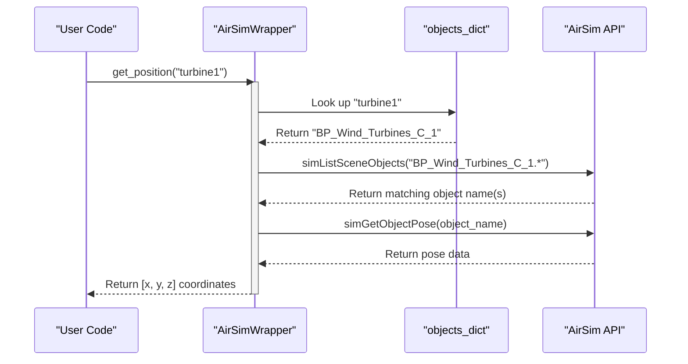
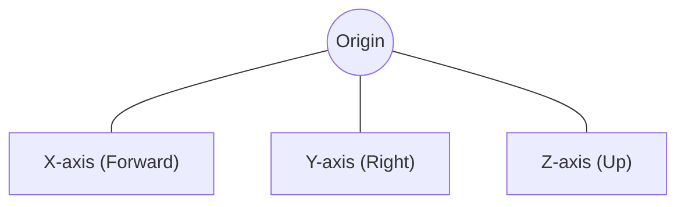
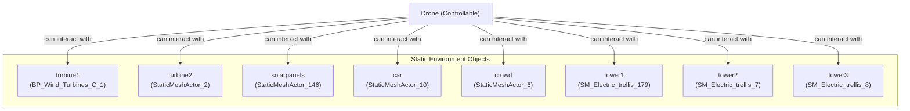

<!-- source: DeepWiki mcp.deepwiki.com · repo microsoft/PromptCraft-Robotics · page 3.5 AirSim Environment Objects · fetched 2026-10-26 -->

# AirSim Environment Objects

<details>
<summary>Relevant source files</summary>

The following files were used as context for generating this wiki page:

- [chatgpt_airsim/airsim_wrapper.py](chatgpt_airsim/airsim_wrapper.py)
- [chatgpt_airsim/prompts/airsim_basic.txt](chatgpt_airsim/prompts/airsim_basic.txt)

</details>


## Purpose and Scope
This page documents the objects available in the AirSim simulation environment used in PromptCraft-Robotics. These objects serve as landmarks, obstacles, or targets for drone operations within the simulation. Here you'll learn what objects are available, how they're represented in code, and how to interact with them programmatically.

For information about controlling the drone itself, see [Drone Control API](#3.4).

Sources: [chatgpt_airsim/prompts/airsim_basic.txt:21-26]()

## Object Representation
In the PromptCraft-Robotics codebase, environment objects are mapped from user-friendly names to internal Unreal Engine identifiers through the `objects_dict` dictionary:



Sources: [chatgpt_airsim/airsim_wrapper.py:5-14](), [chatgpt_airsim/airsim_wrapper.py:57-63]()

## Available Objects
The environment contains the following static objects:

| Friendly Name | Internal ID | Object Type |
|---------------|-------------|------------|
| turbine1 | BP_Wind_Turbines_C_1 | Wind Turbine |
| turbine2 | StaticMeshActor_2 | Wind Turbine |
| solarpanels | StaticMeshActor_146 | Solar Panel Array |
| crowd | StaticMeshActor_6 | Group of People |
| car | StaticMeshActor_10 | Automobile |
| tower1 | SM_Electric_trellis_179 | Electrical Tower |
| tower2 | SM_Electric_trellis_7 | Electrical Tower |
| tower3 | SM_Electric_trellis_8 | Electrical Tower |

Sources: [chatgpt_airsim/airsim_wrapper.py:5-14](), [chatgpt_airsim/prompts/airsim_basic.txt:21-23]()

## Multiple Objects of the Same Type
The environment contains multiple instances of certain object types:
- Two wind turbines: `turbine1`, `turbine2`
- Three electrical towers: `tower1`, `tower2`, `tower3`

When referring to these objects in natural language commands, you should specify the exact object (e.g., "turbine1" instead of just "turbine"). If a command is ambiguous, clarification should be requested.

Sources: [chatgpt_airsim/prompts/airsim_basic.txt:25-26]()

## Interacting with Objects
The primary way to interact with environment objects is through the `get_position` function:



The `get_position` function takes a friendly object name as input and returns its position as a list of three float values corresponding to the X, Y, and Z coordinates.

Sources: [chatgpt_airsim/airsim_wrapper.py:57-63](), [chatgpt_airsim/prompts/airsim_basic.txt:10]()

## Implementation Details
The object position retrieval process:
1. The friendly name (e.g., "turbine1") is mapped to its internal ID (e.g., "BP_Wind_Turbines_C_1") using `objects_dict`
2. A query string is created by appending ".*" to the internal ID
3. The `simListSceneObjects` method is called with this query string to get matching object names
4. The first matching object's pose is retrieved using `simGetObjectPose`
5. The X, Y, and Z coordinates are extracted from the pose and returned as a list

Sources: [chatgpt_airsim/airsim_wrapper.py:57-63]()

## Coordinate System
The AirSim environment uses a right-handed coordinate system where:
- Forward corresponds to the positive X axis
- Right corresponds to the positive Y axis
- Up corresponds to the positive Z axis



Sources: [chatgpt_airsim/prompts/airsim_basic.txt:28]()

## Object Immobility
All environment objects are static and immovable. Only the drone can be moved within the environment.

Sources: [chatgpt_airsim/prompts/airsim_basic.txt:25]()

## Environment Object Layout
The following diagram illustrates the general concept of objects in the AirSim environment:



Sources: [chatgpt_airsim/airsim_wrapper.py:5-14](), [chatgpt_airsim/prompts/airsim_basic.txt:21-26]()

## Example Usage Patterns
Here are common patterns for interacting with environment objects:

### 1. Getting an Object's Position
```python
# Get the position of turbine1
turbine_pos = aw.get_position("turbine1")
# turbine_pos is now a list like [x, y, z]
```

### 2. Flying to an Object
```python
# Get position of an object
tower_pos = aw.get_position("tower1")
# Fly to that position
aw.fly_to(tower_pos)
```

### 3. Flying to a Position Relative to an Object
```python
# Get position of car
car_pos = aw.get_position("car")
# Create a position 5 meters above the car
inspection_pos = [car_pos[0], car_pos[1], car_pos[2] + 5]
# Fly to the inspection position
aw.fly_to(inspection_pos)
```

Sources: [chatgpt_airsim/prompts/airsim_basic.txt:3-10](), [chatgpt_airsim/airsim_wrapper.py:57-63]()

## Requesting Clarification
When working with multiple objects of the same type, if a command doesn't specify which specific object to interact with, clarification should be requested:

```
User: "Fly to the turbine"
System: "Question - there are two turbines (turbine1 and turbine2). Which one would you like me to fly to?"
User: "Fly to turbine1"
System: [executes command to fly to turbine1]
```

Sources: [chatgpt_airsim/prompts/airsim_basic.txt:17-19]()

---

