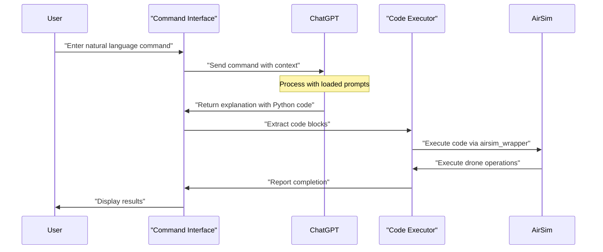
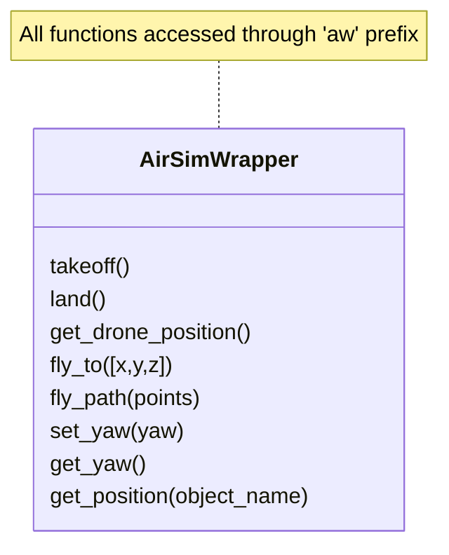
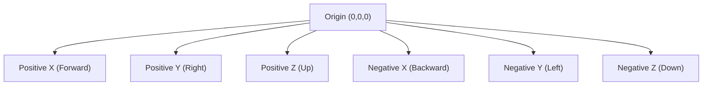
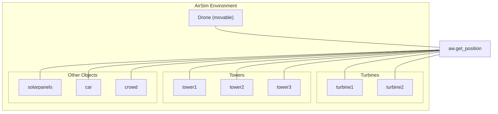
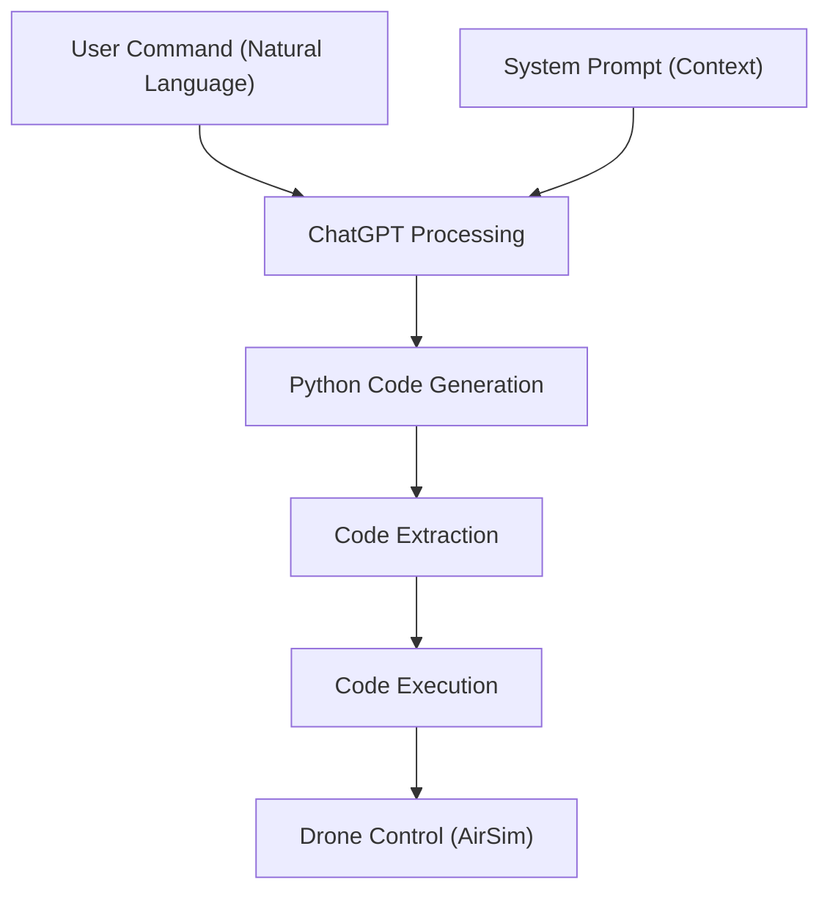

<!-- source: DeepWiki mcp.deepwiki.com · repo microsoft/PromptCraft-Robotics · page 4 Using the System · fetched 2026-10-26 -->

# Using the System

<details>
<summary>Relevant source files</summary>

The following files were used as context for generating this wiki page:

- [chatgpt_airsim/README.md](chatgpt_airsim/README.md)
- [chatgpt_airsim/chatgpt_airsim.py](chatgpt_airsim/chatgpt_airsim.py)
- [chatgpt_airsim/prompts/airsim_basic.txt](chatgpt_airsim/prompts/airsim_basic.txt)

</details>


This document provides a comprehensive guide on how to interact with and use the ChatGPT-AirSim interface after installation. For installation and setup instructions, see [Installation and Setup](#3.1). For architectural details, see [Core Architecture](#3.2).

## Getting Started

The ChatGPT-AirSim interface provides a natural language interface to control a drone in the AirSim simulation environment. The system translates your natural language commands into executable Python code that controls the drone.

### Starting the System

1. First, ensure the AirSim simulation is running:
   ```
   .\run.bat
   ```

2. Then, launch the ChatGPT-AirSim interface from your command line:
   ```
   python chatgpt_airsim.py
   ```

3. When ready, the system will display a prompt:
   ```
   AirSim>
   ```

Sources: [chatgpt_airsim/README.md:24-28]()

### Command Interface Workflow

When you enter a command at the `AirSim>` prompt, the following process occurs:

1. Your command is sent to ChatGPT with context from the system prompt
2. ChatGPT generates a response, including Python code to execute your intent
3. The code is automatically extracted and executed in AirSim
4. You see both ChatGPT's explanation and the result of your command

**Command Interface Diagram**



Sources: [chatgpt_airsim/chatgpt_airsim.py:102-120]()

### Special Commands

The interface provides several special commands:

| Command | Description |
|---------|-------------|
| `!quit` or `!exit` | Exit the application |
| `!clear` | Clear the terminal screen |

Sources: [chatgpt_airsim/chatgpt_airsim.py:105-110]()

## Drone Control Functions

The system provides several high-level functions for controlling the drone. These functions are referenced through the `aw` object, which is an instance of the `AirSimWrapper` class.

**Available Drone Control Functions**



### Function Reference

| Function | Description | Parameters | Return Value |
|----------|-------------|------------|--------------|
| `aw.takeoff()` | Takes off the drone | None | None |
| `aw.land()` | Lands the drone | None | None |
| `aw.get_drone_position()` | Gets current drone position | None | `[x, y, z]` coordinates |
| `aw.fly_to([x, y, z])` | Flies drone to specified position | `[x, y, z]` coordinates | None |
| `aw.fly_path(points)` | Flies drone along specified path | List of `[x, y, z]` points | None |
| `aw.set_yaw(yaw)` | Sets the drone's yaw (rotation) | Yaw angle in degrees | None |
| `aw.get_yaw()` | Gets the drone's current yaw | None | Yaw angle in degrees |
| `aw.get_position(object_name)` | Gets position of named object | Object name as string | `[x, y, z]` coordinates |

Sources: [chatgpt_airsim/prompts/airsim_basic.txt:1-10]()

### Coordinate System

The system uses a standard 3D coordinate system:

- X-axis: Forward direction
- Y-axis: Right direction
- Z-axis: Up direction



Sources: [chatgpt_airsim/prompts/airsim_basic.txt:26-27]()

## Environment Objects

The simulation environment contains several objects that the drone can interact with. These objects are fixed and cannot be moved.

**Environment Objects Diagram**



To get the position of any object in the environment, use:

```
aw.get_position("object_name")
```

Where `object_name` is one of: `turbine1`, `turbine2`, `solarpanels`, `car`, `crowd`, `tower1`, `tower2`, `tower3`.

Sources: [chatgpt_airsim/prompts/airsim_basic.txt:21-26]()

## Basic Usage Examples

Here are some common tasks and how to accomplish them:

### Taking Off and Landing

To take off:
```
AirSim> Please take off the drone
```

To land:
```
AirSim> Land the drone
```

### Moving to a Specific Position

To move to absolute coordinates:
```
AirSim> Fly to position [10, 20, 30]
```

To move relative to current position:
```
AirSim> Move 5 units forward, 3 units right, and 10 units up
```

### Flying to an Object

To fly to a specific object:
```
AirSim> Fly to turbine1
```

### Complex Flight Patterns

To fly in a square pattern:
```
AirSim> Fly in a square pattern with 10 meter sides
```

To fly around an object:
```
AirSim> Circle around tower2 at a distance of 15 meters
```

## Communication Best Practices

The following practices will help you effectively communicate with the system:

### Handling Ambiguity

When there are multiple objects of the same type, always specify which one you're referring to:

```
AirSim> Fly to the turbine
```

The system will respond with a clarification question:
```
Question - there are two turbines (turbine1 and turbine2). Which one do you want me to fly to?
```

Then you can provide clarification:
```
AirSim> Fly to turbine1
```

### Asking for Information

You can ask about the current state:
```
AirSim> What is the current position of the drone?
```

Or about object positions:
```
AirSim> How far is the drone from tower1?
```

### Command Execution Workflow

**Natural Language to Drone Control Flow**



Sources: [chatgpt_airsim/chatgpt_airsim.py:45-63](), [chatgpt_airsim/chatgpt_airsim.py:71-81]()

## Tips and Recommendations

1. **Be specific with directional commands**: When giving movement commands, clearly specify the direction and distance (e.g., "Move 5 meters forward" rather than "Move forward").

2. **Use object names precisely**: Refer to objects using their exact names as defined in the environment (e.g., "turbine1" not "the first turbine").

3. **Combine multiple operations**: You can request complex sequences in a single command (e.g., "Take off, fly to the car, and then circle around it").

4. **Ask for help**: If you're unsure about available functions or capabilities, simply ask "What can you do?" or "What functions are available?"

5. **Recovery from unexpected behavior**: If the drone behaves unexpectedly, you can always give a command to return to a safe position or land.

Sources: [chatgpt_airsim/prompts/airsim_basic.txt:12-19]()

## Example Interactions

### Basic Navigation

```
AirSim> Take off and fly 10 units up
```

Response:
```
I'll help you take off the drone and fly it 10 units up.

```python
aw.takeoff()
aw.fly_to([aw.get_drone_position()[0], aw.get_drone_position()[1], aw.get_drone_position()[2]+10])
```

This code first uses the `takeoff()` function to lift the drone off the ground. Then it uses the `fly_to()` function to move the drone 10 units up from its current position. It does this by:
1. Getting the current position with `get_drone_position()`
2. Creating a new position with the same X and Y coordinates, but with Z increased by 10
3. Flying the drone to this new position
```

### Complex Task

```
AirSim> Fly to turbine1, circle around it once maintaining a distance of 10 meters, then return to your starting position
```

Response would include Python code to execute this complex sequence and an explanation of what the code is doing.

Sources: [chatgpt_airsim/chatgpt_airsim.py:30-41]()

## Next Steps

For more detailed information about the system components, refer to:

- [Core Architecture](#3.2) for details about the system's design
- [Prompt System](#3.3) for information about how prompts work
- [Example Prompts](#4.1) for more usage examples
- [Troubleshooting](#4.2) if you encounter issues

---

