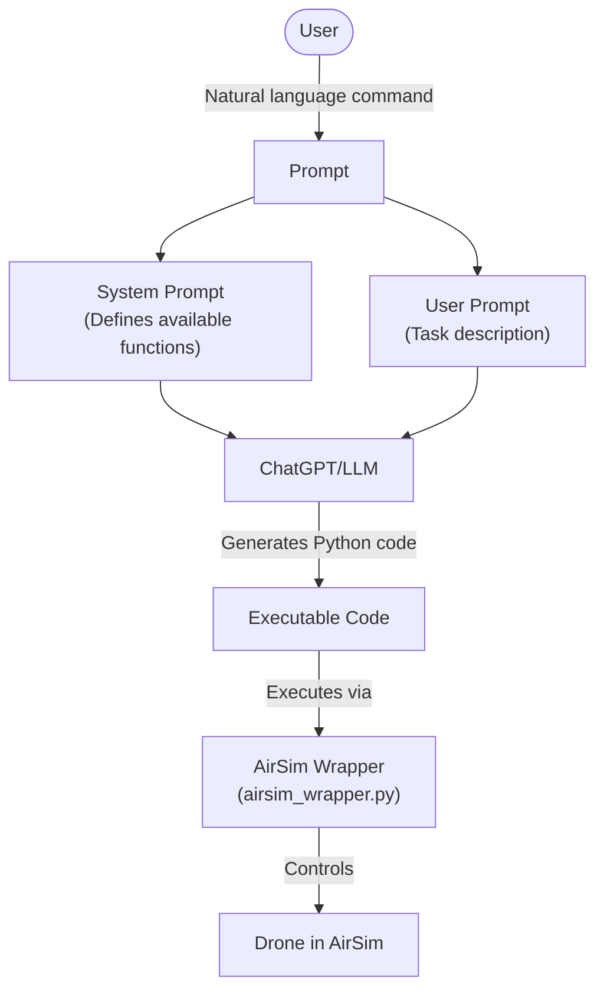
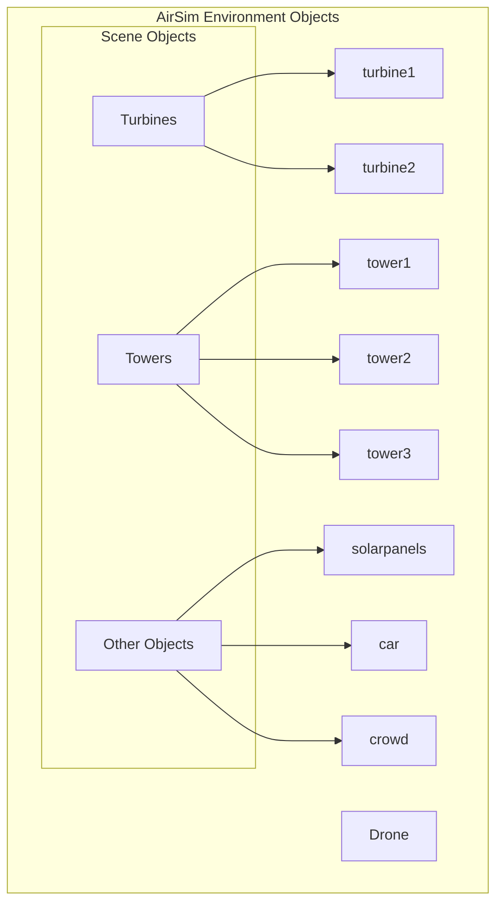
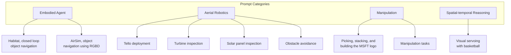

<!-- source: DeepWiki mcp.deepwiki.com · repo microsoft/PromptCraft-Robotics · page 4.1 Example Prompts · fetched 2026-10-26 -->

# Example Prompts

<details>
<summary>Relevant source files</summary>

The following files were used as context for generating this wiki page:

- [README.md](README.md)
- [chatgpt_airsim/prompts/airsim_basic.txt](chatgpt_airsim/prompts/airsim_basic.txt)

</details>


This page presents a collection of example prompts for the PromptCraft-Robotics system, particularly focusing on the ChatGPT-AirSim integration. These examples demonstrate effective prompt engineering techniques for controlling drones and other robotics systems through natural language. For information about the underlying prompt system architecture, see [Prompt System](#3.3).

## Purpose and Scope

Example prompts serve as:
- References for understanding how to communicate with the system
- Models for crafting your own effective prompts
- Demonstrations of the system's capabilities
- Educational tools for understanding prompt engineering principles in robotics contexts

Sources: [README.md:35-52]()

## Prompt Structure and Flow

The following diagram illustrates how natural language prompts are processed through the system to control the drone in AirSim:



Sources: [chatgpt_airsim/prompts/airsim_basic.txt:1-28]()

## Available Functions Reference

The basic system prompt defines the following functions that can be used to control the drone:

| Function | Description | Parameters | Return Value |
|----------|-------------|------------|--------------|
| `aw.takeoff()` | Takes off the drone | None | None |
| `aw.land()` | Lands the drone | None | None |
| `aw.get_drone_position()` | Gets current drone position | None | List `[x, y, z]` |
| `aw.fly_to([x, y, z])` | Flies to specified position | List `[x, y, z]` | None |
| `aw.fly_path(points)` | Flies along specified path | List of `[x, y, z]` points | None |
| `aw.set_yaw(yaw)` | Sets the drone's yaw | `yaw` in degrees | None |
| `aw.get_yaw()` | Gets current yaw | None | Yaw in degrees |
| `aw.get_position(object_name)` | Gets position of an object | `object_name` as string | List `[x, y, z]` |

Sources: [chatgpt_airsim/prompts/airsim_basic.txt:1-10]()

## Environment Objects

The AirSim environment contains several predefined objects that can be referenced in prompts using their exact names:



Sources: [chatgpt_airsim/prompts/airsim_basic.txt:21-24]()

## Example Prompts by Category

The PromptCraft-Robotics repository organizes prompts into several categories based on the robotics domain they address:



Sources: [README.md:39-52]()

### Basic Drone Control Examples

#### Simple Movement

**User Prompt:**
```
Take off and fly forward 10 meters.
```

**Expected Response:**
The model will generate code using the basic functions to accomplish this task:

```python
# Taking off the drone
aw.takeoff()

# Getting current position
current_position = aw.get_drone_position()
print(f"Current position: {current_position}")

# Flying forward 10 meters (positive X direction)
new_position = [current_position[0] + 10, current_position[1], current_position[2]]
aw.fly_to(new_position)
print(f"New position: {new_position}")
```

#### Position Query and Navigation

**User Prompt:**
```
What is the position of turbine1 and fly to it?
```

**Expected Response:**
```python
# Get the position of turbine1
turbine1_position = aw.get_position("turbine1")
print(f"Position of turbine1: {turbine1_position}")

# Take off if needed
aw.takeoff()

# Fly to turbine1
aw.fly_to(turbine1_position)
print(f"Flew to turbine1 at position {turbine1_position}")
```

### Advanced Aerial Robotics Examples

#### Turbine Inspection

**User Prompt:**
```
Inspect turbine1 by flying around it in a spiral pattern from bottom to top.
```

**Expected Response:**
The model will generate code that:
1. Takes off if necessary
2. Gets the position of turbine1
3. Calculates a spiral path around the turbine
4. Flies the path using `aw.fly_path()`

#### Obstacle Avoidance

**User Prompt:**
```
Fly from my current position to tower3, avoiding all other towers on the way.
```

**Expected Response:**
The model will:
1. Get current position and tower3 position
2. Get positions of tower1 and tower2 as potential obstacles
3. Calculate a path that maintains safe distance from obstacles
4. Execute the path using `aw.fly_path()`

Sources: [README.md:44-47]()

## Clarification in Prompts

The system is designed to ask for clarification when instructions are ambiguous. This is an important feature to ensure safety and accuracy.

**Example Scenario:**

```
User: Fly to the turbine.
ChatGPT: Question - there are two turbines in the scene (turbine1 and turbine2). Which one would you like me to fly to?
User: Turbine1, please.
ChatGPT: [Generates code to fly to turbine1]
```

Sources: [chatgpt_airsim/prompts/airsim_basic.txt:12-19]()

## Spatial References and Conventions

When crafting prompts, it's important to understand the spatial reference system used in AirSim:

| Axis | Direction |
|------|-----------|
| X | Forward |
| Y | Right |
| Z | Up |

This convention affects how coordinates are interpreted when using functions like `fly_to()` and `fly_path()`.

Sources: [chatgpt_airsim/prompts/airsim_basic.txt:27-28]()

## Effective Prompt Patterns

Based on the examples in the repository, several effective patterns emerge for prompting the ChatGPT-AirSim integration:

1. **Be specific about objects**: Use the exact names of objects (e.g., "turbine1" not just "turbine")
2. **Describe motion patterns**: Specify patterns like "spiral", "grid", "circle" for complex movements
3. **Provide spatial references**: Use terms like "closest to", "between", "above" to establish spatial relationships
4. **Include safety parameters**: Mention safe distances and speeds when appropriate

## Creating Your Own Prompts

When creating your own prompts, follow these guidelines:

1. **Start simple**: Begin with basic commands before progressing to complex sequences
2. **Build incrementally**: Add complexity step by step
3. **Use clear, unambiguous language**: Be specific about objects and actions
4. **Leverage existing functions**: Use the provided wrapper functions rather than trying to access AirSim APIs directly
5. **Test in safe areas**: Start testing in open areas before attempting near obstacles

### Contributing Prompts

After developing and testing effective prompts, consider contributing them to the PromptCraft-Robotics repository:

1. Submit your prompt to the GitHub Discussions section
2. Format your submission as markdown
3. Specify which LLM you used (e.g., ChatGPT)
4. Include visuals such as videos or pictures if possible
5. The community will review and upvote interesting examples

Sources: [README.md:6-11]()

## Real-World Applications

The examples in the repository demonstrate various real-world applications of prompting for robotics:

1. **Infrastructure inspection**: Turbine and solar panel inspection
2. **Obstacle avoidance**: Navigation through complex environments
3. **Object recognition and navigation**: Finding and interacting with specific objects
4. **Pattern-based movement**: Creating efficient inspection or coverage patterns

These applications showcase how natural language can effectively control complex robotics systems, bridging the gap between human intent and robotic execution.

Sources: [README.md:43-52]()

---

