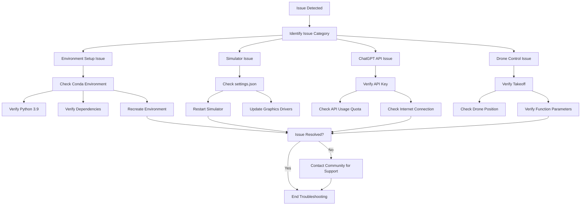
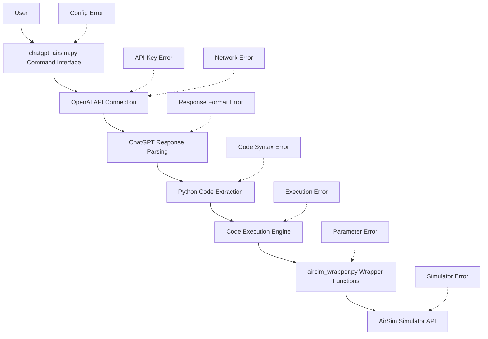
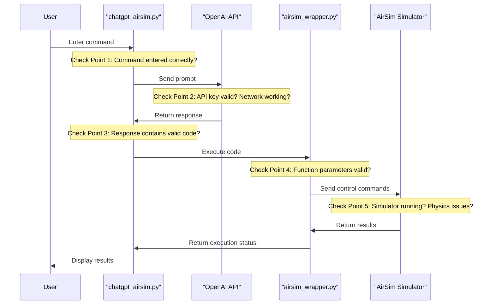

<!-- source: DeepWiki mcp.deepwiki.com · repo microsoft/PromptCraft-Robotics · page 4.2 Troubleshooting · fetched 2026-10-26 -->

# Troubleshooting

<details>
<summary>Relevant source files</summary>

The following files were used as context for generating this wiki page:

- [SUPPORT.md](SUPPORT.md)
- [chatgpt_airsim/README.md](chatgpt_airsim/README.md)
- [chatgpt_airsim/environment.yml](chatgpt_airsim/environment.yml)

</details>


This guide addresses common issues you might encounter when working with the ChatGPT-AirSim integration in the PromptCraft-Robotics repository. It covers environment setup problems, simulator issues, ChatGPT API connectivity, and drone control challenges. For general usage information, see [Using the System](#4) and for setup instructions, refer to [Installation and Setup](#3.1).

## Troubleshooting Process Overview

When encountering issues with the ChatGPT-AirSim integration, follow this systematic troubleshooting process:



Sources: [chatgpt_airsim/README.md:9-26]()

## Common Issues and Solutions

### Environment Setup Issues

#### Conda Environment Problems

**Issue: Environment creation fails**
- Ensure you have Conda installed correctly
- Check internet connectivity as packages need to be downloaded
- Try manually installing required packages if the environment.yml approach fails

**Solution:**
```
conda create -n chatgpt python=3.9
conda activate chatgpt
pip install airsim openai==0.27.2 msgpack-rpc-python
```

**Issue: AirSim client installation fails**
- Ensure you have the right Python version (3.9)
- Try installing the AirSim client directly from GitHub or PyPI

**Solution:**
```
conda activate chatgpt
pip install airsim
```

Sources: [chatgpt_airsim/README.md:11-19](), [chatgpt_airsim/environment.yml:1-18]()

#### OpenAI API Configuration

**Issue: API key not recognized**
- Ensure you've properly formatted the API key in `config.json`
- Check that the API key is valid and hasn't expired
- Verify that you have billing set up on your OpenAI account

**Solution:**
Create or modify your `config.json` file:
```json
{
  "OPENAI_API_KEY": "your-api-key-here"
}
```

**Issue: Config file not found**
- Ensure `config.json` is in the same directory as `chatgpt_airsim.py`

Sources: [chatgpt_airsim/README.md:20]()

### AirSim Simulator Issues

#### Simulator Startup Problems

**Issue: AirSim simulation doesn't start**
- Ensure you've copied `settings.json` to the correct location (`C:\Users\<username>\Documents\AirSim\`)
- Check if your system meets the minimum requirements for the simulator
- Try running the simulation with administrator privileges

**Solution:**
```
# Verify settings.json location
copy settings.json C:\Users\<username>\Documents\AirSim\
# Run as administrator
right-click run.bat -> Run as administrator
```

**Issue: Black screen in simulator**
- Wait a few minutes as the simulator may take time to initialize
- Check if your graphics drivers are up to date
- Try adjusting your display settings

Sources: [chatgpt_airsim/README.md:22-26]()

#### Simulation Crashes

**Issue: Simulator crashes during drone flights**
- Avoid extreme drone movements or positions
- Restart the simulator and try simpler flight patterns
- Check if there are any error messages in the console

**Solution:**
Restart the simulator and use simpler commands first, such as:
```
Can you make the drone takeoff and hover at 10 meters?
```

**Issue: Simulator freezes**
- Check system resource usage (CPU, RAM, GPU)
- Close other resource-intensive applications
- Restart the simulator and the ChatGPT-AirSim interface

Sources: [chatgpt_airsim/README.md:30]()

### ChatGPT Integration Issues

#### System Components and Error Points

The following diagram shows the main components of the system and common error points:



Sources: [chatgpt_airsim/README.md:5-7](), [chatgpt_airsim/README.md:28-30]()

#### API Connectivity

**Issue: Cannot connect to OpenAI API**
- Check your internet connection
- Verify your API key is valid and correctly entered in `config.json`
- Ensure you haven't exceeded API rate limits or usage quotas

**Solution:**
Check API connectivity with a simple request using a tool like curl or Postman to verify your API key works.

**Issue: API requests time out**
- OpenAI servers might be experiencing high load
- Try again later or reduce the complexity of your prompts
- Check if there are any OpenAI service outages

Sources: [chatgpt_airsim/README.md:20]()

#### Response Handling

**Issue: ChatGPT generates invalid code**
- Try rephrasing your request to be more specific
- Use simpler commands that align with the available functions
- Check if your request follows the examples in the prompt

**Solution:**
Use more explicit commands that clearly reference available functions:
```
Can you write code to make the drone takeoff using aw.takeoff() and then fly to position x=10, y=10, z=-10 using aw.fly_to()?
```

**Issue: Code blocks not executing**
- Ensure the ChatGPT response contains proper Python code blocks (with ```python ... ``` syntax)
- Check the console for Python syntax errors
- Try simpler commands to isolate the issue

Sources: [chatgpt_airsim/README.md:28-30]()

### Drone Control Issues

#### Execution Flow and Troubleshooting Points

This diagram illustrates the execution flow and common troubleshooting points:



Sources: [chatgpt_airsim/README.md:28-30]()

#### Navigation Problems

**Issue: Drone doesn't move as expected**
- Verify that the drone has taken off (`aw.takeoff()`)
- Check if the target coordinates are within the simulation boundaries
- Try using relative coordinates instead of absolute positions

**Solution:**
Use a step-by-step approach:
```
1. First check the drone's current position: aw.get_drone_position()
2. Ensure takeoff has occurred: aw.takeoff()
3. Try smaller movements: aw.fly_to(x, y, z, velocity=2)
```

**Issue: Drone crashes into objects**
- Use more conservative flight paths with sufficient clearance from obstacles
- Break down complex movements into smaller steps
- Verify object positions before planning flights: `aw.get_position("object_name")`

Sources: [chatgpt_airsim/README.md:5]()

#### Function Execution Failures

**Issue: Functions return errors**
- Check the console for specific error messages
- Verify that function parameters are within expected ranges
- Ensure you're using the wrapper functions (`aw.*`) rather than direct AirSim API calls

**Solution:**
Ensure you're using wrapper functions correctly:
```
# Correct
aw.takeoff()
aw.fly_to(10, 10, -10)

# Incorrect (direct AirSim API calls)
client.takeoff()
client.moveToPosition(10, 10, -10, 5)
```

**Issue: Drone position queries return unexpected values**
- Reset the drone position using `aw.reset()`
- Restart the simulator if position data seems corrupted
- Verify that the coordinate system used in commands matches the simulator's (Z-axis points down)

Sources: [chatgpt_airsim/README.md:5]()

## General Debugging Tips

### Isolating Issues

- Try running simple, known-working commands to test basic functionality
- Break down complex operations into smaller steps to identify where issues occur
- Check the console output for error messages and exceptions

### Restarting Components

For many issues, restarting components in the following order can resolve problems:
1. The ChatGPT-AirSim interface (`chatgpt_airsim.py`)
2. The AirSim simulator
3. The conda environment

### Checking Logs

AirSim may create log files in:
```
C:\Users\<username>\Documents\AirSim\Logs
```
Check these logs for detailed error information when troubleshooting simulator issues.

### Common Error Messages and Solutions

| Error Message | Possible Cause | Solution |
|---------------|----------------|----------|
| `ModuleNotFoundError: No module named 'airsim'` | AirSim client not installed | Run `pip install airsim` |
| `ImportError: DLL load failed` | Missing Visual C++ redistributables | Install Visual C++ redistributables |
| `OpenAI API error: Invalid API key` | Invalid API key in config.json | Update with a valid key |
| `ConnectionRefusedError: [WinError 10061]` | AirSim simulator not running | Start AirSim simulator first |
| `AttributeError: 'NoneType' object has no attribute...` | Drone not initialized properly | Restart the simulator |
| `Cannot connect to OpenAI API` | Network or API issue | Check connection and API status |

Sources: [chatgpt_airsim/README.md:9-26](), [chatgpt_airsim/README.md:28-30]()

## Known Limitations

- The interface may execute unexpected or potentially problematic code generated by ChatGPT
- Complex maneuvers might result in unstable drone behavior
- The system is designed as a demonstration and educational tool, not for critical applications
- Response times from the OpenAI API can vary based on server load

Sources: [chatgpt_airsim/README.md:30-32]()

---

