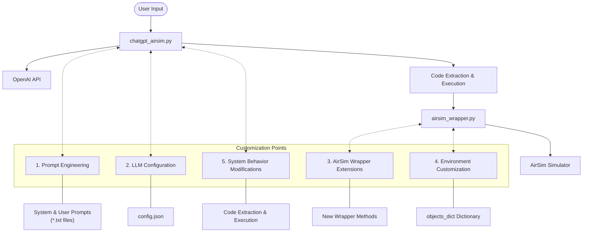
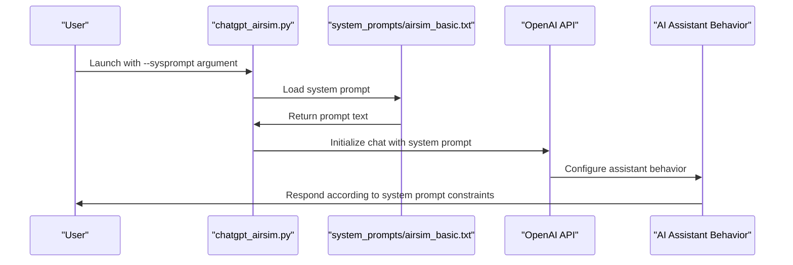
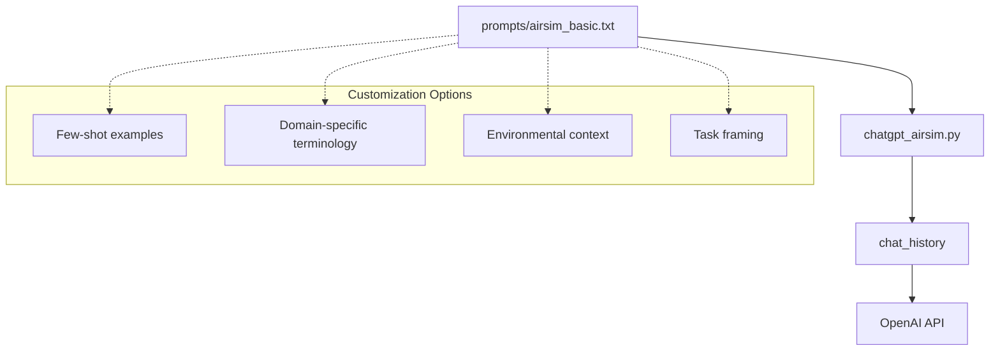
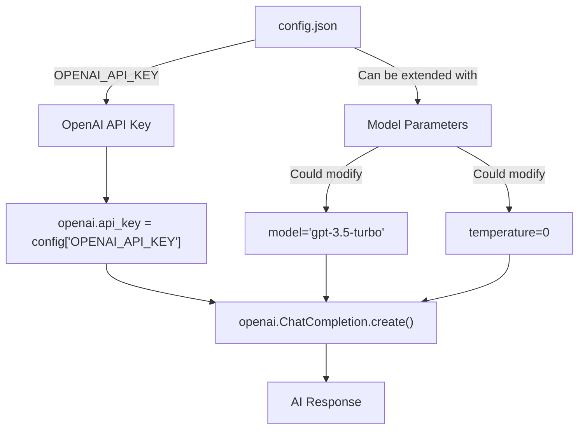
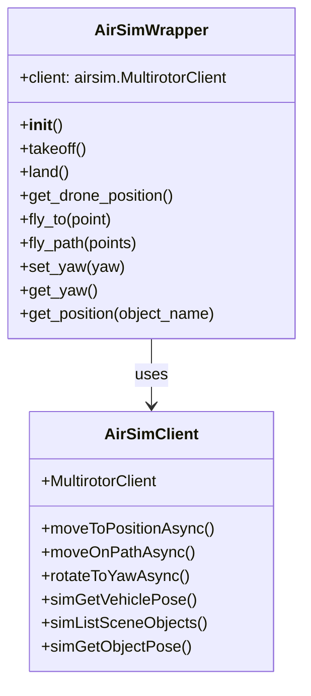
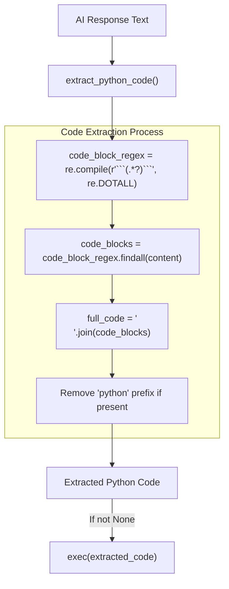
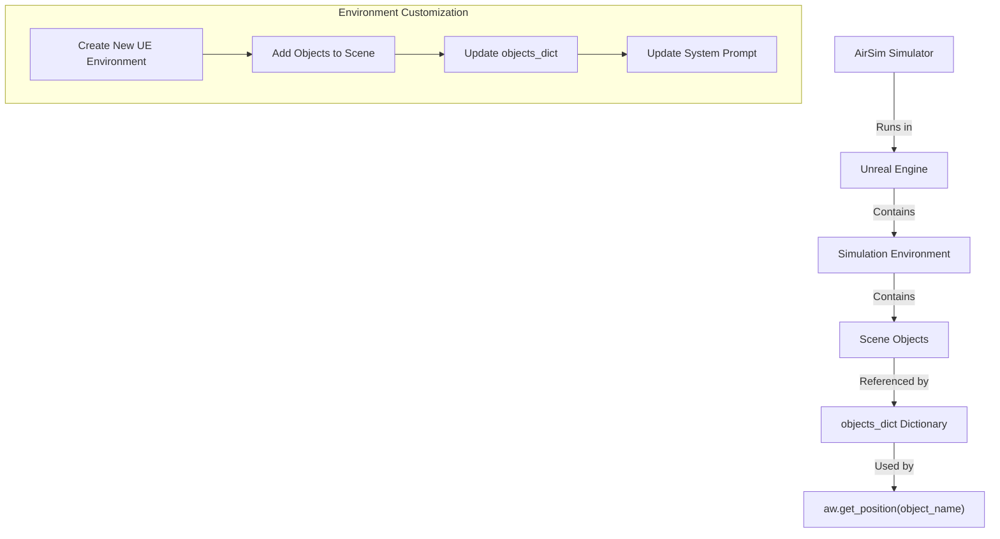

<!-- source: DeepWiki mcp.deepwiki.com · repo microsoft/PromptCraft-Robotics · page 5 Advanced Customization · fetched 2026-10-26 -->

# Advanced Customization

<details>
<summary>Relevant source files</summary>

The following files were used as context for generating this wiki page:

- [chatgpt_airsim/airsim_wrapper.py](chatgpt_airsim/airsim_wrapper.py)
- [chatgpt_airsim/chatgpt_airsim.py](chatgpt_airsim/chatgpt_airsim.py)
- [chatgpt_airsim/system_prompts/airsim_basic.txt](chatgpt_airsim/system_prompts/airsim_basic.txt)

</details>


This page covers advanced customization options for the PromptCraft-Robotics system, focusing on extending and modifying core components to adapt the system for specific research or application needs. For basic usage instructions, please refer to [Using the System](#4).

## Customization Points Overview

The PromptCraft-Robotics system is designed to be customizable at several key points, allowing advanced users to tailor the system to their specific requirements.



Sources: [chatgpt_airsim/chatgpt_airsim.py:1-121](), [chatgpt_airsim/airsim_wrapper.py:1-64](), [chatgpt_airsim/system_prompts/airsim_basic.txt:1-5]()

## 1. Prompt Engineering Customization

### System Prompts

System prompts define the AI assistant's behavior, capabilities, and constraints. The system uses system prompts stored in text files in the `system_prompts` directory, loaded at initialization:



Sources: [chatgpt_airsim/chatgpt_airsim.py:11-13](), [chatgpt_airsim/chatgpt_airsim.py:22-29](), [chatgpt_airsim/system_prompts/airsim_basic.txt:1-5]()

### Creating Custom System Prompts

To create a custom system prompt:

1. Create a new text file in the `system_prompts` directory
2. Define the assistant's role, capabilities, and constraints
3. Launch the application with your custom system prompt:
   ```
   python chatgpt_airsim.py --sysprompt system_prompts/your_custom_prompt.txt
   ```

#### Key Components of Effective System Prompts

| Component | Purpose | Example |
|-----------|---------|---------|
| Role Definition | Establishes the AI's identity | "You are an assistant helping me with the AirSim simulator for drones." |
| Task Instructions | Defines expected response format | "When I ask you to do something, you are supposed to give me Python code and an explanation." |
| Capability Constraints | Limits functions the AI can use | "You are only allowed to use the functions I have defined for you." |
| Knowledge Context | Provides domain-specific information | Information about AirSim's coordinate system or environment |
| Error Handling | Instructs how to handle ambiguity | "If my request is ambiguous, ask clarifying questions before providing code." |

Sources: [chatgpt_airsim/system_prompts/airsim_basic.txt:1-5](), [chatgpt_airsim/chatgpt_airsim.py:11-13]()

### User Prompts Customization

User prompts provide examples or context for specific tasks. The system loads a user prompt file at startup:



Sources: [chatgpt_airsim/chatgpt_airsim.py:12](), [chatgpt_airsim/chatgpt_airsim.py:96-99]()

## 2. Language Model Configuration

### OpenAI API Configuration

The system interfaces with the OpenAI API using configuration parameters stored in `config.json`:



Sources: [chatgpt_airsim/chatgpt_airsim.py:16-20](), [chatgpt_airsim/chatgpt_airsim.py:52-55]()

### Model Parameter Tuning

The `openai.ChatCompletion.create()` method in the `ask()` function accepts several parameters that control the model's behavior:

| Parameter | Default | Purpose | Customization Impact |
|-----------|---------|---------|---------------------|
| model | "gpt-3.5-turbo" | Model to use | Switch to more powerful models like "gpt-4" |
| temperature | 0 | Randomness (0-2) | Higher: more creative, Lower: more deterministic |
| max_tokens | *Not set* | Max response length | Limit token consumption or allow longer responses |
| top_p | *Not set* | Nucleus sampling | Alternative to temperature for controlling randomness |
| presence_penalty | *Not set* | Penalty for repetition | Discourage repetitive responses |
| frequency_penalty | *Not set* | Penalty for token frequency | Encourage lexical diversity |

To modify these parameters, edit the `ask()` function in [chatgpt_airsim/chatgpt_airsim.py:45-63]().

Sources: [chatgpt_airsim/chatgpt_airsim.py:45-63]()

## 3. AirSim Wrapper Extensions

### Understanding the AirSim Wrapper

The `AirSimWrapper` class in `airsim_wrapper.py` provides a simplified interface to the AirSim API:



Sources: [chatgpt_airsim/airsim_wrapper.py:17-63]()

### Adding New Wrapper Methods

To extend the AirSim wrapper with new functionality:

1. Open `airsim_wrapper.py`
2. Add new methods to the `AirSimWrapper` class
3. Update the system prompt to inform the AI about the new capabilities

For example, you could add a method for flying in a circular pattern by implementing a `fly_circle` method in the `AirSimWrapper` class that generates points for a circular path and then uses the existing `fly_path` method.

After adding new methods, update your system prompt to inform the AI assistant about the new capabilities by adding the new function to the list of allowed functions.

Sources: [chatgpt_airsim/airsim_wrapper.py:17-63](), [chatgpt_airsim/system_prompts/airsim_basic.txt:1-5]()

### Environment Object Extensions

The AirSim wrapper includes a dictionary of scene objects that can be queried for their position:

```python
objects_dict = {
    "turbine1": "BP_Wind_Turbines_C_1",
    "turbine2": "StaticMeshActor_2",
    "solarpanels": "StaticMeshActor_146",
    "crowd": "StaticMeshActor_6",
    "car": "StaticMeshActor_10",
    "tower1": "SM_Electric_trellis_179",
    "tower2": "SM_Electric_trellis_7",
    "tower3": "SM_Electric_trellis_8",
}
```

You can extend this dictionary with new objects by adding new key-value pairs, where the key is the friendly name you want to use in your code and the value is the Unreal Engine object name in the simulation.

Sources: [chatgpt_airsim/airsim_wrapper.py:5-14](), [chatgpt_airsim/airsim_wrapper.py:57-63]()

## 4. System Behavior Modifications

### Code Extraction Customization

The system extracts Python code from AI responses using a regular expression pattern:



Sources: [chatgpt_airsim/chatgpt_airsim.py:68-81](), [chatgpt_airsim/chatgpt_airsim.py:116-120]()

You can enhance the code extraction function in [chatgpt_airsim/chatgpt_airsim.py:71-81]() to add safety checks, such as preventing file system or network access, or to handle additional code block formats.

### Custom Command Extensions

You can extend the system with custom commands that are processed directly by the application. The current system already implements `!quit`, `!exit`, and `!clear` commands.

To add new commands, modify the main loop in [chatgpt_airsim/chatgpt_airsim.py:102-111]() by adding additional command handling before the AI interaction.

Sources: [chatgpt_airsim/chatgpt_airsim.py:102-111]()

### Chat History Management

The system maintains a chat history in memory in the `chat_history` list. You can extend this to add persistence, allowing users to save and load conversation history, or implement other features like conversation summarization or context pruning for longer conversations.

Sources: [chatgpt_airsim/chatgpt_airsim.py:25-42](), [chatgpt_airsim/chatgpt_airsim.py:45-63]()

## 5. Creating Custom Environments

### Understanding AirSim Environments

AirSim environments are Unreal Engine-based simulations. The PromptCraft-Robotics system is designed to work with any AirSim environment, but the default object dictionary is specific to the included demo environment.



Sources: [chatgpt_airsim/airsim_wrapper.py:5-14]()

### Creating a Custom Environment

To create a custom environment:

1. Set up an Unreal Engine project with the AirSim plugin
2. Design your environment with the desired objects and features
3. Identify the UE object names for objects you want to interact with
4. Update the `objects_dict` in `airsim_wrapper.py` with your object names
5. Update the system prompt to inform the AI about the new environment and objects

## Best Practices for Advanced Customization

1. **Modular Changes**: Make changes in a modular fashion to allow for easy rollback or combination of features.
2. **Documentation**: Document your customizations, especially if you intend to share them with the community.
3. **Backward Compatibility**: Maintain backward compatibility with existing prompts when possible.
4. **Testing**: Test your customizations thoroughly with a variety of inputs and scenarios.
5. **Security Considerations**: Be mindful of security implications, especially when extending code execution capabilities.

### Testing Customizations

To test your customizations:

1. Create a test script that exercises the new functionality
2. Develop a set of test cases that cover expected inputs and edge cases
3. Compare the behavior with and without your customizations
4. Test the integration with the AI assistant to ensure it can effectively use your extensions

## Advanced Prompt Techniques

### Few-Shot Learning

You can enhance the system's performance by incorporating examples in your prompt file:

```
User: Search for the wind turbine
AI: ```python
turbine_pos = aw.get_position("turbine1")
current_pos = aw.get_drone_position()
aw.fly_to([turbine_pos[0], turbine_pos[1], current_pos[2]])
```
```

### Chain-of-Thought Prompting

Demonstrate step-by-step reasoning in your examples to encourage the AI to think through complex tasks:

```
User: Inspect all wind turbines
AI thought process:
1. Identify all wind turbine objects
2. For each turbine:
   a. Get its position
   b. Fly to a good vantage point
   c. Rotate around for different angles
3. Maintain a safe distance

```python
# Get the positions of the turbines
turbine1_pos = aw.get_position("turbine1")
turbine2_pos = aw.get_position("turbine2")

# Code to inspect each turbine
...
```
```

Sources: [chatgpt_airsim/chatgpt_airsim.py:30-42]()

By leveraging these advanced customization techniques, you can extend the PromptCraft-Robotics system to meet your specific research or application needs while contributing valuable improvements back to the community.

---

