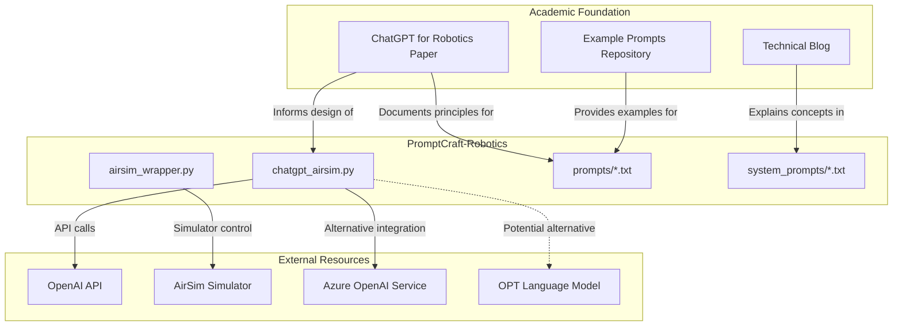
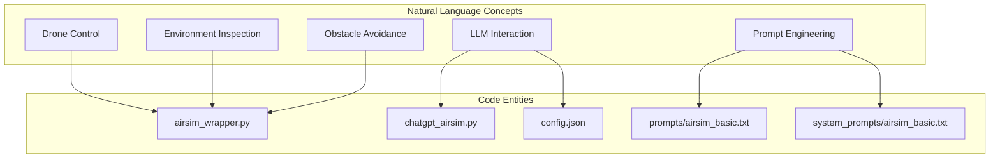
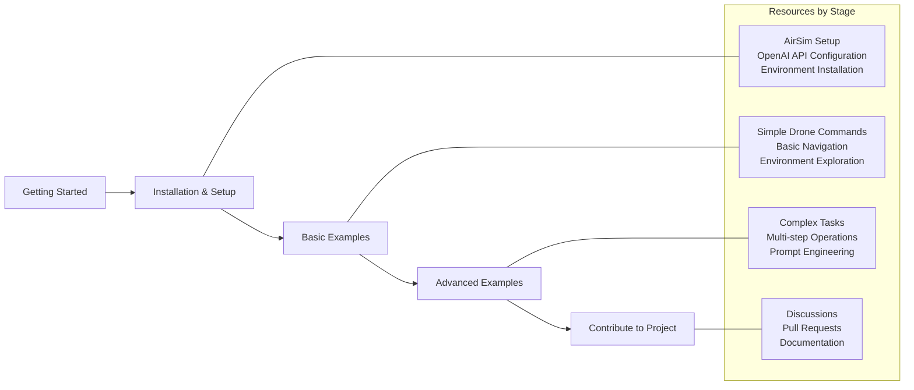

<!-- source: DeepWiki mcp.deepwiki.com · repo microsoft/PromptCraft-Robotics · page 6 References and Resources · fetched 2026-10-26 -->

# References and Resources

<details>
<summary>Relevant source files</summary>

The following files were used as context for generating this wiki page:

- [LICENSE](LICENSE)
- [README.md](README.md)

</details>


This page provides a comprehensive collection of references, external resources, and learning materials related to the PromptCraft-Robotics project. It serves as a central hub for users who want to deepen their understanding of the underlying technologies, explore related projects, or find academic publications in this field. For instructions on setting up the system, see [Installation and Setup](#3.1), and for usage examples, refer to [Example Prompts](#4.1).

## Academic Publications and Citations

### Core Publication

The PromptCraft-Robotics project is based on research detailed in the following technical report:

| Publication | Description |
|------------|-------------|
| "ChatGPT for Robotics: Design Principles and Model Abilities" | Technical report by Vemprala, Bonatti, Bucker, and Kapoor detailing the principles and capabilities of using ChatGPT for robotics applications |

If you use this repository in your research, please use the following citation:

```
@techreport{vemprala2023chatgpt,
author = {Vemprala, Sai and Bonatti, Rogerio and Bucker, Arthur and Kapoor, Ashish},
title = {ChatGPT for Robotics: Design Principles and Model Abilities},
institution = {Microsoft},
year = {2023},
month = {February},
url = {https://www.microsoft.com/en-us/research/publication/chatgpt-for-robotics-design-principles-and-model-abilities/},
number = {MSR-TR-2023-8},
}
```

### Additional Resources

- Blog post: aka.ms/ChatGPT-Robotics
- Paper: "ChatGPT for Robotics: Design Principles and Model Abilities"
- Video demonstration: https://youtu.be/NYd0QcZcS6Q

Sources: [README.md:13-33]()

## Official Documentation

### Large Language Model Resources

The following resources provide official documentation for the LLM platforms that can be used with PromptCraft-Robotics:

| Resource | Description |
|----------|-------------|
| OpenAI API | Official documentation for OpenAI's API, which is used to interact with ChatGPT |
| Azure OpenAI Service | Microsoft's cloud-based offering that provides access to OpenAI models |
| OPT Language Model | Documentation for the Open Pretrained Transformer (OPT) language model |

### Simulation Environment

| Resource | Description |
|----------|-------------|
| AirSim GitHub Repository | The official repository for Microsoft AirSim, which provides the simulation environment used in this project |
| AirSim Documentation | Comprehensive documentation for AirSim, including installation guides, API references, and tutorials |

Sources: [README.md:61-67]()

## Integration Architecture

The following diagram illustrates how PromptCraft-Robotics integrates with external resources and libraries to create a complete system:



Sources: [README.md:3-5](), [README.md:55-59]()

## Code Reference Map

This diagram maps natural language concepts to code entities within the PromptCraft-Robotics repository:



Sources: [README.md:55-59]()

## Example Categories and Resources

The PromptCraft-Robotics repository contains examples organized by category. The following table lists the categories and provides links to corresponding examples:

| Category | Example Resources |
|----------|-------------------|
| Embodied Agent | - Habitat, closed loop object navigation (2 examples)<br>- AirSim, object navigation using RGBD |
| Aerial Robotics | - Real robot: Tello deployment<br>- AirSim turbine inspection<br>- AirSim solar panel inspection<br>- AirSim obstacle avoidance |
| Manipulation | - Real robot: Picking, stacking, and building the MSFT logo<br>- Manipulation tasks |
| Spatial-temporal Reasoning | - Visual servoing with basketball |

Many examples include video demonstrations that complement the text descriptions and code samples.

Sources: [README.md:35-53]()

## Learning Pathway

The following diagram illustrates a suggested learning pathway for users of the PromptCraft-Robotics repository:



Sources: [README.md:7-11](), [README.md:69-81]()

## Community Resources

### Contributing to PromptCraft-Robotics

The project welcomes contributions and suggestions. Here's how you can participate:

1. Submit interesting prompt examples to the [Discussions](https://github.com/microsoft/PromptCraft-Robotics/discussions) section
2. Submit examples under relevant robotics categories
3. Submit pull requests with new categories or examples
4. Follow the Microsoft Open Source Code of Conduct

When contributing, it's recommended to format prompts as markdown, specify which LLM was used, and provide visuals such as videos and pictures when possible.

### License Information

PromptCraft-Robotics is available under the MIT License, which allows for free use, modification, and distribution under certain conditions.

Sources: [README.md:69-89](), [LICENSE:1-21]()

## Related Tools and Technologies

### AirSim Integration Tools

| Tool | Description |
|------|-------------|
| AirSim Binary | Sample inspection environment with assets like wind turbines, electric towers, and solar panels |
| AirSim API | Programming interface for controlling vehicles in AirSim |
| Unreal Engine | Game engine that powers the AirSim simulation environment |

### LLM Platforms and Alternatives

| Platform | Description |
|----------|-------------|
| OpenAI's ChatGPT | Primary LLM used in the repository examples |
| GPT-3 | Alternative model with API access |
| Codex | Code-focused LLM model |
| OPT | Open-source alternative LLM |

Sources: [README.md:3-5](), [README.md:55-59](), [README.md:61-67]()

## Additional Learning Materials

For those interested in deepening their understanding of the technologies used in PromptCraft-Robotics, the following resources are recommended:

1. **Prompt Engineering Techniques**
   - OpenAI's guide to prompt engineering
   - Microsoft's prompt engineering best practices

2. **Robotics Simulation**
   - AirSim tutorials and documentation
   - Robotics simulation principles and practices

3. **LLM Applications in Robotics**
   - Recent research papers in the field
   - Case studies and examples

4. **Drone Programming**
   - Drone control APIs
   - Autonomous navigation techniques

Sources: [README.md:13-33](), [README.md:61-67]()