# Page: Overview

# Overview

<details>
<summary>Relevant source files</summary>

The following files were used as context for generating this wiki page:

- [README.md](README.md)

</details>


## Purpose and Scope

PromptCraft-Robotics is a community-driven repository designed to explore and demonstrate the applications of large language models (LLMs) in robotics. This repository serves as a platform for users to test, share, and collaborate on prompt engineering examples for robotics tasks. The primary focus is on utilizing OpenAI's ChatGPT, though examples from other LLMs are welcome.

This overview document provides a high-level understanding of the PromptCraft-Robotics system, its architecture, and key components. For detailed setup instructions, see [Installation and Setup](#3.1). For information on contributing new prompts, see [Community Contribution Guidelines](#2).

Sources: [README.md:1-11]()

## System Architecture Overview

The PromptCraft-Robotics repository consists of three main components that work together to enable natural language control of robotic systems:

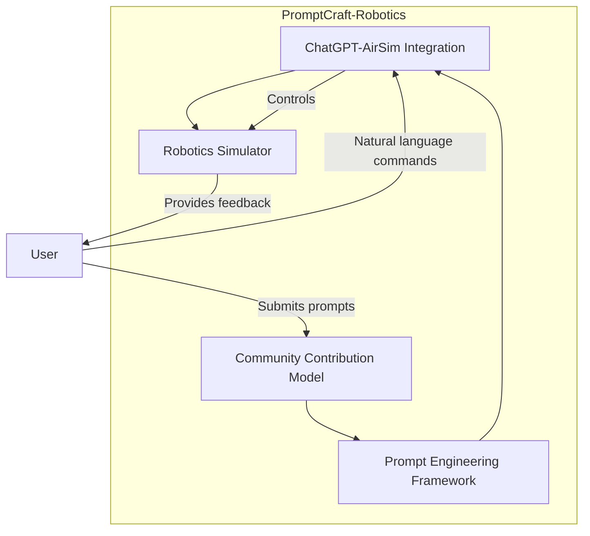

1. **ChatGPT-AirSim Integration**: The core technical component that connects language models to a robotics simulator
2. **Prompt Engineering Framework**: A structured approach for creating effective prompts for various robotics tasks
3. **Community Contribution Model**: A process for users to submit, review, and share interesting prompt examples

Sources: [README.md:3-11](), [README.md:55-59]()

## ChatGPT-AirSim Integration

The ChatGPT-AirSim integration is the primary technical implementation in the repository, allowing users to control a simulated drone using natural language commands.

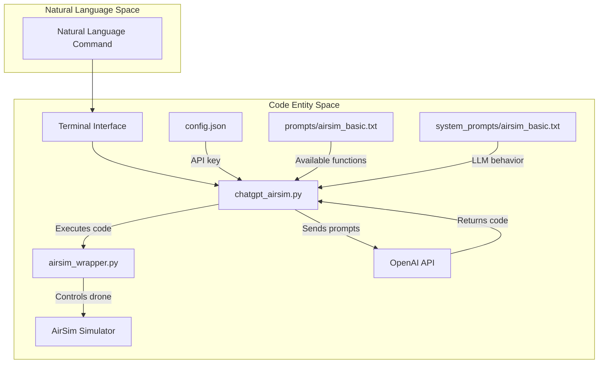

The system works as follows:
1. User enters a natural language command
2. The command is sent to ChatGPT with context from system prompts
3. ChatGPT generates Python code to accomplish the task
4. The code is executed through the AirSim wrapper to control the drone
5. Results are returned to the user

Sources: [README.md:55-57]()

## Prompt Engineering Framework

The repository organizes prompts into categories based on different robotics domains, providing a structured approach to prompt engineering for robotics applications.

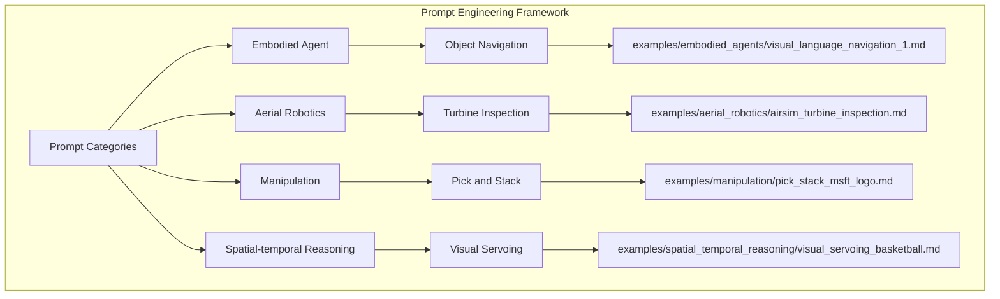

The framework includes example prompts across various domains:

| Category | Example Tasks | File Path |
|----------|---------------|-----------|
| Embodied Agents | Object navigation, RGBD navigation | examples/embodied_agents/* |
| Aerial Robotics | Turbine inspection, obstacle avoidance | examples/aerial_robotics/* |
| Manipulation | Picking, stacking, building | examples/manipulation/* |
| Spatial-temporal | Visual servoing | examples/spatial_temporal_reasoning/* |

Sources: [README.md:35-53]()

## Community Contribution Model

PromptCraft-Robotics follows a community-driven approach where users can contribute prompts through GitHub Discussions.

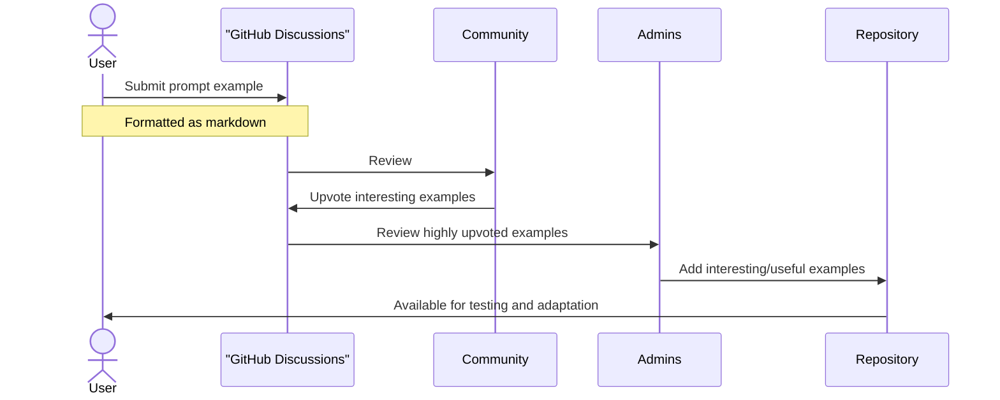

The contribution process:
1. Users submit prompts to the GitHub Discussions section
2. Prompts are categorized in appropriate robotics domains
3. The community reviews and upvotes interesting examples
4. Repository admins add selected prompts to the main repository
5. Submissions should be formatted in markdown with LLM details and visuals

Sources: [README.md:7-11]()

## Data and Control Flow

The following diagram illustrates how user commands flow through the system to control the simulated drone:

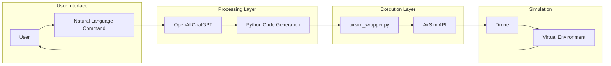

This architecture enables a natural language interface for robotics control, removing the need for users to write code directly. Instead, the LLM interprets commands and generates appropriate code to accomplish the desired tasks.

Sources: [README.md:55-57]()

## AirSim Environment Objects

The AirSim environment includes various objects that can be interacted with using the drone:

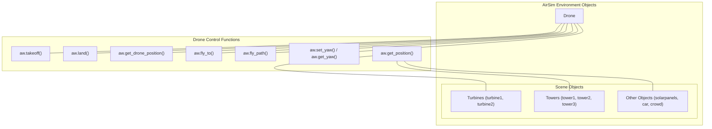

Through the AirSim wrapper functions, users can control the drone to perform various tasks like inspecting wind turbines, avoiding obstacles, or navigating to specific objects.

For more information on the available functions and environment objects, see [Drone Control API](#3.4) and [AirSim Environment Objects](#3.5).

Sources: [README.md:45-47]()

## Research and Resources

PromptCraft-Robotics is accompanied by research publications and additional resources:

- **Research Paper**: "ChatGPT for Robotics: Design Principles and Model Abilities"
- **Blog Post**: Available at aka.ms/ChatGPT-Robotics
- **Demo Videos**: Available on YouTube showing various applications

The project welcomes contributions from the community to expand the range of prompts, robotic applications, and integrations with other simulators.

Sources: [README.md:13-33](), [README.md:61-67]()

## Getting Started

To get started with PromptCraft-Robotics:

1. Explore the existing prompt examples in different categories
2. Set up the ChatGPT-AirSim integration for testing your own prompts
3. Contribute your interesting prompt examples through GitHub Discussions

For detailed setup instructions, see [Installation and Setup](#3.1). For information on using the system with examples, see [Using the System](#4).

Sources: [README.md:55-59]()

---

# Page: Community Contribution Guidelines

# Community Contribution Guidelines

<details>
<summary>Relevant source files</summary>

The following files were used as context for generating this wiki page:

- [CODE_OF_CONDUCT.md](CODE_OF_CONDUCT.md)
- [README.md](README.md)
- [SECURITY.md](SECURITY.md)
- [SUPPORT.md](SUPPORT.md)

</details>


This document outlines the process for contributing to the PromptCraft-Robotics repository through prompt examples that showcase interesting applications of Large Language Models (LLMs) in robotics. For information about setting up and using the ChatGPT-AirSim integration, see [ChatGPT-AirSim Integration](#3).

Sources: [README.md:3-9]()

## Contribution Process Overview

PromptCraft-Robotics is built around community contributions of prompt examples that demonstrate creative uses of LLMs in robotics applications. The diagram below illustrates the complete contribution flow:

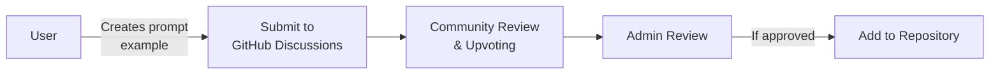

Sources: [README.md:7-8]()

## Where to Submit Contributions

All prompt examples should be submitted to the GitHub Discussions section of the repository. The diagram below shows how natural language contributions flow through GitHub into code entities:

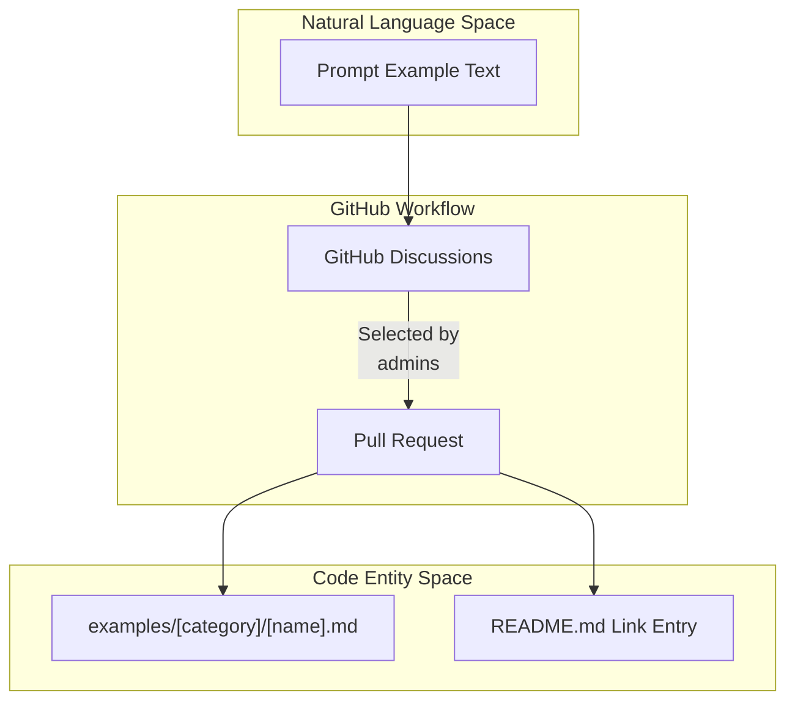

Sources: [README.md:7-8]()

## Robotics Categories

When submitting your prompt, choose the appropriate category that best matches your example. The diagram below shows how natural language categories map to code paths in the repository:

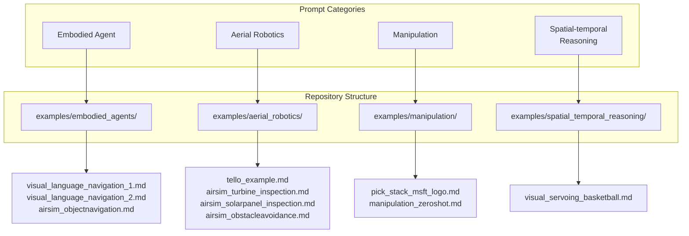

Current categories include:

| Category | Description | Example Applications |
|----------|-------------|----------------------|
| Embodied Agent | Navigation and interaction with environments | Visual language navigation, object navigation |
| Aerial Robotics | Drone control and aerial tasks | Turbine inspection, obstacle avoidance |
| Manipulation | Robot arm movement and object handling | Picking, stacking, building |
| Spatial-temporal Reasoning | Understanding space and time | Visual servoing |

Sources: [README.md:37-52]()

## Submission Format Requirements

For your prompt example to be considered, please follow these formatting requirements:

1. **Format as Markdown**: All submissions should be in markdown format
2. **Specify LLM Used**: Indicate which language model you used (ChatGPT, GPT-3, Codex, etc.)
3. **Include Visual Evidence**: Where possible, provide videos or images demonstrating the results

### Recommended Structure

```markdown
# Title of Your Prompt Example

## LLM Used
- ChatGPT (or specific version)

## Environment
- Simulator: AirSim
- Robot: Drone (or other)

## Prompt
```
Your exact prompt text goes here
```

## Results
```
LLM response goes here
```

## Visual Evidence
- [Video link]
- [Images]

## Discussion
Brief explanation of what makes this example interesting or valuable
```

Sources: [README.md:11-12]()

## Review and Selection Process

### Community Review

After submitting your prompt to GitHub Discussions, the community will review it. High-quality submissions receive upvotes, which help administrators identify valuable contributions.

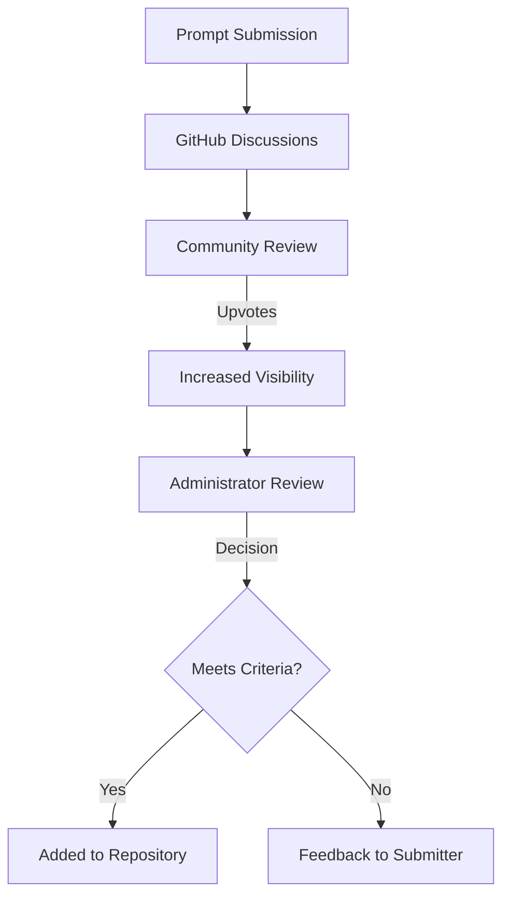

### Selection Criteria

Submissions are evaluated based on:

- **Interestingness**: Shows novel or creative use of LLMs
- **Usefulness**: Demonstrates practical applications for robotics
- **Technical Merit**: Quality of prompt engineering and results
- **Reproducibility**: Clear instructions that others can follow

Note that prompts don't need to be "perfect" or "optimal" to be included - we value creative and interesting approaches even if they have limitations.

Sources: [README.md:8-9]()

## Legal Aspects of Contribution

### Contributor License Agreement (CLA)

Most contributions require you to agree to a Contributor License Agreement (CLA) declaring that you have the right to, and actually do, grant us the rights to use your contribution. For details, visit https://cla.opensource.microsoft.com.

When you submit a pull request, a CLA bot will automatically determine whether you need to provide a CLA and guide you through the process.

### Code of Conduct

This project has adopted the [Microsoft Open Source Code of Conduct](https://opensource.microsoft.com/codeofconduct/). All participants are expected to follow this code in all interactions related to the project.

Sources: [README.md:71-81](), [CODE_OF_CONDUCT.md:1-9]()

## Example Contribution Workflow

The diagram below illustrates a complete contribution workflow from creation to inclusion:

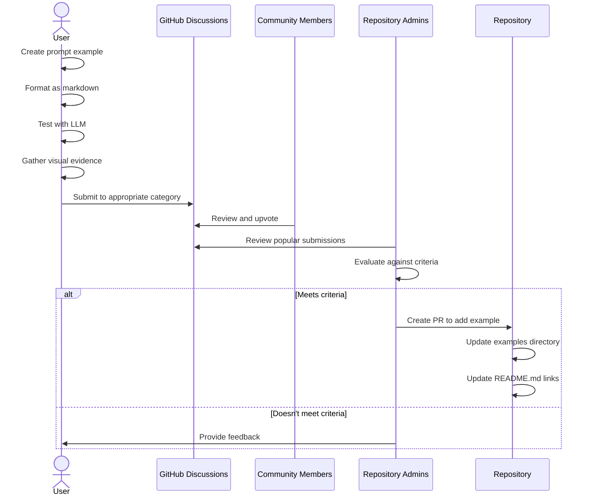

Sources: [README.md:7-12]()

## Tips for Successful Submissions

1. **Be Specific**: Clearly define the robotics task you're addressing
2. **Show Your Work**: Include the complete prompt and response
3. **Document Limitations**: Note any constraints or challenges encountered
4. **Highlight Insights**: Explain what your example demonstrates about LLM capabilities
5. **Follow the Format**: Adhere to the recommended structure for consistency

Sources: [README.md:9-12]()

## Preferred LLMs

While the repository currently focuses on OpenAI's ChatGPT, we welcome examples from other LLMs including:

- OpenAI GPT models (via API)
- OpenAI Codex
- Open-source LLMs

For each submission, please specify which specific model and version you used.

Sources: [README.md:5]()

---

# Page: ChatGPT-AirSim Integration

# ChatGPT-AirSim Integration

<details>
<summary>Relevant source files</summary>

The following files were used as context for generating this wiki page:

- [README.md](README.md)
- [chatgpt_airsim/README.md](chatgpt_airsim/README.md)

</details>


## Purpose and Scope

This document provides a technical overview of the ChatGPT-AirSim integration system, which enables users to control a drone in Microsoft AirSim simulation environments using natural language commands interpreted by OpenAI's ChatGPT. The system acts as a bridge between natural language understanding and robotic control, demonstrating how large language models (LLMs) can be applied to robotics tasks.

For detailed setup instructions, see [Installation and Setup](#3.1). For information about the underlying prompt system that enables the integration, see [Prompt System](#3.3).

## System Overview

The ChatGPT-AirSim integration consists of a Python-based interface that connects OpenAI's ChatGPT language model with the AirSim drone simulation environment. The system allows users to input natural language commands which are processed by ChatGPT to generate executable Python code. This code is automatically executed to control a drone within the simulation.

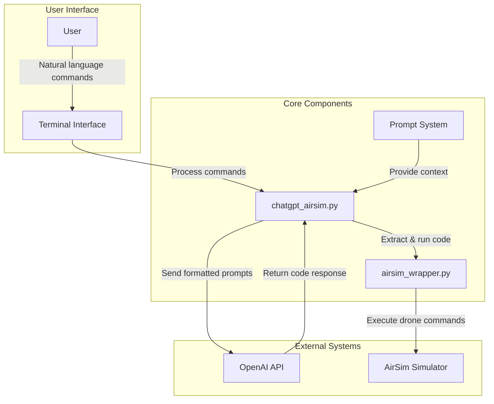

Sources: [chatgpt_airsim/README.md:3-5]()

## Core Components

The integration consists of three primary components working together:

1. **chatgpt_airsim.py** - The main script that handles user input, communicates with the OpenAI API, and manages code execution
2. **airsim_wrapper.py** - A wrapper library that provides high-level drone control functions and interfaces with the AirSim API
3. **Prompt System** - Text files containing carefully crafted prompts that describe available functions and set ChatGPT's behavior

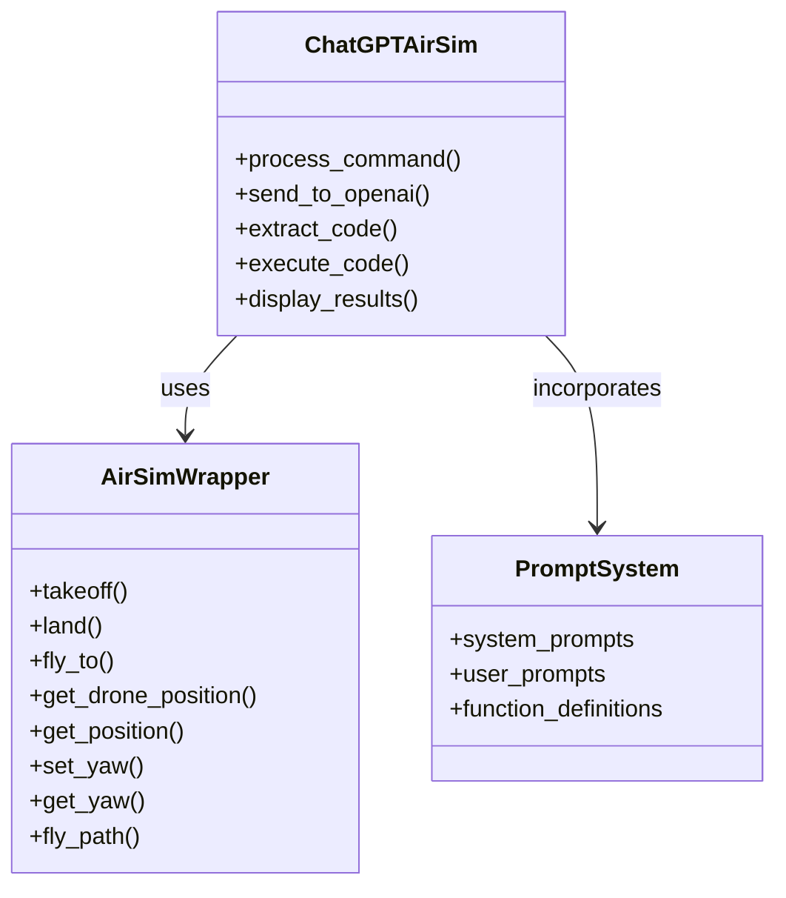

Sources: [chatgpt_airsim/README.md:3-5]()

## Workflow and Data Flow

The integration follows a clear workflow to process user commands and control the drone:

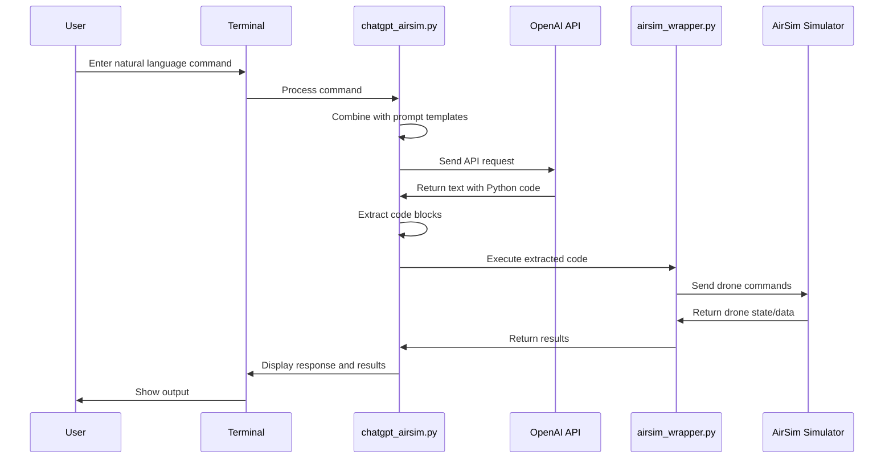

Sources: [chatgpt_airsim/README.md:3-5](), [chatgpt_airsim/README.md:26-30]()

## Technical Implementation

### Command Processing

When a user inputs a natural language command at the `AirSim>` prompt, the system:

1. Takes the user input and combines it with pre-defined prompts that include function definitions
2. Sends this combined prompt to the OpenAI API
3. Receives a response containing explanations and Python code
4. Automatically extracts code blocks (content between triple backticks)
5. Executes the extracted code using the AirSim wrapper functions
6. Displays the results to the user

Sources: [chatgpt_airsim/README.md:26-30]()

### Available Drone Functions

The AirSim wrapper provides a set of high-level functions that can be used to control the drone. These functions are exposed to ChatGPT through the prompt templates.

| Function | Description |
|----------|-------------|
| `takeoff()` | Takes off the drone from the ground |
| `land()` | Lands the drone safely on the ground |
| `get_drone_position()` | Returns the current position of the drone |
| `fly_to(x, y, z)` | Flies the drone to the specified coordinates |
| `fly_path(path)` | Flies the drone along a specified path of coordinates |
| `set_yaw(angle)` | Sets the yaw angle of the drone |
| `get_yaw()` | Returns the current yaw angle of the drone |
| `get_position(object_name)` | Gets the position of a named object in the environment |

Sources: [chatgpt_airsim/README.md:3-5]()

### Environment Objects

The AirSim environment contains various objects that the drone can interact with. These objects can be referenced by name in commands.

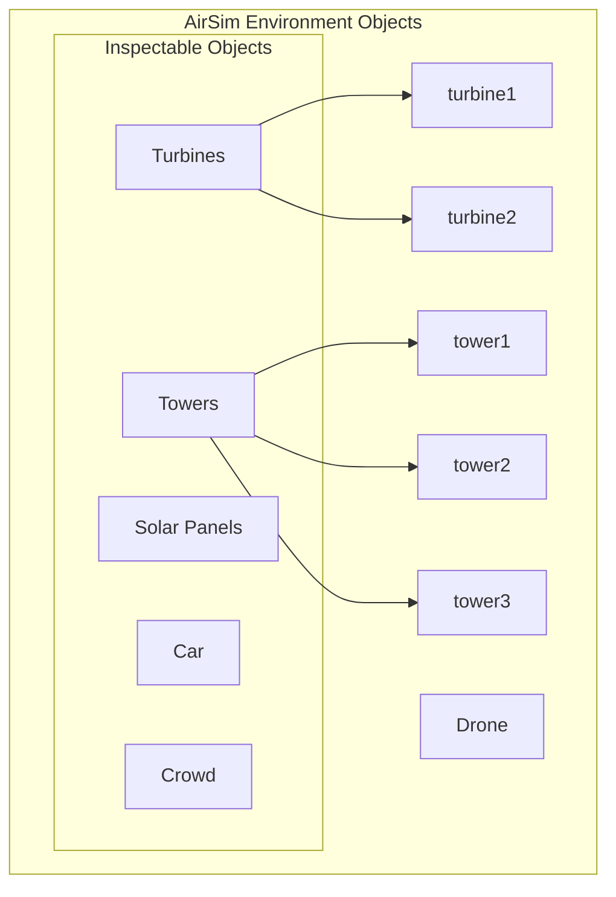

Sources: [chatgpt_airsim/README.md:3-5]()

## Configuration and Setup

The system requires configuration of:

1. OpenAI API key in `config.json`
2. AirSim settings in the proper directory
3. Conda environment for dependencies

The actual simulation runs as a separate process, with the Python interface connecting to it via the AirSim client library.

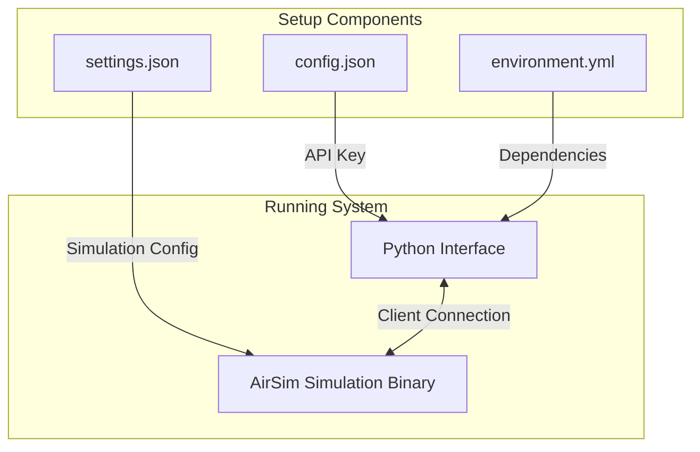

Sources: [chatgpt_airsim/README.md:9-23]()

## Technical Limitations and Considerations

- The system executes generated code directly, which could lead to unpredictable behavior
- Response times depend on the OpenAI API latency
- The wrapper provides a limited set of functions compared to the full AirSim API
- Generated code quality depends on the quality of the prompts and ChatGPT's capabilities

Sources: [chatgpt_airsim/README.md:30-32]()

## Bridging Natural Language to Code Execution

The system bridges the gap between natural language and drone control through a multi-step translation process:

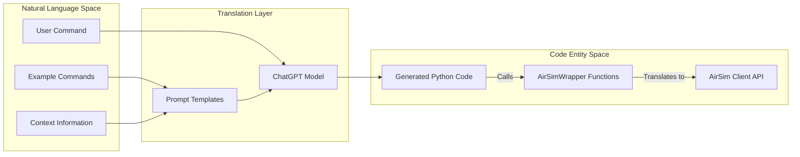

Sources: [chatgpt_airsim/README.md:3-5](), [chatgpt_airsim/README.md:26-30]()

## Technical Design Elements

The system's design separates concerns across different files:

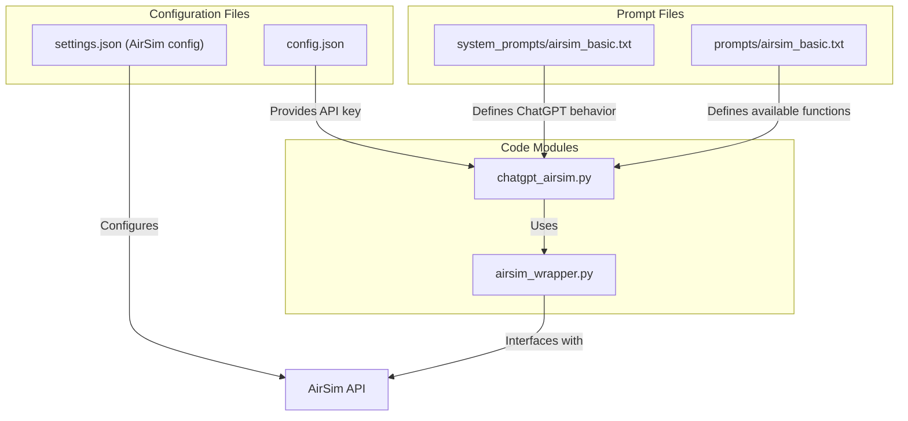

Sources: [chatgpt_airsim/README.md:3-5](), [chatgpt_airsim/README.md:9-23]()

---

# Page: Installation and Setup

# Installation and Setup

<details>
<summary>Relevant source files</summary>

The following files were used as context for generating this wiki page:

- [chatgpt_airsim/README.md](chatgpt_airsim/README.md)
- [chatgpt_airsim/config.json](chatgpt_airsim/config.json)
- [chatgpt_airsim/environment.yml](chatgpt_airsim/environment.yml)

</details>


This page provides comprehensive instructions for installing and configuring the ChatGPT-AirSim integration. The instructions will guide you through setting up the required environment, obtaining necessary API keys, configuring the simulation, and ensuring everything is working correctly. For information about the system's core architecture after installation, see [Core Architecture](#3.2). For details on how to use the system once installed, see [Using the System](#4).

## System Requirements

The current implementation of ChatGPT-AirSim supports Windows operating systems only. Future releases may include support for additional platforms.

- **Operating System**: Windows 10 or higher
- **Hardware**: System capable of running AirSim simulations (recommended: dedicated GPU)
- **Network**: Internet connection for OpenAI API access
- **Accounts**: OpenAI account with API access

Sources: [chatgpt_airsim/README.md:9-10]()

## Installation Process Overview

The installation involves several components working together. The following diagram illustrates the installation workflow:

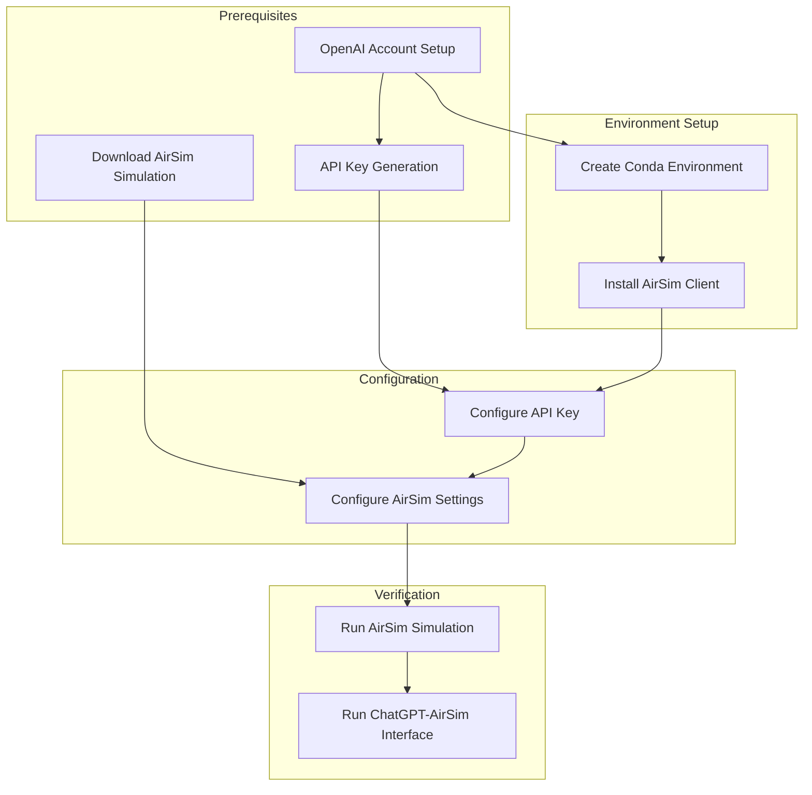

Sources: [chatgpt_airsim/README.md:9-27]()

## 1. OpenAI Account Setup

Before installing the system, you need an OpenAI account with API access:

1. Visit https://platform.openai.com
2. Sign up for an account (or login if you already have one)
3. Navigate to the API section to generate an API key
4. Copy your API key for later use

Sources: [chatgpt_airsim/README.md:10](), [chatgpt_airsim/README.md:20]()

## 2. Environment Setup

The ChatGPT-AirSim integration requires a specific Python environment with several dependencies. The repository provides a conda environment file to simplify this setup.

### 2.1 Create Conda Environment

The `environment.yml` file defines all required dependencies for the ChatGPT-AirSim integration:

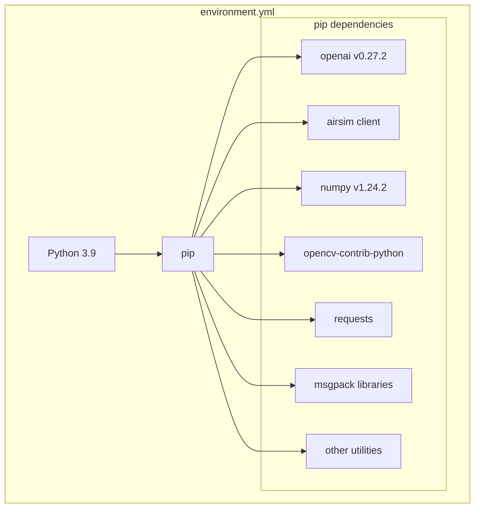

To create the environment:

1. Open a command prompt or terminal
2. Navigate to the repository directory containing the `environment.yml` file
3. Run the following command:
   ```
   conda env create -f environment.yml
   ```
4. Activate the newly created environment:
   ```
   conda activate chatgpt
   ```

Sources: [chatgpt_airsim/README.md:11-14](), [chatgpt_airsim/environment.yml:1-19]()

### 2.2 Install AirSim Client

After activating the conda environment, install the AirSim client:

```
pip install airsim
```

This Python client will communicate with the AirSim simulation.

Sources: [chatgpt_airsim/README.md:15-19]()

## 3. AirSim Simulator Setup

The AirSim simulator needs to be downloaded and configured properly to work with the ChatGPT integration.

### 3.1 Download AirSim Simulation

1. Download the AirSim zip file from the [Releases page](https://github.com/microsoft/PromptCraft-Robotics/releases)
2. Extract the zip file to a location of your choice

Sources: [chatgpt_airsim/README.md:21]()

### 3.2 Configure AirSim Settings

1. Locate the `settings.json` file in the extracted AirSim package
2. Copy this file to `C:\Users\<username>\Documents\AirSim\` (replace `<username>` with your Windows username)

This settings file configures the AirSim simulation environment that the ChatGPT integration will control.

Sources: [chatgpt_airsim/README.md:22]()

## 4. API Configuration

The system requires your OpenAI API key to function.

### 4.1 Configure OpenAI API Key

1. Open the `config.json` file in the repository
2. Replace the placeholder text in the `OPENAI_API_KEY` field with your actual API key:

```
{
    "OPENAI_API_KEY": "your_actual_api_key_here"
}
```

The relationship between configuration files and system components is illustrated below:

```mermaid
graph TD
    subgraph "Configuration Files"
        Config["config.json"]
        Settings["settings.json"]
    end
    
    subgraph "System Components"
        ChatGPT["chatgpt_airsim.py"]
        AirSim["AirSim Simulator"]
        OpenAI["OpenAI API"]
    end
    
    Config -->|"API Key"| ChatGPT
    ChatGPT -->|"API Requests"| OpenAI
    Settings -->|"Environment Configuration"| AirSim
    ChatGPT -->|"Control Commands"| AirSim
```

Sources: [chatgpt_airsim/README.md:20](), [chatgpt_airsim/config.json:1-3]()

## 5. Verification

After completing the installation and configuration steps, you should verify that everything is working correctly.

### 5.1 Run AirSim Simulation

1. Navigate to the extracted AirSim simulation folder
2. Run the simulation by executing:
   ```
   .\run.bat
   ```
3. Wait for the simulation environment to fully load

Sources: [chatgpt_airsim/README.md:25]()

### 5.2 Run ChatGPT-AirSim Interface

1. Open a command prompt or terminal
2. Ensure the conda environment is activated (`conda activate chatgpt`)
3. Navigate to the repository directory
4. Run the interface:
   ```
   python chatgpt_airsim.py
   ```
5. When the interface is ready, you'll see an `AirSim>` prompt

```mermaid
sequenceDiagram
    participant User
    participant Terminal
    participant ChatGPT as chatgpt_airsim.py
    participant AirSim as AirSim Simulator
    participant OpenAI as OpenAI API
    
    User->>Terminal: conda activate chatgpt
    User->>Terminal: python chatgpt_airsim.py
    Terminal->>ChatGPT: Start script
    ChatGPT->>AirSim: Establish connection
    ChatGPT->>OpenAI: Validate API key
    ChatGPT->>Terminal: Display "AirSim>" prompt
    User->>Terminal: Enter command
    Terminal->>ChatGPT: Process command
    ChatGPT->>OpenAI: Send command + context
    OpenAI->>ChatGPT: Return response
    ChatGPT->>AirSim: Execute code in response
    AirSim->>ChatGPT: Return results
    ChatGPT->>Terminal: Display results
    Terminal->>User: Show output
```

Sources: [chatgpt_airsim/README.md:24-28]()

## 6. Troubleshooting

Here are some common issues that may occur during installation and their solutions:

| Issue | Possible Cause | Solution |
|-------|----------------|----------|
| `conda env create` fails | Conda not installed or path issues | Verify conda is installed and in your PATH |
| AirSim client installation fails | Internet connectivity or permission issues | Try installing with admin privileges, check internet connection |
| "Invalid API key" error | Incorrect API key in config.json | Double-check the key and ensure it's properly copied |
| AirSim simulation crashes | Hardware limitations or incorrect settings | Verify your system meets the requirements, check settings.json |
| ChatGPT-AirSim fails to connect to AirSim | AirSim not running or network issues | Ensure AirSim is running before starting chatgpt_airsim.py |

**Note:** The ChatGPT-AirSim integration is experimental in nature. As mentioned in the README, ChatGPT-generated code may sometimes result in unexpected behavior or crashes, as the interface directly executes the commands generated by the AI.

Sources: [chatgpt_airsim/README.md:28-30]()

## Summary

After completing these installation and setup steps, you should have a functioning ChatGPT-AirSim integration that allows you to control a drone in the AirSim simulation environment using natural language commands processed by ChatGPT. The next step is to learn how to effectively use the system, which is covered in [Using the System](#4).

Sources: [chatgpt_airsim/README.md:1-7](), [chatgpt_airsim/README.md:28-32]()

---

# Page: Core Architecture

# Core Architecture

<details>
<summary>Relevant source files</summary>

The following files were used as context for generating this wiki page:

- [chatgpt_airsim/README.md](chatgpt_airsim/README.md)
- [chatgpt_airsim/airsim_wrapper.py](chatgpt_airsim/airsim_wrapper.py)
- [chatgpt_airsim/chatgpt_airsim.py](chatgpt_airsim/chatgpt_airsim.py)

</details>


This document describes the system architecture, components, and interactions in the ChatGPT-AirSim integration. It serves as a technical reference for understanding how natural language commands are processed, translated into code, and executed in the AirSim environment. For information about installing and setting up the system, see [Installation and Setup](#3.1). For details about the prompt system, see [Prompt System](#3.3).

## System Overview

```mermaid
graph TD
    User(["User"]) -->|"Natural language commands"| Interface["chatgpt_airsim.py Interface"]
    Interface -->|"Sends prompts"| OpenAI["OpenAI API"]
    OpenAI -->|"Returns responses with code"| Interface
    Interface -->|"Extracts & executes code"| AirSimWrapper["airsim_wrapper.py"]
    AirSimWrapper -->|"Controls drone"| AirSim["AirSim Simulator"]
    
    Config["config.json"] -->|"API key"| Interface
    Prompts["prompts/airsim_basic.txt"] -->|"Defines context"| Interface
    SystemPrompts["system_prompts/airsim_basic.txt"] -->|"Configures ChatGPT behavior"| Interface
```

The PromptCraft-Robotics architecture consists of three main components:

1. **Interface Layer**: `chatgpt_airsim.py` serves as the primary interface, managing user inputs, API communication, and code execution.
2. **Wrapper Layer**: `airsim_wrapper.py` provides a simplified interface to the AirSim API with high-level drone control functions.
3. **External Services**: OpenAI API for language processing and AirSim for simulation.

Sources: [chatgpt_airsim/README.md:5-5](), [chatgpt_airsim/chatgpt_airsim.py:1-121]()

## Interface Layer

The interface layer, implemented in `chatgpt_airsim.py`, handles the primary communication flow between the user, OpenAI API, and the AirSim wrapper.

```mermaid
classDiagram
    class ChatGPTAirSim {
        -chat_history: list
        -openai.api_key: string
        -sysprompt: string
        -code_block_regex: regex
        -aw: AirSimWrapper
        +ask(prompt): string
        +extract_python_code(content): string
    }
```

The main components of the interface layer include:

| Component | Description | Code Location |
|-----------|-------------|---------------|
| Chat History | Maintains context for OpenAI API calls | [chatgpt_airsim.py:25-41]() |
| ask() Function | Sends prompts to OpenAI and records responses | [chatgpt_airsim.py:45-63]() |
| Code Extraction | Extracts executable Python code from responses | [chatgpt_airsim.py:68-81]() |
| Main Loop | Processes user input and executes code | [chatgpt_airsim.py:102-120]() |

### Communication Flow

```mermaid
sequenceDiagram
    actor User
    participant Interface as chatgpt_airsim.py
    participant OpenAI as OpenAI API
    participant Wrapper as airsim_wrapper.py
    participant AirSim as AirSim Simulator
    
    User->>Interface: Enter natural language command
    Interface->>OpenAI: Send command with context via ask()
    OpenAI->>Interface: Return response with Python code
    Interface->>Interface: Extract code using extract_python_code()
    Interface->>Wrapper: Execute extracted code via exec()
    Wrapper->>AirSim: Translate to AirSim API calls
    AirSim->>Wrapper: Return results
    Wrapper->>Interface: Return results
    Interface->>User: Display results
```

The interface uses a clean command loop pattern:
1. Accepts user input via command line
2. Sends the input to OpenAI API along with conversation history
3. Extracts Python code blocks from the response
4. Executes the extracted code, which calls methods in the AirSim wrapper
5. Displays results and waits for next command

Sources: [chatgpt_airsim/chatgpt_airsim.py:45-63](), [chatgpt_airsim/chatgpt_airsim.py:68-81](), [chatgpt_airsim/chatgpt_airsim.py:102-120]()

## Wrapper Layer

The wrapper layer, implemented in `airsim_wrapper.py`, provides a simplified interface to the AirSim API with high-level drone control functions.

```mermaid
classDiagram
    class AirSimWrapper {
        +client: MultirotorClient
        +__init__()
        +takeoff()
        +land()
        +get_drone_position()
        +fly_to(point)
        +fly_path(points)
        +set_yaw(yaw)
        +get_yaw()
        +get_position(object_name)
    }
```

The `AirSimWrapper` class encapsulates the following functionality:

| Method | Description | Code Location |
|--------|-------------|---------------|
| __init__() | Initializes AirSim client and enables API control | [airsim_wrapper.py:17-22]() |
| takeoff() | Commands drone to take off | [airsim_wrapper.py:24-25]() |
| land() | Commands drone to land | [airsim_wrapper.py:27-28]() |
| get_drone_position() | Returns current drone position | [airsim_wrapper.py:30-32]() |
| fly_to() | Moves drone to specified coordinates | [airsim_wrapper.py:34-38]() |
| fly_path() | Moves drone along a specified path | [airsim_wrapper.py:40-47]() |
| set_yaw() | Sets drone yaw angle | [airsim_wrapper.py:49-50]() |
| get_yaw() | Gets current drone yaw angle | [airsim_wrapper.py:52-55]() |
| get_position() | Gets position of a named object in the environment | [airsim_wrapper.py:57-63]() |

The wrapper also maintains a dictionary of environment objects (`objects_dict`) that maps friendly names to internal object identifiers in AirSim.

Sources: [airsim_wrapper.py:5-63](), [chatgpt_airsim/README.md:5-5]()

## Code Execution Pipeline

```mermaid
graph TD
    UserInput["User Input"] --> ask["ask(prompt)"]
    ask --> UpdateHistory["Update chat_history"]
    UpdateHistory --> OpenAICall["openai.ChatCompletion.create()"]
    OpenAICall --> ExtractCode["extract_python_code(content)"]
    ExtractCode --> CodeExecution["exec(code)"]
    CodeExecution --> AirSimWrapper["AirSimWrapper methods"]
```

The code execution pipeline follows these steps:

1. **Input Processing**: User input is captured in the main loop and passed to the `ask()` function
2. **Context Management**: The input is added to chat history to maintain context
3. **API Communication**: The `ask()` function sends the prompt to OpenAI API
4. **Response Processing**: The response is added to chat history and returned
5. **Code Extraction**: `extract_python_code()` extracts executable Python code using regex
6. **Code Execution**: The extracted code is executed using Python's `exec()` function
7. **Drone Control**: The executed code calls methods in the `AirSimWrapper` class

Sources: [chatgpt_airsim/chatgpt_airsim.py:45-63](), [chatgpt_airsim/chatgpt_airsim.py:68-81](), [chatgpt_airsim/chatgpt_airsim.py:102-120]()

## Configuration System

```mermaid
graph TD
    UserConfig["User Configuration"] --> ConfigJSON["config.json"]
    ConfigJSON -->|"OPENAI_API_KEY"| Interface["chatgpt_airsim.py"]
    
    CommandLine["Command Line Arguments"] --> Interface
    CommandLine -->|"--prompt"| PromptFile["prompts/airsim_basic.txt"]
    CommandLine -->|"--sysprompt"| SystemPrompt["system_prompts/airsim_basic.txt"]
    
    PromptFile --> Interface
    SystemPrompt --> Interface
```

The system configuration is managed through:

1. **config.json**: Contains the OpenAI API key
2. **Command-line Arguments**: 
   - `--prompt`: Path to the user prompt file (default: `prompts/airsim_basic.txt`)
   - `--sysprompt`: Path to the system prompt file (default: `system_prompts/airsim_basic.txt`)

Sources: [chatgpt_airsim/chatgpt_airsim.py:11-20](), [chatgpt_airsim/README.md:20-20]()

## Environment Object Mapping

```mermaid
graph TD
    AirSimWrapper["AirSimWrapper"] --> ObjectsDict["objects_dict"]
    ObjectsDict --> Objects["Environment Objects"]
    
    Objects --> Turbines["Turbines (turbine1, turbine2)"]
    Objects --> Towers["Towers (tower1, tower2, tower3)"]
    Objects --> OtherObjects["Other Objects (solarpanels, car, crowd)"]
    
    GetPosition["get_position(object_name)"] --> ObjectsDict
    GetPosition --> SimListSceneObjects["client.simListSceneObjects()"]
    SimListSceneObjects --> SimGetObjectPose["client.simGetObjectPose()"]
```

The `objects_dict` in `airsim_wrapper.py` maps user-friendly object names to internal AirSim object identifiers:

| User-friendly Name | AirSim Object Identifier |
|-------------------|--------------------------|
| turbine1 | BP_Wind_Turbines_C_1 |
| turbine2 | StaticMeshActor_2 |
| solarpanels | StaticMeshActor_146 |
| crowd | StaticMeshActor_6 |
| car | StaticMeshActor_10 |
| tower1 | SM_Electric_trellis_179 |
| tower2 | SM_Electric_trellis_7 |
| tower3 | SM_Electric_trellis_8 |

The `get_position()` method uses this dictionary to locate objects in the environment.

Sources: [airsim_wrapper.py:5-14](), [airsim_wrapper.py:57-63]()

## Initialization Sequence

```mermaid
sequenceDiagram
    participant Script as chatgpt_airsim.py
    participant Config as config.json
    participant PromptFile as prompts/airsim_basic.txt
    participant SysPromptFile as system_prompts/airsim_basic.txt
    participant Wrapper as AirSimWrapper
    participant AirSim as AirSim Client
    
    Script->>Config: Load OpenAI API key
    Script->>SysPromptFile: Load system prompt
    Script->>Script: Initialize chat_history
    Script->>Wrapper: Create AirSimWrapper instance
    Wrapper->>AirSim: confirmConnection()
    Wrapper->>AirSim: enableApiControl(True)
    Wrapper->>AirSim: armDisarm(True)
    Script->>PromptFile: Load user prompt
    Script->>Script: Send initial prompt to ChatGPT
    Script->>Script: Start command loop
```

The system initialization follows these steps:

1. Load configuration and API key
2. Load system prompt
3. Initialize chat history with system prompt and example
4. Initialize AirSim wrapper, which connects to the simulator
5. Load user prompt and send it to ChatGPT
6. Begin command loop for user interaction

Sources: [chatgpt_airsim/chatgpt_airsim.py:11-100](), [airsim_wrapper.py:17-22]()

## Error Handling

The system includes minimal error handling:

1. The `extract_python_code()` function returns `None` if no code blocks are found
2. The main loop checks if the extracted code is `None` before executing it
3. The `get_position()` method waits until objects are found in the scene

The interface executes code directly using Python's `exec()` function, which could lead to unexpected behavior or crashes if the generated code contains errors.

Sources: [chatgpt_airsim/chatgpt_airsim.py:68-81](), [chatgpt_airsim/chatgpt_airsim.py:116-120](), [chatgpt_airsim/README.md:30-30](), [airsim_wrapper.py:57-63]()

---

# Page: Prompt System

# Prompt System

<details>
<summary>Relevant source files</summary>

The following files were used as context for generating this wiki page:

- [chatgpt_airsim/chatgpt_airsim.py](chatgpt_airsim/chatgpt_airsim.py)
- [chatgpt_airsim/prompts/airsim_basic.txt](chatgpt_airsim/prompts/airsim_basic.txt)
- [chatgpt_airsim/system_prompts/airsim_basic.txt](chatgpt_airsim/system_prompts/airsim_basic.txt)

</details>


## Purpose and Scope

This document explains the Prompt System used in PromptCraft-Robotics to enable natural language control of drones in the AirSim simulator. The Prompt System is the communication layer between user commands and drone actions, transforming natural language into executable code through structured prompts and interaction patterns.

For information about the overall architecture of the integration, see [Core Architecture](#3.2). For details about the available drone control functions, see [Drone Control API](#3.4).

## Overview of the Prompt System

The Prompt System in PromptCraft-Robotics consists of several key components that work together to enable effective communication between the user, the language model, and the AirSim environment.

```mermaid
graph TB
    User["User"] --> |"Natural language\ncommands"| ChatInterface["chatgpt_airsim.py"]
    
    subgraph "Prompt System"
        SystemPrompt["System Prompt\n(Role definition)"]
        UserPrompt["User Prompt\n(Available functions)"]
        ExampleInteraction["Example Interaction\n(Demonstrations)"]
        ChatHistory["Chat History\n(Context maintenance)"]
    end
    
    SystemPrompt --> ChatInterface
    UserPrompt --> ChatInterface
    ExampleInteraction --> ChatInterface
    ChatInterface <--> ChatHistory
    
    ChatInterface --> |"OpenAI API"| LLM["Language Model"]
    LLM --> |"Response with\nPython code"| ChatInterface
    ChatInterface --> |"Extracted code"| CodeExecution["Code Execution"]
    CodeExecution --> AirSim["AirSim Simulator"]
```

Sources: [chatgpt_airsim/chatgpt_airsim.py:22-63](), [chatgpt_airsim/system_prompts/airsim_basic.txt:1-5](), [chatgpt_airsim/prompts/airsim_basic.txt:1-28]()

## Components of the Prompt System

### System Prompt

The system prompt defines the AI assistant's role and behavioral constraints. It is loaded at initialization and included in every API call to the language model.

The system prompt:
- Defines the AI's role as an assistant for AirSim simulator
- Instructs the AI to respond with Python code followed by explanations
- Restricts the AI to only use the explicitly defined functions
- Allows the use of simple Python functions from libraries like `math` and `numpy`

Sources: [chatgpt_airsim/system_prompts/airsim_basic.txt:1-5](), [chatgpt_airsim/chatgpt_airsim.py:22-29]()

### User Prompt

The user prompt provides detailed information about available functions, scene objects, and usage guidelines. This prompt is sent to the model at the beginning of each session to establish the context.

The user prompt includes:
- Available drone control functions with descriptions
- Usage guidelines and conventions
- Objects in the scene and how to reference them
- Axis conventions and directional references
- Guidelines for handling clarification questions

Sources: [chatgpt_airsim/prompts/airsim_basic.txt:1-28](), [chatgpt_airsim/chatgpt_airsim.py:96-99]()

### Example Interactions

The system includes pre-defined example interactions that demonstrate correct use patterns. These examples:
- Show proper function usage (using `fly_to()` to move the drone upward)
- Establish the expected response format (code block followed by explanation)
- Serve as few-shot learning examples for the language model

Sources: [chatgpt_airsim/chatgpt_airsim.py:30-41]()

### Chat History

The chat history maintains the context of the ongoing conversation, enabling more coherent and contextually appropriate responses throughout a session. The system:
- Initializes chat history with the system prompt and example interaction
- Appends each user query and AI response to maintain context
- Sends the complete history with each new API request

Sources: [chatgpt_airsim/chatgpt_airsim.py:25-41](), [chatgpt_airsim/chatgpt_airsim.py:45-63]()

## From Natural Language to Drone Control

The Prompt System creates a pipeline that transforms natural language commands into drone actions:

```mermaid
sequenceDiagram
    actor User
    participant Interface as "chatgpt_airsim.py"
    participant OpenAI as "OpenAI API"
    participant Extractor as "extract_python_code()"
    participant Executor as "exec()"
    participant Wrapper as "AirSimWrapper"
    participant Simulator as "AirSim"
    
    User->>Interface: "fly to turbine1"
    Interface->>Interface: Add to chat_history
    Interface->>OpenAI: Send complete chat history
    Note over OpenAI: Process with context from<br>system and user prompts
    OpenAI->>Interface: Return response with code
    Interface->>Interface: Display full response
    Interface->>Extractor: extract_python_code(response)
    Extractor->>Interface: Return extracted code
    Interface->>Executor: exec(code)
    Executor->>Wrapper: Call wrapper functions
    Wrapper->>Simulator: Translate to AirSim API calls
    Simulator->>User: Drone flies to turbine1
```

Sources: [chatgpt_airsim/chatgpt_airsim.py:45-63](), [chatgpt_airsim/chatgpt_airsim.py:68-81](), [chatgpt_airsim/chatgpt_airsim.py:102-120]()

## Code Components and Their Roles

### Prompt Loading and Initialization

The system loads prompts from files and initializes the chat history at startup:

```mermaid
graph TD
    Start["Program Start"] --> ParseArgs["Parse Arguments"]
    ParseArgs --> LoadConfig["Load config.json"]
    LoadConfig --> InitOpenAI["Initialize OpenAI API"]
    InitOpenAI --> LoadSysPrompt["Load System Prompt\nfrom file"]
    LoadSysPrompt --> InitHistory["Initialize Chat History"]
    InitHistory --> InitAirSim["Initialize AirSimWrapper"]
    InitAirSim --> LoadUserPrompt["Load User Prompt\nfrom file"]
    LoadUserPrompt --> SendFirstPrompt["Send First Prompt to LLM"]
    SendFirstPrompt --> StartLoop["Start Interaction Loop"]
```

Sources: [chatgpt_airsim/chatgpt_airsim.py:11-14](), [chatgpt_airsim/chatgpt_airsim.py:16-20](), [chatgpt_airsim/chatgpt_airsim.py:22-41](), [chatgpt_airsim/chatgpt_airsim.py:92-100]()

### Main Components and Their Interactions

The table below shows the key components involved in the Prompt System and their primary responsibilities:

| Component | File | Lines | Primary Responsibility |
|-----------|------|-------|------------------------|
| `chat_history` | chatgpt_airsim.py | 25-41 | Maintains conversation context |
| `ask()` function | chatgpt_airsim.py | 45-63 | Sends prompts to OpenAI API and updates history |
| `extract_python_code()` | chatgpt_airsim.py | 68-81 | Extracts executable code from LLM responses |
| System Prompt | system_prompts/airsim_basic.txt | 1-5 | Defines assistant role and behavior |
| User Prompt | prompts/airsim_basic.txt | 1-28 | Defines available functions and guidelines |
| Main Loop | chatgpt_airsim.py | 102-120 | Handles user input and executes responses |

Sources: [chatgpt_airsim/chatgpt_airsim.py:25-41](), [chatgpt_airsim/chatgpt_airsim.py:45-63](), [chatgpt_airsim/chatgpt_airsim.py:68-81](), [chatgpt_airsim/chatgpt_airsim.py:102-120]()

## Available Functions in User Prompt

The user prompt defines specific drone control functions that can be used by the language model:

```mermaid
graph TD
    subgraph "Available Functions in User Prompt"
        takeoff["aw.takeoff()\nTakes off the drone"]
        land["aw.land()\nLands the drone"]
        getPos["aw.get_drone_position()\nReturns drone XYZ coordinates"]
        flyTo["aw.fly_to([x, y, z])\nFlies to specified coordinates"]
        flyPath["aw.fly_path(points)\nFlies along specified path"]
        setYaw["aw.set_yaw(yaw)\nSets drone yaw in degrees"]
        getYaw["aw.get_yaw()\nReturns current yaw in degrees"]
        getObjPos["aw.get_position(object_name)\nReturns object XYZ coordinates"]
    end
    
    subgraph "Scene Objects"
        turbine1["turbine1"]
        turbine2["turbine2"]
        solarpanels["solarpanels"]
        car["car"]
        crowd["crowd"]
        tower1["tower1"]
        tower2["tower2"]
        tower3["tower3"]
    end
    
    getObjPos --> turbine1
    getObjPos --> turbine2
    getObjPos --> solarpanels
    getObjPos --> car
    getObjPos --> crowd
    getObjPos --> tower1
    getObjPos --> tower2
    getObjPos --> tower3
```

Sources: [chatgpt_airsim/prompts/airsim_basic.txt:1-10](), [chatgpt_airsim/prompts/airsim_basic.txt:21-23]()

## Prompt Structure and Guidelines

The user prompt contains several types of information to guide the language model's responses:

1. **Function Definitions**: Lists available functions with their parameters and return values
2. **Usage Guidelines**: Advises on best practices (e.g., using `fly_to()` instead of `moveToPositionAsync()`)
3. **Clarification Protocol**: Defines how to handle ambiguous requests
4. **Scene Object Reference**: Lists available objects and naming conventions
5. **Coordinate System**: Explains the axis conventions (X=forward, Y=right, Z=up)

Sources: [chatgpt_airsim/prompts/airsim_basic.txt:1-28]()

## Code Extraction and Execution

A key part of the Prompt System is extracting and executing code from the language model's responses:

```mermaid
graph TD
    Response["LLM Response"] --> Extraction["extract_python_code()\nFinds code blocks with regex"]
    Extraction --> CodeBlocks["Code blocks found?"]
    CodeBlocks -->|Yes| Process["Process code blocks"]
    Process --> Python["Is Python?"]
    Python -->|Yes| RemoveMarker["Remove 'python' marker if present"]
    RemoveMarker --> Execute["exec()\nExecute code"]
    CodeBlocks -->|No| NoExecution["No code execution"]
    Python -->|No| Execute
```

Sources: [chatgpt_airsim/chatgpt_airsim.py:68-81](), [chatgpt_airsim/chatgpt_airsim.py:116-120]()

## Best Practices for Prompt Engineering

Based on the implementation, these best practices are used in the Prompt System:

1. **Clear role definition**: The system prompt clearly defines what the assistant should and shouldn't do
2. **Function documentation**: The user prompt clearly documents available functions
3. **Example interactions**: The system includes example queries and responses
4. **Clarification guidelines**: The prompt instructs when to ask for clarification
5. **Domain-specific terminology**: The prompt defines axis conventions and object names

Sources: [chatgpt_airsim/system_prompts/airsim_basic.txt:1-5](), [chatgpt_airsim/prompts/airsim_basic.txt:1-28]()

## Conclusion

The Prompt System in PromptCraft-Robotics enables natural language control of drones by:
- Defining the assistant's role and behavior through system prompts
- Documenting available functions and scene objects through user prompts
- Providing examples of correct interactions
- Maintaining conversation context through chat history
- Extracting and executing code from language model responses

This system creates an intuitive interface for controlling drones in the AirSim simulator without requiring direct programming knowledge.

---

# Page: Drone Control API

# Drone Control API

<details>
<summary>Relevant source files</summary>

The following files were used as context for generating this wiki page:

- [chatgpt_airsim/airsim_wrapper.py](chatgpt_airsim/airsim_wrapper.py)
- [chatgpt_airsim/prompts/airsim_basic.txt](chatgpt_airsim/prompts/airsim_basic.txt)

</details>


This page documents the Drone Control API for the PromptCraft-Robotics system. The API provides functions for controlling drones in the AirSim simulator through simple Python function calls.

For information about the broader system architecture, see [Core Architecture](#3.2). For details about the simulation environment and available objects, see [AirSim Environment Objects](#3.5).

## Overview

The Drone Control API is implemented as a wrapper around the AirSim API, providing a simplified interface for drone control operations. This API is referenced in the prompt system as `aw` (short for AirSim Wrapper) and allows for operations like takeoff, landing, movement, and orientation control.

```mermaid
flowchart TD
    subgraph "Natural Language Space"
        UserCommand["User Command\n(e.g., 'fly to the turbine')"]
        ChatGPT["ChatGPT Processing"]
    end
    
    subgraph "Code Entity Space"
        CodeGen["Generated Python Code\n(using aw.* functions)"]
        AirSimWrapper["AirSimWrapper Class"]
        AirSimAPI["AirSim API"]
    end
    
    UserCommand --> ChatGPT
    ChatGPT --> CodeGen
    CodeGen --> AirSimWrapper
    AirSimWrapper --> AirSimAPI
```

Sources: [chatgpt_airsim/airsim_wrapper.py:17-64](), [chatgpt_airsim/prompts/airsim_basic.txt:1-28]()

## API Class Structure

The API is implemented by the `AirSimWrapper` class, which wraps the AirSim MultirotorClient to provide simplified drone control functionality.

```mermaid
classDiagram
    class AirSimWrapper {
        +client: MultirotorClient
        +takeoff()
        +land()
        +get_drone_position()
        +fly_to(point)
        +fly_path(points)
        +set_yaw(yaw)
        +get_yaw()
        +get_position(object_name)
    }
```

Sources: [chatgpt_airsim/airsim_wrapper.py:17-64]()

## Available Functions

The following functions are available through the Drone Control API:

| Function | Description | Parameters | Return Value |
|----------|-------------|------------|--------------|
| `aw.takeoff()` | Takes off the drone | None | None |
| `aw.land()` | Lands the drone | None | None |
| `aw.get_drone_position()` | Gets the current position of the drone | None | List `[x, y, z]` |
| `aw.fly_to([x, y, z])` | Flies the drone to a specific position | List `[x, y, z]` | None |
| `aw.fly_path(points)` | Flies the drone along a path | List of points, each a list `[x, y, z]` | None |
| `aw.set_yaw(yaw)` | Sets the yaw of the drone | Float (degrees) | None |
| `aw.get_yaw()` | Gets the current yaw of the drone | None | Float (degrees) |
| `aw.get_position(object_name)` | Gets the position of an environment object | String (object name) | List `[x, y, z]` |

Sources: [chatgpt_airsim/prompts/airsim_basic.txt:3-10](), [chatgpt_airsim/airsim_wrapper.py:24-63]()

## Function Implementation Details

### Basic Movement Functions

The basic movement functions provide fundamental drone control capabilities:

- `takeoff()`: Calls the AirSim `takeoffAsync()` function and waits for completion
- `land()`: Calls the AirSim `landAsync()` function and waits for completion
- `get_drone_position()`: Retrieves the drone's position from the simulator

```mermaid
sequenceDiagram
    participant User as "User Code"
    participant AW as "AirSimWrapper"
    participant AS as "AirSim API"
    
    User->>AW: aw.takeoff()
    AW->>AS: takeoffAsync().join()
    AS-->>AW: (completion)
    AW-->>User: (returns)
    
    User->>AW: aw.land()
    AW->>AS: landAsync().join()
    AS-->>AW: (completion)
    AW-->>User: (returns)
    
    User->>AW: aw.get_drone_position()
    AW->>AS: simGetVehiclePose()
    AS-->>AW: pose
    AW-->>User: [x, y, z]
```

Sources: [chatgpt_airsim/airsim_wrapper.py:24-32]()

### Navigation Functions

The navigation functions allow controlling the drone's position and path:

- `fly_to([x, y, z])`: Moves the drone to the specified position
- `fly_path(points)`: Moves the drone along a path defined by waypoints

These functions handle coordinate system conversion automatically. In the user-facing API, positive Z is up, while in AirSim internally, negative Z is up.

```mermaid
sequenceDiagram
    participant User as "User Code"
    participant AW as "AirSimWrapper"
    participant AS as "AirSim API"
    
    User->>AW: aw.fly_to([10, 5, 20])
    Note over AW: Converts Z coordinate
    AW->>AS: moveToPositionAsync(10, 5, -20, 5).join()
    AS-->>AW: (completion)
    AW-->>User: (returns)
    
    User->>AW: aw.fly_path([[0,0,10], [10,0,10], [10,10,10]])
    Note over AW: Converts all Z coordinates
    AW->>AS: moveOnPathAsync([Vector3r(0,0,-10), Vector3r(10,0,-10), Vector3r(10,10,-10)], ...).join()
    AS-->>AW: (completion)
    AW-->>User: (returns)
```

Sources: [chatgpt_airsim/airsim_wrapper.py:34-47]()

### Orientation Functions

The orientation functions control the drone's heading:

- `set_yaw(yaw)`: Sets the drone's yaw (heading) in degrees
- `get_yaw()`: Gets the drone's current yaw in degrees

Sources: [chatgpt_airsim/airsim_wrapper.py:49-55]()

### Environment Interaction

The `get_position(object_name)` function allows retrieving the position of objects in the environment:

```mermaid
sequenceDiagram
    participant User as "User Code"
    participant AW as "AirSimWrapper"
    participant Dict as "objects_dict"
    participant AS as "AirSim API"
    
    User->>AW: aw.get_position("turbine1")
    AW->>Dict: Lookup "turbine1"
    Dict-->>AW: "BP_Wind_Turbines_C_1"
    AW->>AS: simListSceneObjects("BP_Wind_Turbines_C_1.*")
    AS-->>AW: object_names_ue
    AW->>AS: simGetObjectPose(object_names_ue[0])
    AS-->>AW: pose
    AW-->>User: [x, y, z]
```

Sources: [chatgpt_airsim/airsim_wrapper.py:57-63](), [chatgpt_airsim/airsim_wrapper.py:5-14]()

## Coordinate System

The API uses a right-handed coordinate system:

```mermaid
graph TD
    Origin(("O")) --- X["X-axis\n(Forward)"]
    Origin --- Y["Y-axis\n(Right)"]
    Origin --- Z["Z-axis\n(Up)"]
```

- X-axis: Forward direction (positive X)
- Y-axis: Right direction (positive Y)
- Z-axis: Up direction (positive Z)

All position coordinates are represented as lists of 3 floats `[x, y, z]`.

Sources: [chatgpt_airsim/prompts/airsim_basic.txt:27-28]()

## Environment Objects

The API provides access to various objects in the simulation environment through the `get_position()` function. The available objects include:

| Object Name | Description |
|-------------|-------------|
| `turbine1` | First wind turbine |
| `turbine2` | Second wind turbine |
| `solarpanels` | Solar panels |
| `car` | A car |
| `crowd` | A crowd of people |
| `tower1` | First electric tower |
| `tower2` | Second electric tower |
| `tower3` | Third electric tower |

To retrieve an object's position:

```python
# Get the position of turbine1
turbine_position = aw.get_position("turbine1")  # Returns [x, y, z]
```

Sources: [chatgpt_airsim/airsim_wrapper.py:5-14](), [chatgpt_airsim/prompts/airsim_basic.txt:21-26]()

## Usage Guidelines

When working with the Drone Control API:

1. Always use the provided wrapper functions (e.g., `aw.fly_to()`) instead of direct AirSim API calls.
2. Use exact object names as specified in the Environment Objects section.
3. When referring to objects with multiple instances (e.g., turbines, towers), always specify which instance (e.g., `turbine1`, `tower2`).
4. Remember that coordinates are in the form `[x, y, z]` with positive Z representing up.

Sources: [chatgpt_airsim/prompts/airsim_basic.txt:12-26]()

---

# Page: AirSim Environment Objects

# AirSim Environment Objects

<details>
<summary>Relevant source files</summary>

The following files were used as context for generating this wiki page:

- [chatgpt_airsim/airsim_wrapper.py](chatgpt_airsim/airsim_wrapper.py)
- [chatgpt_airsim/prompts/airsim_basic.txt](chatgpt_airsim/prompts/airsim_basic.txt)

</details>


## Purpose and Scope
This page documents the objects available in the AirSim simulation environment used in PromptCraft-Robotics. These objects serve as landmarks, obstacles, or targets for drone operations within the simulation. Here you'll learn what objects are available, how they're represented in code, and how to interact with them programmatically.

For information about controlling the drone itself, see [Drone Control API](#3.4).

Sources: [chatgpt_airsim/prompts/airsim_basic.txt:21-26]()

## Object Representation
In the PromptCraft-Robotics codebase, environment objects are mapped from user-friendly names to internal Unreal Engine identifiers through the `objects_dict` dictionary:

```mermaid
graph TD
    subgraph "Natural Language Space"
        UserRef["User References"]
        UserRef --> |"refer to"| FriendlyNames["Friendly Names<br>(turbine1, tower2, etc.)"]
    end
    
    subgraph "Code Entity Space"
        FriendlyNames --> |"mapped via<br>objects_dict"| InternalIDs["Unreal Engine IDs<br>(BP_Wind_Turbines_C_1, etc.)"]
        InternalIDs --> |"queried with<br>simListSceneObjects()"| UnrealObjects["Unreal Engine Objects"]
        UnrealObjects --> |"position retrieved with<br>simGetObjectPose()"| ObjectPose["Object Position<br>[x, y, z]"]
    end
```

Sources: [chatgpt_airsim/airsim_wrapper.py:5-14](), [chatgpt_airsim/airsim_wrapper.py:57-63]()

## Available Objects
The environment contains the following static objects:

| Friendly Name | Internal ID | Object Type |
|---------------|-------------|------------|
| turbine1 | BP_Wind_Turbines_C_1 | Wind Turbine |
| turbine2 | StaticMeshActor_2 | Wind Turbine |
| solarpanels | StaticMeshActor_146 | Solar Panel Array |
| crowd | StaticMeshActor_6 | Group of People |
| car | StaticMeshActor_10 | Automobile |
| tower1 | SM_Electric_trellis_179 | Electrical Tower |
| tower2 | SM_Electric_trellis_7 | Electrical Tower |
| tower3 | SM_Electric_trellis_8 | Electrical Tower |

Sources: [chatgpt_airsim/airsim_wrapper.py:5-14](), [chatgpt_airsim/prompts/airsim_basic.txt:21-23]()

## Multiple Objects of the Same Type
The environment contains multiple instances of certain object types:
- Two wind turbines: `turbine1`, `turbine2`
- Three electrical towers: `tower1`, `tower2`, `tower3`

When referring to these objects in natural language commands, you should specify the exact object (e.g., "turbine1" instead of just "turbine"). If a command is ambiguous, clarification should be requested.

Sources: [chatgpt_airsim/prompts/airsim_basic.txt:25-26]()

## Interacting with Objects
The primary way to interact with environment objects is through the `get_position` function:

```mermaid
sequenceDiagram
    participant User as "User Code"
    participant Wrapper as "AirSimWrapper"
    participant ObjectDict as "objects_dict"
    participant AirSim as "AirSim API"
    
    User->>Wrapper: get_position("turbine1")
    activate Wrapper
    Wrapper->>ObjectDict: Look up "turbine1"
    ObjectDict-->>Wrapper: Return "BP_Wind_Turbines_C_1"
    Wrapper->>AirSim: simListSceneObjects("BP_Wind_Turbines_C_1.*")
    AirSim-->>Wrapper: Return matching object name(s)
    Wrapper->>AirSim: simGetObjectPose(object_name)
    AirSim-->>Wrapper: Return pose data
    Wrapper-->>User: Return [x, y, z] coordinates
    deactivate Wrapper
```

The `get_position` function takes a friendly object name as input and returns its position as a list of three float values corresponding to the X, Y, and Z coordinates.

Sources: [chatgpt_airsim/airsim_wrapper.py:57-63](), [chatgpt_airsim/prompts/airsim_basic.txt:10]()

## Implementation Details
The object position retrieval process:
1. The friendly name (e.g., "turbine1") is mapped to its internal ID (e.g., "BP_Wind_Turbines_C_1") using `objects_dict`
2. A query string is created by appending ".*" to the internal ID
3. The `simListSceneObjects` method is called with this query string to get matching object names
4. The first matching object's pose is retrieved using `simGetObjectPose`
5. The X, Y, and Z coordinates are extracted from the pose and returned as a list

Sources: [chatgpt_airsim/airsim_wrapper.py:57-63]()

## Coordinate System
The AirSim environment uses a right-handed coordinate system where:
- Forward corresponds to the positive X axis
- Right corresponds to the positive Y axis
- Up corresponds to the positive Z axis

```mermaid
graph TD
    O(("Origin")) --- X["X-axis (Forward)"]
    O --- Y["Y-axis (Right)"]
    O --- Z["Z-axis (Up)"]
```

Sources: [chatgpt_airsim/prompts/airsim_basic.txt:28]()

## Object Immobility
All environment objects are static and immovable. Only the drone can be moved within the environment.

Sources: [chatgpt_airsim/prompts/airsim_basic.txt:25]()

## Environment Object Layout
The following diagram illustrates the general concept of objects in the AirSim environment:

```mermaid
graph TD
    Drone["Drone (Controllable)"] 
    
    subgraph "Static Environment Objects"
        T1["turbine1<br>(BP_Wind_Turbines_C_1)"]
        T2["turbine2<br>(StaticMeshActor_2)"]
        SP["solarpanels<br>(StaticMeshActor_146)"]
        C["car<br>(StaticMeshActor_10)"]
        CR["crowd<br>(StaticMeshActor_6)"]
        TW1["tower1<br>(SM_Electric_trellis_179)"]
        TW2["tower2<br>(SM_Electric_trellis_7)"]
        TW3["tower3<br>(SM_Electric_trellis_8)"]
    end
    
    Drone --> |"can interact with"| T1
    Drone --> |"can interact with"| T2
    Drone --> |"can interact with"| SP
    Drone --> |"can interact with"| C
    Drone --> |"can interact with"| CR
    Drone --> |"can interact with"| TW1
    Drone --> |"can interact with"| TW2
    Drone --> |"can interact with"| TW3
```

Sources: [chatgpt_airsim/airsim_wrapper.py:5-14](), [chatgpt_airsim/prompts/airsim_basic.txt:21-26]()

## Example Usage Patterns
Here are common patterns for interacting with environment objects:

### 1. Getting an Object's Position
```python
# Get the position of turbine1
turbine_pos = aw.get_position("turbine1")
# turbine_pos is now a list like [x, y, z]
```

### 2. Flying to an Object
```python
# Get position of an object
tower_pos = aw.get_position("tower1")
# Fly to that position
aw.fly_to(tower_pos)
```

### 3. Flying to a Position Relative to an Object
```python
# Get position of car
car_pos = aw.get_position("car")
# Create a position 5 meters above the car
inspection_pos = [car_pos[0], car_pos[1], car_pos[2] + 5]
# Fly to the inspection position
aw.fly_to(inspection_pos)
```

Sources: [chatgpt_airsim/prompts/airsim_basic.txt:3-10](), [chatgpt_airsim/airsim_wrapper.py:57-63]()

## Requesting Clarification
When working with multiple objects of the same type, if a command doesn't specify which specific object to interact with, clarification should be requested:

```
User: "Fly to the turbine"
System: "Question - there are two turbines (turbine1 and turbine2). Which one would you like me to fly to?"
User: "Fly to turbine1"
System: [executes command to fly to turbine1]
```

Sources: [chatgpt_airsim/prompts/airsim_basic.txt:17-19]()

---

# Page: Using the System

# Using the System

<details>
<summary>Relevant source files</summary>

The following files were used as context for generating this wiki page:

- [chatgpt_airsim/README.md](chatgpt_airsim/README.md)
- [chatgpt_airsim/chatgpt_airsim.py](chatgpt_airsim/chatgpt_airsim.py)
- [chatgpt_airsim/prompts/airsim_basic.txt](chatgpt_airsim/prompts/airsim_basic.txt)

</details>


This document provides a comprehensive guide on how to interact with and use the ChatGPT-AirSim interface after installation. For installation and setup instructions, see [Installation and Setup](#3.1). For architectural details, see [Core Architecture](#3.2).

## Getting Started

The ChatGPT-AirSim interface provides a natural language interface to control a drone in the AirSim simulation environment. The system translates your natural language commands into executable Python code that controls the drone.

### Starting the System

1. First, ensure the AirSim simulation is running:
   ```
   .\run.bat
   ```

2. Then, launch the ChatGPT-AirSim interface from your command line:
   ```
   python chatgpt_airsim.py
   ```

3. When ready, the system will display a prompt:
   ```
   AirSim>
   ```

Sources: [chatgpt_airsim/README.md:24-28]()

### Command Interface Workflow

When you enter a command at the `AirSim>` prompt, the following process occurs:

1. Your command is sent to ChatGPT with context from the system prompt
2. ChatGPT generates a response, including Python code to execute your intent
3. The code is automatically extracted and executed in AirSim
4. You see both ChatGPT's explanation and the result of your command

**Command Interface Diagram**

```mermaid
sequenceDiagram
    participant User
    participant Interface as "Command Interface"
    participant ChatGPT
    participant CodeExecution as "Code Executor"
    participant AirSim

    User->>Interface: "Enter natural language command"
    Interface->>ChatGPT: "Send command with context"
    Note over ChatGPT: Process with loaded prompts
    ChatGPT->>Interface: "Return explanation with Python code"
    Interface->>CodeExecution: "Extract code blocks"
    CodeExecution->>AirSim: "Execute code via airsim_wrapper"
    AirSim->>CodeExecution: "Execute drone operations"
    CodeExecution->>Interface: "Report completion"
    Interface->>User: "Display results"
```

Sources: [chatgpt_airsim/chatgpt_airsim.py:102-120]()

### Special Commands

The interface provides several special commands:

| Command | Description |
|---------|-------------|
| `!quit` or `!exit` | Exit the application |
| `!clear` | Clear the terminal screen |

Sources: [chatgpt_airsim/chatgpt_airsim.py:105-110]()

## Drone Control Functions

The system provides several high-level functions for controlling the drone. These functions are referenced through the `aw` object, which is an instance of the `AirSimWrapper` class.

**Available Drone Control Functions**

```mermaid
classDiagram
    class AirSimWrapper {
        takeoff()
        land()
        get_drone_position()
        fly_to([x,y,z])
        fly_path(points)
        set_yaw(yaw)
        get_yaw()
        get_position(object_name)
    }

    note for AirSimWrapper "All functions accessed through 'aw' prefix"
```

### Function Reference

| Function | Description | Parameters | Return Value |
|----------|-------------|------------|--------------|
| `aw.takeoff()` | Takes off the drone | None | None |
| `aw.land()` | Lands the drone | None | None |
| `aw.get_drone_position()` | Gets current drone position | None | `[x, y, z]` coordinates |
| `aw.fly_to([x, y, z])` | Flies drone to specified position | `[x, y, z]` coordinates | None |
| `aw.fly_path(points)` | Flies drone along specified path | List of `[x, y, z]` points | None |
| `aw.set_yaw(yaw)` | Sets the drone's yaw (rotation) | Yaw angle in degrees | None |
| `aw.get_yaw()` | Gets the drone's current yaw | None | Yaw angle in degrees |
| `aw.get_position(object_name)` | Gets position of named object | Object name as string | `[x, y, z]` coordinates |

Sources: [chatgpt_airsim/prompts/airsim_basic.txt:1-10]()

### Coordinate System

The system uses a standard 3D coordinate system:

- X-axis: Forward direction
- Y-axis: Right direction
- Z-axis: Up direction

```mermaid
graph TD
    Origin["Origin (0,0,0)"]
    PosX["Positive X (Forward)"]
    PosY["Positive Y (Right)"]
    PosZ["Positive Z (Up)"]
    NegX["Negative X (Backward)"]
    NegY["Negative Y (Left)"]
    NegZ["Negative Z (Down)"]
    
    Origin --> PosX
    Origin --> PosY
    Origin --> PosZ
    Origin --> NegX
    Origin --> NegY
    Origin --> NegZ
```

Sources: [chatgpt_airsim/prompts/airsim_basic.txt:26-27]()

## Environment Objects

The simulation environment contains several objects that the drone can interact with. These objects are fixed and cannot be moved.

**Environment Objects Diagram**

```mermaid
graph TD
    subgraph "AirSim Environment"
        Drone["Drone (movable)"]
        
        subgraph "Turbines"
            Turbine1["turbine1"]
            Turbine2["turbine2"]
        end
        
        subgraph "Towers"
            Tower1["tower1"]
            Tower2["tower2"]
            Tower3["tower3"]
        end
        
        subgraph "Other Objects"
            SolarPanels["solarpanels"]
            Car["car"]
            Crowd["crowd"]
        end
    end
    
    Drone --- aw.get_position
    aw.get_position --- Turbine1
    aw.get_position --- Turbine2
    aw.get_position --- Tower1
    aw.get_position --- Tower2
    aw.get_position --- Tower3
    aw.get_position --- SolarPanels
    aw.get_position --- Car
    aw.get_position --- Crowd
```

To get the position of any object in the environment, use:

```
aw.get_position("object_name")
```

Where `object_name` is one of: `turbine1`, `turbine2`, `solarpanels`, `car`, `crowd`, `tower1`, `tower2`, `tower3`.

Sources: [chatgpt_airsim/prompts/airsim_basic.txt:21-26]()

## Basic Usage Examples

Here are some common tasks and how to accomplish them:

### Taking Off and Landing

To take off:
```
AirSim> Please take off the drone
```

To land:
```
AirSim> Land the drone
```

### Moving to a Specific Position

To move to absolute coordinates:
```
AirSim> Fly to position [10, 20, 30]
```

To move relative to current position:
```
AirSim> Move 5 units forward, 3 units right, and 10 units up
```

### Flying to an Object

To fly to a specific object:
```
AirSim> Fly to turbine1
```

### Complex Flight Patterns

To fly in a square pattern:
```
AirSim> Fly in a square pattern with 10 meter sides
```

To fly around an object:
```
AirSim> Circle around tower2 at a distance of 15 meters
```

## Communication Best Practices

The following practices will help you effectively communicate with the system:

### Handling Ambiguity

When there are multiple objects of the same type, always specify which one you're referring to:

```
AirSim> Fly to the turbine
```

The system will respond with a clarification question:
```
Question - there are two turbines (turbine1 and turbine2). Which one do you want me to fly to?
```

Then you can provide clarification:
```
AirSim> Fly to turbine1
```

### Asking for Information

You can ask about the current state:
```
AirSim> What is the current position of the drone?
```

Or about object positions:
```
AirSim> How far is the drone from tower1?
```

### Command Execution Workflow

**Natural Language to Drone Control Flow**

```mermaid
flowchart TD
    UserCommand["User Command (Natural Language)"]
    SystemPrompt["System Prompt (Context)"]
    ChatGPT["ChatGPT Processing"]
    CodeGeneration["Python Code Generation"]
    CodeExtraction["Code Extraction"]
    CodeExecution["Code Execution"]
    DroneControl["Drone Control (AirSim)"]
    
    UserCommand --> ChatGPT
    SystemPrompt --> ChatGPT
    ChatGPT --> CodeGeneration
    CodeGeneration --> CodeExtraction
    CodeExtraction --> CodeExecution
    CodeExecution --> DroneControl
```

Sources: [chatgpt_airsim/chatgpt_airsim.py:45-63](), [chatgpt_airsim/chatgpt_airsim.py:71-81]()

## Tips and Recommendations

1. **Be specific with directional commands**: When giving movement commands, clearly specify the direction and distance (e.g., "Move 5 meters forward" rather than "Move forward").

2. **Use object names precisely**: Refer to objects using their exact names as defined in the environment (e.g., "turbine1" not "the first turbine").

3. **Combine multiple operations**: You can request complex sequences in a single command (e.g., "Take off, fly to the car, and then circle around it").

4. **Ask for help**: If you're unsure about available functions or capabilities, simply ask "What can you do?" or "What functions are available?"

5. **Recovery from unexpected behavior**: If the drone behaves unexpectedly, you can always give a command to return to a safe position or land.

Sources: [chatgpt_airsim/prompts/airsim_basic.txt:12-19]()

## Example Interactions

### Basic Navigation

```
AirSim> Take off and fly 10 units up
```

Response:
```
I'll help you take off the drone and fly it 10 units up.

```python
aw.takeoff()
aw.fly_to([aw.get_drone_position()[0], aw.get_drone_position()[1], aw.get_drone_position()[2]+10])
```

This code first uses the `takeoff()` function to lift the drone off the ground. Then it uses the `fly_to()` function to move the drone 10 units up from its current position. It does this by:
1. Getting the current position with `get_drone_position()`
2. Creating a new position with the same X and Y coordinates, but with Z increased by 10
3. Flying the drone to this new position
```

### Complex Task

```
AirSim> Fly to turbine1, circle around it once maintaining a distance of 10 meters, then return to your starting position
```

Response would include Python code to execute this complex sequence and an explanation of what the code is doing.

Sources: [chatgpt_airsim/chatgpt_airsim.py:30-41]()

## Next Steps

For more detailed information about the system components, refer to:

- [Core Architecture](#3.2) for details about the system's design
- [Prompt System](#3.3) for information about how prompts work
- [Example Prompts](#4.1) for more usage examples
- [Troubleshooting](#4.2) if you encounter issues

---

# Page: Example Prompts

# Example Prompts

<details>
<summary>Relevant source files</summary>

The following files were used as context for generating this wiki page:

- [README.md](README.md)
- [chatgpt_airsim/prompts/airsim_basic.txt](chatgpt_airsim/prompts/airsim_basic.txt)

</details>


This page presents a collection of example prompts for the PromptCraft-Robotics system, particularly focusing on the ChatGPT-AirSim integration. These examples demonstrate effective prompt engineering techniques for controlling drones and other robotics systems through natural language. For information about the underlying prompt system architecture, see [Prompt System](#3.3).

## Purpose and Scope

Example prompts serve as:
- References for understanding how to communicate with the system
- Models for crafting your own effective prompts
- Demonstrations of the system's capabilities
- Educational tools for understanding prompt engineering principles in robotics contexts

Sources: [README.md:35-52]()

## Prompt Structure and Flow

The following diagram illustrates how natural language prompts are processed through the system to control the drone in AirSim:

```mermaid
flowchart TD
    User(["User"]) -->|"Natural language command"| Prompt["Prompt"]
    Prompt --> SystemPrompt["System Prompt\n(Defines available functions)"]
    Prompt --> UserPrompt["User Prompt\n(Task description)"]
    
    SystemPrompt --> ChatGPT["ChatGPT/LLM"]
    UserPrompt --> ChatGPT
    
    ChatGPT -->|"Generates Python code"| Code["Executable Code"]
    Code -->|"Executes via"| Wrapper["AirSim Wrapper\n(airsim_wrapper.py)"]
    Wrapper -->|"Controls"| Drone["Drone in AirSim"]
```

Sources: [chatgpt_airsim/prompts/airsim_basic.txt:1-28]()

## Available Functions Reference

The basic system prompt defines the following functions that can be used to control the drone:

| Function | Description | Parameters | Return Value |
|----------|-------------|------------|--------------|
| `aw.takeoff()` | Takes off the drone | None | None |
| `aw.land()` | Lands the drone | None | None |
| `aw.get_drone_position()` | Gets current drone position | None | List `[x, y, z]` |
| `aw.fly_to([x, y, z])` | Flies to specified position | List `[x, y, z]` | None |
| `aw.fly_path(points)` | Flies along specified path | List of `[x, y, z]` points | None |
| `aw.set_yaw(yaw)` | Sets the drone's yaw | `yaw` in degrees | None |
| `aw.get_yaw()` | Gets current yaw | None | Yaw in degrees |
| `aw.get_position(object_name)` | Gets position of an object | `object_name` as string | List `[x, y, z]` |

Sources: [chatgpt_airsim/prompts/airsim_basic.txt:1-10]()

## Environment Objects

The AirSim environment contains several predefined objects that can be referenced in prompts using their exact names:

```mermaid
graph TD
    subgraph "AirSim Environment Objects"
        Drone["Drone"]
        
        subgraph "Scene Objects"
            Turbines["Turbines"]
            Towers["Towers"]
            Others["Other Objects"]
        end
        
        Turbines --> Turbine1["turbine1"]
        Turbines --> Turbine2["turbine2"]
        
        Towers --> Tower1["tower1"]
        Towers --> Tower2["tower2"]
        Towers --> Tower3["tower3"]
        
        Others --> SolarPanels["solarpanels"]
        Others --> Car["car"]
        Others --> Crowd["crowd"]
    end
```

Sources: [chatgpt_airsim/prompts/airsim_basic.txt:21-24]()

## Example Prompts by Category

The PromptCraft-Robotics repository organizes prompts into several categories based on the robotics domain they address:

```mermaid
graph TD
    subgraph "Prompt Categories"
        EmbodiedAgent["Embodied Agent"]
        AerialRobotics["Aerial Robotics"]
        Manipulation["Manipulation"]
        SpatialTemporal["Spatial-temporal Reasoning"]
    end
    
    EmbodiedAgent --> Nav1["Habitat, closed loop\nobject navigation"]
    EmbodiedAgent --> Nav2["AirSim, object\nnavigation using RGBD"]
    
    AerialRobotics --> TelloDeploy["Tello deployment"]
    AerialRobotics --> TurbineInsp["Turbine inspection"]
    AerialRobotics --> SolarInsp["Solar panel inspection"]
    AerialRobotics --> ObstacleAvoid["Obstacle avoidance"]
    
    Manipulation --> PickStack["Picking, stacking, and\nbuilding the MSFT logo"]
    Manipulation --> ManipZero["Manipulation tasks"]
    
    SpatialTemporal --> VisualServo["Visual servoing\nwith basketball"]
```

Sources: [README.md:39-52]()

### Basic Drone Control Examples

#### Simple Movement

**User Prompt:**
```
Take off and fly forward 10 meters.
```

**Expected Response:**
The model will generate code using the basic functions to accomplish this task:

```python
# Taking off the drone
aw.takeoff()

# Getting current position
current_position = aw.get_drone_position()
print(f"Current position: {current_position}")

# Flying forward 10 meters (positive X direction)
new_position = [current_position[0] + 10, current_position[1], current_position[2]]
aw.fly_to(new_position)
print(f"New position: {new_position}")
```

#### Position Query and Navigation

**User Prompt:**
```
What is the position of turbine1 and fly to it?
```

**Expected Response:**
```python
# Get the position of turbine1
turbine1_position = aw.get_position("turbine1")
print(f"Position of turbine1: {turbine1_position}")

# Take off if needed
aw.takeoff()

# Fly to turbine1
aw.fly_to(turbine1_position)
print(f"Flew to turbine1 at position {turbine1_position}")
```

### Advanced Aerial Robotics Examples

#### Turbine Inspection

**User Prompt:**
```
Inspect turbine1 by flying around it in a spiral pattern from bottom to top.
```

**Expected Response:**
The model will generate code that:
1. Takes off if necessary
2. Gets the position of turbine1
3. Calculates a spiral path around the turbine
4. Flies the path using `aw.fly_path()`

#### Obstacle Avoidance

**User Prompt:**
```
Fly from my current position to tower3, avoiding all other towers on the way.
```

**Expected Response:**
The model will:
1. Get current position and tower3 position
2. Get positions of tower1 and tower2 as potential obstacles
3. Calculate a path that maintains safe distance from obstacles
4. Execute the path using `aw.fly_path()`

Sources: [README.md:44-47]()

## Clarification in Prompts

The system is designed to ask for clarification when instructions are ambiguous. This is an important feature to ensure safety and accuracy.

**Example Scenario:**

```
User: Fly to the turbine.
ChatGPT: Question - there are two turbines in the scene (turbine1 and turbine2). Which one would you like me to fly to?
User: Turbine1, please.
ChatGPT: [Generates code to fly to turbine1]
```

Sources: [chatgpt_airsim/prompts/airsim_basic.txt:12-19]()

## Spatial References and Conventions

When crafting prompts, it's important to understand the spatial reference system used in AirSim:

| Axis | Direction |
|------|-----------|
| X | Forward |
| Y | Right |
| Z | Up |

This convention affects how coordinates are interpreted when using functions like `fly_to()` and `fly_path()`.

Sources: [chatgpt_airsim/prompts/airsim_basic.txt:27-28]()

## Effective Prompt Patterns

Based on the examples in the repository, several effective patterns emerge for prompting the ChatGPT-AirSim integration:

1. **Be specific about objects**: Use the exact names of objects (e.g., "turbine1" not just "turbine")
2. **Describe motion patterns**: Specify patterns like "spiral", "grid", "circle" for complex movements
3. **Provide spatial references**: Use terms like "closest to", "between", "above" to establish spatial relationships
4. **Include safety parameters**: Mention safe distances and speeds when appropriate

## Creating Your Own Prompts

When creating your own prompts, follow these guidelines:

1. **Start simple**: Begin with basic commands before progressing to complex sequences
2. **Build incrementally**: Add complexity step by step
3. **Use clear, unambiguous language**: Be specific about objects and actions
4. **Leverage existing functions**: Use the provided wrapper functions rather than trying to access AirSim APIs directly
5. **Test in safe areas**: Start testing in open areas before attempting near obstacles

### Contributing Prompts

After developing and testing effective prompts, consider contributing them to the PromptCraft-Robotics repository:

1. Submit your prompt to the GitHub Discussions section
2. Format your submission as markdown
3. Specify which LLM you used (e.g., ChatGPT)
4. Include visuals such as videos or pictures if possible
5. The community will review and upvote interesting examples

Sources: [README.md:6-11]()

## Real-World Applications

The examples in the repository demonstrate various real-world applications of prompting for robotics:

1. **Infrastructure inspection**: Turbine and solar panel inspection
2. **Obstacle avoidance**: Navigation through complex environments
3. **Object recognition and navigation**: Finding and interacting with specific objects
4. **Pattern-based movement**: Creating efficient inspection or coverage patterns

These applications showcase how natural language can effectively control complex robotics systems, bridging the gap between human intent and robotic execution.

Sources: [README.md:43-52]()

---

# Page: Troubleshooting

# Troubleshooting

<details>
<summary>Relevant source files</summary>

The following files were used as context for generating this wiki page:

- [SUPPORT.md](SUPPORT.md)
- [chatgpt_airsim/README.md](chatgpt_airsim/README.md)
- [chatgpt_airsim/environment.yml](chatgpt_airsim/environment.yml)

</details>


This guide addresses common issues you might encounter when working with the ChatGPT-AirSim integration in the PromptCraft-Robotics repository. It covers environment setup problems, simulator issues, ChatGPT API connectivity, and drone control challenges. For general usage information, see [Using the System](#4) and for setup instructions, refer to [Installation and Setup](#3.1).

## Troubleshooting Process Overview

When encountering issues with the ChatGPT-AirSim integration, follow this systematic troubleshooting process:

```mermaid
flowchart TD
    Start["Issue Detected"] --> IdentifyCategory["Identify Issue Category"]
    
    IdentifyCategory --> EnvIssue["Environment Setup Issue"]
    IdentifyCategory --> SimIssue["Simulator Issue"]
    IdentifyCategory --> APIIssue["ChatGPT API Issue"]
    IdentifyCategory --> DroneIssue["Drone Control Issue"]
    
    EnvIssue --> CheckEnv["Check Conda Environment"]
    CheckEnv --> CheckPython["Verify Python 3.9"]
    CheckEnv --> CheckDeps["Verify Dependencies"]
    CheckEnv --> FixEnv["Recreate Environment"]
    
    SimIssue --> CheckSettings["Check settings.json"]
    CheckSettings --> RestartSim["Restart Simulator"]
    CheckSettings --> UpdateDrivers["Update Graphics Drivers"]
    
    APIIssue --> CheckKey["Verify API Key"]
    CheckKey --> CheckQuota["Check API Usage Quota"]
    CheckKey --> CheckConn["Check Internet Connection"]
    
    DroneIssue --> CheckTakeoff["Verify Takeoff"]
    CheckTakeoff --> CheckPosition["Check Drone Position"]
    CheckTakeoff --> CheckParams["Verify Function Parameters"]
    
    FixEnv --> Resolved["Issue Resolved?"]
    RestartSim --> Resolved
    CheckConn --> Resolved
    CheckParams --> Resolved
    
    Resolved -->|"Yes"| End["End Troubleshooting"]
    Resolved -->|"No"| Contact["Contact Community for Support"]
    
    Contact --> End
```

Sources: [chatgpt_airsim/README.md:9-26]()

## Common Issues and Solutions

### Environment Setup Issues

#### Conda Environment Problems

**Issue: Environment creation fails**
- Ensure you have Conda installed correctly
- Check internet connectivity as packages need to be downloaded
- Try manually installing required packages if the environment.yml approach fails

**Solution:**
```
conda create -n chatgpt python=3.9
conda activate chatgpt
pip install airsim openai==0.27.2 msgpack-rpc-python
```

**Issue: AirSim client installation fails**
- Ensure you have the right Python version (3.9)
- Try installing the AirSim client directly from GitHub or PyPI

**Solution:**
```
conda activate chatgpt
pip install airsim
```

Sources: [chatgpt_airsim/README.md:11-19](), [chatgpt_airsim/environment.yml:1-18]()

#### OpenAI API Configuration

**Issue: API key not recognized**
- Ensure you've properly formatted the API key in `config.json`
- Check that the API key is valid and hasn't expired
- Verify that you have billing set up on your OpenAI account

**Solution:**
Create or modify your `config.json` file:
```json
{
  "OPENAI_API_KEY": "your-api-key-here"
}
```

**Issue: Config file not found**
- Ensure `config.json` is in the same directory as `chatgpt_airsim.py`

Sources: [chatgpt_airsim/README.md:20]()

### AirSim Simulator Issues

#### Simulator Startup Problems

**Issue: AirSim simulation doesn't start**
- Ensure you've copied `settings.json` to the correct location (`C:\Users\<username>\Documents\AirSim\`)
- Check if your system meets the minimum requirements for the simulator
- Try running the simulation with administrator privileges

**Solution:**
```
# Verify settings.json location
copy settings.json C:\Users\<username>\Documents\AirSim\
# Run as administrator
right-click run.bat -> Run as administrator
```

**Issue: Black screen in simulator**
- Wait a few minutes as the simulator may take time to initialize
- Check if your graphics drivers are up to date
- Try adjusting your display settings

Sources: [chatgpt_airsim/README.md:22-26]()

#### Simulation Crashes

**Issue: Simulator crashes during drone flights**
- Avoid extreme drone movements or positions
- Restart the simulator and try simpler flight patterns
- Check if there are any error messages in the console

**Solution:**
Restart the simulator and use simpler commands first, such as:
```
Can you make the drone takeoff and hover at 10 meters?
```

**Issue: Simulator freezes**
- Check system resource usage (CPU, RAM, GPU)
- Close other resource-intensive applications
- Restart the simulator and the ChatGPT-AirSim interface

Sources: [chatgpt_airsim/README.md:30]()

### ChatGPT Integration Issues

#### System Components and Error Points

The following diagram shows the main components of the system and common error points:

```mermaid
flowchart TD
    User["User"] --> CLI["chatgpt_airsim.py Command Interface"]
    CLI --> APIConnection["OpenAI API Connection"]
    APIConnection --> ResponseParsing["ChatGPT Response Parsing"]
    ResponseParsing --> CodeExtraction["Python Code Extraction"]
    CodeExtraction --> CodeExecution["Code Execution Engine"]
    CodeExecution --> AirSimWrapper["airsim_wrapper.py Wrapper Functions"]
    AirSimWrapper --> AirSimAPI["AirSim Simulator API"]
    
    E1["Config Error"] -.-> CLI
    E2["API Key Error"] -.-> APIConnection
    E3["Network Error"] -.-> APIConnection
    E4["Response Format Error"] -.-> ResponseParsing
    E5["Code Syntax Error"] -.-> CodeExtraction
    E6["Execution Error"] -.-> CodeExecution
    E7["Parameter Error"] -.-> AirSimWrapper
    E8["Simulator Error"] -.-> AirSimAPI
```

Sources: [chatgpt_airsim/README.md:5-7](), [chatgpt_airsim/README.md:28-30]()

#### API Connectivity

**Issue: Cannot connect to OpenAI API**
- Check your internet connection
- Verify your API key is valid and correctly entered in `config.json`
- Ensure you haven't exceeded API rate limits or usage quotas

**Solution:**
Check API connectivity with a simple request using a tool like curl or Postman to verify your API key works.

**Issue: API requests time out**
- OpenAI servers might be experiencing high load
- Try again later or reduce the complexity of your prompts
- Check if there are any OpenAI service outages

Sources: [chatgpt_airsim/README.md:20]()

#### Response Handling

**Issue: ChatGPT generates invalid code**
- Try rephrasing your request to be more specific
- Use simpler commands that align with the available functions
- Check if your request follows the examples in the prompt

**Solution:**
Use more explicit commands that clearly reference available functions:
```
Can you write code to make the drone takeoff using aw.takeoff() and then fly to position x=10, y=10, z=-10 using aw.fly_to()?
```

**Issue: Code blocks not executing**
- Ensure the ChatGPT response contains proper Python code blocks (with ```python ... ``` syntax)
- Check the console for Python syntax errors
- Try simpler commands to isolate the issue

Sources: [chatgpt_airsim/README.md:28-30]()

### Drone Control Issues

#### Execution Flow and Troubleshooting Points

This diagram illustrates the execution flow and common troubleshooting points:

```mermaid
sequenceDiagram
    participant User
    participant Interface as "chatgpt_airsim.py"
    participant OpenAI as "OpenAI API"
    participant Wrapper as "airsim_wrapper.py"
    participant Simulator as "AirSim Simulator"
    
    User->>Interface: Enter command
    Note over Interface: Check Point 1: Command entered correctly?
    
    Interface->>OpenAI: Send prompt
    Note over OpenAI: Check Point 2: API key valid? Network working?
    
    OpenAI->>Interface: Return response
    Note over Interface: Check Point 3: Response contains valid code?
    
    Interface->>Wrapper: Execute code
    Note over Wrapper: Check Point 4: Function parameters valid?
    
    Wrapper->>Simulator: Send control commands
    Note over Simulator: Check Point 5: Simulator running? Physics issues?
    
    Simulator->>Wrapper: Return results
    Wrapper->>Interface: Return execution status
    Interface->>User: Display results
```

Sources: [chatgpt_airsim/README.md:28-30]()

#### Navigation Problems

**Issue: Drone doesn't move as expected**
- Verify that the drone has taken off (`aw.takeoff()`)
- Check if the target coordinates are within the simulation boundaries
- Try using relative coordinates instead of absolute positions

**Solution:**
Use a step-by-step approach:
```
1. First check the drone's current position: aw.get_drone_position()
2. Ensure takeoff has occurred: aw.takeoff()
3. Try smaller movements: aw.fly_to(x, y, z, velocity=2)
```

**Issue: Drone crashes into objects**
- Use more conservative flight paths with sufficient clearance from obstacles
- Break down complex movements into smaller steps
- Verify object positions before planning flights: `aw.get_position("object_name")`

Sources: [chatgpt_airsim/README.md:5]()

#### Function Execution Failures

**Issue: Functions return errors**
- Check the console for specific error messages
- Verify that function parameters are within expected ranges
- Ensure you're using the wrapper functions (`aw.*`) rather than direct AirSim API calls

**Solution:**
Ensure you're using wrapper functions correctly:
```
# Correct
aw.takeoff()
aw.fly_to(10, 10, -10)

# Incorrect (direct AirSim API calls)
client.takeoff()
client.moveToPosition(10, 10, -10, 5)
```

**Issue: Drone position queries return unexpected values**
- Reset the drone position using `aw.reset()`
- Restart the simulator if position data seems corrupted
- Verify that the coordinate system used in commands matches the simulator's (Z-axis points down)

Sources: [chatgpt_airsim/README.md:5]()

## General Debugging Tips

### Isolating Issues

- Try running simple, known-working commands to test basic functionality
- Break down complex operations into smaller steps to identify where issues occur
- Check the console output for error messages and exceptions

### Restarting Components

For many issues, restarting components in the following order can resolve problems:
1. The ChatGPT-AirSim interface (`chatgpt_airsim.py`)
2. The AirSim simulator
3. The conda environment

### Checking Logs

AirSim may create log files in:
```
C:\Users\<username>\Documents\AirSim\Logs
```
Check these logs for detailed error information when troubleshooting simulator issues.

### Common Error Messages and Solutions

| Error Message | Possible Cause | Solution |
|---------------|----------------|----------|
| `ModuleNotFoundError: No module named 'airsim'` | AirSim client not installed | Run `pip install airsim` |
| `ImportError: DLL load failed` | Missing Visual C++ redistributables | Install Visual C++ redistributables |
| `OpenAI API error: Invalid API key` | Invalid API key in config.json | Update with a valid key |
| `ConnectionRefusedError: [WinError 10061]` | AirSim simulator not running | Start AirSim simulator first |
| `AttributeError: 'NoneType' object has no attribute...` | Drone not initialized properly | Restart the simulator |
| `Cannot connect to OpenAI API` | Network or API issue | Check connection and API status |

Sources: [chatgpt_airsim/README.md:9-26](), [chatgpt_airsim/README.md:28-30]()

## Known Limitations

- The interface may execute unexpected or potentially problematic code generated by ChatGPT
- Complex maneuvers might result in unstable drone behavior
- The system is designed as a demonstration and educational tool, not for critical applications
- Response times from the OpenAI API can vary based on server load

Sources: [chatgpt_airsim/README.md:30-32]()

---

# Page: Advanced Customization

# Advanced Customization

<details>
<summary>Relevant source files</summary>

The following files were used as context for generating this wiki page:

- [chatgpt_airsim/airsim_wrapper.py](chatgpt_airsim/airsim_wrapper.py)
- [chatgpt_airsim/chatgpt_airsim.py](chatgpt_airsim/chatgpt_airsim.py)
- [chatgpt_airsim/system_prompts/airsim_basic.txt](chatgpt_airsim/system_prompts/airsim_basic.txt)

</details>


This page covers advanced customization options for the PromptCraft-Robotics system, focusing on extending and modifying core components to adapt the system for specific research or application needs. For basic usage instructions, please refer to [Using the System](#4).

## Customization Points Overview

The PromptCraft-Robotics system is designed to be customizable at several key points, allowing advanced users to tailor the system to their specific requirements.

```mermaid
flowchart TD
    User(["User Input"]) --> ChatGPTAirSim["chatgpt_airsim.py"]
    
    subgraph "Customization Points"
        CP1["1. Prompt Engineering"]
        CP2["2. LLM Configuration"]
        CP3["3. AirSim Wrapper Extensions"]
        CP4["4. Environment Customization"]
        CP5["5. System Behavior Modifications"]
    end
    
    ChatGPTAirSim <-.-> CP1
    ChatGPTAirSim <-.-> CP2
    AirSimWrapper["airsim_wrapper.py"] <-.-> CP3
    AirSimWrapper <-.-> CP4
    ChatGPTAirSim <-.-> CP5
    
    CP1 --- Prompts["System & User Prompts\n(*.txt files)"]
    CP2 --- Config["config.json"]
    CP3 --- WrapperCode["New Wrapper Methods"]
    CP4 --- ObjectsDict["objects_dict Dictionary"]
    CP5 --- CodeExec["Code Extraction & Execution"]
    
    ChatGPTAirSim --> OpenAI["OpenAI API"]
    ChatGPTAirSim --> CodeExtraction["Code Extraction & Execution"]
    CodeExtraction --> AirSimWrapper
    AirSimWrapper --> AirSim["AirSim Simulator"]
```

Sources: [chatgpt_airsim/chatgpt_airsim.py:1-121](), [chatgpt_airsim/airsim_wrapper.py:1-64](), [chatgpt_airsim/system_prompts/airsim_basic.txt:1-5]()

## 1. Prompt Engineering Customization

### System Prompts

System prompts define the AI assistant's behavior, capabilities, and constraints. The system uses system prompts stored in text files in the `system_prompts` directory, loaded at initialization:

```mermaid
sequenceDiagram
    participant User as "User"
    participant Script as "chatgpt_airsim.py"
    participant SysPrompt as "system_prompts/airsim_basic.txt"
    participant OpenAI as "OpenAI API"
    participant Assistant as "AI Assistant Behavior"
    
    User->>Script: Launch with --sysprompt argument
    Script->>SysPrompt: Load system prompt
    SysPrompt->>Script: Return prompt text
    Script->>OpenAI: Initialize chat with system prompt
    OpenAI->>Assistant: Configure assistant behavior
    Assistant->>User: Respond according to system prompt constraints
```

Sources: [chatgpt_airsim/chatgpt_airsim.py:11-13](), [chatgpt_airsim/chatgpt_airsim.py:22-29](), [chatgpt_airsim/system_prompts/airsim_basic.txt:1-5]()

### Creating Custom System Prompts

To create a custom system prompt:

1. Create a new text file in the `system_prompts` directory
2. Define the assistant's role, capabilities, and constraints
3. Launch the application with your custom system prompt:
   ```
   python chatgpt_airsim.py --sysprompt system_prompts/your_custom_prompt.txt
   ```

#### Key Components of Effective System Prompts

| Component | Purpose | Example |
|-----------|---------|---------|
| Role Definition | Establishes the AI's identity | "You are an assistant helping me with the AirSim simulator for drones." |
| Task Instructions | Defines expected response format | "When I ask you to do something, you are supposed to give me Python code and an explanation." |
| Capability Constraints | Limits functions the AI can use | "You are only allowed to use the functions I have defined for you." |
| Knowledge Context | Provides domain-specific information | Information about AirSim's coordinate system or environment |
| Error Handling | Instructs how to handle ambiguity | "If my request is ambiguous, ask clarifying questions before providing code." |

Sources: [chatgpt_airsim/system_prompts/airsim_basic.txt:1-5](), [chatgpt_airsim/chatgpt_airsim.py:11-13]()

### User Prompts Customization

User prompts provide examples or context for specific tasks. The system loads a user prompt file at startup:

```mermaid
flowchart TD
    PromptFile["prompts/airsim_basic.txt"] --> ChatGPTAirSim["chatgpt_airsim.py"]
    ChatGPTAirSim --> ChatHistory["chat_history"]
    ChatHistory --> OpenAI["OpenAI API"]
    
    subgraph "Customization Options"
        FewShot["Few-shot examples"]
        DomainTerms["Domain-specific terminology"]
        ContextInfo["Environmental context"]
        TaskFraming["Task framing"]
    end
    
    PromptFile -.-> FewShot
    PromptFile -.-> DomainTerms
    PromptFile -.-> ContextInfo
    PromptFile -.-> TaskFraming
```

Sources: [chatgpt_airsim/chatgpt_airsim.py:12](), [chatgpt_airsim/chatgpt_airsim.py:96-99]()

## 2. Language Model Configuration

### OpenAI API Configuration

The system interfaces with the OpenAI API using configuration parameters stored in `config.json`:

```mermaid
flowchart TD
    ConfigFile["config.json"] --> |"OPENAI_API_KEY"| APIKey["OpenAI API Key"]
    ConfigFile --> |"Can be extended with"| ModelParams["Model Parameters"]
    
    APIKey --> OpenAIInit["openai.api_key = config['OPENAI_API_KEY']"]
    ModelParams --> |"Could modify"| ModelSelection["model='gpt-3.5-turbo'"]
    ModelParams --> |"Could modify"| Temperature["temperature=0"]
    
    OpenAIInit --> OpenAIRequest["openai.ChatCompletion.create()"]
    ModelSelection --> OpenAIRequest
    Temperature --> OpenAIRequest
    
    OpenAIRequest --> Response["AI Response"]
```

Sources: [chatgpt_airsim/chatgpt_airsim.py:16-20](), [chatgpt_airsim/chatgpt_airsim.py:52-55]()

### Model Parameter Tuning

The `openai.ChatCompletion.create()` method in the `ask()` function accepts several parameters that control the model's behavior:

| Parameter | Default | Purpose | Customization Impact |
|-----------|---------|---------|---------------------|
| model | "gpt-3.5-turbo" | Model to use | Switch to more powerful models like "gpt-4" |
| temperature | 0 | Randomness (0-2) | Higher: more creative, Lower: more deterministic |
| max_tokens | *Not set* | Max response length | Limit token consumption or allow longer responses |
| top_p | *Not set* | Nucleus sampling | Alternative to temperature for controlling randomness |
| presence_penalty | *Not set* | Penalty for repetition | Discourage repetitive responses |
| frequency_penalty | *Not set* | Penalty for token frequency | Encourage lexical diversity |

To modify these parameters, edit the `ask()` function in [chatgpt_airsim/chatgpt_airsim.py:45-63]().

Sources: [chatgpt_airsim/chatgpt_airsim.py:45-63]()

## 3. AirSim Wrapper Extensions

### Understanding the AirSim Wrapper

The `AirSimWrapper` class in `airsim_wrapper.py` provides a simplified interface to the AirSim API:

```mermaid
classDiagram
    class AirSimWrapper {
        +client: airsim.MultirotorClient
        +__init__()
        +takeoff()
        +land()
        +get_drone_position()
        +fly_to(point)
        +fly_path(points)
        +set_yaw(yaw)
        +get_yaw()
        +get_position(object_name)
    }
    
    class AirSimClient {
        +MultirotorClient
        +moveToPositionAsync()
        +moveOnPathAsync()
        +rotateToYawAsync()
        +simGetVehiclePose()
        +simListSceneObjects()
        +simGetObjectPose()
    }
    
    AirSimWrapper --> AirSimClient : uses
```

Sources: [chatgpt_airsim/airsim_wrapper.py:17-63]()

### Adding New Wrapper Methods

To extend the AirSim wrapper with new functionality:

1. Open `airsim_wrapper.py`
2. Add new methods to the `AirSimWrapper` class
3. Update the system prompt to inform the AI about the new capabilities

For example, you could add a method for flying in a circular pattern by implementing a `fly_circle` method in the `AirSimWrapper` class that generates points for a circular path and then uses the existing `fly_path` method.

After adding new methods, update your system prompt to inform the AI assistant about the new capabilities by adding the new function to the list of allowed functions.

Sources: [chatgpt_airsim/airsim_wrapper.py:17-63](), [chatgpt_airsim/system_prompts/airsim_basic.txt:1-5]()

### Environment Object Extensions

The AirSim wrapper includes a dictionary of scene objects that can be queried for their position:

```python
objects_dict = {
    "turbine1": "BP_Wind_Turbines_C_1",
    "turbine2": "StaticMeshActor_2",
    "solarpanels": "StaticMeshActor_146",
    "crowd": "StaticMeshActor_6",
    "car": "StaticMeshActor_10",
    "tower1": "SM_Electric_trellis_179",
    "tower2": "SM_Electric_trellis_7",
    "tower3": "SM_Electric_trellis_8",
}
```

You can extend this dictionary with new objects by adding new key-value pairs, where the key is the friendly name you want to use in your code and the value is the Unreal Engine object name in the simulation.

Sources: [chatgpt_airsim/airsim_wrapper.py:5-14](), [chatgpt_airsim/airsim_wrapper.py:57-63]()

## 4. System Behavior Modifications

### Code Extraction Customization

The system extracts Python code from AI responses using a regular expression pattern:

```mermaid
flowchart TD
    Response["AI Response Text"] --> CodeExtractor["extract_python_code()"]
    
    subgraph "Code Extraction Process"
        Regex["code_block_regex = re.compile(r'```(.*?)```', re.DOTALL)"]
        FindAll["code_blocks = code_block_regex.findall(content)"]
        Join["full_code = '\n'.join(code_blocks)"]
        CleanPython["Remove 'python' prefix if present"]
    end
    
    CodeExtractor --> Regex
    Regex --> FindAll
    FindAll --> Join
    Join --> CleanPython
    CleanPython --> Code["Extracted Python Code"]
    
    Code --> |"If not None"| Execution["exec(extracted_code)"]
```

Sources: [chatgpt_airsim/chatgpt_airsim.py:68-81](), [chatgpt_airsim/chatgpt_airsim.py:116-120]()

You can enhance the code extraction function in [chatgpt_airsim/chatgpt_airsim.py:71-81]() to add safety checks, such as preventing file system or network access, or to handle additional code block formats.

### Custom Command Extensions

You can extend the system with custom commands that are processed directly by the application. The current system already implements `!quit`, `!exit`, and `!clear` commands.

To add new commands, modify the main loop in [chatgpt_airsim/chatgpt_airsim.py:102-111]() by adding additional command handling before the AI interaction.

Sources: [chatgpt_airsim/chatgpt_airsim.py:102-111]()

### Chat History Management

The system maintains a chat history in memory in the `chat_history` list. You can extend this to add persistence, allowing users to save and load conversation history, or implement other features like conversation summarization or context pruning for longer conversations.

Sources: [chatgpt_airsim/chatgpt_airsim.py:25-42](), [chatgpt_airsim/chatgpt_airsim.py:45-63]()

## 5. Creating Custom Environments

### Understanding AirSim Environments

AirSim environments are Unreal Engine-based simulations. The PromptCraft-Robotics system is designed to work with any AirSim environment, but the default object dictionary is specific to the included demo environment.

```mermaid
flowchart TD
    AirSim["AirSim Simulator"] --> |"Runs in"| UE["Unreal Engine"]
    UE --> |"Contains"| Environment["Simulation Environment"]
    Environment --> |"Contains"| Objects["Scene Objects"]
    Objects --> |"Referenced by"| ObjectsDict["objects_dict Dictionary"]
    ObjectsDict --> |"Used by"| GetPosition["aw.get_position(object_name)"]
    
    subgraph "Environment Customization"
        CreateEnv["Create New UE Environment"]
        AddObjects["Add Objects to Scene"]
        UpdateDict["Update objects_dict"]
        ModifyPrompt["Update System Prompt"]
    end
    
    CreateEnv --> AddObjects
    AddObjects --> UpdateDict
    UpdateDict --> ModifyPrompt
```

Sources: [chatgpt_airsim/airsim_wrapper.py:5-14]()

### Creating a Custom Environment

To create a custom environment:

1. Set up an Unreal Engine project with the AirSim plugin
2. Design your environment with the desired objects and features
3. Identify the UE object names for objects you want to interact with
4. Update the `objects_dict` in `airsim_wrapper.py` with your object names
5. Update the system prompt to inform the AI about the new environment and objects

## Best Practices for Advanced Customization

1. **Modular Changes**: Make changes in a modular fashion to allow for easy rollback or combination of features.
2. **Documentation**: Document your customizations, especially if you intend to share them with the community.
3. **Backward Compatibility**: Maintain backward compatibility with existing prompts when possible.
4. **Testing**: Test your customizations thoroughly with a variety of inputs and scenarios.
5. **Security Considerations**: Be mindful of security implications, especially when extending code execution capabilities.

### Testing Customizations

To test your customizations:

1. Create a test script that exercises the new functionality
2. Develop a set of test cases that cover expected inputs and edge cases
3. Compare the behavior with and without your customizations
4. Test the integration with the AI assistant to ensure it can effectively use your extensions

## Advanced Prompt Techniques

### Few-Shot Learning

You can enhance the system's performance by incorporating examples in your prompt file:

```
User: Search for the wind turbine
AI: ```python
turbine_pos = aw.get_position("turbine1")
current_pos = aw.get_drone_position()
aw.fly_to([turbine_pos[0], turbine_pos[1], current_pos[2]])
```
```

### Chain-of-Thought Prompting

Demonstrate step-by-step reasoning in your examples to encourage the AI to think through complex tasks:

```
User: Inspect all wind turbines
AI thought process:
1. Identify all wind turbine objects
2. For each turbine:
   a. Get its position
   b. Fly to a good vantage point
   c. Rotate around for different angles
3. Maintain a safe distance

```python
# Get the positions of the turbines
turbine1_pos = aw.get_position("turbine1")
turbine2_pos = aw.get_position("turbine2")

# Code to inspect each turbine
...
```
```

Sources: [chatgpt_airsim/chatgpt_airsim.py:30-42]()

By leveraging these advanced customization techniques, you can extend the PromptCraft-Robotics system to meet your specific research or application needs while contributing valuable improvements back to the community.

---

# Page: References and Resources

# References and Resources

<details>
<summary>Relevant source files</summary>

The following files were used as context for generating this wiki page:

- [LICENSE](LICENSE)
- [README.md](README.md)

</details>


This page provides a comprehensive collection of references, external resources, and learning materials related to the PromptCraft-Robotics project. It serves as a central hub for users who want to deepen their understanding of the underlying technologies, explore related projects, or find academic publications in this field. For instructions on setting up the system, see [Installation and Setup](#3.1), and for usage examples, refer to [Example Prompts](#4.1).

## Academic Publications and Citations

### Core Publication

The PromptCraft-Robotics project is based on research detailed in the following technical report:

| Publication | Description |
|------------|-------------|
| "ChatGPT for Robotics: Design Principles and Model Abilities" | Technical report by Vemprala, Bonatti, Bucker, and Kapoor detailing the principles and capabilities of using ChatGPT for robotics applications |

If you use this repository in your research, please use the following citation:

```
@techreport{vemprala2023chatgpt,
author = {Vemprala, Sai and Bonatti, Rogerio and Bucker, Arthur and Kapoor, Ashish},
title = {ChatGPT for Robotics: Design Principles and Model Abilities},
institution = {Microsoft},
year = {2023},
month = {February},
url = {https://www.microsoft.com/en-us/research/publication/chatgpt-for-robotics-design-principles-and-model-abilities/},
number = {MSR-TR-2023-8},
}
```

### Additional Resources

- Blog post: aka.ms/ChatGPT-Robotics
- Paper: "ChatGPT for Robotics: Design Principles and Model Abilities"
- Video demonstration: https://youtu.be/NYd0QcZcS6Q

Sources: [README.md:13-33]()

## Official Documentation

### Large Language Model Resources

The following resources provide official documentation for the LLM platforms that can be used with PromptCraft-Robotics:

| Resource | Description |
|----------|-------------|
| OpenAI API | Official documentation for OpenAI's API, which is used to interact with ChatGPT |
| Azure OpenAI Service | Microsoft's cloud-based offering that provides access to OpenAI models |
| OPT Language Model | Documentation for the Open Pretrained Transformer (OPT) language model |

### Simulation Environment

| Resource | Description |
|----------|-------------|
| AirSim GitHub Repository | The official repository for Microsoft AirSim, which provides the simulation environment used in this project |
| AirSim Documentation | Comprehensive documentation for AirSim, including installation guides, API references, and tutorials |

Sources: [README.md:61-67]()

## Integration Architecture

The following diagram illustrates how PromptCraft-Robotics integrates with external resources and libraries to create a complete system:

```mermaid
flowchart TD
    subgraph "PromptCraft-Robotics"
        chatgpt_airsim["chatgpt_airsim.py"]
        airsim_wrapper["airsim_wrapper.py"]
        prompts["prompts/*.txt"]
        system_prompts["system_prompts/*.txt"]
    end

    subgraph "External Resources"
        openai_api["OpenAI API"]
        airsim["AirSim Simulator"]
        azure_openai["Azure OpenAI Service"]
        opt_model["OPT Language Model"]
    end

    subgraph "Academic Foundation"
        paper["ChatGPT for Robotics Paper"]
        blog["Technical Blog"]
        examples["Example Prompts Repository"]
    end

    chatgpt_airsim --> |"API calls"| openai_api
    chatgpt_airsim --> |"Alternative integration"| azure_openai
    chatgpt_airsim -.-> |"Potential alternative"| opt_model
    
    airsim_wrapper --> |"Simulator control"| airsim
    
    paper --> |"Informs design of"| chatgpt_airsim
    paper --> |"Documents principles for"| prompts
    examples --> |"Provides examples for"| prompts
    blog --> |"Explains concepts in"| system_prompts
```

Sources: [README.md:3-5](), [README.md:55-59]()

## Code Reference Map

This diagram maps natural language concepts to code entities within the PromptCraft-Robotics repository:

```mermaid
graph TD
    subgraph "Natural Language Concepts"
        drone_control["Drone Control"]
        environment_inspection["Environment Inspection"]
        obstacle_avoidance["Obstacle Avoidance"]
        llm_interaction["LLM Interaction"]
        prompt_engineering["Prompt Engineering"]
    end

    subgraph "Code Entities"
        airsim_wrapper["airsim_wrapper.py"]
        chatgpt_airsim["chatgpt_airsim.py"]
        basic_prompt["prompts/airsim_basic.txt"]
        system_prompt["system_prompts/airsim_basic.txt"]
        config_json["config.json"]
    end

    drone_control --> airsim_wrapper
    environment_inspection --> airsim_wrapper
    obstacle_avoidance --> airsim_wrapper
    
    llm_interaction --> chatgpt_airsim
    llm_interaction --> config_json
    
    prompt_engineering --> basic_prompt
    prompt_engineering --> system_prompt
```

Sources: [README.md:55-59]()

## Example Categories and Resources

The PromptCraft-Robotics repository contains examples organized by category. The following table lists the categories and provides links to corresponding examples:

| Category | Example Resources |
|----------|-------------------|
| Embodied Agent | - Habitat, closed loop object navigation (2 examples)<br>- AirSim, object navigation using RGBD |
| Aerial Robotics | - Real robot: Tello deployment<br>- AirSim turbine inspection<br>- AirSim solar panel inspection<br>- AirSim obstacle avoidance |
| Manipulation | - Real robot: Picking, stacking, and building the MSFT logo<br>- Manipulation tasks |
| Spatial-temporal Reasoning | - Visual servoing with basketball |

Many examples include video demonstrations that complement the text descriptions and code samples.

Sources: [README.md:35-53]()

## Learning Pathway

The following diagram illustrates a suggested learning pathway for users of the PromptCraft-Robotics repository:

```mermaid
flowchart LR
    start["Getting Started"] --> setup["Installation & Setup"]
    setup --> basic_examples["Basic Examples"]
    basic_examples --> advanced_examples["Advanced Examples"]
    
    subgraph "Resources by Stage"
        setup_resources["AirSim Setup<br>OpenAI API Configuration<br>Environment Installation"]
        basic_resources["Simple Drone Commands<br>Basic Navigation<br>Environment Exploration"]
        advanced_resources["Complex Tasks<br>Multi-step Operations<br>Prompt Engineering"]
        contrib_resources["Discussions<br>Pull Requests<br>Documentation"]
    end
    
    setup --- setup_resources
    basic_examples --- basic_resources
    advanced_examples --- advanced_resources
    
    advanced_examples --> contribute["Contribute to Project"]
    contribute --- contrib_resources
```

Sources: [README.md:7-11](), [README.md:69-81]()

## Community Resources

### Contributing to PromptCraft-Robotics

The project welcomes contributions and suggestions. Here's how you can participate:

1. Submit interesting prompt examples to the [Discussions](https://github.com/microsoft/PromptCraft-Robotics/discussions) section
2. Submit examples under relevant robotics categories
3. Submit pull requests with new categories or examples
4. Follow the Microsoft Open Source Code of Conduct

When contributing, it's recommended to format prompts as markdown, specify which LLM was used, and provide visuals such as videos and pictures when possible.

### License Information

PromptCraft-Robotics is available under the MIT License, which allows for free use, modification, and distribution under certain conditions.

Sources: [README.md:69-89](), [LICENSE:1-21]()

## Related Tools and Technologies

### AirSim Integration Tools

| Tool | Description |
|------|-------------|
| AirSim Binary | Sample inspection environment with assets like wind turbines, electric towers, and solar panels |
| AirSim API | Programming interface for controlling vehicles in AirSim |
| Unreal Engine | Game engine that powers the AirSim simulation environment |

### LLM Platforms and Alternatives

| Platform | Description |
|----------|-------------|
| OpenAI's ChatGPT | Primary LLM used in the repository examples |
| GPT-3 | Alternative model with API access |
| Codex | Code-focused LLM model |
| OPT | Open-source alternative LLM |

Sources: [README.md:3-5](), [README.md:55-59](), [README.md:61-67]()

## Additional Learning Materials

For those interested in deepening their understanding of the technologies used in PromptCraft-Robotics, the following resources are recommended:

1. **Prompt Engineering Techniques**
   - OpenAI's guide to prompt engineering
   - Microsoft's prompt engineering best practices

2. **Robotics Simulation**
   - AirSim tutorials and documentation
   - Robotics simulation principles and practices

3. **LLM Applications in Robotics**
   - Recent research papers in the field
   - Case studies and examples

4. **Drone Programming**
   - Drone control APIs
   - Autonomous navigation techniques

Sources: [README.md:13-33](), [README.md:61-67]()