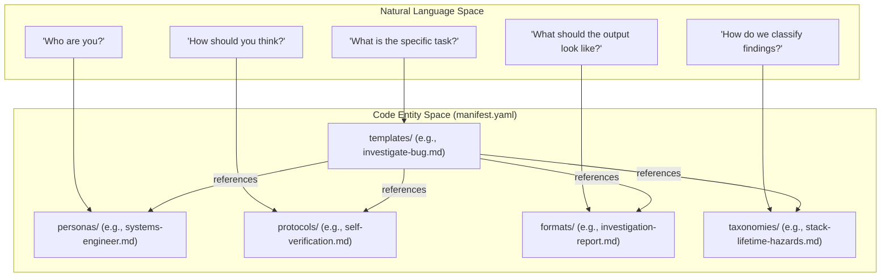
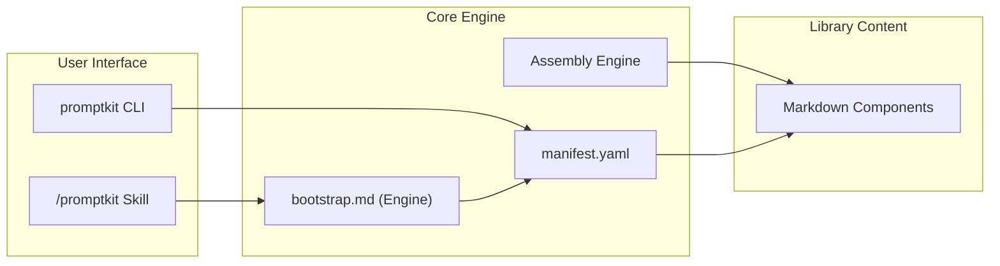

<!-- source: DeepWiki mcp.deepwiki.com · repo microsoft/PromptKit · page 1 PromptKit Overview · fetched 2026-10-26 -->

# PromptKit Overview

Relevant source files

The following files were used as context for generating this wiki page:

- [README.md](README.md)
- [docs/PromptKit-DeepDive.pdf](docs/PromptKit-DeepDive.pdf)
- [docs/PromptKit-DeepDive.pptx](docs/PromptKit-DeepDive.pptx)
- [docs/PromptKit-Intro.pdf](docs/PromptKit-Intro.pdf)
- [docs/PromptKit-Intro.pptx](docs/PromptKit-Intro.pptx)
- [docs/architecture.md](docs/architecture.md)
- [docs/case-studies/investigate-bug.md](docs/case-studies/investigate-bug.md)
- [docs/faq.md](docs/faq.md)
- [docs/getting-started.md](docs/getting-started.md)
- [docs/pipeline-guide.md](docs/pipeline-guide.md)
- [formats/agentic-workflow.md](formats/agentic-workflow.md)
- [formats/copilot-prompt-file.md](formats/copilot-prompt-file.md)
- [manifest.yaml](manifest.yaml)
- [protocols/guardrails/self-verification.md](protocols/guardrails/self-verification.md)

PromptKit is a composable prompt library that treats prompts as engineered software artifacts. It provides a structured framework for building, versioning, and testing prompts used in complex engineering tasks across software, hardware, firmware, and protocol domains [README.md:14-28]().

Instead of ad-hoc, monolithic system prompts, PromptKit decomposes the LLM instruction set into five modular, reusable layers that are snapped together at runtime [docs/architecture.md:6-20](). This approach ensures consistency, enables systematic audits, and allows teams to apply the same engineering rigor to prompts as they do to code [README.md:18-24]().

## The Five-Layer Composition Model

The core of PromptKit's architecture is the decomposition of a prompt into five distinct layers. A **template** acts as the orchestration entity, declaring which components from the other layers should be assembled [docs/architecture.md:8-10]().

| Layer | Entity Space | Role |
| :--- | :--- | :--- |
| **1. Persona** | `personas/` | Defines identity, expertise, and behavioral constraints [docs/architecture.md:33-36](). |
| **2. Protocol** | `protocols/` | Defines reasoning methodologies and guardrails [docs/architecture.md:61-64](). |
| **3. Format** | `formats/` | Defines output document structure and section rules [docs/architecture.md:82-85](). |
| **4. Taxonomy** | `taxonomies/` | Provides domain-specific classification schemes (e.g., hazard levels) [docs/architecture.md:98-102](). |
| **5. Template** | `templates/` | Orchestrates layers and provides task-specific instructions [docs/architecture.md:119-123](). |

**Sources:** [docs/architecture.md:12-20](), [docs/architecture.md:31-146]().

## System Architecture and Registry

PromptKit utilizes a central registry, the `manifest.yaml`, to manage the relationships between components. The assembly engine (CLI) and the bootstrap engine (Interactive) use this manifest to discover available personas, protocols, and templates [manifest.yaml:4-9]().

### From Natural Language to Code Entities

The following diagram illustrates how high-level engineering concepts map to specific code entities and file structures within the PromptKit repository.

**PromptKit Component Mapping**

**Sources:** [manifest.yaml:11-202](), [docs/architecture.md:12-20]().

## Major Subsystems

PromptKit consists of three primary subsystems that bridge the library content with the user's development environment.

### 1. The Assembly Engine (CLI)
The `promptkit` CLI tool (invoked via `npx @alan-jowett/promptkit`) provides commands to `list`, `search`, and `assemble` prompts [README.md:82-99](). The `assemble` command resolves the dependencies declared in a template's YAML frontmatter and produces a single Markdown file [docs/getting-started.md:34-51]().

### 2. The Bootstrap Engine (Interactive Mode)
Interactive mode (`npx promptkit`) auto-detects LLM CLI tools like GitHub Copilot CLI or Claude Code [README.md:67-77](). It uses `bootstrap.md` as a custom instruction to guide the user through template selection and parameter collection within a live session [docs/getting-started.md:57-77]().

### 3. Integration Skills
PromptKit integrates with GitHub via the `.github/skills/` directory, providing slash commands like `/promptkit`, `/boot`, and `/bootstrap` that trigger the bootstrap engine directly within Copilot [README.md:113-119]().

**Subsystem Interaction Diagram**

**Sources:** [README.md:82-120](), [docs/getting-started.md:57-77](), [manifest.yaml:4-9]().

## Engineering Lifecycles

PromptKit supports three primary workflows that cover the end-to-end engineering lifecycle, moving beyond simple one-off prompting:

1.  **Bootstrap (`spec-extraction-workflow`):** Scans a repository to extract structured requirements and design specs from existing code [README.md:59]().
2.  **Evolve (`engineering-workflow`):** Propagates changes through requirements and implementation using adversarial audits [README.md:60]().
3.  **Maintain (`maintenance-workflow`):** Detects and corrects drift between specifications and code [README.md:61]().

For details, see [Pipelines and Lifecycle Workflows](#1.3).

---

## Child Pages
- [Getting Started](#1.1) — Installation, CLI usage, and your first assembled prompt.
- [Core Concepts and Architecture](#1.2) — Deep dive into the five-layer model and manifest-driven assembly.
- [Pipelines and Lifecycle Workflows](#1.3) — Chaining templates and managing the engineering lifecycle.

**Sources:** [README.md:32-65](), [docs/getting-started.md:1-139](), [docs/architecture.md:1-202]().

---

