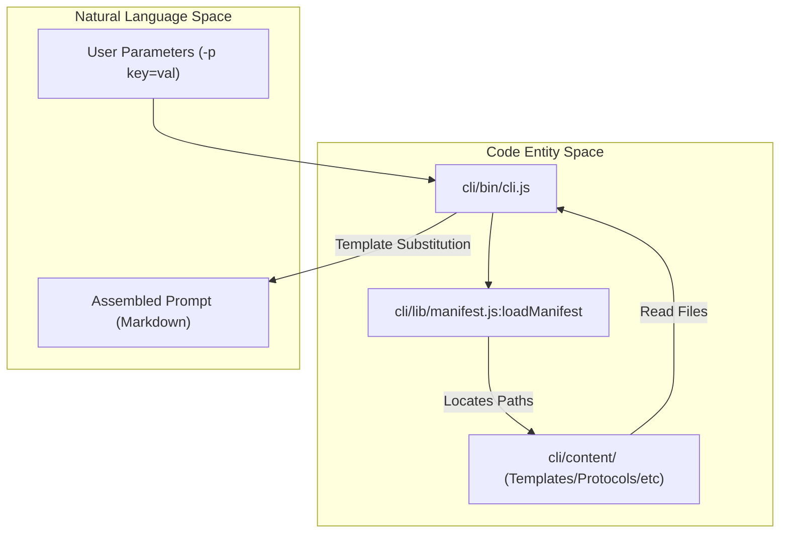
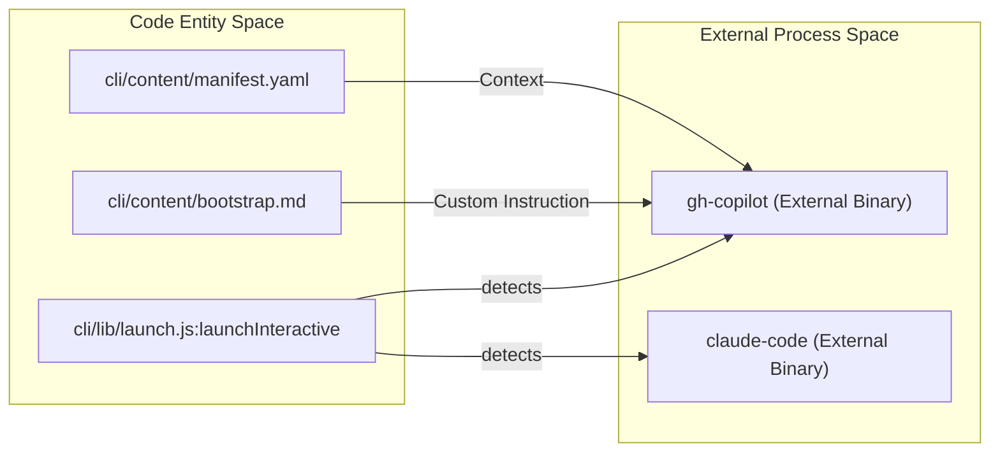

<!-- source: DeepWiki mcp.deepwiki.com · repo microsoft/PromptKit · page 1.1 Getting Started · fetched 2026-10-26 -->

# Getting Started

<details>
<summary>Relevant source files</summary>

The following files were used as context for generating this wiki page:

- [README.md](README.md)
- [cli/bin/cli.js](cli/bin/cli.js)
- [cli/package.json](cli/package.json)
- [docs/PromptKit-DeepDive.pdf](docs/PromptKit-DeepDive.pdf)
- [docs/PromptKit-DeepDive.pptx](docs/PromptKit-DeepDive.pptx)
- [docs/PromptKit-Intro.pdf](docs/PromptKit-Intro.pdf)
- [docs/PromptKit-Intro.pptx](docs/PromptKit-Intro.pptx)
- [docs/case-studies/investigate-bug.md](docs/case-studies/investigate-bug.md)
- [docs/faq.md](docs/faq.md)
- [docs/getting-started.md](docs/getting-started.md)
- [docs/pipeline-guide.md](docs/pipeline-guide.md)

</details>


PromptKit is a composable prompt library that treats prompts as engineered software components. It provides a structured framework for assembling task-specific prompts from reusable **Personas**, **Reasoning Protocols**, **Output Formats**, and **Task Templates**. This guide covers the installation and initial usage of the PromptKit CLI to help you go from zero to your first assembled prompt in under five minutes.

## Prerequisites

To use PromptKit, ensure your environment meets the following requirements:

*   **Node.js 18+**: Required for the `npx` CLI and the core assembly engine [cli/package.json:29-31]().
*   **LLM CLI (Optional for Interactive Mode)**: To use the automated `interactive` mode, you need one of the following installed and authenticated:
    *   **GitHub Copilot CLI**: Requires `gh auth login` and `gh extension install github/gh-copilot` [README.md:74-74]().
    *   **Claude Code**: Anthropic's CLI tool [README.md:75-75]().
    *   **OpenAI Codex CLI**: [README.md:76-76]().

Sources: [README.md:67-78](), [cli/package.json:29-31]()

---

## Installation and Basic Commands

PromptKit is designed to be run without a permanent local installation via `npx`. This ensures you are always using the latest components and the most recent version of the assembly logic.

### 1. List Available Components
The `list` command allows you to browse the library. By default, it shows available templates.
```bash
# List all task templates
npx @alan-jowett/promptkit list

# List all component types (Personas, Protocols, Formats, etc.)
npx @alan-jowett/promptkit list --all
```
The CLI uses the `loadManifest` function to read `manifest.yaml`, which serves as the central registry for all library components [cli/bin/cli.js:99-113]().

### 2. Search for Specific Tasks
If you are looking for a specific domain (e.g., "memory safety" or "security"), use the `search` command.
```bash
npx @alan-jowett/promptkit search "memory safety"
```
This command matches the keyword against both the component names and their descriptions [cli/bin/cli.js:157-193]().

### 3. Inspect a Component
To see the dependencies and metadata (such as which persona or protocols a template uses), use the `show` command.
```bash
npx @alan-jowett/promptkit show review-cpp-code
```

Sources: [README.md:82-99](), [cli/bin/cli.js:86-214](), [docs/getting-started.md:25-33]()

---

## Assembling Your First Prompt

Assembly is the process of resolving a template's dependencies and injecting user parameters into a single Markdown file.

### Step-by-Step Assembly
Use the `assemble` command followed by the template name and its required parameters (`-p key=value`).

```bash
npx @alan-jowett/promptkit assemble investigate-bug \
  -p problem_description="Segfault when parsing untrusted input on Linux" \
  -p code_context="See src/parser.c lines 120-180" \
  -p environment="Ubuntu 22.04, gcc 12, AddressSanitizer enabled" \
  -o bug-investigation.md
```

### The Assembly Data Flow
When you run `assemble`, the CLI performs the following operations:
1.  **Resolution**: It looks up the template in `manifest.yaml`.
2.  **Composition**: It fetches the linked **Persona** (Identity), **Protocols** (Reasoning rules), and **Output Format** (Structure).
3.  **Injection**: It replaces placeholders (e.g., `{{problem_description}}`) in the template body with your provided values.
4.  **Serialization**: It concatenates these layers into a single Markdown file separated by horizontal rules [docs/getting-started.md:78-83]().

### Data Flow Diagram: From CLI to Assembled File

This diagram illustrates how the `cli.js` interacts with the `manifest.js` logic to produce a final prompt.

| Component | Code Entity | Role |
| :--- | :--- | :--- |
| **CLI Entry** | `cli/bin/cli.js` | Parses arguments and routes to commands. |
| **Manifest Loader** | `loadManifest` | Reads `manifest.yaml` to locate file paths. |
| **Assembly Engine** | `assemble` (logic) | Merges Persona, Protocol, Format, and Template. |
| **Output** | `*.md` | The final engineered prompt. |

**Assembly Pipeline Diagram**


Sources: [docs/getting-started.md:34-55](), [cli/bin/cli.js:18-36](), [cli/lib/manifest.js:11-16]()

---

## Interactive Mode

Interactive mode is the recommended way to use PromptKit for complex engineering workflows. It uses a "Bootstrap Engine" to guide you through a session.

### Launching the Session
```bash
npx @alan-jowett/promptkit
```

### How it Works
1.  **Detection**: The CLI calls `launchInteractive` in `cli/lib/launch.js` to detect available LLM binaries (e.g., `gh`, `claude`) [cli/bin/cli.js:82]().
2.  **Staging**: It creates a temporary directory and copies the library content (personas, protocols, etc.) into it using `copy-content.js` [cli/bin/cli.js:20-22]().
3.  **Bootstrapping**: It spawns the LLM CLI and passes `bootstrap.md` as the initial instruction.
4.  **Interaction**: The LLM reads `manifest.yaml` and presents you with options. You describe your goal, and the LLM recommends the best template and collects parameters interactively [docs/getting-started.md:57-77]().

### Interactive Mode System Bridge

This diagram shows how the CLI bridges the local filesystem components to a live LLM process.

**CLI to LLM Bridge Diagram**


Sources: [README.md:121-128](), [cli/lib/launch.js:8-8](), [cli/bin/cli.js:53-83](), [docs/getting-started.md:57-77]()

---

## FAQ & Quick Start Scenarios

### Common Templates for New Users

| Task | Template Name | Recommended Persona |
| :--- | :--- | :--- |
| **Bug Investigation** | `investigate-bug` | `systems-engineer` |
| **Code Review** | `review-code` | `systems-engineer` |
| **Security Audit** | `investigate-security` | `security-auditor` |
| **System Design** | `author-design-doc` | `software-architect` |
| **Requirements** | `author-requirements-doc` | `software-architect` |

### Frequently Asked Questions
*   **Do I need a specific LLM?** No. While interactive mode uses specific CLIs, the `assemble` command produces standard Markdown that works in ChatGPT, Claude, Gemini, or Copilot Chat [docs/faq.md:20-24]().
*   **Is PromptKit an AI Agent?** No. It is a prompt library and template engine. It does not call LLMs autonomously; it produces the text you use to drive the LLM [docs/faq.md:35-41]().
*   **Can I use it in CI/CD?** Yes. Use the `assemble` command to generate prompts for automated code reviews or release note generation [docs/faq.md:121-133]().

Sources: [docs/getting-started.md:88-103](), [docs/faq.md:1-54]()

---

