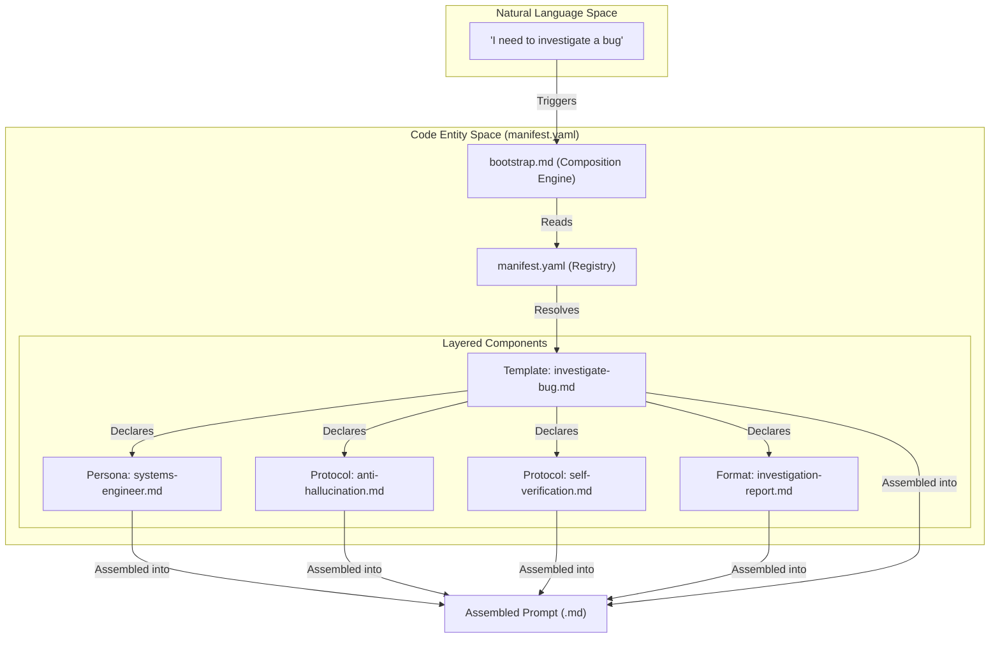
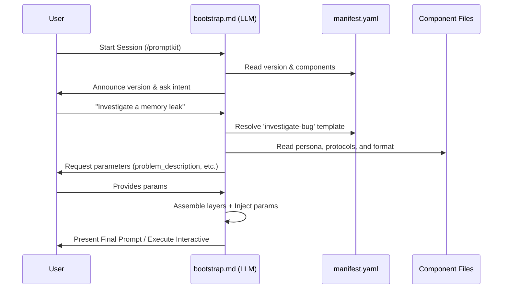

<!-- source: DeepWiki mcp.deepwiki.com · repo microsoft/PromptKit · page 1.2 Core Concepts and Architecture · fetched 2026-10-26 -->

# Core Concepts and Architecture

Relevant source files

The following files were used as context for generating this wiki page:

- [README.md](README.md)
- [bootstrap.md](bootstrap.md)
- [docs/architecture.md](docs/architecture.md)
- [docs/faq.md](docs/faq.md)
- [docs/getting-started.md](docs/getting-started.md)
- [formats/agentic-workflow.md](formats/agentic-workflow.md)
- [formats/copilot-prompt-file.md](formats/copilot-prompt-file.md)
- [formats/investigation-report.md](formats/investigation-report.md)
- [manifest.yaml](manifest.yaml)
- [protocols/guardrails/anti-hallucination.md](protocols/guardrails/anti-hallucination.md)
- [protocols/guardrails/operational-constraints.md](protocols/guardrails/operational-constraints.md)
- [protocols/guardrails/self-verification.md](protocols/guardrails/self-verification.md)
- [protocols/reasoning/root-cause-analysis.md](protocols/reasoning/root-cause-analysis.md)
- [templates/investigate-bug.md](templates/investigate-bug.md)
- [templates/investigate-trace.md](templates/investigate-trace.md)

This page provides a deep dive into the technical architecture of PromptKit. It explains the five-layer composition model, the manifest-driven registry, the bootstrap engine, and the assembly pipeline that transforms modular components into task-specific prompts.

## The Five-Layer Composition Model

PromptKit treats prompts as engineered artifacts by decomposing them into five composable layers. This modularity allows for independent versioning, testing, and reuse across different engineering domains.

| Layer | Component Type | Responsibility |
| :--- | :--- | :--- |
| **1. Identity** | `Persona` | Defines the role, tone, and domain expertise (e.g., `systems-engineer`). |
| **2. Reasoning** | `Protocol` | Enforces systematic thinking and guardrails (e.g., `anti-hallucination`, `root-cause-analysis`). |
| **3. Output** | `Format` | Defines the structure and schema of the result (e.g., `investigation-report`). |
| **4. Taxonomy** | `Taxonomy` | Provides a shared vocabulary for classifying findings (e.g., `stack-lifetime-hazards`). |
| **5. Task** | `Template` | The specific instruction set that binds the other layers together with user parameters. |

**Sources:** [README.md:18-30](), [docs/getting-started.md:78-86](), [docs/faq.md:12-18]()

---

## Architecture: Natural Language to Code Entity Space

The following diagram illustrates how the abstract concept of a "prompt" is realized through specific code entities and files within the PromptKit repository.

### Component Snap-Together Architecture

**Sources:** [manifest.yaml:5-117](), [bootstrap.md:12-27](), [templates/investigate-bug.md:10-18]()

---

## The Manifest-Driven Registry

The `manifest.yaml` file serves as the central registry for the entire library. It indexes every component, providing the bootstrap engine with the metadata necessary to discover and resolve dependencies.

### Key Manifest Functions
- **Discovery**: Lists all available personas, protocols, formats, and templates [manifest.yaml:11-118]().
- **Resolution**: Maps short names (e.g., `systems-engineer`) to physical file paths (e.g., `personas/systems-engineer.md`) [manifest.yaml:12-13]().
- **Versioning**: Stores the current library version, which is emitted by the bootstrap engine upon initialization [manifest.yaml:9](), [bootstrap.md:31-40]().

---

## The Bootstrap Engine

The `bootstrap.md` file is the meta-prompt entry point. It transforms a standard LLM session into a **composition engine** capable of building other prompts.

### Assembly Pipeline Flow
The engine follows a structured lifecycle to move from user intent to a final artifact:

**Sources:** [bootstrap.md:21-64](), [bootstrap.md:140-142]()

### Execution Modes
The engine supports two primary execution modes defined in the template frontmatter:
1.  **Single-shot**: Assembles a Markdown file (raw prompt, agent instructions, or workflow) for use in a separate session [bootstrap.md:65-135]().
2.  **Interactive**: Loads the components and executes the task directly within the current session, guiding the user through phases [bootstrap.md:54-64]().

---

## Component Deep Dive

### Protocols: The Reasoning Engine
Protocols like `self-verification` and `anti-hallucination` provide the "how" of the reasoning process.
- **`anti-hallucination`**: Enforces epistemic labeling (`KNOWN`, `INFERRED`, `ASSUMED`) to ensure grounding in source text [protocols/guardrails/anti-hallucination.md:21-30]().
- **`self-verification`**: Acts as a quality gate, requiring the LLM to perform sampling checks and internal consistency audits before finalizing output [protocols/guardrails/self-verification.md:14-25]().
- **`operational-constraints`**: Manages context window limits and tool usage discipline (e.g., "Scope Before You Search") [protocols/guardrails/operational-constraints.md:24-31]().

### Formats: Structural Contracts
Formats like `investigation-report` define strict schemas. They often include logic for **Abbreviated** vs. **Full** versions based on finding severity or count [formats/investigation-report.md:15-29]().

### Templates: The Assembly Logic
Templates (e.g., `investigate-bug.md`) use YAML frontmatter to declare their "bill of materials" and `{{parameter}}` syntax to define their input surface [templates/investigate-bug.md:4-29]().

**Sources:** [templates/investigate-bug.md:31-46](), [protocols/guardrails/self-verification.md:27-47](), [formats/investigation-report.md:103-163]()

---

