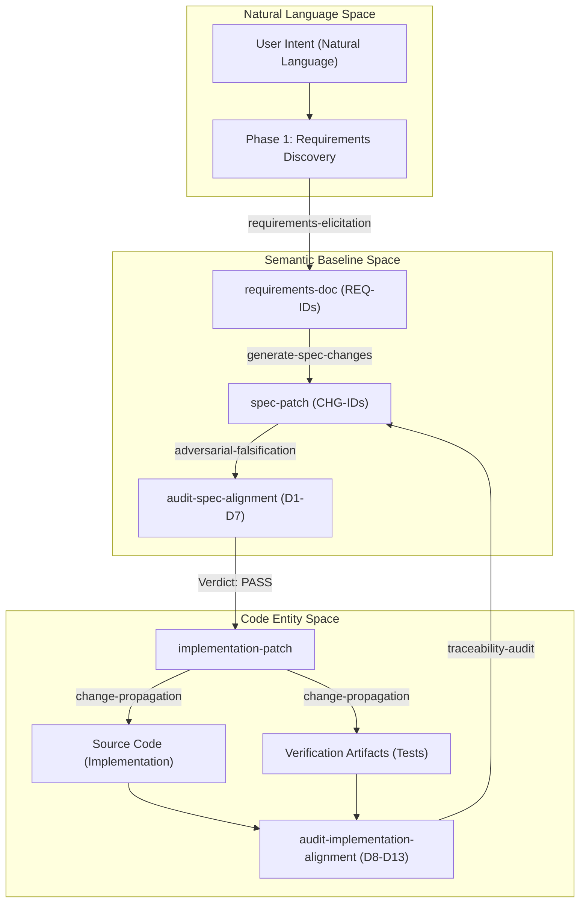
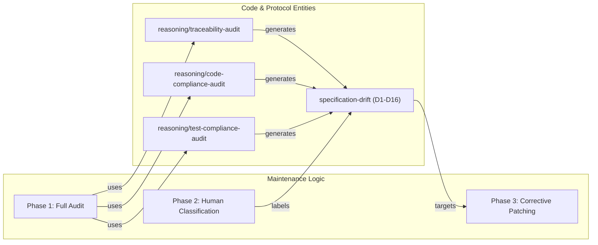

<!-- source: DeepWiki mcp.deepwiki.com · repo microsoft/PromptKit · page 1.3 Pipelines and Lifecycle Workflows · fetched 2026-10-26 -->

# Pipelines and Lifecycle Workflows

Relevant source files

The following files were used as context for generating this wiki page:

- [LICENSE](LICENSE)
- [PromptKit-logo.png](PromptKit-logo.png)
- [formats/design-doc.md](formats/design-doc.md)
- [formats/pipeline-spec.md](formats/pipeline-spec.md)
- [formats/requirements-doc.md](formats/requirements-doc.md)
- [manifest.yaml](manifest.yaml)
- [protocols/guardrails/self-verification.md](protocols/guardrails/self-verification.md)
- [templates/audit-implementation-alignment.md](templates/audit-implementation-alignment.md)
- [templates/audit-spec-alignment.md](templates/audit-spec-alignment.md)
- [templates/author-pipeline.md](templates/author-pipeline.md)
- [templates/author-requirements-doc.md](templates/author-requirements-doc.md)
- [templates/author-validation-plan.md](templates/author-validation-plan.md)
- [templates/engineering-workflow.md](templates/engineering-workflow.md)
- [templates/generate-implementation-changes.md](templates/generate-implementation-changes.md)
- [templates/generate-spec-changes.md](templates/generate-spec-changes.md)
- [templates/maintenance-workflow.md](templates/maintenance-workflow.md)
- [templates/spec-extraction-workflow.md](templates/spec-extraction-workflow.md)
- [templates/triage-issues.md](templates/triage-issues.md)

This page details the multi-stage execution pipelines in PromptKit. It explains how individual templates are chained together using input/output contracts to form comprehensive engineering workflows. PromptKit moves beyond single-turn prompting by enforcing a structured progression from requirements to implementation, with adversarial audits gating each transition.

## Core Pipeline Architecture

Pipelines in PromptKit are constructed by linking templates where the `output_contract` of one stage satisfies the `input_contract` of the next [templates/engineering-workflow.md:35-41](). This chaining is governed by the `change-propagation` protocol, which ensures that every modification in a downstream artifact (like code) is traceable to an upstream modification (like a requirement) [templates/generate-implementation-changes.md:41-43]().

### Data Flow and Contract Types

| Contract Type | Primary Producing Template | Consuming Template(s) |
| :--- | :--- | :--- |
| `requirements-patch` | `engineering-workflow` (Phase 1) | `generate-spec-changes` |
| `spec-patch` | `generate-spec-changes` | `generate-implementation-changes`, `audit-implementation-alignment` |
| `implementation-patch` | `generate-implementation-changes` | `audit-implementation-alignment` |
| `investigation-report` | `audit-spec-alignment` | `engineering-workflow` (Verdict Gate) |

**Sources:** [templates/engineering-workflow.md:35-41](), [templates/generate-spec-changes.md:29-33](), [templates/generate-implementation-changes.md:31-36](), [templates/audit-implementation-alignment.md:32-37]().

---

## The Engineering Workflow Pipeline

The `engineering-workflow` is the primary pipeline for incremental development. It implements a dual-loop system: the **Specification Loop** (Phases 1-4) and the **Implementation Loop** (Phases 5-8) [templates/engineering-workflow.md:44-87]().

### Pipeline Progression and Gating

The pipeline uses an "Adversarial Audit" pattern to prevent semantic drift. A `specification-analyst` persona [manifest.yaml:51-56]() performs a blind audit of changes against the user's original intent, issuing a `Verdict` (PASS, REVISE, or RESTART) that determines if the pipeline can proceed [templates/audit-spec-alignment.md:134-141]().

### Logic Flow: Natural Language to Code Entity Space

The following diagram illustrates how natural language intent is transformed into verifiable code entities through the pipeline stages.

**Sources:** [templates/engineering-workflow.md:71-87](), [templates/audit-spec-alignment.md:124-141](), [templates/generate-implementation-changes.md:63-107](), [templates/audit-implementation-alignment.md:124-135]().

---

## The Spec-Extraction Workflow

For legacy or undocumented repositories, the `spec-extraction-workflow` provides a "bottom-up" pipeline. It uses the `reverse-engineer` persona [manifest.yaml:44-49]() to derive a semantic baseline from existing code [templates/spec-extraction-workflow.md:46-51]().

### Workflow Phases
1.  **Repository Scan:** Uses tools to build a directory tree and identify entry points [templates/spec-extraction-workflow.md:93-122]().
2.  **Draft Extraction:** Applies the `requirements-from-implementation` protocol to synthesize REQ-IDs from code behavior [templates/spec-extraction-workflow.md:142-151]().
3.  **Human Clarification:** An interactive loop to resolve `[UNKNOWN]` or `[ASSUMPTION]` markers [templates/spec-extraction-workflow.md:152-157]().
4.  **Consistency Audit:** Final adversarial check for internal alignment before creating the baseline [templates/spec-extraction-workflow.md:84]().

**Sources:** [templates/spec-extraction-workflow.md:77-89](), [manifest.yaml:44-49]().

---

## The Maintenance Workflow

The `maintenance-workflow` completes the lifecycle triad. It is designed for periodic health checks to detect drift between the semantic baseline and the evolving implementation [templates/maintenance-workflow.md:7-13]().

### Drift Detection Pipeline
The maintenance pipeline applies three systematic audits:
*   **Document-Level (D1–D7):** Checks forward/backward traceability between requirements, design, and validation plans [templates/maintenance-workflow.md:108-121]().
*   **Code-Level (D8–D10):** Uses `code-compliance-audit` to ensure every requirement is implemented and no undocumented behaviors exist [templates/maintenance-workflow.md:122-132]().
*   **Test-Level (D11–D13):** Uses `test-compliance-audit` to verify test case coverage and assertion accuracy [templates/maintenance-workflow.md:136-146]().

### Maintenance Pipeline Mapping

This diagram shows the relationship between the Maintenance Workflow logic and the specific audit protocols and taxonomies.

**Sources:** [templates/maintenance-workflow.md:96-146](), [templates/maintenance-workflow.md:174-192](), [manifest.yaml:118-175]().

---

## Hardware and Specialized Lifecycles

PromptKit extends these pipelines into hardware engineering through specialized personas and templates.

### Hardware Lifecycle Pipeline
The hardware workflow mirrors the engineering workflow but swaps software-specific protocols for hardware equivalents:
*   **Persona:** `electrical-engineer`, `mechanical-engineer`, or `rf-engineer` [manifest.yaml:87-108]().
*   **Artifacts:** Schematics, BOM (Bill of Materials), and PCB layouts [manifest.yaml:91-92]().
*   **Verification:** Simulation reports and manufacturing artifact audits [templates/generate-implementation-changes.md:8-10]().

### Protocol Engineering Pipeline
Focused on the evolution of communication protocols, this pipeline uses the `protocol-architect` persona [manifest.yaml:110-117]() to manage state machines and message formats. It relies heavily on the `change-propagation` protocol to ensure backward compatibility during updates [templates/generate-spec-changes.md:60-62]().

**Sources:** [manifest.yaml:87-117](), [templates/generate-implementation-changes.md:8-10](), [templates/engineering-workflow.md:11-12]().

---

