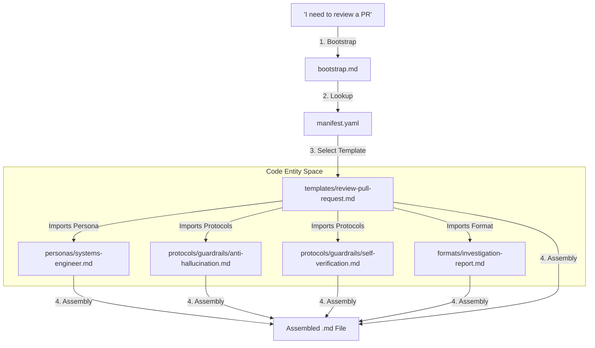
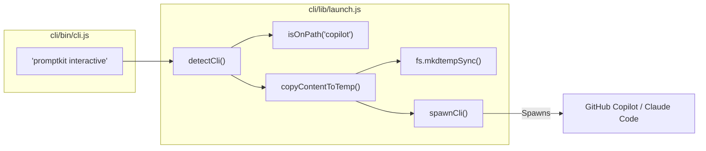

<!-- source: DeepWiki mcp.deepwiki.com · repo microsoft/PromptKit · page 10 Glossary · fetched 2026-10-26 -->

# Glossary

Relevant source files

The following files were used as context for generating this wiki page:

- [.github/skills/respond-to-pr-comments/SKILL.md](.github/skills/respond-to-pr-comments/SKILL.md)
- [CATALOG.md](CATALOG.md)
- [README.md](README.md)
- [bootstrap.md](bootstrap.md)
- [cli/lib/launch.js](cli/lib/launch.js)
- [cli/tests/launch.test.js](cli/tests/launch.test.js)
- [docs/examples.md](docs/examples.md)
- [docs/faq.md](docs/faq.md)
- [docs/getting-started.md](docs/getting-started.md)
- [docs/scenarios.md](docs/scenarios.md)
- [formats/agent-instructions.md](formats/agent-instructions.md)
- [formats/decision-log.md](formats/decision-log.md)
- [formats/investigation-report.md](formats/investigation-report.md)
- [formats/pr-comment-responses.md](formats/pr-comment-responses.md)
- [manifest.yaml](manifest.yaml)
- [protocols/analysis/prompt-determinism-analysis.md](protocols/analysis/prompt-determinism-analysis.md)
- [protocols/guardrails/adversarial-falsification.md](protocols/guardrails/adversarial-falsification.md)
- [protocols/guardrails/anti-hallucination.md](protocols/guardrails/anti-hallucination.md)
- [protocols/guardrails/definition-of-done.md](protocols/guardrails/definition-of-done.md)
- [protocols/guardrails/human-voice-fidelity.md](protocols/guardrails/human-voice-fidelity.md)
- [protocols/guardrails/input-clarity-gate.md](protocols/guardrails/input-clarity-gate.md)
- [protocols/guardrails/operational-constraints.md](protocols/guardrails/operational-constraints.md)
- [protocols/guardrails/self-verification.md](protocols/guardrails/self-verification.md)
- [protocols/guardrails/tool-reliability-defense.md](protocols/guardrails/tool-reliability-defense.md)
- [protocols/reasoning/corpus-safety-audit.md](protocols/reasoning/corpus-safety-audit.md)
- [protocols/reasoning/integration-audit.md](protocols/reasoning/integration-audit.md)
- [protocols/reasoning/requirements-elicitation.md](protocols/reasoning/requirements-elicitation.md)
- [protocols/reasoning/root-cause-analysis.md](protocols/reasoning/root-cause-analysis.md)
- [protocols/reasoning/test-compliance-audit.md](protocols/reasoning/test-compliance-audit.md)
- [taxonomies/specification-drift.md](taxonomies/specification-drift.md)
- [templates/audit-code-compliance.md](templates/audit-code-compliance.md)
- [templates/audit-integration-compliance.md](templates/audit-integration-compliance.md)
- [templates/audit-library-health.md](templates/audit-library-health.md)
- [templates/audit-test-compliance.md](templates/audit-test-compliance.md)
- [templates/author-agent-instructions.md](templates/author-agent-instructions.md)
- [templates/author-known-conditions-registry.md](templates/author-known-conditions-registry.md)
- [templates/investigate-bug.md](templates/investigate-bug.md)
- [templates/investigate-trace.md](templates/investigate-trace.md)
- [templates/lint-prompt.md](templates/lint-prompt.md)
- [templates/respond-to-pr-comments.md](templates/respond-to-pr-comments.md)
- [templates/review-pull-request.md](templates/review-pull-request.md)
- [tests/self-audit-prompt.md](tests/self-audit-prompt.md)

This page provides technical definitions for terms, abbreviations, and domain concepts specific to the PromptKit codebase. It serves as a reference for engineers to understand the implementation details of the five-layer composition model and the underlying CLI and integration mechanics.

## Core Architecture Concepts

### 1. Component Layers
PromptKit utilizes a five-layer model to construct prompts. These are indexed in `manifest.yaml` [manifest.yaml:5-118]() and assembled by the `bootstrap` engine [bootstrap.md:21-25]().

| Layer | Code Entity / Directory | Description |
| :--- | :--- | :--- |
| **Persona** | `personas/` | Defines the identity, expertise, and behavioral constraints of the LLM (e.g., `systems-engineer`) [manifest.yaml:11-13](). |
| **Protocol** | `protocols/` | Systematic reasoning steps or guardrails (e.g., `anti-hallucination`, `root-cause-analysis`) [manifest.yaml:118-124](). |
| **Format** | `formats/` | Structural schemas for the output (e.g., `investigation-report`) [manifest.yaml:831-833](). |
| **Taxonomy** | `taxonomies/` | Classification systems for findings (e.g., `specification-drift`) [manifest.yaml:875-877](). |
| **Template** | `templates/` | The task-specific logic that binds parameters to the other four layers [manifest.yaml:1044-1046](). |

### 2. Manifest
The `manifest.yaml` is the central registry of the library. It is used by the CLI and the `bootstrap.md` meta-prompt to discover components, their paths, and their metadata [manifest.yaml:1-9]().

### 3. Bootstrap Engine
The meta-prompt defined in `bootstrap.md`. It acts as a "composition engine" that reads the manifest, interacts with the user to collect parameters, and performs the final assembly of the prompt [bootstrap.md:12-25]().

**Sources:** `manifest.yaml`, `bootstrap.md`

---

## Technical Terms & Jargon

### Agent Instruction File
A persistent configuration file (e.g., `.instructions.md`, `CLAUDE.md`, `.cursorrules`) that encodes PromptKit personas and protocols for automatic loading by an IDE or agent runtime [bootstrap.md:69-84](). Unlike a "Single-shot" prompt, these are standing instructions [formats/agent-instructions.md:18-30]().

### Agentic Workflow
An output mode that produces `.github/workflows/*.md` files. These are designed to be compiled into GitHub Actions workflows that run LLM-based automation [bootstrap.md:108-118]().

### Assembly
The process of concatenating a Persona, multiple Protocols, an Output Format, and a filled Template into a single Markdown file. This is handled by the CLI's `assemble` command [docs/getting-started.md:34-52]() or the `bootstrap.md` engine [bootstrap.md:21-25]().

### Epistemic Labeling
A requirement in the `anti-hallucination` protocol where every claim must be tagged as `[KNOWN]`, `[INFERRED]`, or `[ASSUMPTION]` to prevent fabrication [protocols/guardrails/anti-hallucination.md](). It is enforced by the `self-verification` protocol [protocols/guardrails/self-verification.md:50-56]().

### Interactive Mode
A state where the template `mode` is set to `interactive` [bootstrap.md:54-64](). Instead of generating a file, the LLM executes the template's logic directly within the current session, typically involving multi-phase reasoning or clarification gates [bootstrap.md:54-64]().

**Sources:** `bootstrap.md`, `formats/agent-instructions.md`, `docs/getting-started.md`, `protocols/guardrails/self-verification.md`

---

## CLI and Integration Components

### LLM CLI Detection
The CLI logic in `cli/lib/launch.js` that scans the system `PATH` for supported binaries like `copilot`, `gh`, `claude`, or `codex` [cli/lib/launch.js:79-94]().

### Staging Directory
A temporary directory created by `copyContentToTemp` where the library content is mirrored before launching an LLM session. This allows the LLM to access the full library via the `--add-dir` flag [cli/lib/launch.js:96-100]().

### Prompt Mapping (Natural Language to Code)

The following diagram illustrates how user intent in "Natural Language Space" is mapped to specific code entities within the PromptKit "Code Space".

**Intent to Component Mapping**

**CLI Execution Flow**

**Sources:** `cli/lib/launch.js`, `bootstrap.md`, `templates/review-pull-request.md`

---

## Domain Concepts

### 1. Investigation Formats
The `investigation-report` format provides two modes based on finding severity:
*   **Abbreviated Format**: Used when there are $\le$ 5 findings and no High/Critical severity issues [formats/investigation-report.md:36-43]().
*   **Full Format**: A 9-section structure required for complex root cause analysis or high-severity findings [formats/investigation-report.md:88-102]().

### 2. Confidence Framework
A three-level scale (High, Medium, Low) used in reports to quantify the certainty of a finding based on the evidence provided (e.g., code inspection vs. circumstantial logs) [formats/investigation-report.md:174-180]().

### 3. Operational Constraints
A set of rules (e.g., the "Two-Failures Rule") that prevents the LLM from entering infinite loops or over-ingesting data. It requires a mandatory `Coverage` statement in every analysis [protocols/guardrails/operational-constraints.md:123-148]().

**Sources:** `formats/investigation-report.md`, `protocols/guardrails/operational-constraints.md`