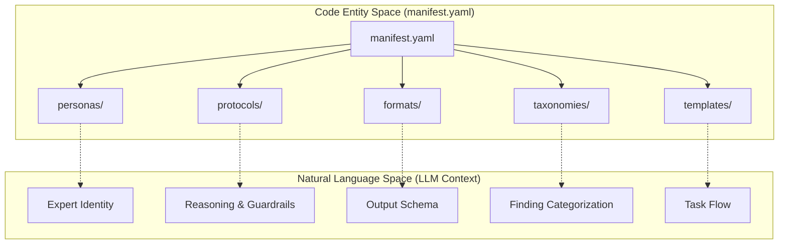
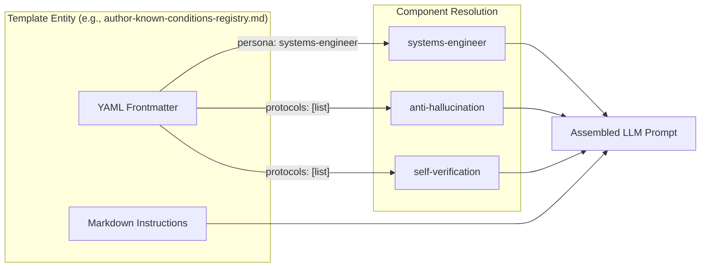

<!-- source: DeepWiki mcp.deepwiki.com · repo microsoft/PromptKit · page 2 Component Library Reference · fetched 2026-10-26 -->

# Component Library Reference

Relevant source files

The following files were used as context for generating this wiki page:

- [CATALOG.md](CATALOG.md)
- [manifest.yaml](manifest.yaml)
- [protocols/guardrails/adversarial-falsification.md](protocols/guardrails/adversarial-falsification.md)
- [protocols/guardrails/definition-of-done.md](protocols/guardrails/definition-of-done.md)
- [protocols/guardrails/input-clarity-gate.md](protocols/guardrails/input-clarity-gate.md)
- [protocols/guardrails/self-verification.md](protocols/guardrails/self-verification.md)
- [protocols/guardrails/tool-reliability-defense.md](protocols/guardrails/tool-reliability-defense.md)
- [templates/author-known-conditions-registry.md](templates/author-known-conditions-registry.md)

The PromptKit library is a structured repository of engineering expertise, reasoning frameworks, and data schemas. These components are organized into five functional layers that are composed at runtime to create high-fidelity prompts for Large Language Models (LLMs). By decoupling identity (Personas), behavior (Protocols), structure (Formats), classification (Taxonomies), and orchestration (Templates), PromptKit enables a modular approach to semantic engineering. [manifest.yaml:5-7]()

### Library Composition Model

The library is indexed via a central `manifest.yaml` [manifest.yaml:1-9]() and categorized in the `CATALOG.md` [CATALOG.md:4-17](). The following diagram illustrates how these entities relate within the codebase and the logical "Natural Language Space."

**System Component Relationship**

**Sources:** [manifest.yaml:11-170](), [CATALOG.md:8-17]()

---

## Personas
Personas define the **Expert Identity** of the LLM. They establish the domain expertise, professional tone, and specific behavioral constraints required for a task. PromptKit includes 15 specialized personas covering the full engineering lifecycle, from `systems-engineer` and `security-auditor` to `electrical-engineer` and `rf-engineer`. [manifest.yaml:11-117]()

For details, see [Personas](#2.1).

**Sources:** [manifest.yaml:11-117]()

---

## Protocols
Protocols define the **Reasoning and Guardrails** that govern how the LLM processes information. Unlike Personas, which focus on *who* the agent is, Protocols focus on *how* the agent thinks and acts. These are divided into three categories:

*   **Guardrails**: Cross-cutting safety and quality gates (e.g., `anti-hallucination`, `self-verification`). [manifest.yaml:119-167]()
*   **Analysis**: Domain-specific inspection logic (e.g., `memory-safety`, `thread-safety`). [CATALOG.md:13-13]()
*   **Reasoning**: Systematic problem-solving frameworks (e.g., `root-cause-analysis`, `traceability-audit`). [CATALOG.md:13-13]()

For details, see [Protocols](#2.2).

**Sources:** [manifest.yaml:118-170](), [CATALOG.md:13-13](), [protocols/guardrails/self-verification.md:14-18]()

---

## Output Formats
Output Formats define the **Structure** of the LLM's response. PromptKit provides 27 schemas to ensure that LLM outputs are machine-readable or professionally formatted for human consumption. Examples include `investigation-report`, `structured-patch`, and `requirements-doc`. [CATALOG.md:14-14]()

The library often uses an abbreviated vs. full format selection logic to manage context window efficiency. [CATALOG.md:14-14]()

For details, see [Output Formats](#2.3).

**Sources:** [CATALOG.md:14-14](), [manifest.yaml:172-245]()

---

## Taxonomies
Taxonomies provide the **Classification Schemes** used to label findings and data. They ensure consistency across different LLM sessions and different agents. Key taxonomies include the CWE (Common Weakness Enumeration) domain mappings, `specification-drift` categories (D1–D16), and `kernel-defect-categories`. [CATALOG.md:15-15]()

For details, see [Taxonomies](#2.4).

**Sources:** [CATALOG.md:15-15](), [manifest.yaml:247-285]()

---

## Templates
Templates are the **Orchestration** layer. They are YAML-frontmatter-driven files that select a Persona, a set of Protocols, and a Format to execute a specific task (e.g., `review-code`, `author-design-doc`). [CATALOG.md:16-16]()

**Template Orchestration Flow**

**Sources:** [templates/author-known-conditions-registry.md:4-26](), [CATALOG.md:18-39]()

For details, see [Templates Catalog](#3).

---

