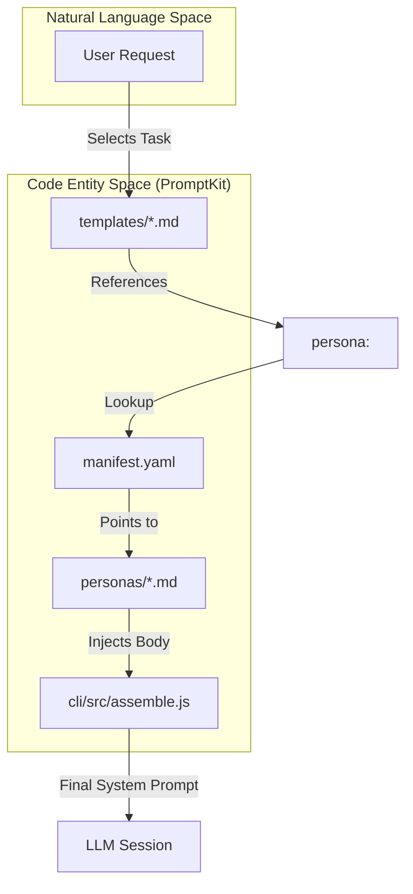
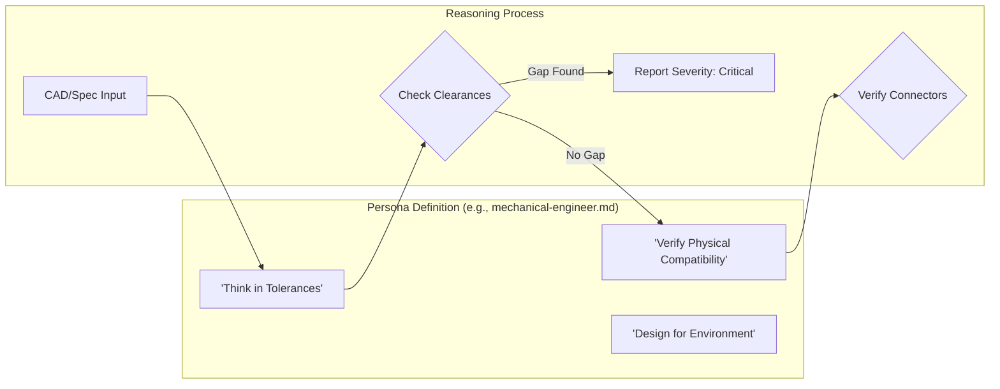

<!-- source: DeepWiki mcp.deepwiki.com · repo microsoft/PromptKit · page 2.1 Personas · fetched 2026-10-26 -->

# Personas

Relevant source files

The following files were used as context for generating this wiki page:

- [CATALOG.md](CATALOG.md)
- [docs/case-studies/reverse-engineer-requirements.md](docs/case-studies/reverse-engineer-requirements.md)
- [personas/devops-engineer.md](personas/devops-engineer.md)
- [personas/electrical-engineer.md](personas/electrical-engineer.md)
- [personas/embedded-firmware-engineer.md](personas/embedded-firmware-engineer.md)
- [personas/implementation-engineer.md](personas/implementation-engineer.md)
- [personas/mechanical-engineer.md](personas/mechanical-engineer.md)
- [personas/reverse-engineer.md](personas/reverse-engineer.md)
- [personas/rf-engineer.md](personas/rf-engineer.md)
- [personas/security-auditor.md](personas/security-auditor.md)
- [personas/software-architect.md](personas/software-architect.md)
- [personas/test-engineer.md](personas/test-engineer.md)
- [personas/workflow-arbiter.md](personas/workflow-arbiter.md)
- [protocols/analysis/enclosure-design-review.md](protocols/analysis/enclosure-design-review.md)
- [protocols/analysis/link-budget-audit.md](protocols/analysis/link-budget-audit.md)
- [protocols/analysis/schematic-compliance-audit.md](protocols/analysis/schematic-compliance-audit.md)
- [protocols/guardrails/adversarial-falsification.md](protocols/guardrails/adversarial-falsification.md)
- [protocols/guardrails/definition-of-done.md](protocols/guardrails/definition-of-done.md)
- [protocols/guardrails/input-clarity-gate.md](protocols/guardrails/input-clarity-gate.md)
- [protocols/guardrails/tool-reliability-defense.md](protocols/guardrails/tool-reliability-defense.md)
- [protocols/reasoning/requirements-from-implementation.md](protocols/reasoning/requirements-from-implementation.md)
- [protocols/reasoning/spec-invariant-audit.md](protocols/reasoning/spec-invariant-audit.md)
- [protocols/reasoning/workflow-arbitration.md](protocols/reasoning/workflow-arbitration.md)
- [templates/audit-link-budget.md](templates/audit-link-budget.md)
- [templates/audit-spec-invariants.md](templates/audit-spec-invariants.md)
- [templates/author-implementation-prompt.md](templates/author-implementation-prompt.md)
- [templates/author-known-conditions-registry.md](templates/author-known-conditions-registry.md)
- [templates/author-test-prompt.md](templates/author-test-prompt.md)
- [templates/author-workflow-prompts.md](templates/author-workflow-prompts.md)
- [templates/reverse-engineer-requirements.md](templates/reverse-engineer-requirements.md)
- [templates/review-enclosure.md](templates/review-enclosure.md)
- [templates/review-schematic.md](templates/review-schematic.md)

This page serves as a technical reference for the 15 persona definitions within PromptKit. Personas represent the "Layer 1" identity in the PromptKit composition model, providing the domain expertise, linguistic tone, and behavioral constraints that ground the LLM's reasoning process [CATALOG.md:12-12]().

## Purpose and Implementation

Personas are implemented as Markdown files in the `personas/` directory. Each file contains a YAML frontmatter block for metadata and a body that defines the expert's background and operational constraints. During the assembly pipeline, the persona's content is injected into the system prompt to establish the agent's identity before protocols or templates are applied.

### Data Flow and Persona Selection

The following diagram illustrates how personas are selected and integrated into the final prompt assembly via the `manifest.yaml` registry.

**Persona Integration Diagram**

Sources: [CATALOG.md:22-39](), [templates/audit-spec-invariants.md:12-12](), [personas/mechanical-engineer.md:5-17]()

---

## Persona Reference Catalog

### 1. Systems and Software Engineering

These personas focus on high-level system design, cross-component integration, and lifecycle management.

| Persona | Domain Expertise | Primary Tone | Key Constraints |
|:---|:---|:---|:---|
| `software-architect` | Distributed systems, interface design, architectural patterns. | Strategic, principled | Must prioritize scalability and cross-cutting concerns. |
| `systems-engineer` | Root cause analysis, system-level debugging, integration. | Analytical, forensic | Required to use evidence-grounded reasoning. |
| `devops-engineer` | CI/CD pipelines, infrastructure as code, build systems. | Operational, automation-focused | Prioritizes idempotency and build health. |
| `specification-analyst` | Requirements traceability, compliance auditing, spec drift. | Adversarial, pedantic | Must find "worst-case" compliant interpretations. |

Sources: [CATALOG.md:24-39](), [personas/mechanical-engineer.md:16-16](), [templates/author-known-conditions-registry.md:10-10]()

### 2. Hardware and Embedded Engineering

These personas bridge the gap between physical constraints and software implementation.

#### Mechanical Engineer (`mechanical-engineer.md`)
Specializes in enclosure design, 3D printing (FDM/SLA/SLS), and environmental protection (IP ratings).
*   **Behavioral Constraint:** Must "think in tolerances" and distinguish between CAD dimensions and physical manufacturing variance [personas/mechanical-engineer.md:79-82]().
*   **Domain:** Material selection (ASA, PETG, ABS), thermal management, and RF transparency [personas/mechanical-engineer.md:36-47]().

#### Electrical Engineer (`electrical-engineer.md`)
Focuses on schematic design, PCB layout, and power delivery networks (PDN).
*   **Behavioral Constraint:** Required to verify pin-level compatibility and bus integrity (I2C, SPI, UART) against datasheets [protocols/analysis/schematic-compliance-audit.md:60-65]().

#### Embedded Firmware Engineer (`embedded-firmware-engineer.md`)
Expert in bare-metal and RTOS development, hardware abstraction layers (HAL), and low-level drivers.
*   **Behavioral Constraint:** Prioritizes memory safety, interrupt latency, and power-aware execution.

#### RF Engineer (`rf-engineer.md`)
Focuses on wireless communication, link budgets, and antenna integration.
*   **Behavioral Constraint:** Must account for environmental path loss and material interference in enclosure designs [protocols/analysis/enclosure-design-review.md:128-134]().

Sources: [personas/mechanical-engineer.md:1-95](), [protocols/analysis/schematic-compliance-audit.md:1-17](), [protocols/analysis/enclosure-design-review.md:1-15]()

### 3. Security and Analysis

#### Security Auditor (`security-auditor.md`)
Expert in vulnerability research, threat modeling, and exploit mitigation.
*   **Behavioral Constraint:** Applies the `adversarial-falsification` protocol, assuming bugs exist until disproven [protocols/guardrails/adversarial-falsification.md:29-33]().

#### Reverse Engineer (`reverse-engineer.md`)
Specializes in extracting requirements and behavioral models from compiled code or legacy implementations.
*   **Behavioral Constraint:** Must reconstruct invariants and state machines without assuming original design intent [CATALOG.md:30-30]().

Sources: [protocols/guardrails/adversarial-falsification.md:1-18](), [CATALOG.md:30-30]()

---

## Implementation Detail: Behavioral Constraints

Behavioral constraints are the most critical component of a Persona file. They prevent common LLM failures such as "hallucinating" that a design is safe when it hasn't been verified.

**Constraint Logic Diagram**

Sources: [personas/mechanical-engineer.md:69-87](), [templates/review-enclosure.md:89-101]()

### Constraint Enforcement Examples

1.  **Adversarial Falsification:** Personas like the `security-auditor` are constrained to "assume more bugs exist" and must document why a finding is *not* a false positive [protocols/guardrails/adversarial-falsification.md:29-52]().
2.  **Anti-Hallucination:** All engineering personas are bound by the `anti-hallucination` protocol, requiring verbatim citations for every claim made about a specification or source file [templates/audit-spec-invariants.md:71-80]().
3.  **Tool Reliability:** For agentic personas, the `tool-reliability-defense` constraint forces the agent to "never trust success messages" and verify every file write with an independent read [protocols/guardrails/tool-reliability-defense.md:69-80]().

Sources: [protocols/guardrails/adversarial-falsification.md:20-52](), [templates/audit-spec-invariants.md:71-80](), [protocols/guardrails/tool-reliability-defense.md:19-27]()

---

