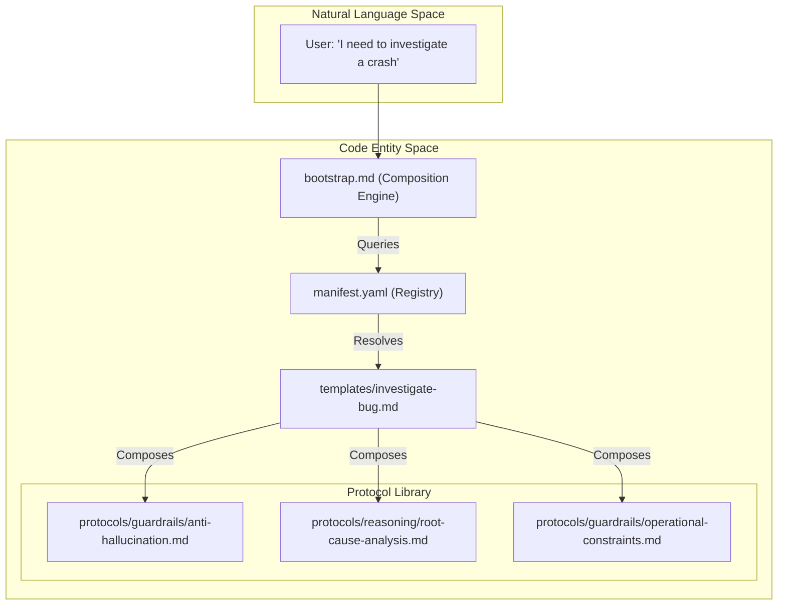
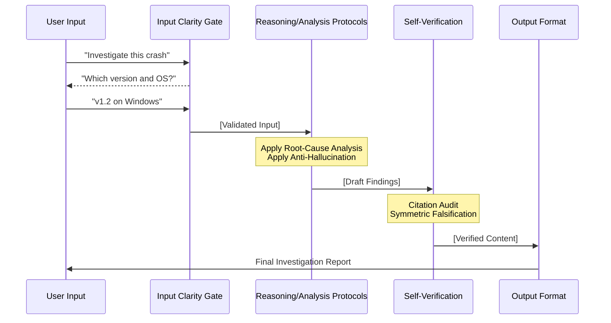

<!-- source: DeepWiki mcp.deepwiki.com · repo microsoft/PromptKit · page 2.2 Protocols · fetched 2026-10-26 -->

# Protocols

<details>
<summary>Relevant source files</summary>

The following files were used as context for generating this wiki page:

- [CATALOG.md](CATALOG.md)
- [bootstrap.md](bootstrap.md)
- [formats/investigation-report.md](formats/investigation-report.md)
- [manifest.yaml](manifest.yaml)
- [protocols/guardrails/adversarial-falsification.md](protocols/guardrails/adversarial-falsification.md)
- [protocols/guardrails/anti-hallucination.md](protocols/guardrails/anti-hallucination.md)
- [protocols/guardrails/definition-of-done.md](protocols/guardrails/definition-of-done.md)
- [protocols/guardrails/input-clarity-gate.md](protocols/guardrails/input-clarity-gate.md)
- [protocols/guardrails/operational-constraints.md](protocols/guardrails/operational-constraints.md)
- [protocols/guardrails/self-verification.md](protocols/guardrails/self-verification.md)
- [protocols/guardrails/tool-reliability-defense.md](protocols/guardrails/tool-reliability-defense.md)
- [protocols/reasoning/root-cause-analysis.md](protocols/reasoning/root-cause-analysis.md)
- [templates/author-known-conditions-registry.md](templates/author-known-conditions-registry.md)
- [templates/investigate-bug.md](templates/investigate-bug.md)
- [templates/investigate-trace.md](templates/investigate-trace.md)

</details>


This page provides a high-level overview of the **Protocol** layer in PromptKit. Protocols are the systematic "how-to" guides that govern an LLM's reasoning process, enforce safety boundaries, and define domain-specific analysis steps.

In the PromptKit five-layer composition model, protocols represent the behavioral constraints and cognitive strategies applied to a task. They are designed to be composable, allowing a single prompt to combine cross-cutting safety checks with deep technical reasoning.

## Protocol Categories

PromptKit organizes its library of 56 protocols into three distinct categories based on their functional role:

| Category | Count | Purpose |
| :--- | :--- | :--- |
| **Guardrail Protocols** | 9 | Cross-cutting safety and quality gates. Prevents hallucination, ensures self-verification, and manages operational limits. |
| **Analysis Protocols** | 19 | Domain-specific technical checks. Covers memory safety, thread safety, security vulnerabilities, and API conventions. |
| **Reasoning Protocols** | 39 | Systematic problem-solving strategies. Covers root-cause analysis, traceability, and multi-agent coordination. |

### 1. Guardrail Protocols
Guardrails are the foundation of PromptKit's reliability. They are typically applied to all tasks to ensure the LLM remains grounded in the provided context and maintains intellectual honesty. Key examples include `anti-hallucination`, which enforces epistemic labeling (KNOWN/INFERRED/ASSUMED), and `operational-constraints`, which prevents context window exhaustion by limiting file ingestion.

For details, see [Guardrail Protocols](#2.2.1).

### 2. Analysis Protocols
Analysis protocols provide the "technical lens" for specific engineering domains. These are applied when the task requires specialized knowledge, such as auditing C++ code for lifetime hazards or verifying Windows API usage. They often utilize specific taxonomies to classify findings.

For details, see [Analysis Protocols](#2.2.2).

### 3. Reasoning Protocols
Reasoning protocols define the step-by-step logic the LLM must follow to reach a conclusion. For instance, the `root-cause-analysis` protocol requires generating 3–5 competing hypotheses before investigating any single one, preventing premature convergence on a wrong conclusion.

For details, see [Reasoning Protocols](#2.2.3).

---

## Selection and Composition

Protocols are selected and composed at runtime by the `bootstrap.md` engine or defined statically within a template's YAML frontmatter.

### Manifest Discovery
The `manifest.yaml` file serves as the central registry for all protocols. Each protocol entry includes its name, file path, and a description used by the LLM to determine its relevance to a user's request.


**Sources:** [manifest.yaml:118-124](), [bootstrap.md:14-27](), [templates/investigate-bug.md:11-15]()

### Composition Logic
When a template like `investigate-bug` is activated, the engine performs a "deep merge" of the protocol instructions. The resulting prompt contains the combined rules of all referenced protocols, often ordered to create a sequential workflow (e.g., "First, apply Operational Constraints to scope the search, then use Root Cause Analysis to evaluate hypotheses").

**Example Template Composition:**
```yaml
name: investigate-bug
persona: systems-engineer
protocols:
  - guardrails/anti-hallucination
  - guardrails/self-verification
  - guardrails/operational-constraints
  - reasoning/root-cause-analysis
format: investigation-report
```
**Sources:** [templates/investigate-bug.md:5-18]()

---

## The Guardrail Pipeline

Every PromptKit execution follows a conceptual pipeline where guardrails act as entry and exit gates.


**Sources:** [protocols/guardrails/input-clarity-gate.md:20-26](), [protocols/guardrails/self-verification.md:16-25](), [protocols/guardrails/anti-hallucination.md:13-17]()

### Key Guardrail Entities

| Entity | File Path | Role |
| :--- | :--- | :--- |
| `anti-hallucination` | `protocols/guardrails/anti-hallucination.md` | Enforces intellectual honesty via `[KNOWN]`, `[INFERRED]`, and `[ASSUMPTION]` tags. |
| `operational-constraints` | `protocols/guardrails/operational-constraints.md` | Limits file reads (max 50) and context usage (max 50k lines) to ensure reliability. |
| `self-verification` | `protocols/guardrails/self-verification.md` | Mandatory pre-submission checklist including a "Citation Audit" and "Symmetric Falsification". |
| `adversarial-falsification` | `protocols/guardrails/adversarial-falsification.md` | Requires the LLM to attempt to disprove every finding before reporting it. |

**Sources:** [protocols/guardrails/anti-hallucination.md:21-30](), [protocols/guardrails/operational-constraints.md:26-31](), [protocols/guardrails/self-verification.md:27-48](), [protocols/guardrails/adversarial-falsification.md:40-52]()

---

