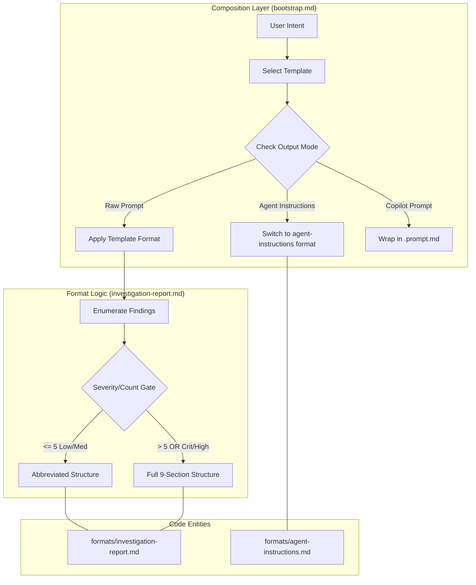
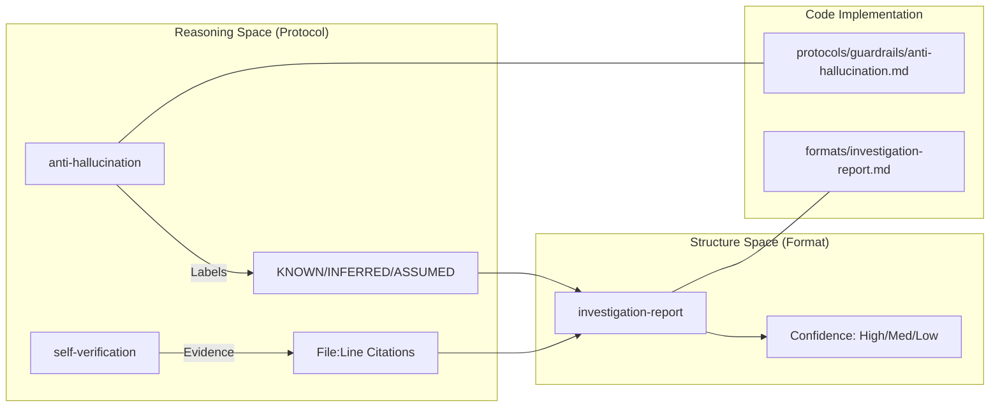

<!-- source: DeepWiki mcp.deepwiki.com · repo microsoft/PromptKit · page 2.3 Output Formats · fetched 2026-10-26 -->

# Output Formats

Relevant source files

The following files were used as context for generating this wiki page:

- [.github/skills/respond-to-pr-comments/SKILL.md](.github/skills/respond-to-pr-comments/SKILL.md)
- [bootstrap.md](bootstrap.md)
- [formats/agent-instructions.md](formats/agent-instructions.md)
- [formats/architecture-spec.md](formats/architecture-spec.md)
- [formats/behavioral-model.md](formats/behavioral-model.md)
- [formats/design-doc.md](formats/design-doc.md)
- [formats/implementation-plan.md](formats/implementation-plan.md)
- [formats/investigation-report.md](formats/investigation-report.md)
- [formats/north-star-document.md](formats/north-star-document.md)
- [formats/pr-comment-responses.md](formats/pr-comment-responses.md)
- [formats/presentation-kit.md](formats/presentation-kit.md)
- [formats/protocol-delta.md](formats/protocol-delta.md)
- [formats/protocol-validation-spec.md](formats/protocol-validation-spec.md)
- [formats/requirements-doc.md](formats/requirements-doc.md)
- [formats/rfc-document.md](formats/rfc-document.md)
- [personas/protocol-architect.md](personas/protocol-architect.md)
- [protocols/analysis/prompt-determinism-analysis.md](protocols/analysis/prompt-determinism-analysis.md)
- [protocols/guardrails/anti-hallucination.md](protocols/guardrails/anti-hallucination.md)
- [protocols/guardrails/human-voice-fidelity.md](protocols/guardrails/human-voice-fidelity.md)
- [protocols/guardrails/operational-constraints.md](protocols/guardrails/operational-constraints.md)
- [protocols/reasoning/corpus-safety-audit.md](protocols/reasoning/corpus-safety-audit.md)
- [protocols/reasoning/invariant-extraction.md](protocols/reasoning/invariant-extraction.md)
- [protocols/reasoning/presentation-design.md](protocols/reasoning/presentation-design.md)
- [protocols/reasoning/protocol-conflict-analysis.md](protocols/reasoning/protocol-conflict-analysis.md)
- [protocols/reasoning/protocol-evolution.md](protocols/reasoning/protocol-evolution.md)
- [protocols/reasoning/protocol-validation-design.md](protocols/reasoning/protocol-validation-design.md)
- [protocols/reasoning/root-cause-analysis.md](protocols/reasoning/root-cause-analysis.md)
- [taxonomies/protocol-change-categories.md](taxonomies/protocol-change-categories.md)
- [templates/analyze-protocol-conflicts.md](templates/analyze-protocol-conflicts.md)
- [templates/audit-code-compliance.md](templates/audit-code-compliance.md)
- [templates/audit-library-health.md](templates/audit-library-health.md)
- [templates/author-agent-instructions.md](templates/author-agent-instructions.md)
- [templates/author-architecture-spec.md](templates/author-architecture-spec.md)
- [templates/author-north-star.md](templates/author-north-star.md)
- [templates/author-pipeline.md](templates/author-pipeline.md)
- [templates/author-presentation.md](templates/author-presentation.md)
- [templates/author-protocol-validation.md](templates/author-protocol-validation.md)
- [templates/author-requirements-doc.md](templates/author-requirements-doc.md)
- [templates/author-rfc.md](templates/author-rfc.md)
- [templates/author-validation-plan.md](templates/author-validation-plan.md)
- [templates/evolve-protocol.md](templates/evolve-protocol.md)
- [templates/extract-invariants.md](templates/extract-invariants.md)
- [templates/investigate-bug.md](templates/investigate-bug.md)
- [templates/investigate-trace.md](templates/investigate-trace.md)
- [templates/reconstruct-behavior.md](templates/reconstruct-behavior.md)
- [templates/respond-to-pr-comments.md](templates/respond-to-pr-comments.md)
- [templates/review-pull-request.md](templates/review-pull-request.md)
- [templates/triage-issues.md](templates/triage-issues.md)

Output Formats are the final layer of the PromptKit composition pipeline. They define the structural schema, section ordering, and data representation for the artifacts generated by an LLM session [bootstrap.md:48-49](). PromptKit includes 27 distinct output format schemas, ranging from technical investigation reports to persistent agent instruction files.

## Format Selection Logic

PromptKit employs a dynamic selection logic to determine which structural variation of a format to apply. This is most prominent in the `investigation-report` format, which uses a "Complexity Gate" to switch between **Abbreviated** and **Full** modes [formats/investigation-report.md:19-27]().

### Abbreviated vs. Full Format
The system evaluates the findings before finalizing the document structure:
*   **Abbreviated Format**: Used when the total finding count is $\le 5$ AND no findings have a severity of "Critical" or "High" [formats/investigation-report.md:38-41](). It omits high-overhead sections like `Problem Statement`, `Root Cause Analysis`, and `Prevention` [formats/investigation-report.md:75-79]().
*   **Full Format**: Triggered if findings exceed 5, any "Critical/High" severity is present, or the context involves incident response or security audits [formats/investigation-report.md:88-93](). Certain templates (e.g., `investigate-bug`) explicitly override the gate to always require the full 9-section structure [templates/investigate-bug.md:88-90]().

### Format Selection Flow
The following diagram illustrates how the `bootstrap.md` composition engine and individual format logic interact to select the final output structure.

**Format Decision and Assembly Pipeline**

**Sources:** [bootstrap.md:48-58](), [formats/investigation-report.md:19-34](), [templates/investigate-bug.md:88-90]()

---

## Core Format Reference

### Investigation and Review Formats
These formats are designed for analytical tasks, emphasizing evidence, severity, and remediation.

| Format Name | Purpose | Key Sections |
| :--- | :--- | :--- |
| `investigation-report` | Bug/Security audits [formats/investigation-report.md:7-9]() | Executive Summary, Findings (F-NNN), Root Cause, Remediation, Coverage [formats/investigation-report.md:105-163]() |
| `pr-comment-responses` | Review feedback [formats/pr-comment-responses.md:7-10]() | Thread Summary (Native Status), Contradiction Report, Per-Thread Responses [formats/pr-comment-responses.md:25-107]() |
| `structured-patch` | Code modifications | Before/After blocks, Impact Analysis, Test Verification |

**Sources:** [formats/investigation-report.md:5-11](), [formats/pr-comment-responses.md:5-12](), [templates/review-pull-request.md:17]()

### Persistent Agent Formats
Unlike standard reports, these formats produce files intended for version control and consumption by LLM runtimes (GitHub Copilot, Claude Code, Cursor) [formats/agent-instructions.md:7-14]().

*   **`agent-instructions`**: Produces composable `.instructions.md` files. For GitHub Copilot, it decomposes a single prompt into multiple files targeted via `applyTo` globs (e.g., `**/*.c` for a memory-safety skill) [formats/agent-instructions.md:22-25, 48-52]().
*   **`agentic-workflow`**: Wraps prompts in GitHub Actions metadata, including `permissions`, `tools`, and `safe-outputs` [bootstrap.md:108-118]().

**Sources:** [formats/agent-instructions.md:18-53](), [bootstrap.md:69-87](), [templates/author-agent-instructions.md:46-51]()

---

## Implementation Details: The Confidence Framework

Most analytical formats (notably `investigation-report`) implement a standardized **Confidence Framework** to communicate the epistemic certainty of findings [formats/investigation-report.md:172-180]().

| Level | Meaning | Code Requirement |
| :--- | :--- | :--- |
| **High** | Verified finding | Requires code inspection, reproduction, or direct evidence [formats/investigation-report.md:178]() |
| **Medium** | Plausible finding | Direct evidence exists but a key aspect (e.g., concurrency) is unverified [formats/investigation-report.md:179]() |
| **Low** | Circumstantial | Evidence is weak; requires expert review before action [formats/investigation-report.md:180]() |

This framework is enforced by the `anti-hallucination` protocol, which requires every claim to be labeled as `KNOWN`, `INFERRED`, or `ASSUMED` [protocols/guardrails/anti-hallucination.md:21-30]().

**Data Flow: From Protocol to Format**

**Sources:** [protocols/guardrails/anti-hallucination.md:21-30](), [formats/investigation-report.md:172-184]()

---

## Complete Format Catalog (Summary)

PromptKit provides 27 schemas. Key technical formats include:

1.  **`investigation-report`**: Root cause and security analysis [formats/investigation-report.md]().
2.  **`requirements-doc`**: Functional and non-functional specifications.
3.  **`design-doc`**: Architectural blueprints and component definitions.
4.  **`agent-instructions`**: Composable skill and agent files [formats/agent-instructions.md]().
5.  **`rfc-document`**: Request for Comments for protocol/system changes.
6.  **`behavioral-model`**: Formal descriptions of system state and transitions.
7.  **`triage-report`**: Initial classification of bugs or issues.
8.  **`validation-plan`**: Test strategies and compliance matrices.
9.  **`implementation-plan`**: Step-by-step engineering execution guides.
10. **`pr-comment-responses`**: Automated PR feedback management [formats/pr-comment-responses.md]().
11. **`protocol-validation-spec`**: Invariant and property checks for protocols.
12. **`protocol-delta`**: Structured changes between protocol versions.
13. **`architecture-spec`**: High-level system structure and constraints.
14. **`north-star-document`**: Long-term vision and strategy alignment.
15. **`presentation-kit`**: Structured content for technical presentations.

**Sources:** [manifest.yaml](), [formats/agent-instructions.md:5-15](), [formats/investigation-report.md:5-11](), [formats/pr-comment-responses.md:5-12]()

---

