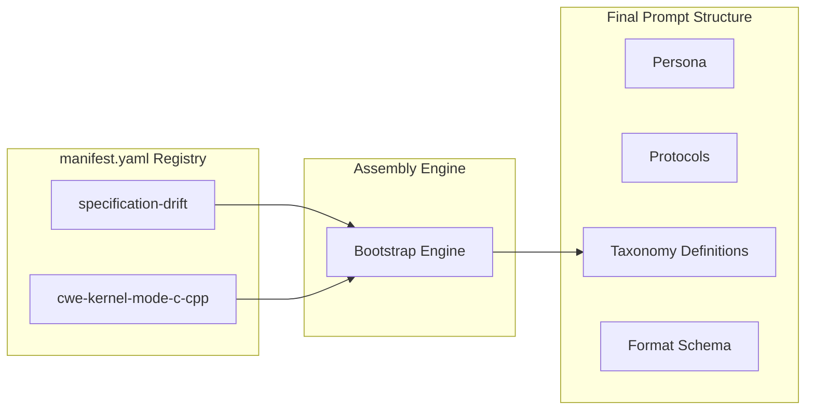

<!-- source: DeepWiki mcp.deepwiki.com · repo microsoft/PromptKit · page 2.4 Taxonomies · fetched 2026-10-26 -->

# Taxonomies

<details>
<summary>Relevant source files</summary>

The following files were used as context for generating this wiki page:

- [CATALOG.md](CATALOG.md)
- [docs/examples.md](docs/examples.md)
- [docs/scenarios.md](docs/scenarios.md)
- [formats/decision-log.md](formats/decision-log.md)
- [protocols/guardrails/adversarial-falsification.md](protocols/guardrails/adversarial-falsification.md)
- [protocols/guardrails/definition-of-done.md](protocols/guardrails/definition-of-done.md)
- [protocols/guardrails/input-clarity-gate.md](protocols/guardrails/input-clarity-gate.md)
- [protocols/guardrails/tool-reliability-defense.md](protocols/guardrails/tool-reliability-defense.md)
- [protocols/reasoning/integration-audit.md](protocols/reasoning/integration-audit.md)
- [protocols/reasoning/test-compliance-audit.md](protocols/reasoning/test-compliance-audit.md)
- [scripts/ingest-cwe.py](scripts/ingest-cwe.py)
- [taxonomies/agent-behavioral-failures.md](taxonomies/agent-behavioral-failures.md)
- [taxonomies/cpp-review-patterns.md](taxonomies/cpp-review-patterns.md)
- [taxonomies/cwe-cli-tools.md](taxonomies/cwe-cli-tools.md)
- [taxonomies/cwe-cloud-service.md](taxonomies/cwe-cloud-service.md)
- [taxonomies/cwe-container-k8s.md](taxonomies/cwe-container-k8s.md)
- [taxonomies/cwe-crypto-protocols.md](taxonomies/cwe-crypto-protocols.md)
- [taxonomies/cwe-data-processing.md](taxonomies/cwe-data-processing.md)
- [taxonomies/cwe-firmware-embedded.md](taxonomies/cwe-firmware-embedded.md)
- [taxonomies/cwe-iac.md](taxonomies/cwe-iac.md)
- [taxonomies/cwe-kernel-mode-c-cpp.md](taxonomies/cwe-kernel-mode-c-cpp.md)
- [taxonomies/cwe-managed-dotnet.md](taxonomies/cwe-managed-dotnet.md)
- [taxonomies/cwe-mobile-app.md](taxonomies/cwe-mobile-app.md)
- [taxonomies/cwe-native-user-mode-c-cpp.md](taxonomies/cwe-native-user-mode-c-cpp.md)
- [taxonomies/cwe-web-backend.md](taxonomies/cwe-web-backend.md)
- [taxonomies/cwe-web-js-ts.md](taxonomies/cwe-web-js-ts.md)
- [taxonomies/specification-drift.md](taxonomies/specification-drift.md)
- [templates/audit-integration-compliance.md](templates/audit-integration-compliance.md)
- [templates/audit-test-compliance.md](templates/audit-test-compliance.md)
- [templates/author-known-conditions-registry.md](templates/author-known-conditions-registry.md)

</details>


Taxonomies in PromptKit provide the formal classification schemes used to label findings, vulnerabilities, and document discrepancies. While protocols define *how* to analyze, taxonomies define *what* the result is called. Every finding generated by an audit or investigation template must map to exactly one label within a specified taxonomy, ensuring that LLM outputs remain structured, searchable, and compatible with downstream engineering workflows.

The PromptKit library currently contains 19 taxonomy files, ranging from specialized specification-drift trackers to massive CWE (Common Weakness Enumeration) domain subsets.

## Taxonomy Architecture

Taxonomies are defined as YAML-frontmatter-enabled Markdown files in the `taxonomies/` directory. They bridge the gap between "Natural Language Space" (the LLM's reasoning) and "Code Entity Space" (stable identifiers for bug trackers and CI/CD).

### Data Flow and Classification
When a template like `audit-traceability` is executed, the `specification-drift` taxonomy is injected into the prompt context. The LLM uses the `Pattern` and `Risk` definitions to classify its observations.

Title: Taxonomy Classification Pipeline
```mermaid
graph TD
    subgraph "Natural Language Space"
        A["User Input (Code/Docs)"] --> B["LLM Analysis"]
        C["Taxonomy Pattern Definitions"] --> B
    end

    subgraph "Code Entity Space"
        B --> D["Structured Finding"]
        D --> E["Label (e.g., D2_UNTESTED_REQUIREMENT)"]
        E --> F["Investigation Report / JSON"]
    end

    [taxonomies/specification-drift.md:48-53]()
    [templates/audit-traceability.md:20-22]()
```
Sources: [taxonomies/specification-drift.md:48-53](), [CATALOG.md:31-31]()

## Specification Drift (D1–D16)

The `specification-drift` taxonomy is the primary tool for auditing the engineering lifecycle. it covers the divergence between requirements, design, implementation, and testing.

| Range | Group | Focus |
|-------|-------|-------|
| **D1–D7** | Traceability | Gaps between Requirements, Design, and Validation Plans. |
| **D8–D10** | Code Compliance | Discrepancies between source code and specifications. |
| **D11–D13** | Test Compliance | Gaps between test code and the validation plan. |
| **D14–D16** | Integration | Interface contract mismatches between components. |

### Key Labels and Patterns
*   **D2_UNTESTED_REQUIREMENT**: A requirement exists in the doc but has no corresponding test case in the validation plan [taxonomies/specification-drift.md:66-73]().
*   **D6_CONSTRAINT_VIOLATION**: A design decision directly contradicts a stated requirement (e.g., performance targets) [taxonomies/specification-drift.md:134-142]().
*   **D8_UNIMPLEMENTED_REQUIREMENT**: A specified behavior is missing from the source code [taxonomies/specification-drift.md:171-178]().

Sources: [taxonomies/specification-drift.md:34-47](), [taxonomies/specification-drift.md:66-73](), [taxonomies/specification-drift.md:134-142](), [taxonomies/specification-drift.md:171-178]()

## CWE Domain Taxonomies

PromptKit includes 13 domain-specific taxonomies derived from the MITRE CWE™ corpus. These are generated via `scripts/ingest-cwe.py`, which parses the CWE XML and filters weaknesses into domain-relevant subsets.

### Implementation of Domain Scoping
Each CWE taxonomy file (e.g., `cwe-firmware-embedded.md`) includes a strict instruction to the LLM: **only** consider CWE IDs listed in that file [taxonomies/cwe-firmware-embedded.md:28-31](). This prevents "CWE sprawl" where an LLM might report a web-specific vulnerability in a kernel driver.

| Domain Taxonomy | CWE Count | Target |
|-----------------|-----------|--------|
| `cwe-firmware-embedded` | 226 | SoC, Bootloaders, HAL [taxonomies/cwe-firmware-embedded.md:25-26]() |
| `cwe-kernel-mode-c-cpp` | 113 | OS Kernels, Drivers [taxonomies/cwe-kernel-mode-c-cpp.md:25-26]() |
| `cwe-cloud-service` | 113 | APIs, Cloud-hosted backends [taxonomies/cwe-cloud-service.md:23-26]() |
| `cwe-managed-dotnet` | 92 | C#, F#, VB.NET [taxonomies/cwe-managed-dotnet.md:25-26]() |
| `cwe-cli-tools` | 65 | Command-line utilities [taxonomies/cwe-cli-tools.md:23-26]() |
| `cwe-mobile-app` | 23 | iOS, Android [taxonomies/cwe-mobile-app.md:25-26]() |
| `cwe-iac` | 8 | Terraform, Bicep, ARM [taxonomies/cwe-iac.md:25-26]() |

Sources: [taxonomies/cwe-firmware-embedded.md:25-31](), [taxonomies/cwe-kernel-mode-c-cpp.md:25-26](), [taxonomies/cwe-cloud-service.md:23-26](), [taxonomies/cwe-managed-dotnet.md:25-26](), [taxonomies/cwe-cli-tools.md:23-26](), [taxonomies/cwe-mobile-app.md:25-26](), [taxonomies/cwe-iac.md:25-26]()

## Specialized Taxonomies

Beyond drift and CWEs, PromptKit utilizes taxonomies to manage agent behavior and specific technical patterns.

### Agent Behavioral Failures
Used to classify failures in AI agent sessions, such as:
*   **Tool-use errors**: Incorrect argument formatting or hallucinated tools.
*   **Context drift**: Losing track of the original objective during multi-step reasoning.
*   **Safety gate triggers**: Refusals or over-censorship.

### C++ Review Patterns
The `cpp-review-patterns` taxonomy provides a vocabulary for the `review-cpp-code` template. It focuses on modern C++ (C++11 through C++23) hazards like:
*   **Iterator Invalidation**: Use of iterators after container modification.
*   **Perfect Forwarding Failures**: Misuse of `std::forward` in templates.
*   **Lambda Capture Hazards**: Capturing local variables by reference in asynchronous contexts.

### Protocol Change Categories
Used by the `diff-specifications` template to classify changes between two versions of a protocol or RFC [CATALOG.md:36-36]().
*   **Tightened**: Constraints became more restrictive.
*   **Relaxed**: Constraints became more permissive.
*   **Clarified**: Semantic meaning unchanged, but ambiguity reduced.

Sources: [CATALOG.md:36-36](), [taxonomies/specification-drift.md:1-18]()

## Usage in Prompt Assembly

Taxonomies are integrated into the final prompt via the `Taxonomy` layer of the assembly pipeline.

Title: Taxonomy Injection into LLM Context


When a user runs `npx promptkit assemble --template audit-code-compliance`, the CLI:
1.  Looks up the template in `manifest.yaml`.
2.  Identifies `specification-drift` as the required taxonomy.
3.  Appends the content of `taxonomies/specification-drift.md` to the prompt.
4.  Instructs the LLM: "Every finding MUST use exactly one label from this taxonomy" [taxonomies/specification-drift.md:22-24]().

Sources: [CATALOG.md:6-16](), [taxonomies/specification-drift.md:22-24]()

---

