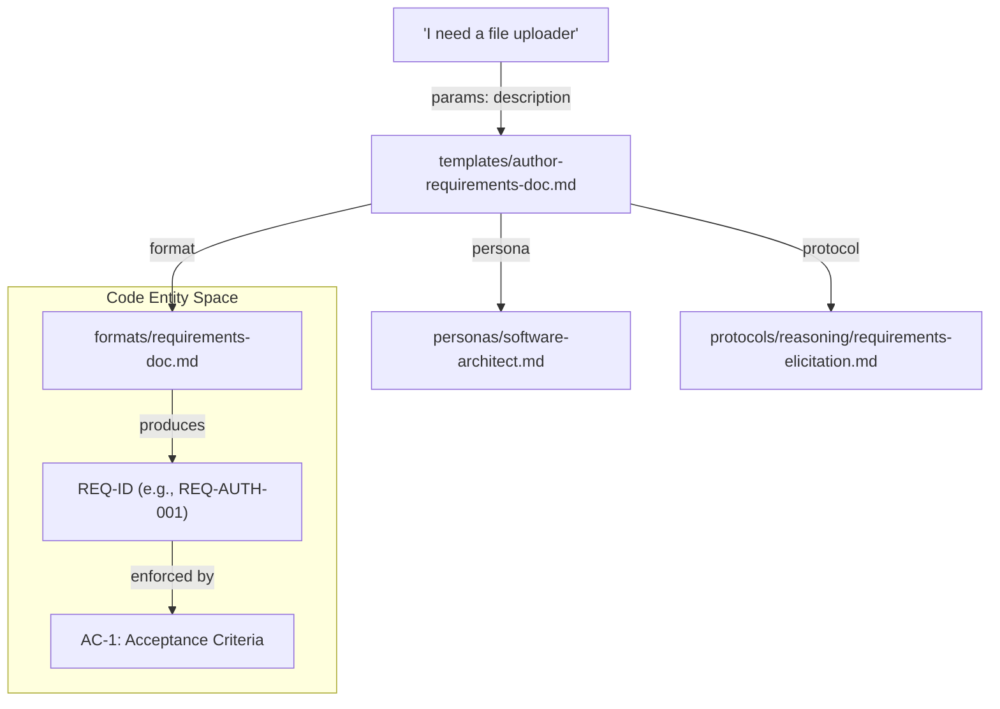
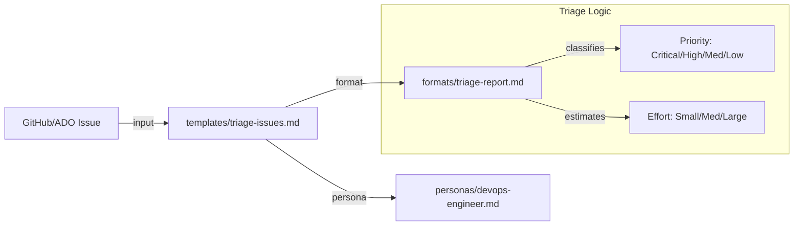

<!-- source: DeepWiki mcp.deepwiki.com · repo microsoft/PromptKit · page 3 Templates Catalog · fetched 2026-10-26 -->

# Templates Catalog

<details>
<summary>Relevant source files</summary>

The following files were used as context for generating this wiki page:

- [CATALOG.md](CATALOG.md)
- [formats/design-doc.md](formats/design-doc.md)
- [formats/requirements-doc.md](formats/requirements-doc.md)
- [manifest.yaml](manifest.yaml)
- [protocols/guardrails/adversarial-falsification.md](protocols/guardrails/adversarial-falsification.md)
- [protocols/guardrails/definition-of-done.md](protocols/guardrails/definition-of-done.md)
- [protocols/guardrails/input-clarity-gate.md](protocols/guardrails/input-clarity-gate.md)
- [protocols/guardrails/self-verification.md](protocols/guardrails/self-verification.md)
- [protocols/guardrails/tool-reliability-defense.md](protocols/guardrails/tool-reliability-defense.md)
- [templates/author-known-conditions-registry.md](templates/author-known-conditions-registry.md)
- [templates/author-pipeline.md](templates/author-pipeline.md)
- [templates/author-requirements-doc.md](templates/author-requirements-doc.md)
- [templates/author-validation-plan.md](templates/author-validation-plan.md)
- [templates/triage-issues.md](templates/triage-issues.md)

</details>


The **Templates Catalog** is the top-level orchestration layer of PromptKit. While Personas, Protocols, and Formats provide the building blocks, Templates define the specific engineering tasks and the "glue" that binds these components into executable prompts. 

PromptKit currently contains **78 templates** [CATALOG.md:16-16]() covering the full lifecycle of systems, software, and hardware engineering.

## Template Structure

Each template is a Markdown file residing in the `templates/` directory, governed by a YAML frontmatter block that defines its dependencies and interface contracts.

### Component Composition
Templates do not contain hardcoded logic for personas or guardrails. Instead, they reference components by name from the `manifest.yaml`. When a template is assembled by the CLI, the engine resolves these references to build a complete system prompt.

| Field | Description | Code Reference |
|-------|-------------|----------------|
| `persona` | The expert identity used for the task. | [templates/author-requirements-doc.md:9-9]() |
| `protocols` | List of guardrails, reasoning, or analysis protocols to apply. | [templates/author-requirements-doc.md:10-13]() |
| `format` | The specific output schema the LLM must follow. | [templates/author-requirements-doc.md:14-14]() |
| `params` | Variables (e.g., `project_name`) injected into the template body. | [templates/author-requirements-doc.md:15-19]() |

### Input and Output Contracts
Templates use **Contracts** to ensure they can be chained into multi-stage pipelines. An `input_contract` defines the expected type of data (e.g., `requirements-document`), while an `output_contract` specifies what the template produces.

```yaml
input_contract:
  type: requirements-document
  description: A requirements document with numbered REQ-IDs.
output_contract:
  type: validation-plan
  description: A validation plan with test cases and traceability.
```
*Sources: [templates/author-validation-plan.md:19-28]()*

## Domain Mapping: Natural Language to Code Entities

The following diagrams illustrate how PromptKit bridges high-level engineering intent with specific code-space entities (files, schemas, and identifiers).

### Requirement Extraction Workflow
This diagram shows how a user's natural language intent is transformed into structured code entities via the `author-requirements-doc` template.


*Sources: [templates/author-requirements-doc.md:5-26](), [formats/requirements-doc.md:41-54]()*

### Investigation and Triage Pipeline
This diagram illustrates the flow from a repository issue to a structured triage report using DevOps-centric entities.


*Sources: [templates/triage-issues.md:10-28](), [manifest.yaml:37-42]()*

---

## Template Categories

The catalog is organized into functional areas. Each category is detailed in its own child page.

### [3.1 Investigation and Debugging Templates](#)
Focuses on root-cause analysis, trace investigation, and security vulnerability hunting. Key templates include `investigate-bug` and `root-cause-ci-failure`.
*For details, see [Investigation and Debugging Templates](#3.1).*

### [3.2 Code Review and Compliance Templates](#)
Covers the auditing of source code against specifications, PR reviews, and traceability checks. Includes `review-pull-request` and `audit-code-compliance`.
*For details, see [Code Review and Compliance Templates](#3.2).*

### [3.3 Design and Requirements Templates](#)
Orchestrates the creation of foundational engineering documents. Features templates like `author-design-doc` and the multi-phase `interactive-design`.
*For details, see [Design and Requirements Templates](#3.3).*

### [3.4 Hardware Design Templates](#)
Specialized workflows for electrical and mechanical engineering, including schematic reviews and link budget validation.
*For details, see [Hardware Design Templates](#3.4).*

### [3.5 Agent Instructions and Prompt Engineering Templates](#)
Tools for maintaining the PromptKit library itself and generating instructions for persistent AI agents. Includes `author-agent-instructions` and `lint-prompt`.
*For details, see [Agent Instructions and Prompt Engineering Templates](#3.5).*

### [3.6 Protocol Engineering Templates](#)
Dedicated to the design and evolution of communication protocols and state machines. Includes `author-rfc` and `analyze-protocol-conflicts`.
*For details, see [Protocol Engineering Templates](#3.6).*

---
**Sources:**
- [CATALOG.md:1-110]()
- [manifest.yaml:1-175]()
- [templates/author-requirements-doc.md:1-81]()
- [templates/author-validation-plan.md:1-89]()
- [templates/triage-issues.md:1-111]()
- [templates/author-known-conditions-registry.md:1-154]()

---

