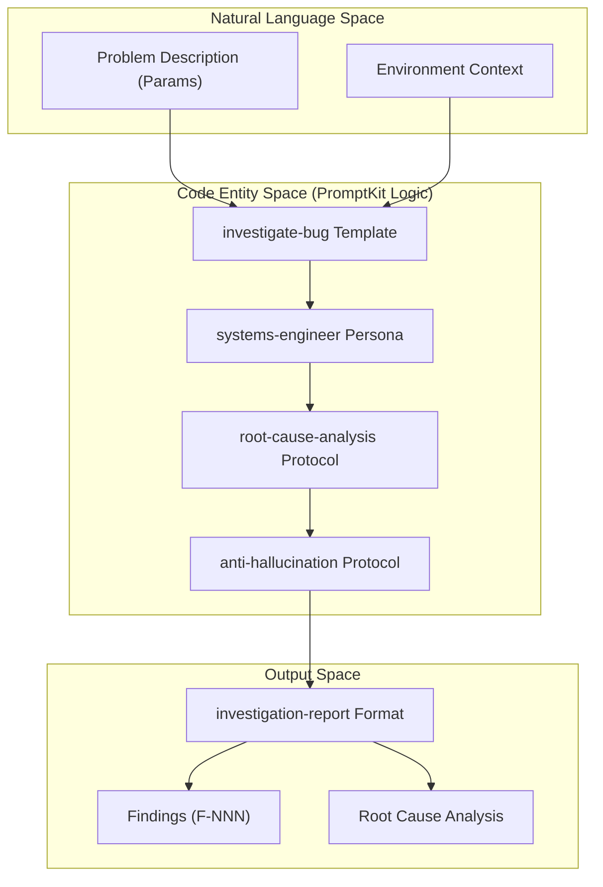
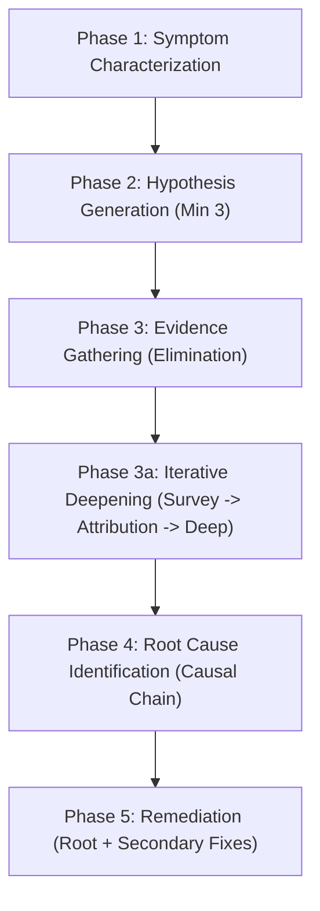

<!-- source: DeepWiki mcp.deepwiki.com · repo microsoft/PromptKit · page 3.1 Investigation and Debugging Templates · fetched 2026-10-26 -->

# Investigation and Debugging Templates

Relevant source files

The following files were used as context for generating this wiki page:

- [bootstrap.md](bootstrap.md)
- [formats/investigation-report.md](formats/investigation-report.md)
- [protocols/analysis/security-vulnerability.md](protocols/analysis/security-vulnerability.md)
- [protocols/guardrails/anti-hallucination.md](protocols/guardrails/anti-hallucination.md)
- [protocols/guardrails/operational-constraints.md](protocols/guardrails/operational-constraints.md)
- [protocols/reasoning/exhaustive-path-tracing.md](protocols/reasoning/exhaustive-path-tracing.md)
- [protocols/reasoning/root-cause-analysis.md](protocols/reasoning/root-cause-analysis.md)
- [templates/author-design-doc.md](templates/author-design-doc.md)
- [templates/exhaustive-bug-hunt.md](templates/exhaustive-bug-hunt.md)
- [templates/find-and-fix-bugs.md](templates/find-and-fix-bugs.md)
- [templates/interactive-design.md](templates/interactive-design.md)
- [templates/investigate-bug.md](templates/investigate-bug.md)
- [templates/investigate-security.md](templates/investigate-security.md)
- [templates/investigate-trace.md](templates/investigate-trace.md)
- [templates/plan-implementation.md](templates/plan-implementation.md)
- [templates/review-code.md](templates/review-code.md)

The **Investigation and Debugging Templates** in PromptKit provide structured workflows for identifying, analyzing, and remediating software defects, security vulnerabilities, and performance regressions. These templates leverage the `investigation-report` format and the `root-cause-analysis` protocol to ensure that findings are grounded in evidence and trace back to fundamental causes rather than proximate triggers.

## Core Investigation Pipeline

The investigation templates follow a consistent data flow from natural language problem descriptions and raw technical context (logs, traces, or code) to a structured, evidence-based report.

### Data Flow: Natural Language to Code Entity Space

The following diagram illustrates how a user's problem description is transformed into technical findings through the application of PromptKit protocols.

**Figure 1: Investigation Transformation Flow**

**Sources:** [templates/investigate-bug.md:1-29](), [protocols/reasoning/root-cause-analysis.md:1-15](), [formats/investigation-report.md:103-163]()

## Key Templates

### 1. investigate-bug
The primary entry point for general software defect analysis. It mandates the use of the `root-cause-analysis` protocol and the `systems-engineer` persona.

*   **Implementation:** It forces a "Full Format" report, requiring sections for causal chains and prevention [templates/investigate-bug.md:88-90]().
*   **Key Logic:** The template requires generating 3–5 competing hypotheses before investigating any single one to avoid "anchoring bias" [templates/investigate-bug.md:49-54]().
*   **Verification:** It utilizes the `self-verification` protocol to re-verify at least 3–5 findings against the source code before finalization [templates/investigate-bug.md:72-76]().

**Sources:** [templates/investigate-bug.md:1-130]()

### 2. investigate-security
Designed for security audits and vulnerability research, utilizing the `security-auditor` persona and the `security-vulnerability` analysis protocol.

*   **Trust Boundary Mapping:** Executes a systematic audit of trust boundaries (network, IPC, privilege transitions) [protocols/analysis/security-vulnerability.md:23-34]().
*   **Exhaustive Path Tracing:** Specifically targets parser and decoder functions that handle untrusted structured input [templates/investigate-security.md:93-107]().
*   **CWE Integration:** Requires findings to be mapped to Common Weakness Enumeration (CWE) identifiers [templates/investigate-security.md:68-71]().

**Sources:** [templates/investigate-security.md:1-165](), [protocols/analysis/security-vulnerability.md:1-115]()

### 3. investigate-trace
Specialized for performance, power, and behavioral issues using ETW/ETL captures or telemetry.

*   **Iterative Deepening:** Follows a specific sequence: Broad Survey → Attribution → Deep Analysis → Cross-Component Tracing [templates/investigate-trace.md:137-161]().
*   **Call Stack Analysis:** Mandates call stack grouping by process and thread to move beyond module-level "where" to functional "why" [templates/investigate-trace.md:76-86]().
*   **Energy Divergence:** Includes specific logic for comparing CPU usage against energy estimation to find wake/sleep patterns that drain battery life [templates/investigate-trace.md:87-99]().

**Sources:** [templates/investigate-trace.md:1-163](), [protocols/reasoning/root-cause-analysis.md:66-93]()

## Analysis Protocols and Logic

### Root Cause Analysis (RCA)
The `root-cause-analysis` protocol is the reasoning engine for all investigation templates. It distinguishes between the **proximate cause** (the immediate crash or error) and the **root cause** (the underlying defect) [protocols/reasoning/root-cause-analysis.md:96-104]().

**Figure 2: RCA Protocol Execution Logic**

**Sources:** [protocols/reasoning/root-cause-analysis.md:17-137]()

### Operational Constraints in Debugging
To prevent "context window exhaustion" and "over-ingestion," the `operational-constraints` protocol governs how the LLM interacts with large codebases or trace sets:

*   **Scoping:** Limits initial discovery passes to 50 files before requiring a summary [protocols/guardrails/operational-constraints.md:26-31]().
*   **Deterministic Analysis:** Prefers repeatable methods (scripts/queries) over ad-hoc manual inspection [protocols/guardrails/operational-constraints.md:44-53]().
*   **Two-Failures Rule:** If a debugging strategy fails twice, the protocol mandates a switch in strategy rather than minor variations [protocols/guardrails/operational-constraints.md:123-136]().

**Sources:** [protocols/guardrails/operational-constraints.md:15-148]()

## Standardized Output: Investigation Report

All investigation templates output to the `investigation-report` format. This format enforces a **Confidence Framework** (High/Medium/Low) based on the strength of evidence [formats/investigation-report.md:174-181]().

| Section | Purpose | Mandatory in Full Format |
| :--- | :--- | :--- |
| **1. Executive Summary** | Stakeholder overview | Yes |
| **4. Findings** | Detailed F-NNN entries with evidence | Yes |
| **5. Root Cause Analysis** | The causal chain from symptom to defect | Yes |
| **7. Prevention** | Code/Process changes to stop recurrence | Yes |
| **8. Open Questions** | Unresolved items requiring more data | Yes |

**Sources:** [formats/investigation-report.md:103-163]()

---

