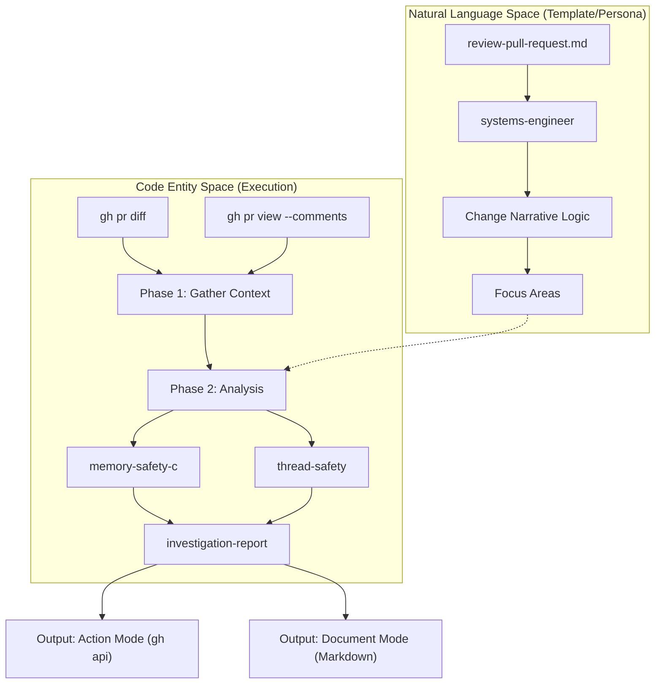
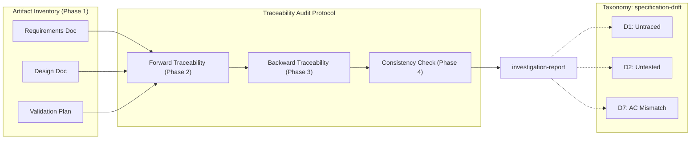

<!-- source: DeepWiki mcp.deepwiki.com · repo microsoft/PromptKit · page 3.2 Code Review and Compliance Templates · fetched 2026-10-26 -->

# Code Review and Compliance Templates

Relevant source files

The following files were used as context for generating this wiki page:

- [.github/skills/respond-to-pr-comments/SKILL.md](.github/skills/respond-to-pr-comments/SKILL.md)
- [docs/case-studies/audit-traceability.md](docs/case-studies/audit-traceability.md)
- [docs/examples.md](docs/examples.md)
- [docs/scenarios.md](docs/scenarios.md)
- [formats/decision-log.md](formats/decision-log.md)
- [formats/pr-comment-responses.md](formats/pr-comment-responses.md)
- [personas/specification-analyst.md](personas/specification-analyst.md)
- [protocols/analysis/cpp-best-practices.md](protocols/analysis/cpp-best-practices.md)
- [protocols/analysis/kernel-correctness.md](protocols/analysis/kernel-correctness.md)
- [protocols/guardrails/human-voice-fidelity.md](protocols/guardrails/human-voice-fidelity.md)
- [protocols/reasoning/code-compliance-audit.md](protocols/reasoning/code-compliance-audit.md)
- [protocols/reasoning/coverage-gap-analysis.md](protocols/reasoning/coverage-gap-analysis.md)
- [protocols/reasoning/integration-audit.md](protocols/reasoning/integration-audit.md)
- [protocols/reasoning/test-compliance-audit.md](protocols/reasoning/test-compliance-audit.md)
- [protocols/reasoning/traceability-audit.md](protocols/reasoning/traceability-audit.md)
- [taxonomies/specification-drift.md](taxonomies/specification-drift.md)
- [templates/audit-coverage-gaps.md](templates/audit-coverage-gaps.md)
- [templates/audit-integration-compliance.md](templates/audit-integration-compliance.md)
- [templates/audit-test-compliance.md](templates/audit-test-compliance.md)
- [templates/audit-traceability.md](templates/audit-traceability.md)
- [templates/author-design-doc.md](templates/author-design-doc.md)
- [templates/fix-compiler-warnings.md](templates/fix-compiler-warnings.md)
- [templates/interactive-design.md](templates/interactive-design.md)
- [templates/investigate-security.md](templates/investigate-security.md)
- [templates/plan-implementation.md](templates/plan-implementation.md)
- [templates/respond-to-pr-comments.md](templates/respond-to-pr-comments.md)
- [templates/review-code.md](templates/review-code.md)
- [templates/review-pull-request.md](templates/review-pull-request.md)

The **Code Review and Compliance Templates** provide a structured, repeatable framework for evaluating engineering artifacts against requirements, safety standards, and security best practices. These templates automate the transition from raw code or documentation to high-fidelity investigation reports and actionable remediation plans.

## Overview and Implementation

These templates utilize a multi-layered assembly of **Personas** (e.g., `systems-engineer`, `security-auditor`, `specification-analyst`), **Protocols** (e.g., `memory-safety-c`, `traceability-audit`), and the `investigation-report` **Format**. The implementation focuses on "evidence-based" analysis, where the LLM is constrained to cite specific line numbers or requirement IDs for every finding.

### Core Templates
*   **review-code**: General-purpose code review focusing on correctness, safety, and maintainability [templates/review-code.md:5-9]().
*   **review-pull-request**: Context-aware PR review that analyzes diffs, commit history, and linked issues [templates/review-pull-request.md:5-10]().
*   **investigate-security**: Deep-dive security audit using `exhaustive-path-tracing` for parsers and decoders [templates/investigate-security.md:5-9]().
*   **audit-traceability**: Cross-document audit ensuring requirements flow into design and validation plans [templates/audit-traceability.md:5-10]().
*   **respond-to-pr-comments**: Automates the feedback loop by processing reviewer comments and generating code fixes or explanations [templates/respond-to-pr-comments.md:5-11]().

Sources: [templates/review-code.md:1-30](), [templates/review-pull-request.md:1-33](), [templates/investigate-security.md:1-31](), [templates/audit-traceability.md:1-39](), [templates/respond-to-pr-comments.md:1-32]().

---

## Data Flow: Code Review and Pull Request Analysis

The `review-pull-request` template bridges the gap between raw SCM data (GitHub/ADO) and structured engineering feedback. It introduces a **Change Narrative** logic that determines if a PR is complex enough to warrant an architectural summary before the line-by-line review [templates/review-pull-request.md:84-114]().

### Pull Request Review Pipeline

The diagram below illustrates how the `review-pull-request` template interacts with SCM CLI tools and internal protocols to produce a report.

**PR Review Entity Mapping**

Sources: [templates/review-pull-request.md:57-157](), [templates/review-code.md:52-105](), [protocols/guardrails/human-voice-fidelity.md:43-46]().

---

## Security and Compliance Auditing

Security auditing in PromptKit is driven by the `investigate-security` template, which applies the `security-vulnerability` analysis protocol. A key technical feature is the selective application of `exhaustive-path-tracing` specifically to **parser and decoder functions** that handle untrusted structured input [templates/investigate-security.md:93-106]().

### Security Audit Implementation Detail
The template instructs the agent to identify functions meeting three criteria:
1.  Decodes multiple fields from untrusted sources [templates/investigate-security.md:99-100]().
2.  Performs arithmetic on decoded values [templates/investigate-security.md:101-103]().
3.  Contains loops updating shared state (offsets/accumulators) [templates/investigate-security.md:104-106]().

For these functions, the `exhaustive-path-tracing` protocol [templates/investigate-security.md:17]() forces a check for "loop-carried invariant gaps" and "inter-value arithmetic validation" to find underflows/overflows [templates/investigate-security.md:111-127]().

Sources: [templates/investigate-security.md:49-128](), [taxonomies/specification-drift.md:171-181]().

---

## Traceability and Specification Drift

Compliance auditing uses the `specification-drift` taxonomy to categorize gaps between Requirements (REQ), Design (DES), and Validation (TC).

### Traceability Audit Logic

The `traceability-audit` protocol [protocols/reasoning/traceability-audit.md:16]() performs a bi-directional check:
*   **Forward Traceability**: Ensures every REQ flows into DES (D1) and is verified by a TC (D2) [protocols/reasoning/traceability-audit.md:69-86]().
*   **Backward Traceability**: Ensures every DES element (D3) and TC (D4) is justified by a REQ [protocols/reasoning/traceability-audit.md:123-142]().

**Traceability Mapping**
| Finding ID | Taxonomy Label | Description |
| :--- | :--- | :--- |
| **D1** | `UNTRACED_REQUIREMENT` | REQ exists but is not in Design [taxonomies/specification-drift.md:50-53](). |
| **D2** | `UNTESTED_REQUIREMENT` | REQ exists but has no Test Case [taxonomies/specification-drift.md:66-69](). |
| **D6** | `CONSTRAINT_VIOLATION` | Design violates a stated requirement [taxonomies/specification-drift.md:134-136](). |
| **D7** | `ACCEPTANCE_CRITERIA_MISMATCH` | TC is linked but doesn't verify the specific criteria [taxonomies/specification-drift.md:151-154](). |

**Traceability Audit Workflow**

Sources: [protocols/reasoning/traceability-audit.md:23-157](), [taxonomies/specification-drift.md:20-168](), [templates/audit-traceability.md:65-105]().

---

## Feedback Loop: Responding to PR Comments

The `respond-to-pr-comments` template and its associated GitHub Skill [ .github/skills/respond-to-pr-comments/SKILL.md:2-8]() handle the post-review phase. It supports both **Document Mode** (planning) and **Action Mode** (executing fixes via `gh` or `az` CLI) [templates/respond-to-pr-comments.md:23-24]().

### Platform Detection and Voice Fidelity
1.  **Platform Detection**: Uses URL parsing or `git remote -v` to distinguish between GitHub and Azure DevOps (ADO) [templates/respond-to-pr-comments.md:57-98]().
2.  **Voice Fidelity**: Applies the `human-voice-fidelity` protocol to sample the user's previous comments (`gh pr list --author @me`) to ensure generated replies match the user's tone and technical density [protocols/guardrails/human-voice-fidelity.md:31-46]().
3.  **Contradiction Detection**: Identifies conflicting feedback from different reviewers (e.g., Reviewer A requests a change that Reviewer B explicitly advised against) [formats/pr-comment-responses.md:65-82]().

Sources: [templates/respond-to-pr-comments.md:34-130](), [protocols/guardrails/human-voice-fidelity.md:17-142](), [formats/pr-comment-responses.md:14-106]().

---

