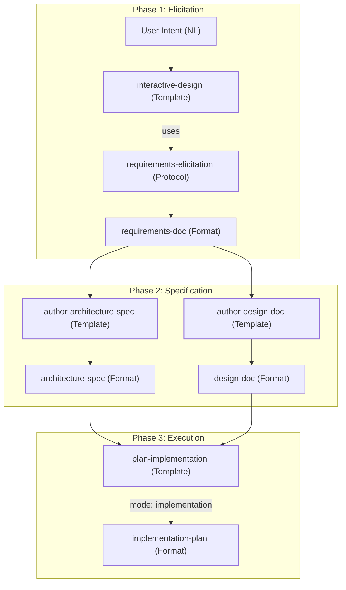
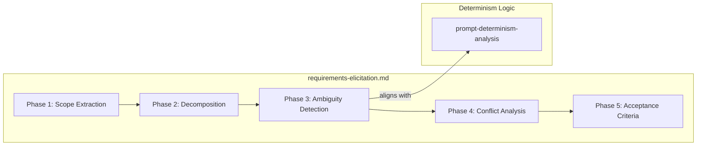

<!-- source: DeepWiki mcp.deepwiki.com · repo microsoft/PromptKit · page 3.3 Design and Requirements Templates · fetched 2026-10-26 -->

# Design and Requirements Templates

Relevant source files

The following files were used as context for generating this wiki page:

- [formats/architecture-spec.md](formats/architecture-spec.md)
- [formats/design-doc.md](formats/design-doc.md)
- [formats/north-star-document.md](formats/north-star-document.md)
- [formats/requirements-doc.md](formats/requirements-doc.md)
- [formats/rfc-document.md](formats/rfc-document.md)
- [protocols/reasoning/requirements-elicitation.md](protocols/reasoning/requirements-elicitation.md)
- [protocols/reasoning/requirements-reconciliation.md](protocols/reasoning/requirements-reconciliation.md)
- [templates/author-architecture-spec.md](templates/author-architecture-spec.md)
- [templates/author-design-doc.md](templates/author-design-doc.md)
- [templates/author-north-star.md](templates/author-north-star.md)
- [templates/author-pipeline.md](templates/author-pipeline.md)
- [templates/author-requirements-doc.md](templates/author-requirements-doc.md)
- [templates/author-rfc.md](templates/author-rfc.md)
- [templates/author-validation-plan.md](templates/author-validation-plan.md)
- [templates/interactive-design.md](templates/interactive-design.md)
- [templates/investigate-security.md](templates/investigate-security.md)
- [templates/lint-prompt.md](templates/lint-prompt.md)
- [templates/plan-implementation.md](templates/plan-implementation.md)
- [templates/reconcile-requirements.md](templates/reconcile-requirements.md)
- [templates/review-code.md](templates/review-code.md)
- [templates/triage-issues.md](templates/triage-issues.md)
- [tests/self-audit-prompt.md](tests/self-audit-prompt.md)

The Design and Requirements templates provide a systematic framework for the early stages of the engineering lifecycle. These templates transform high-level intent and ambiguous natural language into structured, traceable, and verifiable technical specifications. They utilize a multi-layered approach—combining specific personas like `software-architect` [templates/author-design-doc.md:9]() with rigorous reasoning protocols such as `requirements-elicitation` [protocols/reasoning/requirements-elicitation.md:5]()—to ensure engineering artifacts are consistent and deterministic.

## Template Architecture and Data Flow

The design subsystem follows a strict "Contract-Driven" data flow. Templates are designed to be chained: the output of a requirements session becomes the input for an architecture specification, which in turn informs a detailed design document or implementation plan.

### Lifecycle Data Flow Diagram
The following diagram illustrates how data flows through the templates and the specific code entities responsible for each stage.

**Title: Design Artifact Pipeline**

Sources: [templates/interactive-design.md:15-33](), [templates/author-architecture-spec.md:14-30](), [templates/author-design-doc.md:10-28](), [templates/plan-implementation.md:12-39]()

## Core Design Templates

### 1. Interactive Design Session
The `interactive-design` template is unique because it operates in `mode: interactive` [templates/interactive-design.md:6](). Unlike single-shot templates, it enforces a "Reasoning and Challenge" phase before any document generation occurs.

*   **Implementation**: It utilizes `reasoning/requirements-elicitation` and `reasoning/iterative-refinement` [templates/interactive-design.md:18-19]().
*   **Behavior**: The LLM is instructed to act as a "skeptical but constructive reviewer" [templates/interactive-design.md:73]() and is strictly forbidden from generating the final document until the user provides a "READY" signal [templates/interactive-design.md:78-80]().

### 2. Requirements and Architecture
The transition from requirements to architecture is governed by strict traceability.

| Template | Persona | Key Protocol | Output Format |
| :--- | :--- | :--- | :--- |
| `author-requirements-doc` | `specification-analyst` | `requirements-elicitation` | `requirements-doc` |
| `author-architecture-spec` | `software-architect` | `anti-hallucination` | `architecture-spec` |
| `author-design-doc` | `software-architect` | `self-verification` | `design-doc` |

The `author-architecture-spec` template requires every architectural decision to be grounded in the provided inputs, using the `[UNKNOWN]` tag for missing information to prevent hallucination [templates/author-architecture-spec.md:59-63]().

Sources: [templates/author-architecture-spec.md:5-31](), [templates/author-design-doc.md:5-29](), [protocols/reasoning/requirements-elicitation.md:5-15]()

## Protocol Implementation: Requirements Elicitation

The `requirements-elicitation` protocol [protocols/reasoning/requirements-elicitation.md:5]() is the foundation for all design templates. It operationalizes the transformation of vague ideas into "Atomic Requirements."

**Title: Protocol Phase Execution**

Sources: [protocols/reasoning/requirements-elicitation.md:23-107](), [templates/lint-prompt.md:15]()

### Precision and Ambiguity Categories
Phase 3 of the protocol [protocols/reasoning/requirements-elicitation.md:56-85]() defines specific patterns that must be eliminated:
*   **Vague Adjectives**: Words like "fast" must be replaced with measurable criteria (e.g., "under 200ms") [protocols/reasoning/requirements-elicitation.md:63-64]().
*   **Implicit Behavior**: "Handling errors" must be defined as specific actions (Retry, Log, Fail Closed) [protocols/reasoning/requirements-elicitation.md:67-68]().
*   **RFC 2119 Keywords**: Requirements must use `MUST`, `SHOULD`, or `MAY` with stable identifiers like `REQ-PERF-001` [protocols/reasoning/requirements-elicitation.md:42-47]().

## Specialized Design Formats

### RFC and Protocol Specification
For networking and systems standards, the `author-rfc` template [templates/author-rfc.md:5]() generates structurally valid `xml2rfc` Version 3 XML [formats/rfc-document.md:18-20]().

*   **Logic**: It wraps normative keywords in `<bcp14>` tags [formats/rfc-document.md:172]() and requires a "Security Considerations" section that is never empty [formats/rfc-document.md:275]().
*   **Traceability**: If a requirements doc is provided, it uses XML comments to link normative statements to `REQ-IDs` [templates/author-rfc.md:88-93]().

### Implementation and Refactoring Plans
The `plan-implementation` template [templates/plan-implementation.md:5]() supports two distinct operational modes:
1.  **Implementation Mode**: Focuses on task decomposition, dependency graphs, and critical path identification [templates/plan-implementation.md:89-138]().
2.  **Refactoring Mode**: Focuses on incremental, safe transformations of `current_code` [templates/plan-implementation.md:143-162](). It enforces that each step is a "self-contained, committable change" with a clear rollback path [templates/plan-implementation.md:158-161]().

Sources: [templates/author-rfc.md:36-63](), [formats/rfc-document.md:5-14](), [templates/plan-implementation.md:5-39]()

## Quality Assurance and Validation

To ensure these templates meet the library's standards, the `lint-prompt` template and `self-audit-prompt.md` are used to verify compliance.

*   **Determinism Audit**: The `lint-prompt` template applies the `prompt-determinism-analysis` protocol to check for "vague quantifiers" and "abstract action verbs" in the instructions [templates/lint-prompt.md:78-88]().
*   **Self-Audit**: The `tests/self-audit-prompt.md` [tests/self-audit-prompt.md:4]() is used by developers to check if a new design template includes a **Quality checklist** and if all `{{param}}` placeholders in the frontmatter are actually used in the body [tests/self-audit-prompt.md:89-96]().

Sources: [templates/lint-prompt.md:5-28](), [tests/self-audit-prompt.md:79-97]()

---

