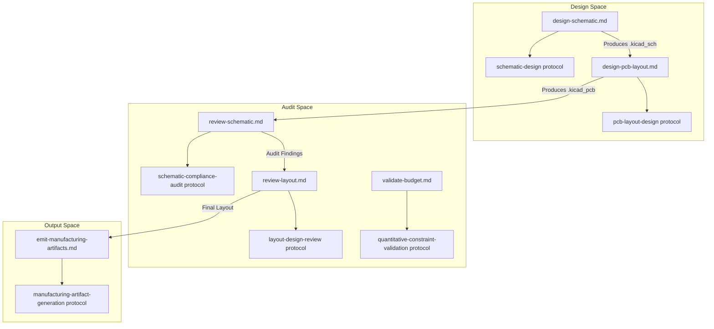
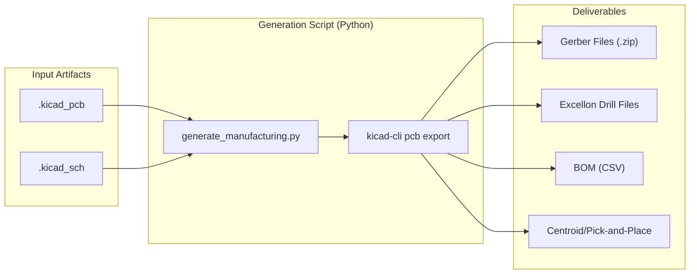

<!-- source: DeepWiki mcp.deepwiki.com · repo microsoft/PromptKit · page 3.4 Hardware Design Templates · fetched 2026-10-26 -->

# Hardware Design Templates

Relevant source files

The following files were used as context for generating this wiki page:

- [personas/electrical-engineer.md](personas/electrical-engineer.md)
- [personas/mechanical-engineer.md](personas/mechanical-engineer.md)
- [personas/rf-engineer.md](personas/rf-engineer.md)
- [protocols/analysis/bom-consistency.md](protocols/analysis/bom-consistency.md)
- [protocols/analysis/component-selection-audit.md](protocols/analysis/component-selection-audit.md)
- [protocols/analysis/enclosure-design-review.md](protocols/analysis/enclosure-design-review.md)
- [protocols/analysis/layout-design-review.md](protocols/analysis/layout-design-review.md)
- [protocols/analysis/link-budget-audit.md](protocols/analysis/link-budget-audit.md)
- [protocols/analysis/schematic-compliance-audit.md](protocols/analysis/schematic-compliance-audit.md)
- [protocols/analysis/simulation-validation.md](protocols/analysis/simulation-validation.md)
- [protocols/reasoning/component-selection.md](protocols/reasoning/component-selection.md)
- [protocols/reasoning/manufacturing-artifact-generation.md](protocols/reasoning/manufacturing-artifact-generation.md)
- [protocols/reasoning/pcb-layout-design.md](protocols/reasoning/pcb-layout-design.md)
- [protocols/reasoning/schematic-design.md](protocols/reasoning/schematic-design.md)
- [templates/audit-link-budget.md](templates/audit-link-budget.md)
- [templates/design-pcb-layout.md](templates/design-pcb-layout.md)
- [templates/design-schematic.md](templates/design-schematic.md)
- [templates/emit-manufacturing-artifacts.md](templates/emit-manufacturing-artifacts.md)
- [templates/hardware-design-workflow.md](templates/hardware-design-workflow.md)
- [templates/review-bom.md](templates/review-bom.md)
- [templates/review-enclosure.md](templates/review-enclosure.md)
- [templates/review-layout.md](templates/review-layout.md)
- [templates/review-schematic.md](templates/review-schematic.md)
- [templates/validate-budget.md](templates/validate-budget.md)
- [templates/validate-simulation.md](templates/validate-simulation.md)

The Hardware Design Templates in PromptKit cover the full hardware engineering lifecycle, from initial requirements and component selection to the generation of manufacturing-ready artifacts. These templates orchestrate complex, multi-phase workflows that integrate electrical, mechanical, and RF engineering domains through structured reasoning and analysis protocols.

## Lifecycle Architecture

The hardware lifecycle is implemented as a series of interconnected templates that manage the transition between different engineering states. This process is primarily driven by the `electrical-engineer` and `specification-analyst` personas, utilizing KiCad-specific automation and adversarial auditing.

### Hardware-Code Entity Mapping

The following diagram bridges the conceptual hardware design phases to the specific template and protocol entities within the codebase.

**Hardware Engineering Entity Map**

**Sources:** [templates/design-schematic.md:5-21](), [templates/design-pcb-layout.md:5-20](), [templates/emit-manufacturing-artifacts.md:5-18](), [protocols/reasoning/manufacturing-artifact-generation.md:5-18]()

---

## Design and Synthesis Templates

These templates are interactive and guide the user through the creation of hardware artifacts.

### Schematic Design (`design-schematic`)
This template manages the transition from natural language requirements to a formal KiCad schematic. It implements a gate-based workflow:
1.  **Requirements Discovery**: Extracting features, power sources, and environmental constraints [templates/design-schematic.md:80-116]().
2.  **Component Selection**: Utilizing the `component-selection` protocol to identify core ICs and modules [protocols/reasoning/component-selection.md:19-31]().
3.  **Adversarial Audit**: The `component-selection-audit` protocol verifies that selected parts actually exist and meet specs before schematic entry [protocols/analysis/component-selection-audit.md:20-25]().
4.  **S-Expression Generation**: Produces the final `.kicad_sch` file using the `schematic-design` protocol [protocols/reasoning/schematic-design.md:18-26]().

### PCB Layout Design (`design-pcb-layout`)
This template handles the physical implementation of the schematic. It is notable for generating automation scripts:
*   **Python Automation**: Generates scripts using the KiCad `pcbnew` API for component placement [protocols/reasoning/pcb-layout-design.md:173-199]().
*   **Routing Integration**: Interfaces with `FreeRouting` via `.dsn` exports [protocols/reasoning/pcb-layout-design.md:33-38]().
*   **DRC Loop**: Orchestrates a validation loop using `kicad-cli` to ensure the layout is manufacture-ready [protocols/reasoning/pcb-layout-design.md:245-265]().

---

## Analysis and Validation Templates

These templates perform "adversarial" reviews of existing hardware designs to find defects before fabrication.

### Budget and Constraint Validation
The `validate-budget` template [templates/validate-budget.md:1-33]() is used to verify quantitative claims against specifications.

| Budget Type | Key Verification Metrics | Source Protocol |
| :--- | :--- | :--- |
| **Power** | Peak vs. Average current, LDO dropout, battery life | `quantitative-constraint-validation` |
| **Link** | Path loss models, dB calculations, regulatory limits | `link-budget-audit` |
| **Memory** | Alignment/padding, static vs. dynamic allocation | `quantitative-constraint-validation` |
| **Timing** | Critical path summation, worst-case values | `quantitative-constraint-validation` |

**Sources:** [templates/validate-budget.md:70-84](), [protocols/analysis/link-budget-audit.md:1-20]()

### Enclosure Review (`review-enclosure`)
This template bridges mechanical and electrical engineering. It audits the physical housing against the PCB specifications, focusing on:
*   **Antenna Keepouts**: Ensuring the enclosure material or geometry doesn't attenuate RF signals [templates/review-enclosure.md:64-71]().
*   **Thermal Paths**: Verifying air flow or heat-sinking for high-power components [templates/review-enclosure.md:130-131]().
*   **Ingress Protection**: Assessing the design against IP-rating requirements [templates/review-enclosure.md:89-94]().

---

## Manufacturing and Artifact Generation

The final stage of the hardware lifecycle is the generation of deliverables for fabrication houses (e.g., JLCPCB, PCBWay).

### Manufacturing Workflow Data Flow
The `emit-manufacturing-artifacts` template automates the creation of the "fab package" using `kicad-cli`.

**Manufacturing Pipeline**

**Sources:** [protocols/reasoning/manufacturing-artifact-generation.md:106-113](), [protocols/reasoning/manufacturing-artifact-generation.md:133-143](), [templates/emit-manufacturing-artifacts.md:142-157]()

### Key Generation Functions
The protocol defines specific requirements for the generated Python script:
*   **Gerber Export**: Maps KiCad layers to Protel extensions (e.g., `F.Cu` to `.GTL`) [protocols/reasoning/manufacturing-artifact-generation.md:78-91]().
*   **Drill Generation**: Separates Plated Through-Hole (PTH) and Non-Plated Through-Hole (NPTH) files [protocols/reasoning/manufacturing-artifact-generation.md:118-132]().
*   **BOM Formatting**: Applies fab-specific logic, such as mapping schematic fields to "LCSC" or "CPL" columns for JLCPCB [protocols/reasoning/manufacturing-artifact-generation.md:185-188]().

**Sources:** [protocols/reasoning/manufacturing-artifact-generation.md:1-200](), [templates/emit-manufacturing-artifacts.md:1-100]()

---

