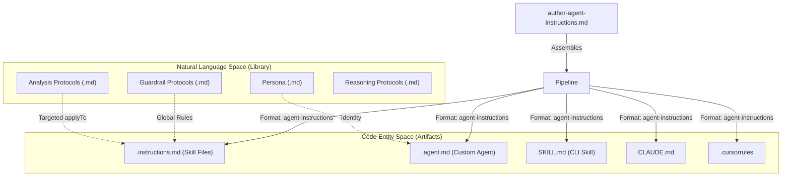

<!-- source: DeepWiki mcp.deepwiki.com · repo microsoft/PromptKit · page 3.5 Agent Instructions and Prompt Engineering Templates · fetched 2026-10-26 -->

# Agent Instructions and Prompt Engineering Templates

<details>
<summary>Relevant source files</summary>

The following files were used as context for generating this wiki page:

- [TESTING.md](TESTING.md)
- [docs/case-studies/audit-library-health-report.md](docs/case-studies/audit-library-health-report.md)
- [docs/case-studies/audit-library-health.md](docs/case-studies/audit-library-health.md)
- [docs/case-studies/author-agent-instructions.md](docs/case-studies/author-agent-instructions.md)
- [formats/agent-instructions.md](formats/agent-instructions.md)
- [formats/multi-artifact.md](formats/multi-artifact.md)
- [formats/portability-report.md](formats/portability-report.md)
- [formats/promptkit-pull-request.md](formats/promptkit-pull-request.md)
- [personas/promptkit-contributor.md](personas/promptkit-contributor.md)
- [protocols/analysis/prompt-determinism-analysis.md](protocols/analysis/prompt-determinism-analysis.md)
- [protocols/reasoning/corpus-safety-audit.md](protocols/reasoning/corpus-safety-audit.md)
- [protocols/reasoning/iterative-refinement.md](protocols/reasoning/iterative-refinement.md)
- [protocols/reasoning/prompt-decomposition.md](protocols/reasoning/prompt-decomposition.md)
- [protocols/reasoning/prompt-portability-evaluation.md](protocols/reasoning/prompt-portability-evaluation.md)
- [protocols/reasoning/promptkit-design.md](protocols/reasoning/promptkit-design.md)
- [protocols/reasoning/quantitative-constraint-validation.md](protocols/reasoning/quantitative-constraint-validation.md)
- [protocols/reasoning/spec-evolution-diff.md](protocols/reasoning/spec-evolution-diff.md)
- [taxonomies/kernel-defect-categories.md](taxonomies/kernel-defect-categories.md)
- [templates/audit-code-compliance.md](templates/audit-code-compliance.md)
- [templates/audit-library-consistency.md](templates/audit-library-consistency.md)
- [templates/audit-library-health.md](templates/audit-library-health.md)
- [templates/author-agent-instructions.md](templates/author-agent-instructions.md)
- [templates/decompose-prompt.md](templates/decompose-prompt.md)
- [templates/diff-specifications.md](templates/diff-specifications.md)
- [templates/evaluate-prompt-portability.md](templates/evaluate-prompt-portability.md)
- [templates/extend-library.md](templates/extend-library.md)
- [templates/review-cpp-code.md](templates/review-cpp-code.md)

</details>


The **Agent Instructions and Prompt Engineering** category of templates provides the mechanisms for maintaining, extending, and exporting the PromptKit library. These templates allow users to transform composable PromptKit components into persistent agent configurations for platforms like GitHub Copilot and Claude, perform deep structural audits of the library itself, and reverse-engineer bespoke prompts into the PromptKit five-layer model.

## Component Architecture for Agent Instructions

The library uses the `agent-instructions` format to bridge the gap between "Natural Language Space" (composable markdown files) and "Code Entity Space" (persistent configuration files used by IDEs and CLI tools).

### Data Flow: Component Assembly to Agent Files

The following diagram illustrates how the `author-agent-instructions` template [templates/author-agent-instructions.md:5-17]() consumes library entities to produce platform-specific artifacts.

**Diagram: Agent Instruction Synthesis**

**Sources:** [formats/agent-instructions.md:31-54](), [templates/author-agent-instructions.md:92-117]()

## Persistent Agent Configurations

PromptKit supports three primary output types for agent persistence [templates/author-agent-instructions.md:44-51]():

1.  **Instructions (Default):** Produces composable skill files for GitHub Copilot. Each PromptKit protocol is mapped to a separate `.instructions.md` file in `.github/instructions/` [formats/agent-instructions.md:22-25](). These use the `applyTo` frontmatter field to target specific file patterns (e.g., `**/*.c` for memory safety protocols) [formats/agent-instructions.md:71-75]().
2.  **Agent:** Produces a standalone `.agent.md` file in `.github/agents/`. This defines a specialized persona with specific tool permissions (e.g., `search/codebase`, `edit`) and model preferences [formats/agent-instructions.md:89-107]().
3.  **Skill:** Produces a `SKILL.md` file in `.github/skills/<name>/`. This defines a reusable workflow invokable via slash commands in the Copilot CLI [formats/agent-instructions.md:147-164]().

**Sources:** [formats/agent-instructions.md:31-43](), [templates/author-agent-instructions.md:98-117]()

## Library Health and Consistency Auditing

The library includes self-referential templates for maintaining the integrity of the component graph. The `audit-library-health` template [templates/audit-library-health.md:5-13]() executes a four-pass analysis of the repository.

### Health Audit Workflow
The audit is typically run interactively within a repository session [templates/audit-library-health.md:61-70]().

| Pass | Focus Area | Key Protocol / Logic |
| :--- | :--- | :--- |
| **Pass 1** | **Structural Consistency** | Detects protocol overlap, template near-duplicates, and terminology drift [templates/audit-library-health.md:108-140](). |
| **Pass 2** | **Corpus Safety** | Applies `corpus-safety-audit` to detect verbatim copying, license issues, or confidential leaks [protocols/reasoning/corpus-safety-audit.md:17-22](). |
| **Pass 3** | **Runtime Fitness** | Assesses prompt length, token bloat, and execution efficiency [templates/audit-library-health.md:222-230](). |
| **Pass 4** | **Determinism** | Applies `prompt-determinism-analysis` to flag vague quantifiers or subjective adjectives [protocols/analysis/prompt-determinism-analysis.md:7-13](). |

**Sources:** [templates/audit-library-health.md:40-42](), [docs/case-studies/audit-library-health-report.md:21-28]()

## Prompt Engineering and Portability

PromptKit provides tools for reverse-engineering existing prompts and validating their behavior across different LLM models.

### Portability Evaluation Pipeline
The `evaluate-prompt-portability` template [templates/evaluate-prompt-portability.md:5-18]() automates the comparison of a prompt's performance across models like Claude and GPT-4.

**Diagram: Portability Analysis Logic**
```mermaid
flowchart LR
    subgraph "Input"
        Prompt["Assembled Prompt"]
        Input["Golden Input"]
    end

    subgraph "Execution"
        M1["Model A"]
        M2["Model B"]
        M3["Model C"]
    end

    subgraph "Arbiter Logic"
        Extract["Claim Extraction"]
        Match["Semantic Matching"]
        Classify["Consensus Classification"]
    end

    Prompt --> M1 & M2 & M3
    Input --> M1 & M2 & M3
    M1 & M2 & M3 --> Extract
    Extract --> Match
    Match --> Classify
    Classify --> Report["Portability Report"]
```
**Sources:** [templates/evaluate-prompt-portability.md:72-102](), [protocols/reasoning/prompt-portability-evaluation.md:41-91]()

### Portability Metrics
Portability is measured at the **claim** level—atomic assertions made by the output—rather than raw text comparison [protocols/reasoning/prompt-portability-evaluation.md:18-23]().

*   **Consensus:** Claims produced by all models [protocols/reasoning/prompt-portability-evaluation.md:98]().
*   **Majority:** Claims produced by >50% of models [protocols/reasoning/prompt-portability-evaluation.md:99]().
*   **Singular:** Claims produced by exactly one model (potential hallucination or unique insight) [protocols/reasoning/prompt-portability-evaluation.md:100]().
*   **Contradictory:** Mutually exclusive assertions (indicates high prompt ambiguity) [protocols/reasoning/prompt-portability-evaluation.md:101]().

**Sources:** [formats/portability-report.md:16-20](), [protocols/reasoning/prompt-portability-evaluation.md:92-101]()

## Prompt Decomposition and Assimilation

The `decompose-prompt` template [templates/decompose-prompt.md:5-12]() is used to ingest bespoke, hand-written prompts into the library. It reverse-engineers the text into the five-layer model:

1.  **Ingestion:** Reads the source prompt and performs a confidentiality triage [templates/decompose-prompt.md:46-60]().
2.  **Segmentation:** Breaks the prompt into semantic segments (Persona, Protocol, Format, etc.) [templates/decompose-prompt.md:88-89]().
3.  **Library Matching:** Maps segments to existing components in `manifest.yaml` [templates/decompose-prompt.md:90-91]().
4.  **Synthesis:** Generates new component files and manifest updates for novel segments [templates/decompose-prompt.md:113-122]().

**Sources:** [templates/decompose-prompt.md:32-35](), [protocols/reasoning/prompt-decomposition.md]() (referenced).

---

