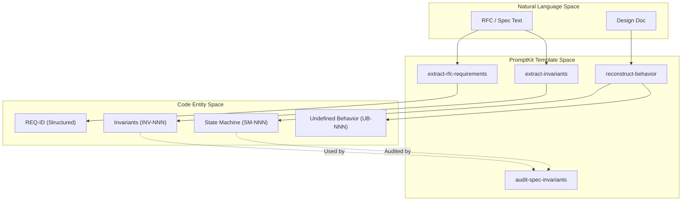
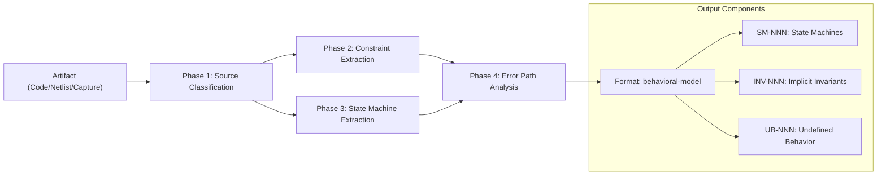

<!-- source: DeepWiki mcp.deepwiki.com · repo microsoft/PromptKit · page 3.6 Protocol Engineering Templates · fetched 2026-10-26 -->

# Protocol Engineering Templates

Relevant source files

The following files were used as context for generating this wiki page:

- [docs/case-studies/sonde-protocol-evolution.md](docs/case-studies/sonde-protocol-evolution.md)
- [docs/case-studies/sonde-specification-audit.md](docs/case-studies/sonde-specification-audit.md)
- [formats/behavioral-model.md](formats/behavioral-model.md)
- [formats/protocol-delta.md](formats/protocol-delta.md)
- [formats/protocol-validation-spec.md](formats/protocol-validation-spec.md)
- [formats/rfc-document.md](formats/rfc-document.md)
- [personas/embedded-firmware-engineer.md](personas/embedded-firmware-engineer.md)
- [personas/protocol-architect.md](personas/protocol-architect.md)
- [protocols/reasoning/invariant-extraction.md](protocols/reasoning/invariant-extraction.md)
- [protocols/reasoning/protocol-conflict-analysis.md](protocols/reasoning/protocol-conflict-analysis.md)
- [protocols/reasoning/protocol-evolution.md](protocols/reasoning/protocol-evolution.md)
- [protocols/reasoning/protocol-validation-design.md](protocols/reasoning/protocol-validation-design.md)
- [protocols/reasoning/rfc-extraction.md](protocols/reasoning/rfc-extraction.md)
- [protocols/reasoning/spec-invariant-audit.md](protocols/reasoning/spec-invariant-audit.md)
- [taxonomies/protocol-change-categories.md](taxonomies/protocol-change-categories.md)
- [templates/analyze-protocol-conflicts.md](templates/analyze-protocol-conflicts.md)
- [templates/audit-spec-invariants.md](templates/audit-spec-invariants.md)
- [templates/author-protocol-validation.md](templates/author-protocol-validation.md)
- [templates/author-rfc.md](templates/author-rfc.md)
- [templates/evolve-protocol.md](templates/evolve-protocol.md)
- [templates/extract-invariants.md](templates/extract-invariants.md)
- [templates/extract-rfc-requirements.md](templates/extract-rfc-requirements.md)
- [templates/reconstruct-behavior.md](templates/reconstruct-behavior.md)

The **Protocol Engineering Templates** in PromptKit provide a specialized toolset for the rigorous design, formalization, evolution, and auditing of communication protocols. These templates bridge the gap between high-level RFCs and low-level implementation by enforcing systematic reasoning protocols that detect ambiguities, state machine gaps, and invariant violations before they manifest as bugs in code.

## Architectural Overview

Protocol engineering in PromptKit follows a pipeline-oriented approach where engineering artifacts (specs, code, or captures) are transformed into structured models or validated against formal invariants.

### Data Flow and Pipeline Integration
The protocol engineering workflow typically starts with **Extraction**, moves to **Analysis/Audit**, and concludes with **Evolution** or **Validation**.

1.  **Extraction**: `extract-rfc-requirements` or `extract-invariants` convert raw text/code into structured requirements.
2.  **Modeling**: `reconstruct-behavior` builds a formal `behavioral-model` (state machines + flow graphs) from existing artifacts.
3.  **Audit**: `audit-spec-invariants` performs adversarial analysis to find edge cases where a spec permits invariant violations.
4.  **Evolution**: `evolve-protocol` manages the lifecycle of changing a protocol across multiple components.

### Natural Language to Code Entity Space
The following diagram illustrates how natural language specifications are decomposed into formal code-like entities (States, Transitions, Invariants) using PromptKit templates and protocols.

**Protocol Engineering Entity Mapping**

**Sources:** [templates/extract-rfc-requirements.md:33-40](), [templates/extract-invariants.md:33-38](), [templates/reconstruct-behavior.md:36-43](), [templates/audit-spec-invariants.md:33-39]()

---

## Core Templates

### 1. Specification and Requirement Extraction
These templates focus on normalizing unstructured engineering documents into machine-readable or audit-ready formats.

| Template | Primary Protocol | Output Format | Purpose |
| :--- | :--- | :--- | :--- |
| `author-rfc` | `guardrails/anti-hallucination` | `rfc-document` (xml2rfc v3) | Authors valid XML for the IETF toolchain [templates/author-rfc.md:7-10]() |
| `extract-rfc-requirements` | `reasoning/rfc-extraction` | `requirements-doc` | Normalizes RFC 2119 keywords into REQ-IDs [templates/extract-rfc-requirements.md:7-11]() |
| `extract-invariants` | `reasoning/invariant-extraction` | `requirements-doc` | Extracts a dense subset of enforceable constraints [templates/extract-invariants.md:7-10]() |

#### `extract-rfc-requirements` Implementation Detail
This template uses a specialized ID scheme `REQ-{{tag}}-<SECTION>-<NNN>` to ensure that every extracted requirement is directly traceable to a specific paragraph in the source RFC [templates/extract-rfc-requirements.md:60-65](). It preserves the exact "keyword strength" (MUST, SHOULD, MAY) as metadata for downstream compliance checking [templates/extract-rfc-requirements.md:67-72]().

**Sources:** [templates/author-rfc.md:1-32](), [templates/extract-rfc-requirements.md:1-31](), [templates/extract-invariants.md:1-31]()

---

### 2. Behavioral Reconstruction and Modeling
`reconstruct-behavior` is used to "reverse-engineer" the actual behavior of a system from its artifacts.

**Reconstruction Logic Flow**

**Sources:** [protocols/reasoning/invariant-extraction.md:26-130](), [templates/reconstruct-behavior.md:60-109](), [formats/behavioral-model.md:15-147]()

*   **State Machine Extraction**: Identifies states, triggers, guards, and actions to build a `Transition Table` [protocols/reasoning/invariant-extraction.md:85-103]().
*   **Undefined Behavior Catalog**: Specifically identifies `state × event` combinations that are not handled in the artifact, flagging them as `UB-NNN` entries [formats/behavioral-model.md:123-134]().
*   **Implicit Invariants**: Captures guarantees the system maintains (e.g., "Mutual Exclusion") even if they aren't documented [formats/behavioral-model.md:108-122]().

---

### 3. Adversarial Invariant Auditing
The `audit-spec-invariants` template applies the `spec-invariant-audit` protocol to find "compliant-but-violating" interpretations of a specification.

#### Methodology: The Disproof Discipline
The protocol mandates a "Disproof Discipline": before reporting a finding, the agent must actively search the spec for other sections that might close the gap [protocols/reasoning/spec-invariant-audit.md:109-116]().

**Finding Severity Classification:**
*   **Critical**: Straightforward reading permits violation [templates/audit-spec-invariants.md:99-101]().
*   **High**: Ambiguous/underspecified area permits violation [templates/audit-spec-invariants.md:102-103]().
*   **Medium**: Requires combining multiple sections or implicit assumptions [templates/audit-spec-invariants.md:104-105]().

**Sources:** [templates/audit-spec-invariants.md:1-110](), [protocols/reasoning/spec-invariant-audit.md:17-148]()

---

### 4. Protocol Evolution
The `evolve-protocol` template manages the complexity of changing a protocol that is shared across multiple distributed components.

**Evolution Lifecycle (The 8-Phase Pipeline)**
1.  **Requirements Discovery**: Interactive gate to confirm the crypto/logic model [docs/case-studies/sonde-protocol-evolution.md:46]().
2.  **Specification Changes**: Updating the "source of truth" [docs/case-studies/sonde-protocol-evolution.md:48]().
3.  **Adversarial Audit**: Checking the new spec for drift [docs/case-studies/sonde-protocol-evolution.md:50]().
4.  **User Review**: Human-in-the-loop sign-off [docs/case-studies/sonde-protocol-evolution.md:52]().
5.  **Implementation**: Code changes (often using feature flags) [docs/case-studies/sonde-protocol-evolution.md:54]().
6.  **Implementation Audit**: Code-to-spec compliance check [docs/case-studies/sonde-protocol-evolution.md:56]().
7.  **Final Review**: Review of the implemented change [docs/case-studies/sonde-protocol-evolution.md:58]().
8.  **Deliverable**: Final artifact creation [docs/case-studies/sonde-protocol-evolution.md:60]().

**Sources:** [docs/case-studies/sonde-protocol-evolution.md:35-61]()

---

## Case Study: Sonde Specification Audit
The effectiveness of these templates was demonstrated in the **Sonde Project**, an IoT runtime.

*   **Scope**: 5 components, 260 requirements, 15 spec documents [docs/case-studies/sonde-specification-audit.md:3-13]().
*   **Outcome**: 147 findings using `audit-traceability` (a specialized version of the protocol engineering templates) [docs/case-studies/sonde-specification-audit.md:3-4]().
*   **Systemic Discovery**: The audit identified that **BLE pairing requirements** were added to the system, but the design documents for the Modem, Node, and Gateway were never updated to reflect the crypto and session logic [docs/case-studies/sonde-specification-audit.md:88-101]().

**Drift Type Distribution (Taxonomy: `specification-drift`)**
| Type | Description | Findings |
| :--- | :--- | :--- |
| **D1** | Untraced Requirement (Req exists, no Design) | 12 |
| **D2** | Untested Requirement (Req exists, no Test) | 10 |
| **D5** | Assumption Drift (Cross-doc conflict) | 7 |
| **D6** | Constraint Violation (Design contradicts Req) | 3 |

**Sources:** [docs/case-studies/sonde-specification-audit.md:121-132](), [docs/case-studies/sonde-specification-audit.md:102-108]()

---

