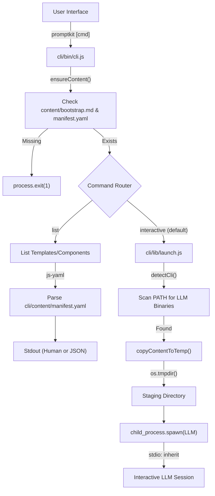
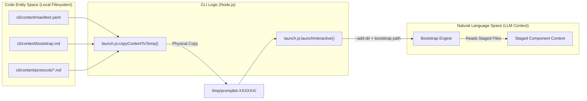

<!-- source: DeepWiki mcp.deepwiki.com · repo microsoft/PromptKit · page 4 CLI Reference · fetched 2026-10-26 -->

# CLI Reference

Relevant source files

The following files were used as context for generating this wiki page:

- [cli/bin/cli.js](cli/bin/cli.js)
- [cli/package-lock.json](cli/package-lock.json)
- [cli/package.json](cli/package.json)
- [cli/specs/design.md](cli/specs/design.md)
- [cli/specs/requirements.md](cli/specs/requirements.md)
- [cli/specs/validation.md](cli/specs/validation.md)
- [docs/case-studies/ebpf-epoch.md](docs/case-studies/ebpf-epoch.md)

The PromptKit CLI (`@alan-jowett/promptkit`) is a Node.js-based tool designed to bridge the gap between the static component library and active Large Language Model (LLM) sessions [cli/package.json:2-4](). It automates the discovery of local LLM interfaces, stages necessary library content, and initializes sessions with a specialized bootstrap prompt [cli/specs/requirements.md:31-35]().

## CLI Architecture and Command Flow

The CLI is built using `commander` for argument parsing and `js-yaml` for manifest processing [cli/package.json:25-28](). It operates as a thin lifecycle manager that delegates the actual prompt assembly logic to the LLM itself via the `bootstrap.md` engine [cli/specs/requirements.md:42-48]().

### Command Execution Pipeline

The following diagram illustrates how the `promptkit` binary routes user requests and interacts with the filesystem and external LLM processes.

**Diagram: CLI Command Routing and Execution**

Sources: [cli/bin/cli.js:42-83](), [cli/lib/launch.js:21-41](), [cli/specs/design.md:62-86]()

## Core Capabilities

The CLI provides two primary functional areas: discovery and session management.

### 1. Interactive Session Launch
The `interactive` command (default) automates the setup of an engineering session. It performs the following steps:
*   **CLI Detection**: Probes the system `PATH` for supported binaries in priority order: `copilot`, `gh copilot`, and `claude` [cli/specs/requirements.md:81-84]().
*   **Staging**: Copies the library content (personas, protocols, etc.) to a temporary directory to ensure the LLM has a clean, accessible workspace [cli/lib/launch.js:37-41]().
*   **Bootstrapping**: Spawns the LLM process with a specific instruction to read and execute the `bootstrap.md` file located in the staging directory [cli/specs/requirements.md:123-131]().

For details on detection logic and cross-platform shims, see [CLI Internals: Launch and Session Management](#4.2).

### 2. Component Discovery
The `list` and `search` commands provide visibility into the library without launching a session.
*   **Template Listing**: By default, `list` enumerates available templates grouped by category [cli/bin/cli.js:157-162]().
*   **Filtering**: Users can filter by `--type` (persona, protocol, format, taxonomy, template), `--category`, or `--language` [cli/bin/cli.js:89-96]().
*   **Metadata Inspection**: The `show <name>` command displays detailed frontmatter, including input/output contracts and cross-references [cli/bin/cli.js:196-204]().

For a full reference of flags and output modes, see [CLI Commands and Usage](#4.1).

## Bridging Code Entities to LLM Space

The CLI acts as the physical bridge between the `Code Entity Space` (files on disk) and the `Natural Language Space` (the LLM's context).

**Diagram: Staging and Context Injection**

Sources: [cli/lib/launch.js:82-110](), [cli/specs/requirements.md:133-141](), [cli/specs/design.md:140-171]()

## Build and Distribution

The CLI is distributed as the `@alan-jowett/promptkit` npm package [cli/package.json:2](). Because the library content resides at the repository root but the CLI needs it bundled, a `copy-content.js` script runs during the `prepublish` and `prepare` lifecycles to sync components into the package structure [cli/package.json:19-22]().

For details on the build pipeline and testing infrastructure, see [CLI Build, Distribution, and Testing](#4.3).

## Summary of Sub-Pages

*   **[CLI Commands and Usage](#4.1)**: Detailed guide for `interactive`, `list`, `search`, and `show`. Covers JSON output for automation and update-check behavior.
*   **[CLI Internals: Launch and Session Management](#4.2)**: Technical details on `child_process` management, Windows `.cmd` resolution, and staging directory lifecycles.
*   **[CLI Build, Distribution, and Testing](#4.3)**: Overview of the npm packaging process, the `copy-content.js` utility, and the Node.js built-in test suite.

Sources:
* [cli/package.json:1-45]()
* [cli/bin/cli.js:1-209]()
* [cli/lib/launch.js:1-120]()
* [cli/specs/requirements.md:27-150]()
* [cli/specs/design.md:24-122]()

---

