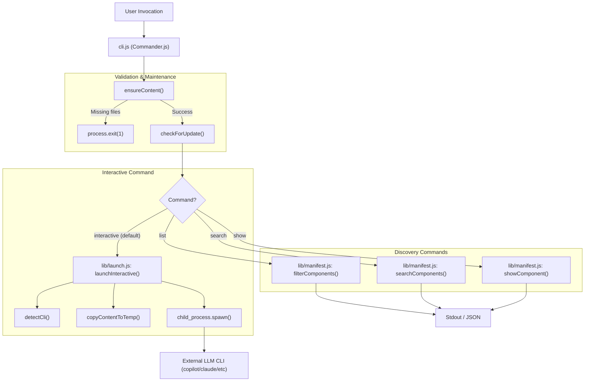
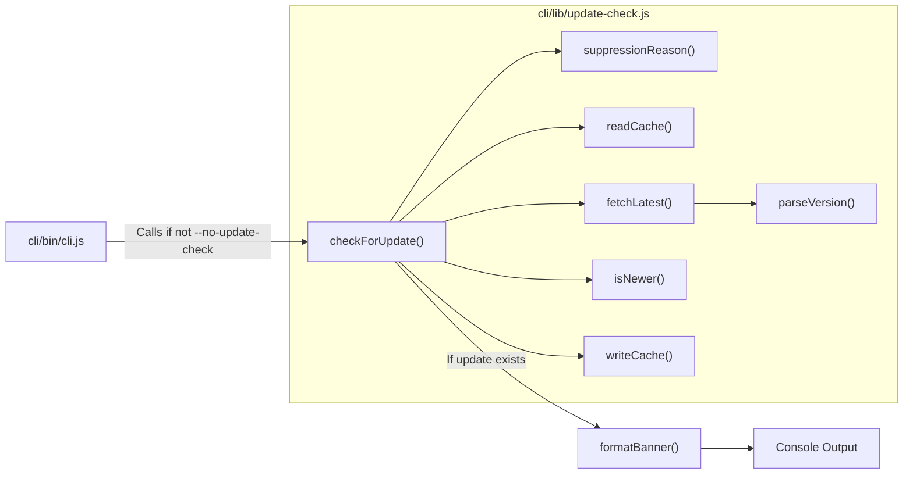

<!-- source: DeepWiki mcp.deepwiki.com · repo microsoft/PromptKit · page 4.1 CLI Commands and Usage · fetched 2026-10-26 -->

# CLI Commands and Usage

<details>
<summary>Relevant source files</summary>

The following files were used as context for generating this wiki page:

- [cli/bin/cli.js](cli/bin/cli.js)
- [cli/lib/manifest.js](cli/lib/manifest.js)
- [cli/lib/update-check.js](cli/lib/update-check.js)
- [cli/package-lock.json](cli/package-lock.json)
- [cli/package.json](cli/package.json)
- [cli/specs/design.md](cli/specs/design.md)
- [cli/specs/requirements.md](cli/specs/requirements.md)
- [cli/specs/validation.md](cli/specs/validation.md)
- [cli/tests/cli.test.js](cli/tests/cli.test.js)
- [cli/tests/list.test.js](cli/tests/list.test.js)
- [cli/tests/search-show.test.js](cli/tests/search-show.test.js)
- [cli/tests/update-check.test.js](cli/tests/update-check.test.js)
- [docs/case-studies/ebpf-epoch.md](docs/case-studies/ebpf-epoch.md)
- [scripts/generate-catalog.js](scripts/generate-catalog.js)

</details>


The PromptKit CLI (`@alan-jowett/promptkit`) is a Node.js-based tool designed to bridge the gap between the reusable component library and interactive LLM sessions. Its primary purpose is to stage the PromptKit library and launch a supported LLM CLI with a bootstrap instruction that delegates prompt assembly to the LLM itself [cli/specs/requirements.md:31-37]().

## Architecture and Command Flow

The CLI is built on the `commander` framework and follows a specific execution flow: validating local content, checking for updates, and then executing the requested command [cli/bin/cli.js:42-51]().

### Command Execution Flow
The following diagram illustrates the data flow from user invocation to the final LLM process launch.

**CLI Command Routing and Data Flow**

**Sources:** [cli/bin/cli.js:54-204](), [cli/specs/design.md:62-86]()

---

## Command Reference

### 1. `interactive` (Default)
Launches an interactive session with a supported LLM CLI. If no command is provided, this is the default action [cli/bin/cli.js:54-55]().

*   **Logic**: It detects an LLM CLI on the system `PATH` (priority: `copilot` → `gh-copilot` → `claude` → `codex`), copies the PromptKit library to a temporary directory, and spawns the LLM process with a bootstrap instruction [cli/specs/requirements.md:81-86](), [cli/specs/design.md:146-155]().
*   **Options**:
    *   `--cli <name>`: Overrides auto-detection. Supported: `copilot`, `gh-copilot`, `claude`, `codex` [cli/bin/cli.js:58-60]().
    *   `--dry-run`: Prints the command that would be executed without launching it [cli/bin/cli.js:61-64]().
    *   `--no-update-check`: Skips the best-effort npm registry update check [cli/bin/cli.js:65-68]().

**Sources:** [cli/bin/cli.js:54-83](), [cli/lib/launch.js:21-35]()

### 2. `list`
Enumerates available components from the manifest. By default, it lists only templates grouped by category [cli/bin/cli.js:86-113]().

*   **Options**:
    *   `--all`: Lists all component types (personas, protocols, formats, taxonomies, templates) [cli/bin/cli.js:89]().
    *   `--type <type>`: Filters by specific layer (e.g., `protocol`, `format`) [cli/bin/cli.js:90-93]().
    *   `--category <category>`: Filters by domain category (e.g., `Guardrails`) [cli/bin/cli.js:94]().
    *   `--language <language>`: Filters protocols by target programming language [cli/bin/cli.js:95]().
    *   `--json`: Outputs the results as a raw JSON array for programmatic use [cli/bin/cli.js:96]().

**Sources:** [cli/bin/cli.js:86-153](), [cli/lib/manifest.js:135-155]()

### 3. `search <keyword>`
Performs a case-insensitive search across component names and descriptions [cli/bin/cli.js:156-158]().

*   **Implementation**: Uses `lib/manifest.js:searchComponents()` to scan the unified component list [cli/bin/cli.js:168]().
*   **Options**:
    *   `--type <type>`: Restricts search to a specific component layer [cli/bin/cli.js:159-162]().
    *   `--json`: Returns search results in JSON format [cli/bin/cli.js:163]().

**Sources:** [cli/bin/cli.js:156-193](), [cli/lib/manifest.js:123-130]()

### 4. `show <name>`
Displays detailed information for a specific component, including metadata (tone, domain, produces/consumes) and reverse cross-references [cli/bin/cli.js:196-198]().

*   **Cross-References**: Shows which templates utilize the specific persona, protocol, or format being inspected [cli/lib/manifest.js:169-178]().
*   **Options**:
    *   `--json`: Outputs full component metadata as JSON [cli/bin/cli.js:199]().

**Sources:** [cli/bin/cli.js:196-208](), [cli/lib/manifest.js:160-181]()

---

## Implementation Details

### Manifest and Discovery Subsystem
The discovery commands (`list`, `search`, `show`) rely on the `loadManifest` function in `lib/manifest.js`. This module parses the central `manifest.yaml` and builds an in-memory graph of component relationships [cli/lib/manifest.js:14-62]().

**Natural Language to Code Entity Mapping: Discovery**
| Concept | Code Entity | File Reference |
| :--- | :--- | :--- |
| **Manifest Loader** | `loadManifest(contentDir)` | [cli/lib/manifest.js:14]() |
| **Component Search** | `searchComponents(components, keyword)` | [cli/lib/manifest.js:123]() |
| **Cross-Ref Builder** | `buildCrossRefs(components)` | [cli/lib/manifest.js:71]() |
| **Type Filtering** | `filterComponents(components, opts)` | [cli/lib/manifest.js:135]() |

**Sources:** [cli/lib/manifest.js:1-190]()

### Update-Check Subsystem
The CLI includes a "best-effort" update notifier. It is designed to be non-blocking and will never fail the CLI execution if the network or registry is unavailable [cli/lib/update-check.js:4-7]().

*   **Caching**: Results are cached in `~/.promptkit/update-check.json` with a 24-hour Time-To-Live (TTL) [cli/lib/update-check.js:14-20]().
*   **Suppression**: The check is automatically skipped in CI environments, non-TTY terminals, or if the `NO_UPDATE_NOTIFIER` environment variable is set [cli/lib/update-check.js:141-148]().
*   **Logic**: It compares the `version` field in `package.json` against the `latest` tag from the npm registry using a custom semver parser [cli/lib/update-check.js:43-58]().

**Natural Language to Code Entity Mapping: Update Subsystem**

**Sources:** [cli/lib/update-check.js:1-198](), [cli/bin/cli.js:71-81]()

---

## Output Modes

### Human-Readable (Default)
Components are grouped by their layer and category. Descriptions are truncated to the first line for brevity [cli/bin/cli.js:38-40]().
```text
  protocol / analysis
    c-memory-safety                     Memory safety analysis for C code.
    rust-ownership-rules                Audit for Borrow Checker compliance.
```

### JSON Mode
The `--json` flag provides a structured array of objects. This is the preferred mode for integration with other tools or scripts [cli/bin/cli.js:115-118]().
```json
[
  {
    "name": "c-memory-safety",
    "type": "protocol",
    "category": "analysis",
    "description": "Memory safety analysis for C code.",
    "language": "c"
  }
]
```

**Sources:** [cli/bin/cli.js:115-118](), [cli/tests/list.test.js:50-71]()

---

