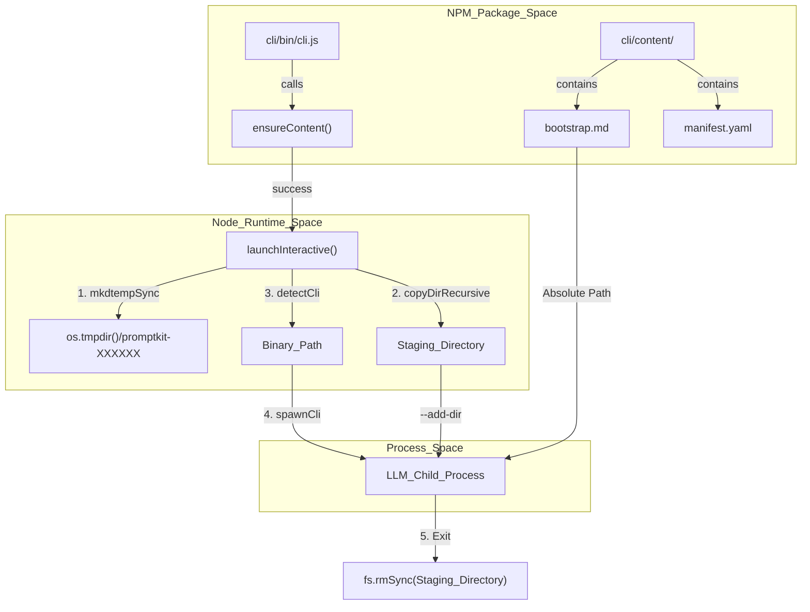
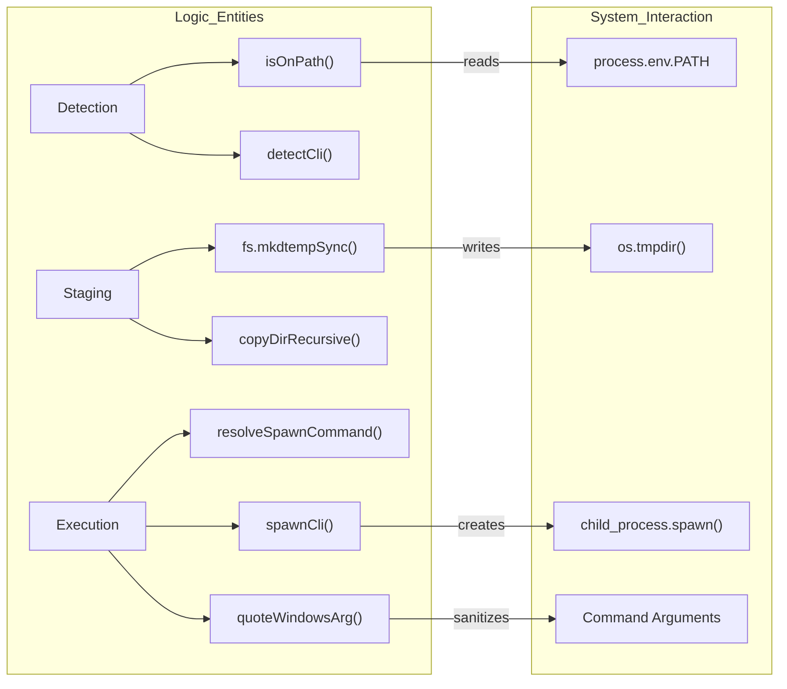

<!-- source: DeepWiki mcp.deepwiki.com · repo microsoft/PromptKit · page 4.2 CLI Internals: Launch and Session Management · fetched 2026-10-26 -->

# CLI Internals: Launch and Session Management

Relevant source files

The following files were used as context for generating this wiki page:

- [cli/lib/launch.js](cli/lib/launch.js)
- [cli/package-lock.json](cli/package-lock.json)
- [cli/specs/design.md](cli/specs/design.md)
- [cli/specs/requirements.md](cli/specs/requirements.md)
- [cli/specs/validation.md](cli/specs/validation.md)
- [cli/tests/copy-content.test.js](cli/tests/copy-content.test.js)
- [cli/tests/launch.test.js](cli/tests/launch.test.js)
- [docs/case-studies/ebpf-epoch.md](docs/case-studies/ebpf-epoch.md)

This page provides a deep dive into the `promptkit` CLI's internal mechanisms for environment detection, content staging, and the lifecycle management of Large Language Model (LLM) child processes. It details how the CLI bridges the local filesystem to external interactive LLM sessions while maintaining cross-platform compatibility.

## 1. LLM CLI Detection Pipeline

The CLI does not include a built-in LLM. Instead, it acts as a launcher for supported third-party LLM interfaces. Detection occurs in `detectCli()` using a prioritized search of the system `PATH` [cli/lib/launch.js:79-94]().

### 1.1 Detection Logic and Priority
The CLI probes for binaries in the following order:
1.  **GitHub Copilot CLI**: Searches for `copilot` [cli/lib/launch.js:81]().
2.  **GitHub CLI with Extension**: Searches for `gh`, then executes `gh copilot --help` to verify the extension is installed [cli/lib/launch.js:83-90]().
3.  **Claude Code**: Searches for `claude` [cli/lib/launch.js:91]().
4.  **OpenAI Codex**: Searches for `codex` [cli/lib/launch.js:92]().

### 1.2 Cross-Platform PATH Resolution
To ensure reliability across Windows, macOS, and Linux, the CLI implements a custom `isOnPath()` helper that avoids external dependencies like `which` or `where` [cli/lib/launch.js:33-52]().

| Feature | Windows Implementation | Unix/Linux Implementation |
| :--- | :--- | :--- |
| **Extension Check** | Iterates through `PATHEXT` (e.g., `.EXE`, `.CMD`) [cli/lib/launch.js:15-19]() | Uses empty string extension [cli/lib/launch.js:37]() |
| **Access Mode** | Checks for file existence (`F_OK`) [cli/lib/launch.js:40]() | Checks for executable bit (`X_OK`) [cli/lib/launch.js:40]() |
| **Shim Handling** | Prefers `.cmd` shims via `resolveSpawnCommand()` [cli/lib/launch.js:54-59]() | Uses raw command name [cli/lib/launch.js:55]() |

**Sources:** [cli/lib/launch.js:11-59](), [cli/lib/launch.js:79-94]()

---

## 2. Content Staging and Staging Directory

Because LLM CLIs often require explicit file access permissions or may be installed in read-only global directories, PromptKit uses a **Staging Pattern**.

### 2.1 Staging Lifecycle
1.  **Creation**: `copyContentToTemp()` creates a unique directory in the OS temp path prefixed with `promptkit-` [cli/lib/launch.js:96-100]().
2.  **Population**: The entire `content/` directory (Personas, Protocols, Templates, etc.) is copied recursively [cli/lib/launch.js:102-113]().
3.  **Exposure**: The temp path is passed to the LLM via the `--add-dir` flag [cli/lib/launch.js:158-172]().
4.  **Cleanup**: The directory is deleted upon child process exit or launch failure [cli/lib/launch.js:203-216]().

### 2.2 Staging Data Flow
The following diagram illustrates the transition from the static npm package content to the volatile runtime environment.

**Staging and Launch Flow**

**Sources:** [cli/lib/launch.js:96-113](), [cli/lib/launch.js:141-221](), [cli/bin/cli.js:37-45]()

---

## 3. Child Process Management

The CLI manages the LLM session as a managed child process, ensuring the user's terminal environment remains consistent.

### 3.1 CWD Preservation
A critical requirement is that the LLM session must reflect the user's project directory, not the PromptKit staging directory.
- The CLI captures `originalCwd` using `process.cwd()` before staging [cli/lib/launch.js:142]().
- The child process is spawned with `options.cwd` set to `originalCwd` [cli/lib/launch.js:195-198]().
- This allows the LLM to read local project files while accessing PromptKit components via absolute paths [cli/lib/launch.js:151]().

### 3.2 Command Execution (spawnCli)
On Windows, executing `.cmd` files requires special handling to prevent argument parsing issues. `spawnCli` wraps the command in `cmd.exe /c` and applies specific quoting rules [cli/lib/launch.js:61-77]().

**Command Construction Table**
| CLI | Command (`cmd`) | Arguments (`args`) |
| :--- | :--- | :--- |
| **copilot** | `copilot` | `["--add-dir", tmpDir, "-i", "Read and execute <abs_path>/bootstrap.md"]` [cli/lib/launch.js:158]() |
| **gh-copilot**| `gh` | `["copilot", "--add-dir", tmpDir, "-i", "Read and execute <abs_path>/bootstrap.md"]` [cli/lib/launch.js:162]() |
| **claude** | `claude` | `["--add-dir", tmpDir, "Read and execute <abs_path>/bootstrap.md"]` [cli/lib/launch.js:167]() |

### 3.3 Bootstrap Lifecycle
The CLI initiates the session by sending a "Bootstrap Prompt". This instruction directs the LLM to read `bootstrap.md` from the staging directory [cli/lib/launch.js:151](). Once `bootstrap.md` is loaded, the LLM assumes responsibility for the internal PromptKit assembly logic, and the Node.js process transitions into a passive observer state, forwarding signals and waiting for exit [cli/lib/launch.js:195-221]().

**Sources:** [cli/lib/launch.js:61-77](), [cli/lib/launch.js:115-222](), [cli/specs/requirements.md:109-150]()

---

## 4. Entity Mapping: Code to System

The following diagram bridges the natural language concepts of "launching" and "staging" to the specific code entities that implement them.

**Code Entity Mapping**

**Sources:** [cli/lib/launch.js:11-77](), [cli/lib/launch.js:96-113]()

---

