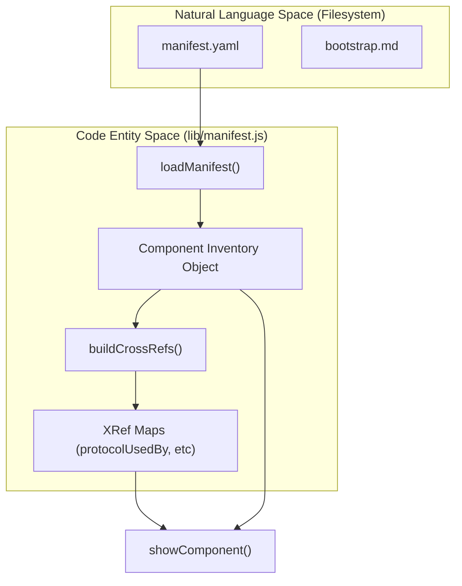
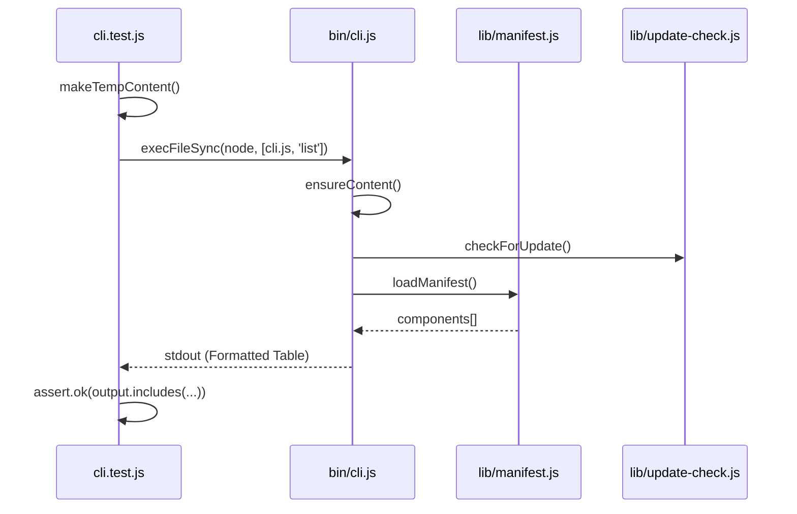

<!-- source: DeepWiki mcp.deepwiki.com · repo microsoft/PromptKit · page 4.3 CLI Build, Distribution, and Testing · fetched 2026-10-26 -->

# CLI Build, Distribution, and Testing

Relevant source files

The following files were used as context for generating this wiki page:

- [.github/workflows/publish-npm.yml](.github/workflows/publish-npm.yml)
- [cli/.gitignore](cli/.gitignore)
- [cli/bin/cli.js](cli/bin/cli.js)
- [cli/lib/manifest.js](cli/lib/manifest.js)
- [cli/lib/update-check.js](cli/lib/update-check.js)
- [cli/package.json](cli/package.json)
- [cli/scripts/copy-content.js](cli/scripts/copy-content.js)
- [cli/specs/engineering-workflow.md](cli/specs/engineering-workflow.md)
- [cli/specs/phase1-requirements-patch.md](cli/specs/phase1-requirements-patch.md)
- [cli/specs/phase3-audit-report.md](cli/specs/phase3-audit-report.md)
- [cli/tests/cli.test.js](cli/tests/cli.test.js)
- [cli/tests/list.test.js](cli/tests/list.test.js)
- [cli/tests/search-show.test.js](cli/tests/search-show.test.js)
- [cli/tests/update-check.test.js](cli/tests/update-check.test.js)
- [scripts/generate-catalog.js](scripts/generate-catalog.js)

This page documents the engineering infrastructure supporting the PromptKit CLI, including its packaging strategy, content bundling pipeline, update notification system, and the automated testing suite.

## npm Package Structure and Lifecycle

The PromptKit CLI is distributed as a standalone npm package (`@alan-jowett/promptkit`). It is designed to be a "thin launcher" that bundles the component library as static content for use by an LLM during an interactive session.

### Package Configuration
The `package.json` defines the entry point and the files included in the distribution.
- **Entry Point**: The `promptkit` command is mapped to `bin/cli.js` [cli/package.json:11-13]().
- **Included Files**: Only the `bin/`, `lib/`, and `content/` directories are packaged [cli/package.json:14-18]().
- **Engines**: Requires Node.js version 18.0.0 or higher [cli/package.json:29-31]().

### Build and Prepublish Lifecycle
PromptKit uses npm lifecycle scripts to ensure that the CLI always has access to the latest library components before testing or distribution.

| Script | Command | Purpose |
| :--- | :--- | :--- |
| `prepare` | `node scripts/copy-content.js` | Runs after `npm install` to sync library content into the CLI folder [cli/package.json:21](). |
| `prepublishOnly` | `node scripts/copy-content.js` | Ensures the `content/` directory is populated before `npm publish` [cli/package.json:20](). |
| `pretest` | `node scripts/copy-content.js` | Guarantees test data is present before running the test suite [cli/package.json:22](). |

Sources: [cli/package.json:1-45]()

## Content Bundling (copy-content.js)

The `copy-content.js` script is the bridge between the root-level component library and the CLI's internal distribution directory.

### Implementation Logic
1. **Source Discovery**: It identifies the root of the repository to locate the library components (personas, protocols, etc.).
2. **Target Preparation**: It creates or clears the `cli/content/` directory.
3. **Selective Copying**: It copies the `manifest.yaml`, `bootstrap.md`, and all component subdirectories into the CLI package structure.
4. **Verification**: The CLI's `ensureContent()` function checks for the existence of `bootstrap.md` and `manifest.yaml` at runtime to prevent execution if the bundling step was skipped [cli/bin/cli.js:21-36]().

Sources: [cli/bin/cli.js:21-36](), [cli/package.json:20-22]()

## Manifest Query Pipeline

The CLI provides introspection capabilities through the `lib/manifest.js` module. This module parses the library's `manifest.yaml` and builds an in-memory graph of component relationships.

### Key Functions
- `loadManifest(contentDir)`: Parses the YAML manifest and organizes components into typed arrays (personas, protocols, formats, taxonomies, templates) [cli/lib/manifest.js:14-62]().
- `buildCrossRefs(components)`: Generates reverse lookup maps (e.g., `protocolUsedBy`) to identify which templates utilize a specific component [cli/lib/manifest.js:71-105]().
- `searchComponents(components, keyword)`: Performs a case-insensitive search across component names and descriptions [cli/lib/manifest.js:123-130]().
- `showComponent(components, xrefs, name)`: Retrieves detailed metadata for a component, including its cross-references [cli/lib/manifest.js:160-181]().

### Component Relationship Mapping
The following diagram illustrates how the `manifest.js` logic transforms the flat `manifest.yaml` into a navigable graph.

**Data Flow: Manifest Resolution**

Sources: [cli/lib/manifest.js:14-181]()

## Update Check Subsystem

The `lib/update-check.js` module implements a non-blocking, best-effort check against the npm registry to notify users of new PromptKit versions.

### Logic and Constraints
- **Suppression**: The check is automatically skipped in CI environments, non-TTY terminals, or if the `NO_UPDATE_NOTIFIER` environment variable is set [cli/lib/update-check.js:141-148]().
- **Caching**: Results are cached in `~/.promptkit/update-check.json` with a 24-hour Time-To-Live (TTL) to avoid excessive network requests [cli/lib/update-check.js:14-20]().
- **Timeouts**: The network fetch has a strict 1500ms timeout to ensure CLI startup remains fast [cli/lib/update-check.js:15]().
- **Safety**: All operations are wrapped in try-catch blocks; a failure in the update check must never crash the CLI [cli/lib/update-check.js:4-7]().

### Version Comparison
The `isNewer(candidate, current)` function parses semver strings into numeric arrays `[major, minor, patch]` for accurate comparison, ignoring pre-release suffixes [cli/lib/update-check.js:43-58]().

Sources: [cli/lib/update-check.js:1-198]()

## Testing Infrastructure

PromptKit utilizes the Node.js built-in test runner (`node --test`) for its CLI integration and unit tests.

### Test Suite Organization
The test suite is executed with `--test-concurrency=1` to prevent race conditions during file system operations [cli/package.json:23]().

| Test File | Scope |
| :--- | :--- |
| `cli.test.js` | Entry point integration, command routing, and missing content handling [cli/tests/cli.test.js:2-3](). |
| `list.test.js` | Validates the `list` command, JSON output, and category grouping [cli/tests/list.test.js:2-3](). |
| `search-show.test.js` | Tests keyword searching and component detail views [cli/tests/search-show.test.js:2-3](). |
| `update-check.test.js` | Unit tests for version parsing, caching, and suppression logic [cli/tests/update-check.test.js:4-7](). |

### Integration Testing Pattern
The `cli.test.js` uses a `makeTempContent` utility to simulate various environment states (e.g., missing `manifest.yaml`) by creating isolated directory structures and executing the CLI via `execFileSync` [cli/tests/cli.test.js:37-103]().

**CLI Execution and Validation Flow**

Sources: [cli/package.json:23](), [cli/tests/cli.test.js:1-212](), [cli/tests/update-check.test.js:1-17]()

## Distribution Pipeline

PromptKit uses GitHub Actions for automated publishing to npm.

1. **Trigger**: The `publish-npm.yml` workflow triggers on a GitHub Release [cli/.github/workflows/publish-npm.yml:7-8]().
2. **Version Sync**: The script extracts the version from the release tag and updates `cli/package.json` [cli/.github/workflows/publish-npm.yml:26-31]().
3. **Content Bundling**: It executes `node scripts/copy-content.js` to finalize the package [cli/.github/workflows/publish-npm.yml:38-41]().
4. **Verification**: It runs `promptkit --version` and `promptkit list` as a smoke test before publishing [cli/.github/workflows/publish-npm.yml:43-47]().
5. **Publish**: The package is published using OIDC-based provenance (`--provenance`) [cli/.github/workflows/publish-npm.yml:49-52]().

Sources: [cli/.github/workflows/publish-npm.yml:1-53]()

---

