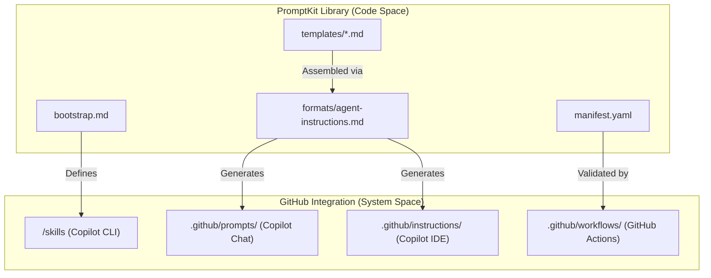
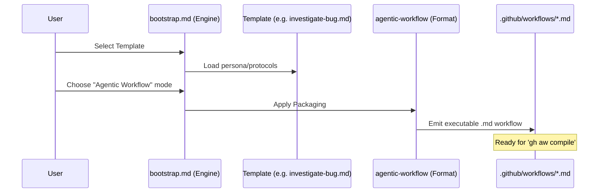

<!-- source: DeepWiki mcp.deepwiki.com · repo microsoft/PromptKit · page 5 GitHub Integration and Skills · fetched 2026-10-26 -->

# GitHub Integration and Skills

Relevant source files

The following files were used as context for generating this wiki page:

- [.github/skills/boot/SKILL.md](.github/skills/boot/SKILL.md)
- [.github/skills/bootstrap/SKILL.md](.github/skills/bootstrap/SKILL.md)
- [.github/skills/promptkit/SKILL.md](.github/skills/promptkit/SKILL.md)
- [bootstrap.md](bootstrap.md)
- [formats/agent-instructions.md](formats/agent-instructions.md)
- [formats/investigation-report.md](formats/investigation-report.md)
- [protocols/analysis/prompt-determinism-analysis.md](protocols/analysis/prompt-determinism-analysis.md)
- [protocols/guardrails/anti-hallucination.md](protocols/guardrails/anti-hallucination.md)
- [protocols/guardrails/operational-constraints.md](protocols/guardrails/operational-constraints.md)
- [protocols/reasoning/corpus-safety-audit.md](protocols/reasoning/corpus-safety-audit.md)
- [protocols/reasoning/root-cause-analysis.md](protocols/reasoning/root-cause-analysis.md)
- [templates/audit-code-compliance.md](templates/audit-code-compliance.md)
- [templates/audit-library-health.md](templates/audit-library-health.md)
- [templates/author-agent-instructions.md](templates/author-agent-instructions.md)
- [templates/investigate-bug.md](templates/investigate-bug.md)
- [templates/investigate-trace.md](templates/investigate-trace.md)

PromptKit is designed to integrate deeply with the GitHub ecosystem, transforming static prompt components into executable agentic workflows, persistent IDE instructions, and interactive CLI skills. This integration bridges the gap between the **Natural Language Space** of prompt engineering and the **Code Entity Space** of active software development.

## Overview of Integration Surface

PromptKit components are projected into GitHub environments through three primary mechanisms:
1.  **Copilot Skills**: Focused, reusable workflows defined in `SKILL.md` files that appear as slash commands in the GitHub Copilot CLI.
2.  **GitHub Actions**: Automation workflows that leverage PromptKit's library for CI/CD tasks like manifest validation and code auditing.
3.  **Agentic Workflows**: A specialized output mode where the `bootstrap` engine generates executable `.github/workflows/*.md` files for use with coding agents.

### Conceptual Mapping: PromptKit to GitHub
The following diagram illustrates how PromptKit internal structures map to GitHub-specific entities.

**Entity Mapping: Library to Ecosystem**

**Sources:** [bootstrap.md:5-10](), [formats/agent-instructions.md:1-16](), [templates/author-agent-instructions.md:5-12]()

---

## 5.1 Copilot Skills and Prompt Files
PromptKit provides a set of pre-configured skills located in the `.github/skills/` directory. These skills use the `SKILL.md` format to define focused workflows that can be invoked via the Copilot CLI.

*   **Boot & Bootstrap**: The `/boot` and `/bootstrap` commands trigger the `bootstrap.md` logic, which acts as the "composition engine" to help users select templates and assemble prompts [bootstrap.md:21-27]().
*   **Prompt Files**: Using the `author-agent-instructions` template, PromptKit can generate `.prompt.md` files in `.github/prompts/`. These files become reusable slash commands in Copilot Chat, translating `{{param}}` placeholders into `${input:param}` syntax [bootstrap.md:88-107]().
*   **Skill Structure**: Each skill is a self-contained directory (e.g., `.github/skills/promptkit/`) containing a `SKILL.md` file with mandatory YAML frontmatter describing its purpose [formats/agent-instructions.md:147-179]().

For details, see **[Copilot Skills and Prompt Files](#5.1)**.

---

## 5.2 GitHub Actions Workflows
The repository includes GitHub Actions workflows to maintain the integrity of the PromptKit library and facilitate distribution.

*   **Manifest Validation**: The `validate-manifest.yml` workflow ensures that the central `manifest.yaml` remains synchronized with the filesystem, checking for broken paths, orphaned files, and invalid frontmatter.
*   **NPM Publishing**: The `publish-npm.yml` workflow manages the distribution of the `@microsoft/promptkit` package using OIDC-based trusted publishing.
*   **Library Auditing**: Templates like `audit-library-health` are designed to be run within GitHub environments to perform "self-audits" of the component library, checking for corpus safety and language determinism [templates/audit-library-health.md:61-70]().

For details, see **[GitHub Actions Workflows](#5.2)**.

---

## 5.3 Agentic Workflow Output Mode
One of the most advanced features of the `bootstrap.md` engine is the `agentic-workflow` output mode. This mode transforms a PromptKit template into a persistent automation file.

**Workflow Generation Logic**

*   **Packaging**: The `agentic-workflow` mode wraps the assembled prompt in frontmatter containing `on:`, `permissions:`, and `tools:` fields [bootstrap.md:108-118]().
*   **Parameter Translation**: Template parameters are mapped to GitHub Actions context, where `{{param}}` might become `${{ github.event.issue.body }}` or `${{ inputs.target }}` [bootstrap.md:122-124]().
*   **Execution**: Generated workflows are designed to be compiled via the `gh-aw` (GitHub Agentic Workflows) toolchain [bootstrap.md:131-132]().

For details, see **[Agentic Workflow Output Mode](#5.3)**.

---

### Sources
- [bootstrap.md:21-135]()
- [formats/agent-instructions.md:1-55]()
- [templates/author-agent-instructions.md:5-51]()
- [templates/audit-library-health.md:5-21]()
- [protocols/analysis/prompt-determinism-analysis.md:5-17]()

---

