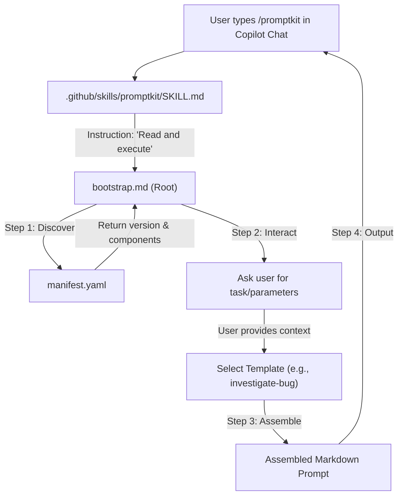
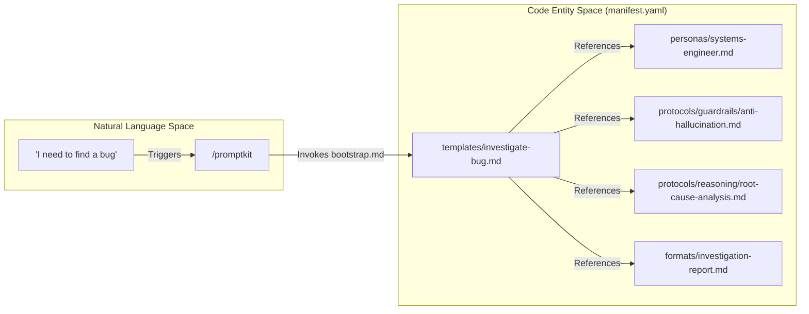

<!-- source: DeepWiki mcp.deepwiki.com · repo microsoft/PromptKit · page 5.1 Copilot Skills and Prompt Files · fetched 2026-10-26 -->

# Copilot Skills and Prompt Files

Relevant source files

The following files were used as context for generating this wiki page:

- [.github/prompts/boot.prompt.md](.github/prompts/boot.prompt.md)
- [.github/prompts/bootstrap.prompt.md](.github/prompts/bootstrap.prompt.md)
- [.github/prompts/ingest-cwe-taxonomies.prompt.md](.github/prompts/ingest-cwe-taxonomies.prompt.md)
- [.github/skills/boot/SKILL.md](.github/skills/boot/SKILL.md)
- [.github/skills/bootstrap/SKILL.md](.github/skills/bootstrap/SKILL.md)
- [.github/skills/ingest-cwe-taxonomies/SKILL.md](.github/skills/ingest-cwe-taxonomies/SKILL.md)
- [.github/skills/promptkit/SKILL.md](.github/skills/promptkit/SKILL.md)
- [bootstrap.md](bootstrap.md)
- [formats/investigation-report.md](formats/investigation-report.md)
- [protocols/guardrails/anti-hallucination.md](protocols/guardrails/anti-hallucination.md)
- [protocols/guardrails/operational-constraints.md](protocols/guardrails/operational-constraints.md)
- [protocols/reasoning/root-cause-analysis.md](protocols/reasoning/root-cause-analysis.md)
- [templates/investigate-bug.md](templates/investigate-bug.md)
- [templates/investigate-trace.md](templates/investigate-trace.md)

This section covers the integration between PromptKit and GitHub Copilot through the use of **Skills** and **Prompt Files**. These mechanisms allow users to trigger the PromptKit composition engine directly from within Copilot Chat using slash commands and persistent instructions.

## The Bootstrap Engine and Slash Commands

The core of PromptKit's GitHub integration is the `bootstrap.md` file, which acts as the meta-prompt entry point [bootstrap.md:1-12](). When triggered, it transforms the LLM into a **composition engine** capable of discovering components via `manifest.yaml`, selecting templates, and assembling them into task-specific prompts [bootstrap.md:14-26]().

To expose this engine as a GitHub Copilot skill, PromptKit uses a directory-based skill definition structure.

### Skill Aliases and Triggers
PromptKit defines several slash commands that all route to the same underlying bootstrap logic. This ensures that users can invoke the library using natural terms like `/boot` or `/bootstrap`.

| Command | Definition File | Purpose |
| :--- | :--- | :--- |
| `/promptkit` | [.github/skills/promptkit/SKILL.md:1-18]() | Primary entry point for prompt assembly and library discovery. |
| `/boot` | [.github/skills/boot/SKILL.md:1-14]() | Shorthand alias for rapid invocation. |
| `/bootstrap` | [.github/skills/bootstrap/SKILL.md:1-14]() | Formal alias for starting the composition engine. |

### Data Flow: From Slash Command to Assembled Prompt
The following diagram illustrates how a user command in Copilot Chat transitions through the skill definition to the bootstrap engine.

**Diagram: Copilot Skill Execution Flow**

**Sources:** [.github/skills/promptkit/SKILL.md:14-17](), [bootstrap.md:14-40](), [bootstrap.md:48-49]()

---

## SKILL.md Format

Each skill is defined in a `SKILL.md` file within a subdirectory of `.github/skills/`. This file follows a specific structure that Copilot uses to understand the skill's capabilities and constraints.

*   **Frontmatter**: Contains the `name` (the slash command) and a `description` that helps the LLM determine when to suggest the skill [.github/skills/promptkit/SKILL.md:1-11]().
*   **Core Instruction**: A mandatory instruction to read `bootstrap.md` as the "single source of truth" [.github/skills/promptkit/SKILL.md:15-17]().
*   **Inputs/Outputs**: Explicitly defines what the skill expects (e.g., repository context, user goals) and what it produces (e.g., a Markdown prompt or an interactive session) [.github/skills/promptkit/SKILL.md:19-30]().

---

## Copilot Prompt Files (.prompt.md)

While Skills are for *invoking* the engine, **Prompt Files** are the *output* of the engine when configured for persistence. PromptKit can package any template into a `.github/prompts/<name>.prompt.md` file [bootstrap.md:88-103]().

### Translation Logic
When generating a `.prompt.md` file, the bootstrap engine performs specific structural translations:
1.  **Variable Syntax**: PromptKit's internal `{{param}}` placeholders are translated to Copilot's `${input:param:hint}` syntax [bootstrap.md:98-99]().
2.  **Frontmatter Packaging**: The assembled prompt is wrapped in Copilot-specific metadata including `description`, `agent`, and `tools` [bootstrap.md:94-95]().
3.  **Semantic Fidelity**: All reasoning protocols (e.g., `anti-hallucination`, `root-cause-analysis`) are preserved verbatim to ensure the resulting slash command maintains the library's analytical rigor [bootstrap.md:105-107]().

### Specialized Integration Skills
Some PromptKit workflows are exposed as standalone skills because they involve complex external data pipelines:

*   **`ingest-cwe-taxonomies`**: Manages the ingestion of the MITRE CWE XML corpus. It uses a dedicated prompt file [`.github/prompts/ingest-cwe-taxonomies.prompt.md`]() to drive a multi-phase pipeline (Acquisition, Normalization, Mapping, Generation) that updates the `taxonomies/cwe-*.md` files and `manifest.yaml` [.github/skills/ingest-cwe-taxonomies/SKILL.md:1-39]().

---

## Technical Implementation: Natural Language to Code Entities

The integration relies on the LLM's ability to map natural language intent to specific file-system entities defined in the PromptKit manifest.

**Diagram: Intent-to-Entity Mapping**

**Sources:** [bootstrap.md:48-49](), [templates/investigate-bug.md:5-18](), [protocols/guardrails/anti-hallucination.md:1-11](), [protocols/reasoning/root-cause-analysis.md:1-15]()

### Key Implementation Details in Protocols
When a skill triggers a template like `investigate-bug`, the following code-level constraints are enforced via the composed protocols:

*   **Operational Constraints**: Limits the LLM to reading at most 50 files per batch and enforces a "Search Before You Search" strategy [protocols/guardrails/operational-constraints.md:24-31]().
*   **Anti-Hallucination**: Requires the LLM to label every claim as `KNOWN`, `INFERRED`, or `ASSUMED` [protocols/guardrails/anti-hallucination.md:21-30]().
*   **Root Cause Analysis**: Forces the LLM to generate at least 3 hypotheses before beginning investigation [protocols/reasoning/root-cause-analysis.md:38-52]().

**Sources:** [protocols/guardrails/operational-constraints.md:24-31](), [protocols/guardrails/anti-hallucination.md:21-30](), [protocols/reasoning/root-cause-analysis.md:38-52]()

---

