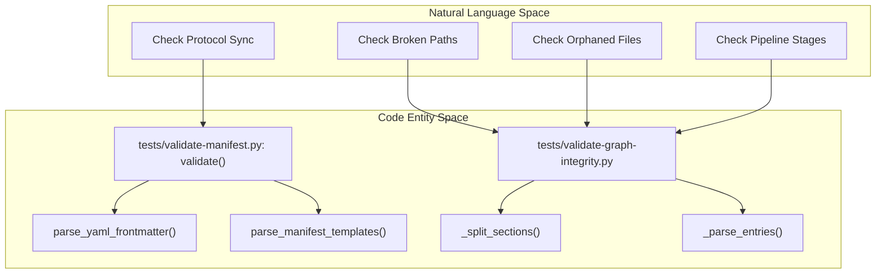
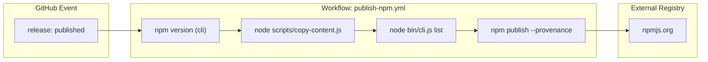

<!-- source: DeepWiki mcp.deepwiki.com · repo microsoft/PromptKit · page 5.2 GitHub Actions Workflows · fetched 2026-10-26 -->

# GitHub Actions Workflows

Relevant source files

The following files were used as context for generating this wiki page:

- [.github/workflows/publish-npm.yml](.github/workflows/publish-npm.yml)
- [.github/workflows/validate-manifest.yml](.github/workflows/validate-manifest.yml)
- [tests/validate-graph-integrity.py](tests/validate-graph-integrity.py)
- [tests/validate-manifest.py](tests/validate-manifest.py)

PromptKit utilizes GitHub Actions to maintain the integrity of its component library and automate the distribution of its CLI. The CI/CD pipeline ensures that the `manifest.yaml` stays in sync with template frontmatter, validates the internal reference graph, and provides a secure, OIDC-based publishing path to npm.

### Overview of Workflows

The repository defines two primary workflows:
1.  **Validate Prompt Library** (`validate-manifest.yml`): Triggered on pushes and pull requests affecting the library or CLI. It performs Python-based static analysis and Node.js smoke tests.
2.  **Publish to npm** (`publish-npm.yml`): Triggered upon the creation of a GitHub release. It handles versioning, content bundling, and secure publication.

---

### Library Validation CI

The `validate-manifest.yml` workflow is the primary gatekeeper for repository health. It ensures that the modular components (Personas, Protocols, Formats, Taxonomies, and Templates) are correctly cross-referenced and that the CLI remains functional.

#### Validation Steps and Data Flow

The workflow executes three parallel jobs to verify different aspects of the system:

1.  **`validate-manifest`**: Runs `tests/validate-manifest.py` to ensure that the protocol lists declared in `manifest.yaml` (used by `bootstrap.md` for prompt assembly) match the `protocols` list in each template's YAML frontmatter [[.github/workflows/validate-manifest.yml:34-47]]().
2.  **`validate-graph-integrity`**: Runs `tests/validate-graph-integrity.py` to perform a deep check of the library's internal references [[.github/workflows/validate-manifest.yml:48-60]]().
3.  **`cli-smoke-test`**: Installs CLI dependencies and executes `npm test` within the `cli/` directory, followed by `--dry-run` executions for different LLM providers [[.github/workflows/validate-manifest.yml:62-88]]().

#### Logic-to-Code Mapping: Integrity Checks

The following diagram maps the logical validation requirements to the specific Python functions and scripts that implement them.

**Library Integrity Validation Mapping**

**Sources:** [[tests/validate-manifest.py:105-176]](), [[tests/validate-graph-integrity.py:5-23]](), [[tests/validate-graph-integrity.py:120-141]]()

#### Key Functions in `tests/validate-manifest.py`
*   `parse_yaml_frontmatter(text)`: Extracts the `protocols` block from a template file using regex to avoid heavy YAML dependencies [[tests/validate-manifest.py:26-56]]().
*   `parse_manifest_templates(manifest_text)`: A state machine that parses `manifest.yaml` to build a mapping of template names to their associated short-name protocols [[tests/validate-manifest.py:59-90]]().
*   `validate(repo_root)`: The main entry point that iterates through all `.md` files in the `templates/` directory and compares their frontmatter against the manifest registry [[tests/validate-manifest.py:105-176]]().

---

### Trusted npm Publishing Pipeline

The `publish-npm.yml` workflow automates the distribution of the `@microsoft/promptkit` package. It utilizes GitHub's OIDC (OpenID Connect) integration to provide a secure "provenance" for the published package without requiring long-lived npm tokens for authentication in every step.

#### Implementation Details
*   **Version Sync**: The workflow extracts the version from the GitHub release tag (e.g., `v1.2.3` becomes `1.2.3`) and applies it to the `cli/package.json` using `npm version` [[.github/workflows/publish-npm.yml:26-31]]().
*   **Content Bundling**: It executes `node scripts/copy-content.js` to pull the library components (personas, protocols, etc.) into the CLI's distribution folder before publishing [[.github/workflows/publish-npm.yml:38-42]]().
*   **Security**: The workflow requires `id-token: write` permissions [[.github/workflows/publish-npm.yml:16]]() to enable `--provenance`, which links the npm package to the specific GitHub Action run that created it [[.github/workflows/publish-npm.yml:49-52]]().

#### Data Flow: Release to Registry

The following diagram illustrates the flow of data from a GitHub Release event to the final npm package.

**NPM Publishing Workflow Data Flow**

**Sources:** [[.github/workflows/publish-npm.yml:6-52]]()

### Summary of Workflow Tasks

| Job Name | File | Purpose |
| :--- | :--- | :--- |
| `validate-manifest` | `validate-manifest.yml` | Prevents drift between `manifest.yaml` and template frontmatter [[.github/workflows/validate-manifest.yml:34]](). |
| `validate-graph-integrity` | `validate-manifest.yml` | Ensures no broken paths, orphaned files, or missing companions [[.github/workflows/validate-manifest.yml:48]](). |
| `cli-smoke-test` | `validate-manifest.yml` | Validates that `bin/cli.js` can launch and list components [[.github/workflows/validate-manifest.yml:62]](). |
| `publish` | `publish-npm.yml` | Bundles content and publishes to npm with OIDC provenance [[.github/workflows/publish-npm.yml:11]](). |

**Sources:** [[.github/workflows/validate-manifest.yml:1-88]](), [[.github/workflows/publish-npm.yml:1-53]](), [[tests/validate-graph-integrity.py:5-23]]()

---

