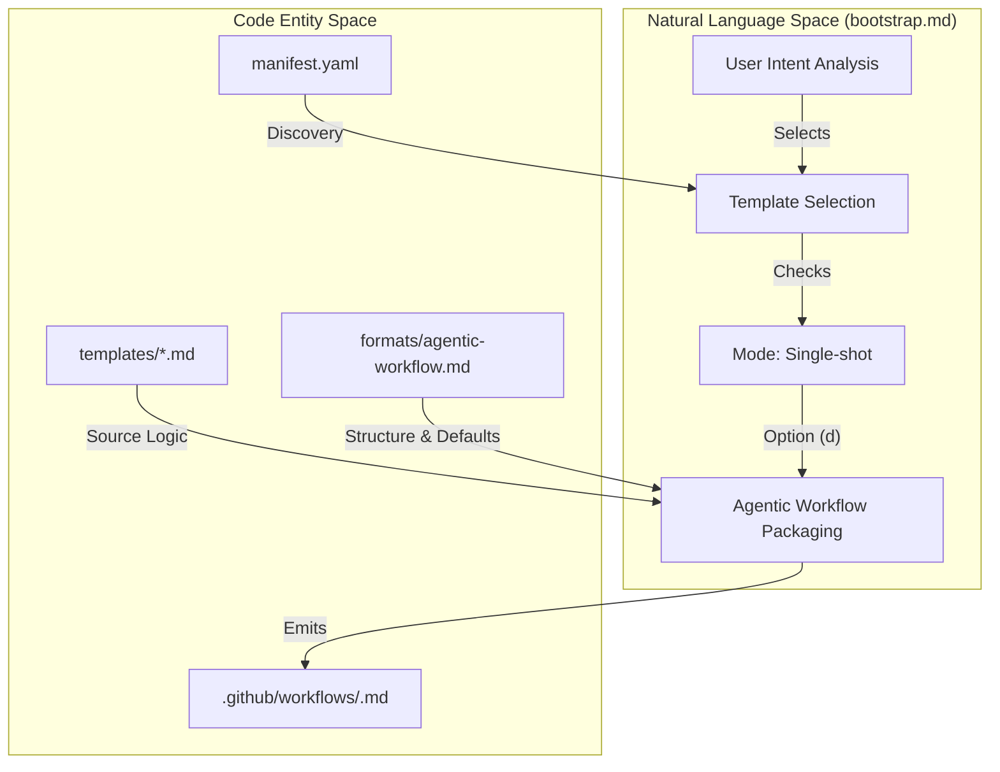
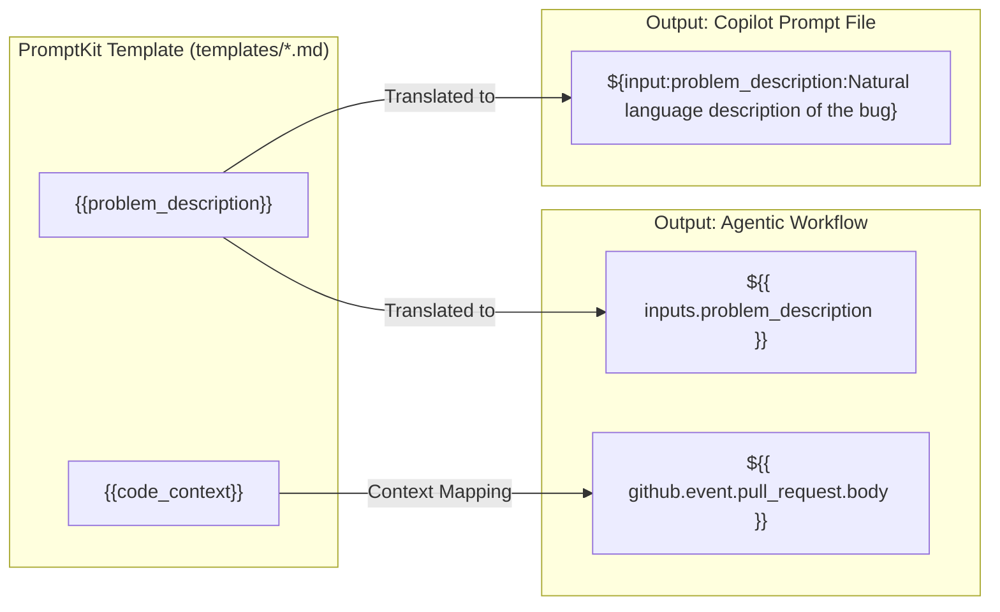

<!-- source: DeepWiki mcp.deepwiki.com · repo microsoft/PromptKit · page 5.3 Agentic Workflow Output Mode · fetched 2026-10-26 -->

# Agentic Workflow Output Mode

Relevant source files

The following files were used as context for generating this wiki page:

- [bootstrap.md](bootstrap.md)
- [docs/architecture.md](docs/architecture.md)
- [formats/agent-instructions.md](formats/agent-instructions.md)
- [formats/agentic-workflow.md](formats/agentic-workflow.md)
- [formats/copilot-prompt-file.md](formats/copilot-prompt-file.md)
- [formats/investigation-report.md](formats/investigation-report.md)
- [protocols/analysis/prompt-determinism-analysis.md](protocols/analysis/prompt-determinism-analysis.md)
- [protocols/guardrails/anti-hallucination.md](protocols/guardrails/anti-hallucination.md)
- [protocols/guardrails/operational-constraints.md](protocols/guardrails/operational-constraints.md)
- [protocols/reasoning/corpus-safety-audit.md](protocols/reasoning/corpus-safety-audit.md)
- [protocols/reasoning/root-cause-analysis.md](protocols/reasoning/root-cause-analysis.md)
- [templates/audit-code-compliance.md](templates/audit-code-compliance.md)
- [templates/audit-library-health.md](templates/audit-library-health.md)
- [templates/author-agent-instructions.md](templates/author-agent-instructions.md)
- [templates/investigate-bug.md](templates/investigate-bug.md)
- [templates/investigate-trace.md](templates/investigate-trace.md)

The **Agentic Workflow** output mode is a specialized packaging format that transforms PromptKit's composable components into executable automation files for GitHub Actions. This mode enables the transition from interactive human-LLM sessions to autonomous, event-driven, or scheduled engineering workflows.

## Overview and Purpose

The agentic-workflow mode treats the PromptKit assembly process as a "packaging" step [bootstrap.md:113-114](). While the core persona and protocol logic remain identical to raw prompts, the output is wrapped in GitHub Actions workflow syntax (`.github/workflows/*.md`) [bootstrap.md:125-129](). These files are designed to be consumed by coding agents running within CI/CD pipelines.

### Key Capabilities
*   **Semantic Fidelity**: All protocol phases, checks, and examples are preserved verbatim from the source components [bootstrap.md:133-134]().
*   **Parameter Translation**: Automatically maps PromptKit `{{param}}` placeholders to GitHub Actions context variables (e.g., `${{ github.event.* }}`) [bootstrap.md:122-124]().
*   **Automation Packaging**: Adds necessary workflow metadata, including triggers (`on:`), permissions, and tool definitions [bootstrap.md:114-116]().

---

## Workflow Generation Logic

The generation process is managed by the `bootstrap.md` meta-prompt, which acts as the composition engine [bootstrap.md:21-25]().

### Data Flow: From Template to Workflow
The following diagram illustrates how the `bootstrap.md` logic (Natural Language Space) interacts with the component files and output specifications (Code Entity Space).

**Diagram: Agentic Workflow Assembly Pipeline**

Sources: [bootstrap.md:21-25](), [bootstrap.md:30-32](), [bootstrap.md:108-118]()

### Parameter Mapping Rules
When generating the workflow file, `bootstrap.md` performs a translation of parameters based on their source [bootstrap.md:122-124]():

| Parameter Type | PromptKit Syntax | GitHub Actions Translation |
| :--- | :--- | :--- |
| **Event Context** | `{{context}}` | `${{ github.event.* }}` |
| **Runtime Inputs** | `{{user_input}}` | `${{ inputs.* }}` |
| **Project Constants** | `{{repo_name}}` | *Hardcoded from user input during assembly* |

---

## The `gh-aw` Compilation Step

Outputting a `.github/workflows/<name>.md` file is the first half of the process. PromptKit follows the "Agentic Workflow" specification which requires a compilation step to generate the final executable YAML.

1.  **Assembly**: The user uses `promptkit` (via `bootstrap.md` or CLI) to generate the `.md` workflow file [bootstrap.md:125-129]().
2.  **Compilation**: The user must run `gh aw compile` [bootstrap.md:131]().
3.  **Locking**: This step generates a `.lock.yml` file which contains the resolved, executable version of the workflow [bootstrap.md:131-132]().
4.  **Commitment**: Both the `.md` and `.lock.yml` files must be committed to the repository to enable the automation [bootstrap.md:131-132]().

---

## Copilot Prompt File (.prompt.md) Mode

A related output mode is the **Copilot Prompt File**, which creates reusable slash commands for GitHub Copilot Chat [bootstrap.md:88-90]().

### Implementation Details
*   **File Path**: Generated at `.github/prompts/<name>.prompt.md` [bootstrap.md:103]().
*   **Packaging**: Wraps the prompt in frontmatter containing `description`, `agent`, and `tools` [bootstrap.md:95]().
*   **Placeholder Translation**: Translates PromptKit `{{param}}` placeholders to the Copilot-specific `${input:param:hint}` syntax [bootstrap.md:98]().
*   **Structure**: Keeps the original template's format content embedded within a `## Output Expectations` section to ensure the LLM follows PromptKit's structural requirements [bootstrap.md:92-97]().

**Diagram: Placeholder Translation Logic**

Sources: [bootstrap.md:98](), [bootstrap.md:122-124](), [templates/investigate-bug.md:19-22]()

---

## Component Integration

The agentic workflow mode relies on specific metadata in the `manifest.yaml` and template frontmatter to determine defaults.

### Category Defaults
The `agentic-workflow` format uses a **Category Defaults Table** to automatically assign workflow properties (like permissions or triggers) based on the template's category in the manifest [bootstrap.md:119-121](). For example:
*   **Investigation Templates**: May default to `on: issue_comment` or `on: workflow_dispatch` [templates/investigate-bug.md:5-9]().
*   **Audit Templates**: May default to `on: pull_request` with read-only permissions [templates/audit-library-health.md:8-13]().

Sources: [bootstrap.md:108-135](), [formats/agent-instructions.md:1-16](), [templates/author-agent-instructions.md:40-52]()

---

