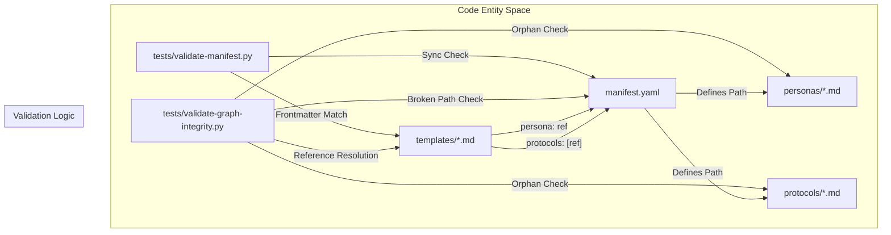
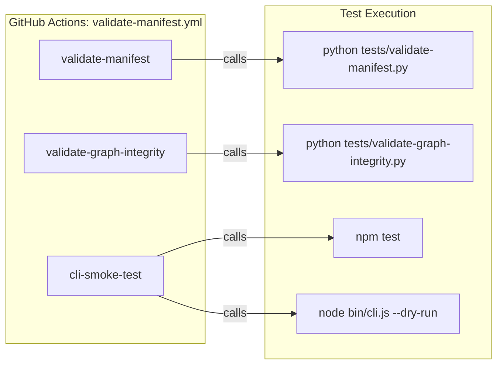

<!-- source: DeepWiki mcp.deepwiki.com · repo microsoft/PromptKit · page 6 Testing and Validation · fetched 2026-10-26 -->

# Testing and Validation

Relevant source files

The following files were used as context for generating this wiki page:

- [.github/workflows/validate-manifest.yml](.github/workflows/validate-manifest.yml)
- [docs/testing-guide.md](docs/testing-guide.md)
- [protocols/reasoning/requirements-elicitation.md](protocols/reasoning/requirements-elicitation.md)
- [templates/lint-prompt.md](templates/lint-prompt.md)
- [tests/self-audit-prompt.md](tests/self-audit-prompt.md)
- [tests/validate-graph-integrity.py](tests/validate-graph-integrity.py)
- [tests/validate-manifest.py](tests/validate-manifest.py)

PromptKit employs a multi-layered testing philosophy that addresses the unique challenges of non-deterministic LLM behavior. Rather than relying solely on traditional unit tests, the framework combines **reference-comparison methodology** for prompt quality with **automated graph validation** for structural integrity. This ensures that as the library grows, the complex relationships between personas, protocols, and templates remain consistent and performant.

### Core Testing Pillars

The testing infrastructure is divided into three primary domains:

1.  **Structural Validation**: Automated scripts ensure the `manifest.yaml` is synchronized with component files and that the "prompt graph" (the web of references between components) is unbroken.
2.  **Quality Auditing**: Systematic gap analysis comparing PromptKit-generated output against "gold-standard" reference prompts.
3.  **Language Precision**: Linter-driven analysis of prompt directives to minimize ambiguity and maximize determinism across different LLM providers.

### Automated Integrity Checks

PromptKit uses Python-based validation scripts integrated into GitHub Actions to maintain the health of the library. These checks prevent "broken links" within the component architecture, such as a template referencing a non-existent protocol or a manifest entry pointing to a missing file.

#### Validation Workflow
The following diagram illustrates how validation scripts bridge the gap between the `manifest.yaml` configuration and the physical `.md` component files.

**Diagram: Manifest and Graph Validation Logic**

**Sources**: [.github/workflows/validate-manifest.yml:48-60](), [tests/validate-graph-integrity.py:11-20](), [tests/validate-manifest.py:5-14]()

For details on specific validation rules and CI integration, see **[Manifest and Graph Integrity Validation](#6.2)**.

### Prompt Quality Methodology

Because LLM outputs are non-deterministic, PromptKit tests the **structure** of the prompt rather than the resulting text. This is achieved through **Reference Comparison**.

*   **Reference Prompts**: Hand-crafted, "known-good" prompts that have been battle-tested in real-world scenarios.
*   **Generated Prompts**: Prompts assembled by the `promptkit assemble` command using the same parameters as the reference.
*   **Gap Analysis**: A structured evaluation across five dimensions (Task Framing, Reasoning, Output Spec, Operations, and QA) to identify what the generated prompt lacks compared to the expert reference.

**Sources**: [docs/testing-guide.md:9-20](), [docs/testing-guide.md:67-71]()

For details on performing gap analysis and the directory structure for test artifacts, see **[Prompt Testing Methodology](#6.1)**.

### Self-Auditing and Linting

PromptKit includes specialized components for auditing its own codebase. The `tests/self-audit-prompt.md` is a meta-prompt designed to check if new components adhere to the project's strict `CONTRIBUTING.md` standards.

Additionally, the `lint-prompt` template provides a systematic way to analyze any prompt for "determinism hazards"—vague language that causes inconsistent LLM performance.

**Table: Determinism Hazard Categories**
| Category | Code Entity / Protocol Reference |
| :--- | :--- |
| **Vague Quantifiers** | `prompt-determinism-analysis` Phase 1 |
| **Missing Branches** | `prompt-determinism-analysis` Phase 2 |
| **Abstract Verbs** | `prompt-determinism-analysis` Phase 3 |
| **Unanchored Comparatives** | `requirements-elicitation` Phase 3 |

**Sources**: [tests/self-audit-prompt.md:30-42](), [templates/lint-prompt.md:73-92](), [protocols/reasoning/requirements-elicitation.md:56-85]()

### Continuous Integration (CI)

All structural and smoke tests are executed on every push and pull request via the `Validate Prompt Library` workflow.

**Diagram: CI Pipeline Components**

**Sources**: [.github/workflows/validate-manifest.yml:34-88]()

---

### Child Pages
*   **[Prompt Testing Methodology](#6.1)**: Deep dive into the five-dimension gap analysis and the `tests/references/` workflow.
*   **[Manifest and Graph Integrity Validation](#6.2)**: Technical details on the Python validation suite and frontmatter cross-check logic.

---

