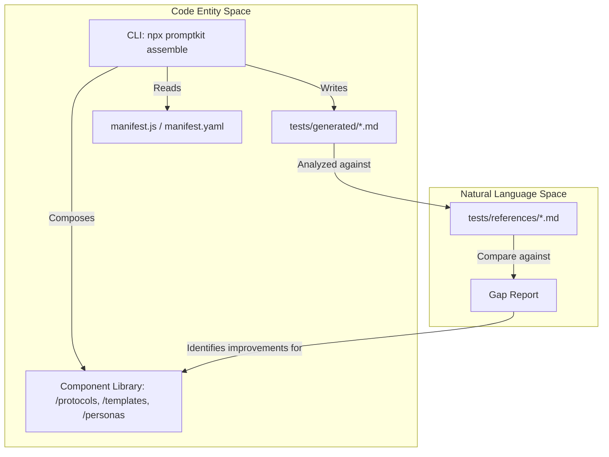
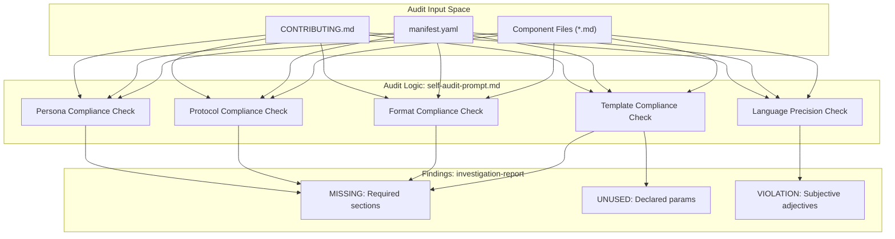

<!-- source: DeepWiki mcp.deepwiki.com · repo microsoft/PromptKit · page 6.1 Prompt Testing Methodology · fetched 2026-10-26 -->

# Prompt Testing Methodology

Relevant source files

The following files were used as context for generating this wiki page:

- [docs/case-studies/determinism-audit-report.md](docs/case-studies/determinism-audit-report.md)
- [docs/case-studies/determinism-audit.md](docs/case-studies/determinism-audit.md)
- [docs/testing-guide.md](docs/testing-guide.md)
- [protocols/reasoning/requirements-elicitation.md](protocols/reasoning/requirements-elicitation.md)
- [templates/lint-prompt.md](templates/lint-prompt.md)
- [tests/references/memory-safety-c-skill.instructions.md](tests/references/memory-safety-c-skill.instructions.md)
- [tests/self-audit-prompt.md](tests/self-audit-prompt.md)

The PromptKit testing methodology relies on a **reference-comparison approach** rather than traditional unit testing [docs/testing-guide.md:3-5](). Because LLM outputs are non-deterministic, PromptKit focuses on validating the **prompt structure** and **instructional precision** of its components [docs/testing-guide.md:11-14](). This ensures that the deterministic assembly process—combining Personas, Protocols, and Formats—consistently produces high-fidelity prompts that match or exceed hand-crafted "gold standards" [docs/testing-guide.md:16-20]().

## Reference Comparison Workflow

The core of PromptKit's validation is the comparison between a hand-crafted **Reference Prompt** (a known-good prompt that produces excellent results) and a **Generated Prompt** (produced by the PromptKit CLI) [docs/testing-guide.md:3-5]().

### 1. Data Flow and Directory Structure
Testing artifacts are organized within the `tests/` directory to facilitate side-by-side analysis [docs/testing-guide.md:21-33]().

| Directory | Purpose | Persistence |
| :--- | :--- | :--- |
| `tests/references/` | Hand-crafted, version-controlled "gold standard" prompts [docs/testing-guide.md:35-35](). | Permanent |
| `tests/generated/` | Prompts assembled via `npx promptkit assemble` for testing [docs/testing-guide.md:36-36](). | Git-ignored |

**System Interaction Diagram**
This diagram shows how the `assemble` command bridges the Component Library and the Testing Infrastructure.

Sources: [docs/testing-guide.md:21-37](), [docs/testing-guide.md:57-65](), [docs/testing-guide.md:145-157]()

### 2. Execution Steps
1.  **Create Reference**: Author a task-specific, battle-tested prompt in `tests/references/` [docs/testing-guide.md:38-49]().
2.  **Generate Version**: Use the CLI to assemble a prompt using the same task parameters [docs/testing-guide.md:57-65]().
3.  **Structured Analysis**: Compare the two across five standardized dimensions [docs/testing-guide.md:67-70]().

## The Five Dimensions of Gap Analysis

PromptKit evaluates prompt quality across five specific technical dimensions. Each is scored as ✅ Covered, ⚠️ Partial, or ❌ Missing [docs/testing-guide.md:69-70]().

| Dimension | Focus Area | Key Verification Questions |
| :--- | :--- | :--- |
| **Task Framing** | Scope and Goals | Is the objective clear? Are non-goals explicitly bounded? [docs/testing-guide.md:72-80]() |
| **Reasoning Methodology** | Analysis Process | Is a systematic protocol (e.g., `requirements-elicitation`) prescribed? [docs/testing-guide.md:81-89]() |
| **Output Specification** | Structure and Format | Is the schema (e.g., `investigation-report`) defined? [docs/testing-guide.md:90-98]() |
| **Operational Guidance** | Execution Strategy | Does it tell the LLM how to use tools or parallelize work? [docs/testing-guide.md:99-107]() |
| **Quality Assurance** | Verification | Are anti-hallucination and self-verification checks present? [docs/testing-guide.md:108-116]() |

Sources: [docs/testing-guide.md:72-116]()

## Language Precision and Determinism Auditing

Beyond structural comparison, PromptKit utilizes the `prompt-determinism-analysis` protocol to "lint" its own instructions for ambiguity [docs/case-studies/determinism-audit.md:5-10](). This process identifies language that causes inconsistent LLM behavior.

### Self-Audit Implementation
The `tests/self-audit-prompt.md` file is a meta-prompt used to audit the repository against `CONTRIBUTING.md` conventions [tests/self-audit-prompt.md:4-8]().

**Audit Logic Flow**

Sources: [tests/self-audit-prompt.md:30-140](), [docs/case-studies/determinism-audit-report.md:44-118]()

### Determinism Pattern Categories
When performing a language audit (e.g., via the `lint-prompt` template), the system scans for specific non-deterministic patterns [templates/lint-prompt.md:73-91]():

1.  **Subjective Adjectives**: Words like "significant," "appropriate," or "reasonable" used as pass/fail criteria [docs/case-studies/determinism-audit-report.md:44-51]().
2.  **Missing Branches**: Conditionals ("If X, do Y") that lack an explicit "Else" branch [docs/case-studies/determinism-audit-report.md:65-72]().
3.  **Vague Quantifiers**: Words like "multiple," "several," or "~30%" instead of concrete counts [docs/case-studies/determinism-audit-report.md:131-136]().
4.  **Abstract Action Verbs**: Using "analyze" or "evaluate" without operational sub-steps [tests/self-audit-prompt.md:150-154]().

Sources: [docs/case-studies/determinism-audit-report.md:44-140](), [templates/lint-prompt.md:73-91](), [tests/self-audit-prompt.md:141-165]()

## Closing the Feedback Loop

Gaps identified during testing or auditing are mapped back to specific library components for remediation [docs/testing-guide.md:147-157]().

*   **Missing Reasoning**: Improve or add a `protocol` (e.g., `protocols/reasoning/requirements-elicitation.md`) [docs/testing-guide.md:151-151]().
*   **Weak Identity**: Update the `persona` behavioral constraints [docs/testing-guide.md:152-152]().
*   **Missing Output Sections**: Update the `format` schema [docs/testing-guide.md:153-153]().
*   **Ambiguous Instructions**: Apply `prompt-determinism-analysis` rewrite suggestions to the `template` body [templates/lint-prompt.md:109-115]().

Sources: [docs/testing-guide.md:145-157](), [templates/lint-prompt.md:106-115]()

---

