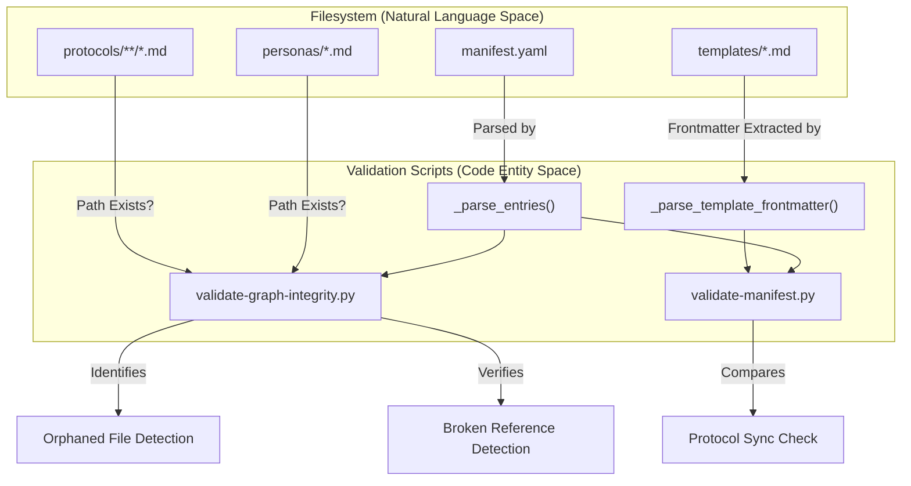
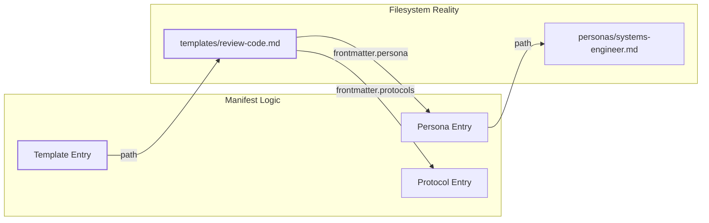

<!-- source: DeepWiki mcp.deepwiki.com · repo microsoft/PromptKit · page 6.2 Manifest and Graph Integrity Validation · fetched 2026-10-26 -->

# Manifest and Graph Integrity Validation

Relevant source files

The following files were used as context for generating this wiki page:

- [.github/workflows/validate-manifest.yml](.github/workflows/validate-manifest.yml)
- [cli/lib/manifest.js](cli/lib/manifest.js)
- [cli/lib/update-check.js](cli/lib/update-check.js)
- [cli/tests/cli.test.js](cli/tests/cli.test.js)
- [cli/tests/list.test.js](cli/tests/list.test.js)
- [cli/tests/search-show.test.js](cli/tests/search-show.test.js)
- [cli/tests/update-check.test.js](cli/tests/update-check.test.js)
- [scripts/generate-catalog.js](scripts/generate-catalog.js)
- [tests/validate-graph-integrity.py](tests/validate-graph-integrity.py)
- [tests/validate-manifest.py](tests/validate-manifest.py)

The PromptKit library relies on a strictly typed, manifest-driven architecture where components (Personas, Protocols, Formats, Taxonomies, and Templates) are interconnected. To prevent runtime failures during prompt assembly, the codebase employs specialized Python validation scripts that enforce referential integrity and consistency across the component graph. These validations ensure that the `manifest.yaml` registry accurately reflects the state of the filesystem and the internal metadata (frontmatter) of the prompt files.

## Validation Overview and CI Integration

Validation is automated via GitHub Actions and triggered on every push or pull request that modifies the library content or the validation scripts themselves [.github/workflows/validate-manifest.yml:6-28]().

The CI pipeline executes three primary validation stages:
1.  **Manifest Protocol Sync**: Ensures the `protocols` listed for a template in `manifest.yaml` match the `protocols` defined in that template's Markdown frontmatter [tests/validate-manifest.py:5-10]().
2.  **Graph Integrity**: Performs a deep check for broken paths, orphaned files, missing companion components, and pipeline contract validity [tests/validate-graph-integrity.py:11-19]().
3.  **CLI Smoke Test**: Verifies that the Node.js CLI can successfully parse the resulting manifest and execute dry-run assemblies [.github/workflows/validate-manifest.yml:62-88]().

### Validation Data Flow

The following diagram illustrates how the validation scripts bridge the gap between the physical file structure and the logical manifest definitions.

**Diagram: Validation Engine Data Flow**

Sources: [tests/validate-manifest.py:105-176](), [tests/validate-graph-integrity.py:11-23](), [.github/workflows/validate-manifest.yml:34-60]()

---

## Protocol Synchronization Validation (`validate-manifest.py`)

The `validate-manifest.py` script specifically targets "drift" between the `manifest.yaml` and template source files. Because `bootstrap.md` uses the manifest to dynamically assemble prompts, any mismatch in the protocol list would result in a prompt that either misses required guardrails or includes unintended ones [tests/validate-manifest.py:7-10]().

### Key Implementation Details
-   **Frontmatter Extraction**: Uses `parse_yaml_frontmatter` to isolate the YAML block between `---` delimiters and extract the `protocols` key [tests/validate-manifest.py:26-56]().
-   **Manifest Parsing**: Uses `parse_manifest_templates` to build a mapping of `{template_name: [protocol_short_names]}` [tests/validate-manifest.py:59-90]().
-   **Normalization**: Both sources are normalized using `protocol_short_name`, which strips category prefixes (e.g., `guardrails/anti-hallucination` becomes `anti-hallucination`) to allow for flexible referencing [tests/validate-manifest.py:93-99]().

Sources: [tests/validate-manifest.py:26-56](), [tests/validate-manifest.py:59-90](), [tests/validate-manifest.py:93-99]()

---

## Graph Integrity Validation (`validate-graph-integrity.py`)

The `validate-graph-integrity.py` script performs a multi-pass audit of the entire library structure. It is designed to be "lightweight" and does not depend on external YAML libraries, using regex-based state machines to parse the manifest [tests/validate-graph-integrity.py:36-141]().

### Validation Categories

| Check Type | Description | Code Reference |
| :--- | :--- | :--- |
| **Broken Paths** | Ensures every `path` entry in the manifest points to a file that exists on disk. | [tests/validate-graph-integrity.py:12]() |
| **Broken References** | Ensures templates only reference personas, protocols, or formats that are registered in the manifest. | [tests/validate-graph-integrity.py:13-14]() |
| **Orphaned Files** | Identifies `.md` files in component directories that are not listed in `manifest.yaml`. | [tests/validate-graph-integrity.py:15]() |
| **Missing Companions** | Enforces that every template must have exactly one persona and at least one protocol. | [tests/validate-graph-integrity.py:16]() |
| **Pipeline Integrity** | Validates that all stages in a multi-step pipeline reference valid template names. | [tests/validate-graph-integrity.py:17]() |

### Internal Logic and Regex Parsing
The script uses `_parse_entries` to scan the manifest for `name` and `path` siblings [tests/validate-graph-integrity.py:144-190](). It then cross-references these against the results of `_parse_template_frontmatter`, which extracts `persona`, `protocols`, `format`, and `taxonomies` from the physical files [tests/validate-graph-integrity.py:52-117]().

**Diagram: Component Dependency Graph Validation**

Sources: [tests/validate-graph-integrity.py:52-117](), [tests/validate-graph-integrity.py:144-190]()

---

## CLI Integration and Runtime Validation

While the Python scripts handle static analysis in CI, the Node.js CLI performs runtime validation during command execution. The `loadManifest` function in `cli/lib/manifest.js` parses the manifest and builds reverse cross-reference maps [cli/lib/manifest.js:14-62]().

### Cross-Reference Maps (`buildCrossRefs`)
The CLI generates `protocolUsedBy`, `personaUsedBy`, `formatUsedBy`, and `taxonomyUsedBy` maps [cli/lib/manifest.js:71-105](). These maps are used by the `show` command to display which templates will be affected by a change to a specific protocol or persona [cli/lib/search-show.test.js:169-188]().

### Error Handling in CLI
The CLI includes integration tests (`TC-CLI-003` and `TC-CLI-003a`) that verify the tool exits with code 1 if `bootstrap.md` or `manifest.yaml` are missing, ensuring that the assembly environment is intact before attempting to generate prompts [cli/tests/cli.test.js:153-210]().

Sources: [cli/lib/manifest.js:14-62](), [cli/lib/manifest.js:71-105](), [cli/tests/cli.test.js:153-210](), [cli/tests/search-show.test.js:169-188]()

---

