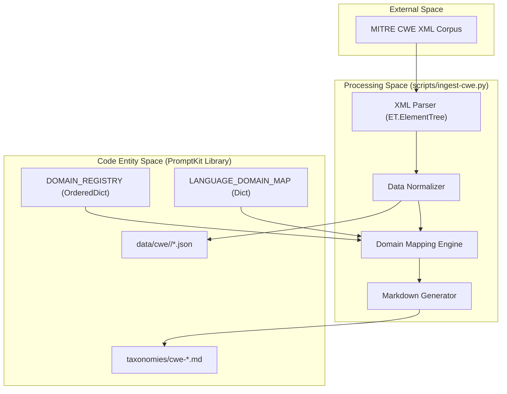
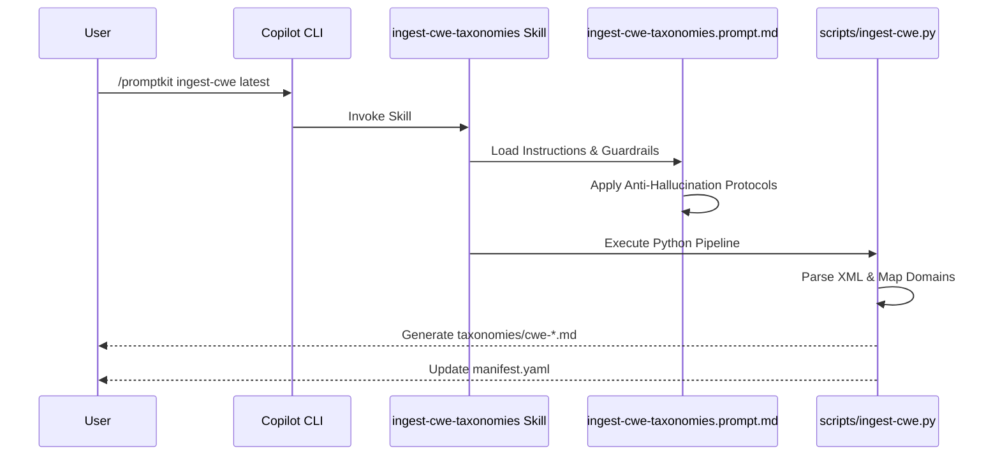

<!-- source: DeepWiki mcp.deepwiki.com · repo microsoft/PromptKit · page 7 CWE Taxonomy Data Pipeline · fetched 2026-10-26 -->

# CWE Taxonomy Data Pipeline

Relevant source files

The following files were used as context for generating this wiki page:

- [.github/prompts/ingest-cwe-taxonomies.prompt.md](.github/prompts/ingest-cwe-taxonomies.prompt.md)
- [.github/skills/ingest-cwe-taxonomies/SKILL.md](.github/skills/ingest-cwe-taxonomies/SKILL.md)
- [.gitignore](.gitignore)
- [data/cwe/4.19.1/cwe-normalized.json](data/cwe/4.19.1/cwe-normalized.json)
- [data/cwe/4.19.1/domain-mappings.json](data/cwe/4.19.1/domain-mappings.json)
- [data/cwe/4.19.1/meta.json](data/cwe/4.19.1/meta.json)
- [data/cwe/4.19.1/unmapped.json](data/cwe/4.19.1/unmapped.json)
- [scripts/ingest-cwe.py](scripts/ingest-cwe.py)
- [taxonomies/cwe-cli-tools.md](taxonomies/cwe-cli-tools.md)
- [taxonomies/cwe-cloud-service.md](taxonomies/cwe-cloud-service.md)
- [taxonomies/cwe-firmware-embedded.md](taxonomies/cwe-firmware-embedded.md)
- [taxonomies/cwe-iac.md](taxonomies/cwe-iac.md)
- [taxonomies/cwe-kernel-mode-c-cpp.md](taxonomies/cwe-kernel-mode-c-cpp.md)
- [taxonomies/cwe-managed-dotnet.md](taxonomies/cwe-managed-dotnet.md)
- [taxonomies/cwe-mobile-app.md](taxonomies/cwe-mobile-app.md)

The CWE (Common Weakness Enumeration) ingestion pipeline is a specialized data processing system designed to transform the massive MITRE CWE XML corpus into domain-specific security audit taxonomies. These taxonomies allow PromptKit templates to constrain LLM security analysis to only the vulnerability classes relevant to a specific software domain (e.g., kernel-mode C++ vs. web frontend JavaScript) [taxonomies/cwe-mobile-app.md:28-31]().

## Pipeline Overview

The pipeline is driven by a Python engine that executes a multi-stage transformation: from raw XML to normalized JSON, through a heuristic mapping engine, and finally to Markdown-based taxonomy files and integration manifests [scripts/ingest-cwe.py:10-19]().

### Data Flow Architecture

The following diagram illustrates the transition from the external MITRE data space into the PromptKit library's code and component space.

**CWE Ingestion Data Flow**

Sources: `[scripts/ingest-cwe.py:1-100]()`, `[taxonomies/cwe-mobile-app.md:1-13]()`

## Implementation Details

### The Domain Registry
The pipeline recognizes 13 distinct audit domains defined in the `DOMAIN_REGISTRY` [scripts/ingest-cwe.py:47-100](). Each domain serves as a target for the mapping engine:

| Domain Key | Description |
| :--- | :--- |
| `kernel-mode-c-cpp` | OS kernel and driver code in C/C++ |
| `firmware-embedded` | Firmware and embedded systems |
| `managed-dotnet` | .NET managed code (C#, F#, VB.NET) |
| `web-js-ts` | Web frontend JavaScript/TypeScript |
| `cloud-service` | Cloud-hosted services and APIs |
| `iac` | Infrastructure as Code (Terraform, Bicep, etc.) |

Sources: `[scripts/ingest-cwe.py:47-100]()`

### Mapping Heuristics
The engine uses three priority levels to associate a CWE ID with one or more domains:
1.  **Platform Mappings**: Matches based on the `Applicable_Platforms` field in the CWE XML [scripts/ingest-cwe.py:106-129]().
2.  **Technology Mappings**: Matches based on technology tags like "Web Server" or "Microcontroller Hardware" [scripts/ingest-cwe.py:138-154]().
3.  **Context Keywords**: Regex patterns applied to the CWE name and description (e.g., `\bIRQL\b` for kernel-mode) [scripts/ingest-cwe.py:160-191]().

### Normalization and Artifacts
The pipeline produces normalized JSON artifacts in `data/cwe/<version>/` to ensure the library can trace the lineage of its data [scripts/ingest-cwe.py:13-17]().

*   `meta.json`: High-level statistics including version, date, and mapping coverage [data/cwe/4.19.1/meta.json:1-12]().
*   `cwe-normalized.json`: A cleaned, structure-agnostic version of the MITRE data.
*   `domain-mappings.json`: The explicit link between CWE IDs and PromptKit domains.

## Execution via GitHub Skills

The pipeline is exposed as a GitHub Copilot skill, allowing maintainers to update the library's security knowledge base using natural language commands [ .github/skills/ingest-cwe-taxonomies/SKILL.md:1-8]().

**Skill Execution Flow**

Sources: `[.github/skills/ingest-cwe-taxonomies/SKILL.md:12-39]()`, `[.github/prompts/ingest-cwe-taxonomies.prompt.md:10-16]()`

## Taxonomy Structure

Each generated file (e.g., `taxonomies/cwe-firmware-embedded.md`) follows a strict format to be consumable by the PromptKit assembly engine:

1.  **Frontmatter**: Defines the `domain`, `type`, and `cwe_version` [taxonomies/cwe-firmware-embedded.md:4-13]().
2.  **Constraint Instruction**: Explicitly tells the LLM to only consider the listed CWE IDs [taxonomies/cwe-firmware-embedded.md:28-31]().
3.  **Class Definitions**: Provides the CWE ID, name, description, abstraction level (e.g., Pillar, Class, Base), and detection hints [taxonomies/cwe-firmware-embedded.md:35-49]().

Sources: `[taxonomies/cwe-firmware-embedded.md:4-49]()`, `[taxonomies/cwe-mobile-app.md:4-41]()`

---

