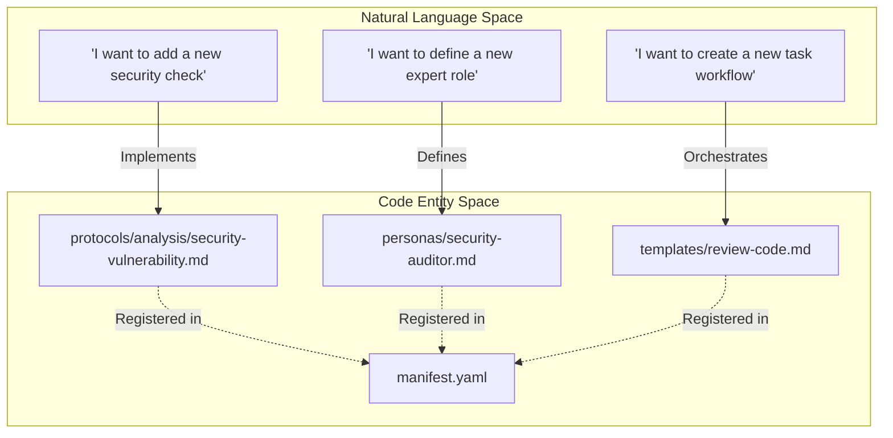
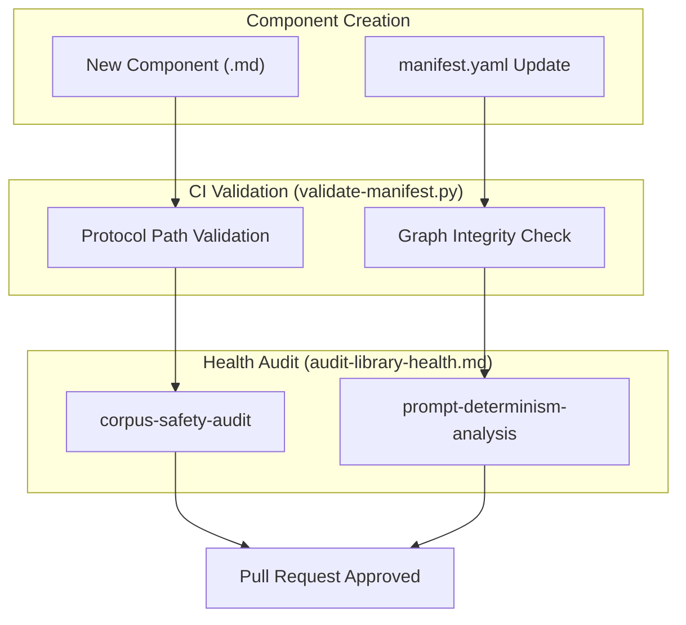

<!-- source: DeepWiki mcp.deepwiki.com · repo microsoft/PromptKit · page 8 Contributing to PromptKit · fetched 2026-10-26 -->

# Contributing to PromptKit

Relevant source files

The following files were used as context for generating this wiki page:

- [.github/copilot-instructions.md](.github/copilot-instructions.md)
- [CONTRIBUTING.md](CONTRIBUTING.md)
- [TESTING.md](TESTING.md)
- [docs/case-studies/author-agent-instructions.md](docs/case-studies/author-agent-instructions.md)
- [docs/contributing-components.md](docs/contributing-components.md)
- [docs/office_hour_talk/promptkit-office-hour.pptx](docs/office_hour_talk/promptkit-office-hour.pptx)
- [docs/office_hour_talk/speaker-notes.md](docs/office_hour_talk/speaker-notes.md)
- [docs/roadmap.md](docs/roadmap.md)
- [formats/agent-instructions.md](formats/agent-instructions.md)
- [formats/multi-artifact.md](formats/multi-artifact.md)
- [formats/promptkit-pull-request.md](formats/promptkit-pull-request.md)
- [personas/promptkit-contributor.md](personas/promptkit-contributor.md)
- [protocols/analysis/prompt-determinism-analysis.md](protocols/analysis/prompt-determinism-analysis.md)
- [protocols/reasoning/corpus-safety-audit.md](protocols/reasoning/corpus-safety-audit.md)
- [protocols/reasoning/promptkit-design.md](protocols/reasoning/promptkit-design.md)
- [templates/audit-code-compliance.md](templates/audit-code-compliance.md)
- [templates/audit-library-health.md](templates/audit-library-health.md)
- [templates/author-agent-instructions.md](templates/author-agent-instructions.md)
- [templates/extend-library.md](templates/extend-library.md)

PromptKit is designed as a modular, extensible library where prompts are treated as engineered artifacts. This page provides a high-level guide for contributors on how to extend the library, follow established naming and metadata conventions, and navigate the Pull Request (PR) process.

## Preferred Workflow: The `extend-library` Pattern

The recommended way to contribute is to use PromptKit to extend itself. Rather than hand-authoring files, contributors should use the `extend-library` template. This ensures that new components—personas, protocols, formats, taxonomies, and templates—conform to the library's architecture and metadata requirements automatically.

For details on the step-by-step process of creating these files, see [Adding New Components](#8.1).

### The Contributor Persona
All library extension tasks are performed by the `promptkit-contributor` persona [templates/author-agent-instructions.md:13-13](). This persona is a specialist in prompt engineering and the PromptKit five-layer model, ensuring that new contributions maintain structural integrity and stylistic consistency.

### Bridge: From Contribution Concept to Code Entity
The following diagram illustrates how the natural language intent of a contributor is transformed into specific code entities within the PromptKit repository.

**Natural Language to Code Entity Mapping**

Sources: [CONTRIBUTING.md:10-13](), [docs/contributing-components.md:8-16](), [templates/author-agent-instructions.md:42-51]()

## Component Requirements and Conventions

Every component in PromptKit must follow strict structural rules to ensure interoperability within the assembly pipeline.

### Metadata and Frontmatter
Every component file MUST contain a YAML frontmatter block [CONTRIBUTING.md:39-40](). This block includes mandatory fields such as `name` (in kebab-case), `description`, and `type` [.github/copilot-instructions.md:80-87](). 

### Manifest Synchronization
The `manifest.yaml` file is the central registry and source of truth for the library [.github/copilot-instructions.md:88-90](). When adding or modifying any component, the contributor must update the manifest to reflect the new file path and metadata [docs/contributing-components.md:214-216](). 

### Naming and Body Structure
- **Filenames**: Must be kebab-case and match the `name` field in the frontmatter [docs/contributing-components.md:32-33]().
- **Protocols**: Must use numbered phases (e.g., Phase 1, Phase 2) [docs/contributing-components.md:36-36]().
- **Templates**: Must include `{{param}}` placeholders, a "Non-Goals" section, and a "Quality Checklist" [docs/contributing-components.md:209-213]().

Sources: [CONTRIBUTING.md:37-45](), [docs/contributing-components.md:30-38](), [.github/copilot-instructions.md:42-45]()

## Validation and Quality Checks

New components are subjected to rigorous automated and manual checks to maintain the health of the library.

### Manifest and Graph Integrity
The CI pipeline runs `tests/validate-manifest.py` to ensure that template frontmatter stays in sync with the central manifest [.github/copilot-instructions.md:98-103](). It specifically checks that the `protocols` list in a template's frontmatter (using category paths) matches the short-name list in the manifest [docs/contributing-components.md:278-279]().

### Specialized Audit Protocols
For complex contributions or library-wide health checks, PromptKit utilizes specialized reasoning and analysis protocols:
- **Corpus Safety Audit**: Scans for verbatim copying from external sources and ensures no confidential or internal-only content is leaked [protocols/reasoning/corpus-safety-audit.md:7-12]().
- **Prompt Determinism Analysis**: Analyzes instruction text for vague quantifiers or subjective adjectives that could cause non-deterministic LLM behavior [protocols/analysis/prompt-determinism-analysis.md:7-13]().

**Component Validation Workflow**

Sources: [templates/audit-library-health.md:8-13](), [protocols/reasoning/corpus-safety-audit.md:19-22](), [protocols/analysis/prompt-determinism-analysis.md:19-23](), [tests/validate-manifest.py:1-5]() (implied by [.github/copilot-instructions.md:101-102]())

## Future Direction

The library is evolving toward a broader "semantic engineering platform." This includes plans for npm scope migration, the development of a GitHub Copilot Extension, and deeper integration with hardware engineering lifecycles.

For more information on the project's trajectory, see [Roadmap and Future Direction](#8.2).

Sources: [docs/roadmap.md:7-12](), [docs/roadmap.md:21-26]()

---

