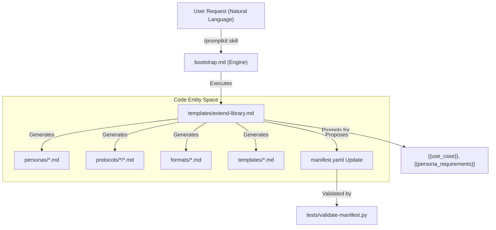
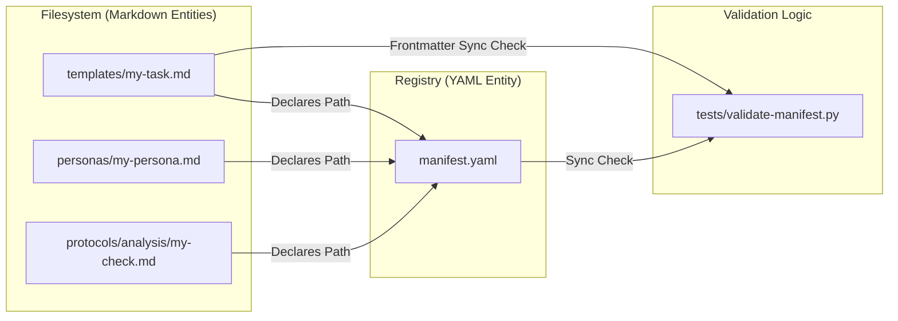

<!-- source: DeepWiki mcp.deepwiki.com · repo microsoft/PromptKit · page 8.1 Adding New Components · fetched 2026-10-26 -->

# Adding New Components

<details>
<summary>Relevant source files</summary>

The following files were used as context for generating this wiki page:

- [.github/copilot-instructions.md](.github/copilot-instructions.md)
- [CONTRIBUTING.md](CONTRIBUTING.md)
- [docs/architecture.md](docs/architecture.md)
- [docs/contributing-components.md](docs/contributing-components.md)
- [docs/office_hour_talk/promptkit-office-hour.pptx](docs/office_hour_talk/promptkit-office-hour.pptx)
- [docs/office_hour_talk/speaker-notes.md](docs/office_hour_talk/speaker-notes.md)
- [formats/agentic-workflow.md](formats/agentic-workflow.md)
- [formats/copilot-prompt-file.md](formats/copilot-prompt-file.md)
- [manifest.yaml](manifest.yaml)
- [protocols/guardrails/self-verification.md](protocols/guardrails/self-verification.md)

</details>


PromptKit is a modular, composable library designed for extension. Adding new components—whether a persona, protocol, format, taxonomy, or template—follows a standardized process to ensure architectural integrity and discoverability. This page provides the technical specifications for manual component creation and the automated `extend-library` workflow.

## Purpose and Scope

The library's architecture relies on five layers of composition [docs/architecture.md:8-20](). To maintain the ability for the bootstrap engine to "snap" these layers together at runtime [docs/architecture.md:22-23](), every component must adhere to strict frontmatter schemas, naming conventions, and manifest registration rules [CONTRIBUTING.md:39-45]().

---

## The Preferred Workflow: `extend-library`

The recommended way to add components is using the library's own `extend-library` template [CONTRIBUTING.md:10-13](). This interactive workflow automates the generation of PR-ready files and manifest updates.

**Execution:**
```bash
# Using the PromptKit CLI
npx promptkit
# Select "extend-library" and follow prompts

# Or using GitHub Copilot CLI in the repo root
copilot "I want to add a template for <use case>"
```
[docs/contributing-components.md:13-25]()

### Data Flow: Natural Language to Code Entity
The following diagram illustrates how a user's natural language request is transformed into specific code entities within the PromptKit structure.

**Workflow Transformation Diagram**

Sources: [CONTRIBUTING.md:22-27](), [docs/architecture.md:147-150](), [docs/contributing-components.md:119-128]()

---

## Component Technical Specifications

### 1. Personas
Personas define identity and behavioral constraints [docs/architecture.md:33-37]().
*   **Location:** `personas/<name>.md` [docs/contributing-components.md:43]()
*   **Required Frontmatter:** `name`, `description`, `domain` (list), `tone` [docs/architecture.md:38-40]()
*   **Body Convention:** Must include a `# Senior <Role Title>` heading and a `### Behavioral Constraints` section [docs/contributing-components.md:62-72]().

### 2. Protocols
Protocols define the "how" of reasoning [docs/architecture.md:63-65]().
*   **Location:** `protocols/<category>/<name>.md` [CONTRIBUTING.md:72]()
*   **Categories:** `guardrails/`, `analysis/`, `reasoning/` [docs/architecture.md:66-70]()
*   **Structure:** Analysis and reasoning protocols MUST use numbered, ordered phases (e.g., Phase 1, Phase 2) [docs/contributing-components.md:116-117]().
*   **Applicability:** The `applicable_to` field in frontmatter signifies that the protocol is *required* by specific templates [CONTRIBUTING.md:114-122]().

### 3. Output Formats
Formats define structure, not content [CONTRIBUTING.md:149]().
*   **Location:** `formats/<name>.md` [CONTRIBUTING.md:131]()
*   **Key Field:** `produces` (artifact type label) enables pipeline chaining [docs/architecture.md:90-92]().
*   **Rule:** Every section must be present; if empty, the LLM must state "None identified" [CONTRIBUTING.md:150-152]().

### 4. Templates
Templates are the orchestration layer that binds the other four layers [docs/architecture.md:120-123]().
*   **Location:** `templates/<name>.md` [CONTRIBUTING.md:157]()
*   **Frontmatter References:** Templates reference protocols by their **category path** (e.g., `guardrails/anti-hallucination`) [docs/architecture.md:78-79]().
*   **Required Sections:** Task Instructions (with `{{param}}`), `### Non-Goals`, and `### Quality Checklist` [docs/contributing-components.md:209-213]().

---

## Manifest Registration Procedure

The `manifest.yaml` is the single source of truth for the bootstrap engine [docs/architecture.md:149-150]().

### Protocol Naming Duality
A critical convention exists between template files and the manifest:
1.  **Template Frontmatter:** Uses category paths: `protocols: [guardrails/anti-hallucination]` [.github/copilot-instructions.md:59-63]().
2.  **Manifest:** Uses short names: `protocols: [anti-hallucination]` [.github/copilot-instructions.md:65-69]().

### Update Steps
1.  Add the new component entry to the appropriate section (`personas:`, `protocols:`, `formats:`, or `templates:`) in `manifest.yaml` [manifest.yaml:11-201]().
2.  Ensure the `path` field points correctly to the `.md` file [manifest.yaml:13]().
3.  For templates, list the required protocols using their **short names** [manifest.yaml:193-194]().

**Component Integration Diagram**

Sources: [docs/architecture.md:149-152](), [.github/copilot-instructions.md:88-97](), [docs/contributing-components.md:214-216]()

---

## Validation and CI

After adding components, the integrity of the manifest and its relationship to the component files must be verified.

### The `validate-manifest.py` Script
This script performs the following checks:
*   **Path Integrity:** Ensures every `path` in `manifest.yaml` exists on disk [.github/copilot-instructions.md:101-102]().
*   **Protocol Sync:** Validates that the `protocols` list in a template's frontmatter matches the `protocols` list for that template in `manifest.yaml` [.github/copilot-instructions.md:95-97]().
*   **Short-Name Mapping:** Confirms that category paths in templates map correctly to the short names in the manifest [.github/copilot-instructions.md:71-72]().

**Running Validation:**
```bash
python tests/validate-manifest.py
```
[docs/contributing-components.md:283]()

Sources:
- [manifest.yaml:1-201]()
- [protocols/guardrails/self-verification.md:1-118]()
- [CONTRIBUTING.md:1-152]()
- [.github/copilot-instructions.md:1-134]()
- [docs/architecture.md:1-201]()
- [docs/contributing-components.md:1-294]()

---

