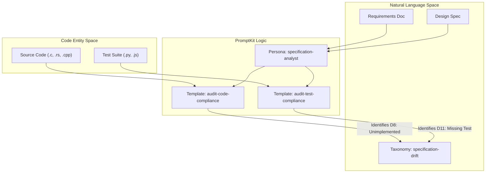
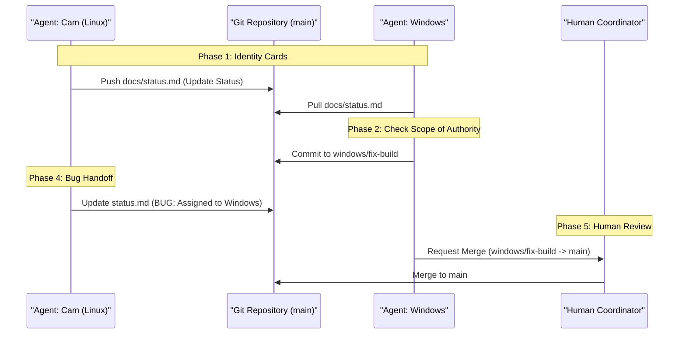

<!-- source: DeepWiki mcp.deepwiki.com · repo microsoft/PromptKit · page 8.2 Roadmap and Future Direction · fetched 2026-10-26 -->

# Roadmap and Future Direction

Relevant source files

The following files were used as context for generating this wiki page:

- [.github/copilot-instructions.md](.github/copilot-instructions.md)
- [CONTRIBUTING.md](CONTRIBUTING.md)
- [docs/contributing-components.md](docs/contributing-components.md)
- [docs/office_hour_talk/promptkit-office-hour.pptx](docs/office_hour_talk/promptkit-office-hour.pptx)
- [docs/office_hour_talk/speaker-notes.md](docs/office_hour_talk/speaker-notes.md)
- [docs/roadmap.md](docs/roadmap.md)
- [protocols/reasoning/multi-agent-coordination.md](protocols/reasoning/multi-agent-coordination.md)

This page documents the planned evolution of PromptKit, transitioning from a composable prompt library into a comprehensive **semantic engineering platform**. The roadmap is structured into pillars that address distribution, integration, and the alignment of engineering artifacts across the software and hardware lifecycles [docs/roadmap.md:7-15]().

## Distribution and Packaging

PromptKit aims to lower the friction of adoption by moving closer to standard enterprise ecosystems and improving the security of its distribution pipeline.

### npm Scope Migration
Currently, the CLI is published under a personal scope. The roadmap includes a migration to an official Microsoft scope (`@microsoft/promptkit`) [docs/roadmap.md:21-26](). This change will be transparent to CLI functionality but provides organizational backing for enterprise users.

### Trusted Publishing via OIDC
To enhance supply chain security, the npm publishing workflow utilizes OpenID Connect (OIDC) through GitHub Actions [docs/roadmap.md:30-32](). This eliminates the need for long-lived npm tokens as repository secrets, instead authenticating via GitHub's identity provider [docs/roadmap.md:30-32]().

**Sources:** [docs/roadmap.md:19-33]()

---

## Integration Ecosystem

A core focus of the roadmap is moving PromptKit beyond the CLI and into the developer's primary workspace.

### GitHub Copilot Extension
The primary planned distribution channel is a **GitHub Copilot Extension**. This will allow users to invoke PromptKit directly within Copilot Chat using slash commands (e.g., `@promptkit investigate this bug`) [docs/roadmap.md:38-44]().

**Implementation Logic:**
The extension will wrap the existing `cli/lib/assemble.js` logic in a server. Copilot Chat will handle the conversational UI for parameter gathering, while PromptKit provides the structured reasoning and output format [docs/roadmap.md:55-58]().

### VS Code Extension
A lighter-weight VS Code extension is under exploration. This would include:
*   **Template Browser:** A visual gallery of available templates.
*   **One-Click Assembly:** Quick generation of prompts from the editor.
*   **Chat Participants:** Integration with the VS Code Chat API [docs/roadmap.md:60-67]().

**Sources:** [docs/roadmap.md:34-68]()

---

## Pillar 1: Specification Integrity

This pillar addresses "correctness drift"—the mismatch between requirements, design, code, and tests as they evolve [docs/roadmap.md:70-75]().

### Cross-Document and Code-to-Spec Audits
PromptKit has already shipped templates like `audit-traceability` and `audit-code-compliance` [docs/roadmap.md:76-93](). Future work focuses on:
*   **Full Drift Surface:** Surfacing "spec-only" behavior (specified but not built) vs. "code-only" behavior (built but not specified) [docs/roadmap.md:98-101]().
*   **Spec Evolution Diffing:** A semantic engine to compare two versions of a specification to detect breaking changes or relaxed constraints [docs/roadmap.md:118-121]().

### Semantic Diff Engine Data Flow
The following diagram illustrates how the `specification-drift` taxonomy [CONTRIBUTING.md:79-80]() and `specification-analyst` persona [CONTRIBUTING.md:78]() bridge the gap between natural language requirements and code entities.

**Title: Semantic Drift Detection Pipeline**

**Sources:** [docs/roadmap.md:70-125](), [CONTRIBUTING.md:78-80]()

---

## Pillar 2: Software Archaeology and Reconstruction

This pillar focuses on understanding legacy systems where documentation is missing or stale [docs/roadmap.md:127-132]().

### Behavioral Reconstruction
Planned components like the `reconstruct-behavior` template and `behavior-reconstruction` protocol aim to extract implicit logic from source code [docs/roadmap.md:138-154]():
*   **State Machine Extraction:** Identifying states and transitions in code that lacks formal state machine definitions [docs/roadmap.md:141-143]().
*   **Control Flow Reconstruction:** Mapping execution paths through macro-heavy or indirect (callback/vtable) code [docs/roadmap.md:144-147]().

### Hidden Behavior Detection
Identifying "magic" behavior, such as debug paths gated by environment variables or undocumented diagnostic modes [docs/roadmap.md:168-172]().

**Sources:** [docs/roadmap.md:127-172]()

---

## Pillar 3: Multi-Agent Coordination

As engineering workflows move toward multiple AI agents working in parallel, PromptKit provides the "Rules of Engagement" [docs/roadmap.md:200-205]().

### Multi-Agent Coordination Protocol
The `multi-agent-coordination` reasoning protocol defines how agents interact with a shared codebase [protocols/reasoning/multi-agent-coordination.md:5-11]().

**Key Coordination Components:**
| Component | Function | Code Reference |
| :--- | :--- | :--- |
| **Agent Identity Cards** | Define OS, tools, and branch prefixes for each agent. | [protocols/reasoning/multi-agent-coordination.md:22-51]() |
| **Scope of Authority** | File-level permissions (Freely modifiable vs. Do not modify). | [protocols/reasoning/multi-agent-coordination.md:58-70]() |
| **Branch Isolation** | Prefix-based branch discipline (e.g., `cam/`, `linux/`). | [protocols/reasoning/multi-agent-coordination.md:81-98]() |
| **Status Files** | Shared `docs/status.md` for cross-agent communication. | [protocols/reasoning/multi-agent-coordination.md:113-118]() |

### Multi-Agent Interaction Diagram
This diagram shows how the `multi-agent-coordination` protocol manages the interaction between agents and the repository.

**Title: Multi-Agent Git Coordination Flow**

**Sources:** [protocols/reasoning/multi-agent-coordination.md:1-165]()

---

## Hardware Lifecycle Expansion

PromptKit is expanding its reach into physical engineering through specialized hardware design templates [docs/roadmap.md:175-180]().

*   **Schematic and PCB Review:** Protocols for validating netlists, BOM consistency, and layout constraints [docs/roadmap.md:182-185]().
*   **Manufacturing Artifacts:** Templates for generating standardized READMEs for fabrication houses and assembly instructions [docs/roadmap.md:186-188]().
*   **Link Budget and Simulation:** Systematic reasoning for RF and electrical validation [docs/roadmap.md:189-192]().

**Sources:** [docs/roadmap.md:175-195]()

---

