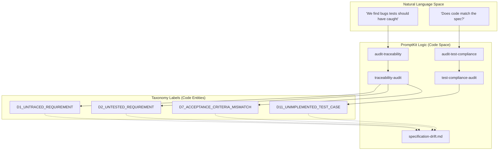
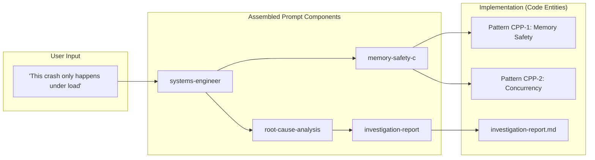

<!-- source: DeepWiki mcp.deepwiki.com · repo microsoft/PromptKit · page 9 Case Studies · fetched 2026-10-26 -->

# Case Studies

Relevant source files

The following files were used as context for generating this wiki page:

- [docs/PromptKit-DeepDive.pdf](docs/PromptKit-DeepDive.pdf)
- [docs/PromptKit-DeepDive.pptx](docs/PromptKit-DeepDive.pptx)
- [docs/PromptKit-Intro.pdf](docs/PromptKit-Intro.pdf)
- [docs/PromptKit-Intro.pptx](docs/PromptKit-Intro.pptx)
- [docs/case-studies/investigate-bug.md](docs/case-studies/investigate-bug.md)
- [docs/examples.md](docs/examples.md)
- [docs/pipeline-guide.md](docs/pipeline-guide.md)
- [docs/scenarios.md](docs/scenarios.md)
- [formats/decision-log.md](formats/decision-log.md)
- [protocols/reasoning/integration-audit.md](protocols/reasoning/integration-audit.md)
- [protocols/reasoning/test-compliance-audit.md](protocols/reasoning/test-compliance-audit.md)
- [taxonomies/specification-drift.md](taxonomies/specification-drift.md)
- [templates/audit-integration-compliance.md](templates/audit-integration-compliance.md)
- [templates/audit-test-compliance.md](templates/audit-test-compliance.md)

The Case Studies section provides a collection of real-world scenarios where PromptKit is applied to solve complex engineering challenges. These studies demonstrate how the five-layer composition model—Persona, Protocol, Format, Taxonomy, and Template—functions in practice to transform vague engineering requests into structured, high-fidelity technical artifacts.

For a summary of common usage scenarios and the specific components they assemble, see the [Scenarios Guide](docs/scenarios.md).

## Overview of Case Study Domains

PromptKit case studies are categorized by their engineering domain. Each study follows a consistent lifecycle: identifying a problem, selecting the appropriate components from the [Component Library](2. Component Library Reference), and executing a multi-stage pipeline to reach a resolution.

### Software Engineering and Security
These case studies focus on the software development lifecycle (SDLC), covering everything from deep kernel debugging to requirements reverse-engineering. They utilize personas like the `systems-engineer` [docs/scenarios.md:34-35]() and protocols such as `memory-safety-c` [docs/scenarios.md:81-82]().

*   **Investigation and Debugging**: Walkthroughs of root-cause analysis for intermittent crashes, memory leaks, and race conditions.
*   **Traceability and Compliance**: Audits that identify gaps between requirements, design, and implementation using the `specification-drift` taxonomy [taxonomies/specification-drift.md:20-21]().
*   **Reverse Engineering**: Extracting formal requirements from legacy codebases lacking documentation.

For details, see [Software Engineering Case Studies](#9.1).

### Hardware and Protocol Engineering
These studies demonstrate PromptKit's expansion into physical engineering and low-level communication protocols. They showcase the `hardware-design-workflow` and specialized protocols for RF, electrical, and mechanical review.

*   **Specification Audits**: Auditing hardware specifications (e.g., sonde devices) for internal consistency and regulatory compliance.
*   **Protocol Evolution**: Managing the transition and versioning of communication protocols between embedded components.
*   **Library Health**: Using PromptKit to audit its own library of prompts for determinism and consistency.

For details, see [Hardware and Protocol Engineering Case Studies](#9.2).

## Bridging Natural Language to Code Space

PromptKit serves as the interface between human-readable requirements and machine-executable logic. The following diagrams illustrate how specific code entities and taxonomies are mapped to real-world engineering tasks.

### Audit Workflow Mapping
This diagram shows how the `specification-drift` taxonomy labels map to specific verification tasks within the `audit-traceability` and `audit-test-compliance` templates.

**Sources**: [taxonomies/specification-drift.md:50-168](), [docs/scenarios.md:13-26](), [protocols/reasoning/test-compliance-audit.md:101-115]()

### Debugging and Safety Pipeline
This diagram illustrates the association between a debugging task and the underlying safety protocols and reasoning patterns.

**Sources**: [docs/scenarios.md:28-41](), [docs/examples.md:30-41](), [formats/decision-log.md:14-23]()

## Case Study Summary Table

The following table summarizes the primary case studies available in the child pages.

| Case Study Title | Primary Template | Persona | Key Taxonomy Labels |
| :--- | :--- | :--- | :--- |
| **eBPF Epoch Investigation** | `investigate-bug` | `systems-engineer` | Root Cause, Proximate Cause |
| **Traceability Audit** | `audit-traceability` | `specification-analyst` | D1–D7 (Traceability) |
| **Code Compliance Audit** | `audit-code-compliance` | `specification-analyst` | D8–D10 (Code Compliance) |
| **Sonde Spec Audit** | `audit-integration-compliance` | `specification-analyst` | D14–D16 (Integration) |
| **Legacy Requirements Extraction** | `reverse-engineer-requirements` | `reverse-engineer` | KNOWN vs. INFERRED |

**Sources**: [docs/scenarios.md:7-10](), [taxonomies/specification-drift.md:34-46](), [templates/audit-integration-compliance.md:5-11]()

## Child Pages
- **[Software Engineering Case Studies](#9.1)**: Deep dives into eBPF debugging, traceability gaps in C++ projects, and reverse-engineering requirements.
- **[Hardware and Protocol Engineering Case Studies](#9.2)**: Analysis of the Sonde hardware lifecycle and the evolution of communication protocols.

**Sources**:
- `taxonomies/specification-drift.md`
- `docs/scenarios.md`
- `docs/examples.md`
- `protocols/reasoning/integration-audit.md`
- `protocols/reasoning/test-compliance-audit.md`
- `templates/audit-integration-compliance.md`
- `templates/audit-test-compliance.md`

---

