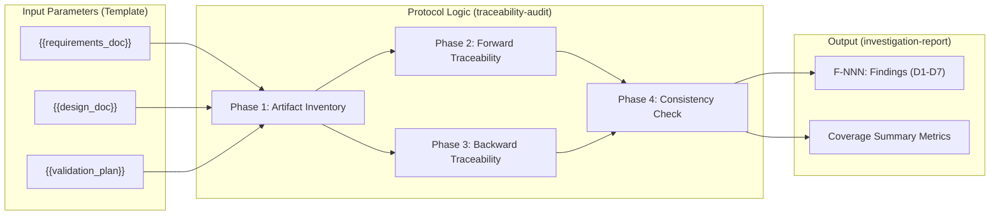

<!-- source: DeepWiki mcp.deepwiki.com · repo microsoft/PromptKit · page 9.1 Software Engineering Case Studies · fetched 2026-10-26 -->

# Software Engineering Case Studies

<details>
<summary>Relevant source files</summary>

The following files were used as context for generating this wiki page:

- [cli/package-lock.json](cli/package-lock.json)
- [cli/specs/design.md](cli/specs/design.md)
- [cli/specs/requirements.md](cli/specs/requirements.md)
- [cli/specs/validation.md](cli/specs/validation.md)
- [docs/case-studies/audit-traceability.md](docs/case-studies/audit-traceability.md)
- [docs/case-studies/determinism-audit-report.md](docs/case-studies/determinism-audit-report.md)
- [docs/case-studies/determinism-audit.md](docs/case-studies/determinism-audit.md)
- [docs/case-studies/ebpf-epoch.md](docs/case-studies/ebpf-epoch.md)
- [docs/case-studies/reverse-engineer-requirements.md](docs/case-studies/reverse-engineer-requirements.md)
- [personas/reverse-engineer.md](personas/reverse-engineer.md)
- [personas/specification-analyst.md](personas/specification-analyst.md)
- [protocols/reasoning/requirements-from-implementation.md](protocols/reasoning/requirements-from-implementation.md)
- [protocols/reasoning/traceability-audit.md](protocols/reasoning/traceability-audit.md)
- [templates/audit-traceability.md](templates/audit-traceability.md)
- [templates/reverse-engineer-requirements.md](templates/reverse-engineer-requirements.md)

</details>


This page documents real-world applications of PromptKit in complex software engineering scenarios. These case studies demonstrate how the library’s five-layer composition model—combining specialized personas, reasoning protocols, and structured formats—solves high-stakes engineering problems such as specification extraction, traceability auditing, and instruction determinism.

## 1. eBPF Epoch: Spec Extraction from Implementation

This case study focuses on the `ebpf_epoch` module within the **eBPF for Windows** project. This kernel-level subsystem provides epoch-based memory reclamation (EBR) but lacked formal specifications beyond its implementation.

### Implementation and Data Flow
The extraction process utilized the `requirements-from-implementation` protocol to transform ~2,350 lines of C/C++ code into a semantic baseline. The workflow employed parallel agents to minimize latency while maintaining high fidelity to the source code.

**Key Entities:**
*   **Persona**: `reverse-engineer` [personas/reverse-engineer.md:1-20]()
*   **Protocol**: `requirements-from-implementation` [protocols/reasoning/requirements-from-implementation.md:16-129]()
*   **Template**: `reverse-engineer-requirements` [templates/reverse-engineer-requirements.md:1-30]()

### Spec Extraction Pipeline
The diagram below illustrates the transition from "Code Entity Space" (C source files) to "Natural Language Space" (Markdown specifications).

**Figure 1: eBPF Epoch Spec Extraction Flow**
```mermaid
graph TD
    subgraph "Code Entity Space"
        [ebpf_epoch.h] --> [Phase_1_Enumeration]
        [ebpf_epoch.c] --> [Phase_2_Contract_Extraction]
        [platform_unit_test.cpp] --> [Phase_2_Contract_Extraction]
    end

    subgraph "Reasoning Logic (PromptKit)"
        [Phase_1_Enumeration] --> |"Public API Catalog"| [Phase_3_Classification]
        [Phase_2_Contract_Extraction] --> |"Pre/Post-conditions"| [Phase_3_Classification]
        [Phase_3_Classification] --> |"Essential vs Incidental"| [Phase_4_Synthesis]
    end

    subgraph "Natural Language Space"
        [Phase_4_Synthesis] --> [requirements.md]
        [Phase_4_Synthesis] --> [design.md]
        [Phase_4_Synthesis] --> [validation.md]
    end

    style [ebpf_epoch.h] stroke-dasharray: 5 5
    style [ebpf_epoch.c] stroke-dasharray: 5 5
    style [requirements.md] stroke-width: 2px
```
**Sources:** [docs/case-studies/ebpf-epoch.md:42-126](), [protocols/reasoning/requirements-from-implementation.md:23-113]()

---

## 2. Traceability Audit: Detecting Specification Drift

This case study demonstrates the `traceability-audit` protocol applied to a set of authentication service specifications. It identifies "Specification Drift"—the divergence between requirements, design, and validation artifacts over time.

### Technical Detail
The audit uses the `specification-drift` taxonomy (D1–D7) to classify findings. It performs both **Forward Traceability** (Requirements → Design/Validation) and **Backward Traceability** (Validation/Design → Requirements) to detect orphaned elements and coverage gaps.

| Drift ID | Category | Description |
| :--- | :--- | :--- |
| **D1** | Untraced Requirement | Requirement not found in design document. |
| **D2** | Untested Requirement | Requirement has no corresponding test case. |
| **D3** | Orphaned Design | Design decision with no originating requirement. |
| **D4** | Orphaned Test | Test case referencing a non-existent REQ-ID. |
| **D7** | Criteria Mismatch | Test exists but doesn't verify acceptance criteria. |

**Sources:** [protocols/reasoning/traceability-audit.md:69-142](), [docs/case-studies/audit-traceability.md:67-85]()

### Audit Execution Diagram
This diagram bridges the `audit-traceability` template parameters to the internal `traceability-audit` protocol phases.

**Figure 2: Traceability Audit Data Mapping**

**Sources:** [templates/audit-traceability.md:47-64](), [protocols/reasoning/traceability-audit.md:23-157]()

---

## 3. Determinism Audit: Prompt Linting

This study involves "eating our own dog food" by running PromptKit against its own component library. The goal was to identify non-deterministic language (vague adjectives, unanchored comparatives) in the prompts that LLMs consume as instructions.

### Findings and Remediation
The audit of 60 components revealed that **33% of High-severity findings** were caused by subjective adjectives used as evaluation criteria.

**Key Findings Example:**
*   **Finding**: `author-design-doc.md` used the phrase "For every *significant* design decision."
*   **Root Cause**: "Significant" is non-deterministic; different LLMs apply different thresholds.
*   **Remediation**: Replaced with observable criteria: "(a) affects multiple components, (b) impacts non-functional requirements, or (c) is difficult to reverse." [docs/case-studies/determinism-audit-report.md:44-62]()

### Audit Metrics
| Grade | Criteria | Components |
| :--- | :--- | :--- |
| **Precise** | 0 High, ≤2 Medium findings | 12% |
| **Acceptable** | Within standard thresholds | 58% |
| **Imprecise** | ≥2 High or 1 High + >2 Medium | 30% |

**Sources:** [docs/case-studies/determinism-audit-report.md:5-17](), [docs/case-studies/determinism-audit.md:71-135]()

---

## 4. CLI Validation and Traceability

The PromptKit CLI (`@alan-jowett/promptkit`) maintains its own internal traceability between requirements and test cases.

### Core Functions
*   `detectCli()`: Probes the system `PATH` for `copilot`, `gh`, or `claude` binaries. [cli/lib/launch.js:21-35]()
*   `copyContentToTemp()`: Stages the library content in a temporary directory to ensure the LLM has a clean environment. [cli/lib/launch.js:37-41]()
*   `ensureContent()`: A guard function in `cli.js` that validates the presence of `bootstrap.md` and `manifest.yaml` before execution. [cli/bin/cli.js:116-119]()

### Traceability Matrix (CLI)
| Requirement ID | Description | Test Case ID |
| :--- | :--- | :--- |
| **REQ-CLI-002** | Provide `interactive` and `list` commands. | **TC-CLI-001**, **TC-CLI-004** |
| **REQ-CLI-004** | Exit 1 if content is missing. | **TC-CLI-003**, **TC-CLI-003a** |
| **REQ-CLI-010** | Auto-detect LLM CLI on PATH. | **TC-CLI-080** |
| **REQ-CLI-024** | Preserve user's original CWD. | **TC-CLI-082** |

**Sources:** [cli/specs/requirements.md:52-150](), [cli/specs/validation.md:53-182](), [cli/specs/design.md:92-123]()

---

