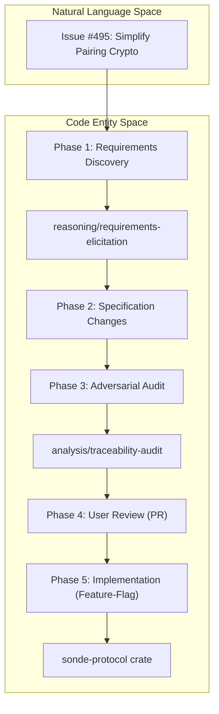
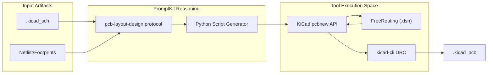

<!-- source: DeepWiki mcp.deepwiki.com · repo microsoft/PromptKit · page 9.2 Hardware and Protocol Engineering Case Studies · fetched 2026-10-26 -->

# Hardware and Protocol Engineering Case Studies

Relevant source files

The following files were used as context for generating this wiki page:

- [docs/case-studies/audit-library-health-report.md](docs/case-studies/audit-library-health-report.md)
- [docs/case-studies/audit-library-health.md](docs/case-studies/audit-library-health.md)
- [docs/case-studies/sonde-protocol-evolution.md](docs/case-studies/sonde-protocol-evolution.md)
- [docs/case-studies/sonde-specification-audit.md](docs/case-studies/sonde-specification-audit.md)
- [protocols/analysis/component-selection-audit.md](protocols/analysis/component-selection-audit.md)
- [protocols/analysis/layout-design-review.md](protocols/analysis/layout-design-review.md)
- [protocols/reasoning/component-selection.md](protocols/reasoning/component-selection.md)
- [protocols/reasoning/pcb-layout-design.md](protocols/reasoning/pcb-layout-design.md)
- [protocols/reasoning/schematic-design.md](protocols/reasoning/schematic-design.md)
- [templates/design-pcb-layout.md](templates/design-pcb-layout.md)
- [templates/hardware-design-workflow.md](templates/hardware-design-workflow.md)

This page covers real-world applications of PromptKit in hardware design and protocol engineering. It demonstrates how the library's multi-layered components (Personas, Protocols, Formats, and Taxonomies) are composed into end-to-end pipelines to solve complex engineering challenges, such as auditing IoT runtimes and evolving cryptographic protocols.

## 1. Sonde Specification Audit

The Sonde project, a programmable runtime for distributed sensor nodes, served as a primary case study for the `audit-traceability` template [docs/case-studies/sonde-specification-audit.md:8-13](). This study highlights the effectiveness of the `specification-analyst` persona and the `traceability-audit` protocol in identifying systemic design gaps.

### Technical Implementation
The audit utilized a single assembled prompt across five distinct components (Modem, Node, Gateway, BLE Tool, and Protocol) [docs/case-studies/sonde-specification-audit.md:41-43]().

**Data Flow and Pipeline:**
1.  **Assembly**: The `promptkit assemble` command combined the `specification-analyst` persona, `traceability-audit` reasoning protocol, `specification-drift` taxonomy, and `investigation-report` format [docs/case-studies/sonde-specification-audit.md:45-63]().
2.  **Input**: Three markdown documents per component (Requirements, Design, Validation Plan) were fed into the LLM session [docs/case-studies/sonde-specification-audit.md:47-49]().
3.  **Execution**: The LLM followed the 6-phase `traceability-audit` protocol [docs/case-studies/sonde-specification-audit.md:68-72]().

### Key Findings
The audit surfaced 147 findings across 260 requirements [docs/case-studies/sonde-specification-audit.md:3-4](). A critical systemic gap was identified where BLE pairing requirements had been added to the project, but the design documents for the Modem and Gateway had 0% coverage for these features [docs/case-studies/sonde-specification-audit.md:96-101]().

**Finding Distribution by Taxonomy (Specification-Drift):**
| Drift Type | Count | Description |
| :--- | :--- | :--- |
| **D1** | 12 | Untraced requirements (missing in design) |
| **D2** | 10 | Untested requirements (missing in validation) |
| **D3** | 7 | Orphaned design (design with no requirement) |
| **D6** | 3 | Design contradicts a requirement |

Sources: [docs/case-studies/sonde-specification-audit.md:1-131]()

---

## 2. Sonde Protocol Evolution

This case study documents the migration of a cryptographic protocol from an asymmetric key-pair model to a PSK-based AES-256-GCM model [docs/case-studies/sonde-protocol-evolution.md:22-30](). It demonstrates the `evolve` workflow's ability to prevent security regressions during major architectural shifts.

### The 8-Phase Evolution Pipeline
The evolution followed a strict pipeline defined in the `evolve-protocol` template (referenced as the `evolve` workflow) [docs/case-studies/sonde-protocol-evolution.md:35-43]().

**Pipeline Diagram:**

### Critical Security Catch
During **Phase 1 (Requirements Discovery)**, the interactive gate caught a fundamental error where the agent initially misunderstood the crypto model [docs/case-studies/sonde-protocol-evolution.md:65-71](). Later, in **Phase 4 (User Review)**, the automated review identified that the GCM nonce construction lacked the `msg_type`, which would have allowed nonce reuse—a critical cryptographic vulnerability [docs/case-studies/sonde-protocol-evolution.md:171-174]().

Sources: [docs/case-studies/sonde-protocol-evolution.md:1-174]()

---

## 3. Hardware Lifecycle Case Study: PCB Design

PromptKit provides a comprehensive `hardware-design-workflow` template that bridges the gap between requirements and physical manufacturing artifacts [templates/hardware-design-workflow.md:5-13]().

### Hardware Engineering Pipeline
The workflow utilizes specialized protocols for each stage of the electrical engineering lifecycle.

| Phase | Core Protocol | Key Functionality |
| :--- | :--- | :--- |
| **Selection** | `component-selection` | Identifies MCUs, Sensors, and Wireless modules [protocols/reasoning/component-selection.md:21-25]() |
| **Schematic** | `schematic-design` | Generates `.kicad_sch` S-expressions for KiCad [protocols/reasoning/schematic-design.md:21-25]() |
| **Layout** | `pcb-layout-design` | Generates Python scripts for the `pcbnew` API [protocols/reasoning/pcb-layout-design.md:21-26]() |
| **Review** | `layout-design-review` | Audits trace widths and impedance control [protocols/analysis/layout-design-review.md:18-22]() |

### Layout Design Implementation
The `pcb-layout-design` protocol is designed to be executed via a Python automation script.

**PCB Layout Data Flow:**

The protocol explicitly validates trace widths for power nets (VIN, VBAT, 3V3) using IPC-2221 standards [protocols/analysis/layout-design-review.md:44-50]() and verifies differential pair routing for high-speed signals like USB D+/D- [protocols/analysis/layout-design-review.md:62-67]().

Sources: [templates/hardware-design-workflow.md:68-86](), [protocols/reasoning/pcb-layout-design.md:33-42](), [protocols/analysis/layout-design-review.md:1-159]()

---

## 4. Library Health Audit

The `audit-library-health` case study demonstrates PromptKit's self-hosting capability by using the library to audit its own 167 component files [docs/case-studies/audit-library-health.md:1-8]().

### Audit Methodology
The audit was conducted in two primary passes using the `specification-analyst` persona [docs/case-studies/audit-library-health.md:42-47]():

1.  **Pass 1: Structural Consistency**: Analyzed protocol overlap and template similarity [docs/case-studies/audit-library-health.md:70-85]().
2.  **Pass 2: Corpus Safety**: Scanned for SPDX headers, license compliance, and verbatim content detection using the `corpus-safety-audit` protocol [docs/case-studies/audit-library-health.md:87-97]().

### Structural Findings
The audit identified a significant consolidation opportunity (Finding **F-001**): nine audit templates shared identical scaffolding and differed only in their final domain-specific protocol [docs/case-studies/audit-library-health-report.md:31-39](). It also found terminology drift between `operational-constraints` and `self-verification` regarding coverage documentation [docs/case-studies/audit-library-health-report.md:67-73]().

Sources: [docs/case-studies/audit-library-health.md:1-180](), [docs/case-studies/audit-library-health-report.md:1-110]()

---

