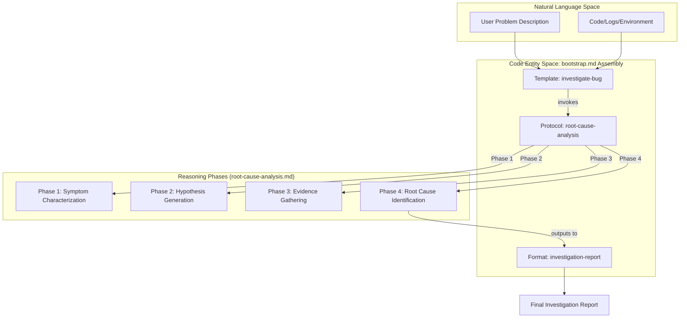
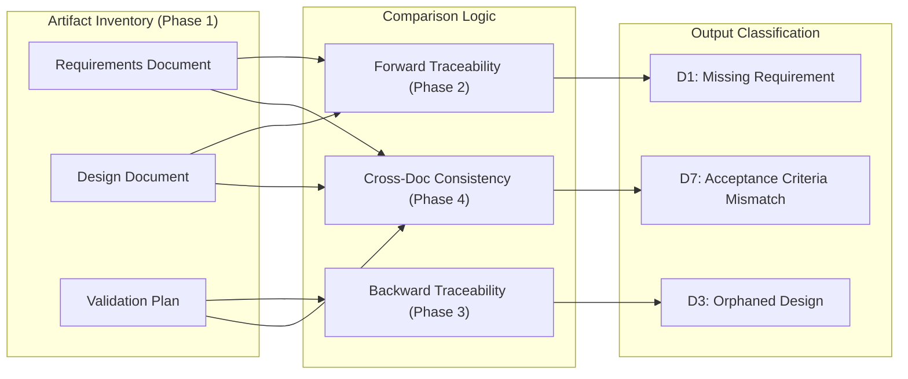

<!-- source: DeepWiki mcp.deepwiki.com · repo microsoft/PromptKit · extra page Reasoning Protocols · fetched 2026-10-26 -->

# Reasoning Protocols

Relevant source files

The following files were used as context for generating this wiki page:

- [bootstrap.md](bootstrap.md)
- [docs/case-studies/audit-traceability.md](docs/case-studies/audit-traceability.md)
- [formats/behavioral-model.md](formats/behavioral-model.md)
- [formats/investigation-report.md](formats/investigation-report.md)
- [formats/structured-patch.md](formats/structured-patch.md)
- [personas/specification-analyst.md](personas/specification-analyst.md)
- [protocols/guardrails/anti-hallucination.md](protocols/guardrails/anti-hallucination.md)
- [protocols/guardrails/operational-constraints.md](protocols/guardrails/operational-constraints.md)
- [protocols/reasoning/change-propagation.md](protocols/reasoning/change-propagation.md)
- [protocols/reasoning/fixed-point-verification.md](protocols/reasoning/fixed-point-verification.md)
- [protocols/reasoning/invariant-extraction.md](protocols/reasoning/invariant-extraction.md)
- [protocols/reasoning/iterative-refinement.md](protocols/reasoning/iterative-refinement.md)
- [protocols/reasoning/manufacturing-artifact-generation.md](protocols/reasoning/manufacturing-artifact-generation.md)
- [protocols/reasoning/minimal-reproduction.md](protocols/reasoning/minimal-reproduction.md)
- [protocols/reasoning/multi-agent-coordination.md](protocols/reasoning/multi-agent-coordination.md)
- [protocols/reasoning/quantitative-constraint-validation.md](protocols/reasoning/quantitative-constraint-validation.md)
- [protocols/reasoning/requirements-elicitation.md](protocols/reasoning/requirements-elicitation.md)
- [protocols/reasoning/root-cause-analysis.md](protocols/reasoning/root-cause-analysis.md)
- [protocols/reasoning/session-handoff.md](protocols/reasoning/session-handoff.md)
- [protocols/reasoning/spec-evolution-diff.md](protocols/reasoning/spec-evolution-diff.md)
- [protocols/reasoning/traceability-audit.md](protocols/reasoning/traceability-audit.md)
- [taxonomies/kernel-defect-categories.md](taxonomies/kernel-defect-categories.md)
- [templates/audit-library-consistency.md](templates/audit-library-consistency.md)
- [templates/audit-traceability.md](templates/audit-traceability.md)
- [templates/author-session-handoff.md](templates/author-session-handoff.md)
- [templates/collaborate-requirements-change.md](templates/collaborate-requirements-change.md)
- [templates/diff-specifications.md](templates/diff-specifications.md)
- [templates/emit-manufacturing-artifacts.md](templates/emit-manufacturing-artifacts.md)
- [templates/extract-invariants.md](templates/extract-invariants.md)
- [templates/investigate-bug.md](templates/investigate-bug.md)
- [templates/investigate-trace.md](templates/investigate-trace.md)
- [templates/lint-prompt.md](templates/lint-prompt.md)
- [templates/reconstruct-behavior.md](templates/reconstruct-behavior.md)
- [templates/review-cpp-code.md](templates/review-cpp-code.md)
- [tests/self-audit-prompt.md](tests/self-audit-prompt.md)

Reasoning protocols in PromptKit are systematic, language-agnostic frameworks that govern how an LLM decomposes complex problems, evaluates evidence, and ensures logical convergence [protocols/reasoning/root-cause-analysis.md:8-10](). Unlike guardrails, which provide cross-cutting constraints, reasoning protocols provide the step-by-step cognitive architecture for specific engineering tasks like failure investigation, requirements engineering, and artifact validation.

## Architecture and Data Flow

Reasoning protocols are implemented as Markdown files with YAML frontmatter. They are typically composed into templates (e.g., `investigate-bug`) alongside a persona and an output format [templates/investigate-bug.md:10-18](). During the assembly process, the `bootstrap` engine reads these protocols and includes their full body text verbatim to guide the session's logic [bootstrap.md:54-58]().

### Protocol Execution Lifecycle

The following diagram illustrates how a reasoning protocol (using `root-cause-analysis` as an example) structures the flow from raw user input to a structured report.

**Logic Flow: Natural Language to Code Entity Space**

**Sources:** [templates/investigate-bug.md:31-47](), [protocols/reasoning/root-cause-analysis.md:17-103](), [bootstrap.md:21-26]()

---

## Core Reasoning Protocols

### Root Cause Analysis (RCA)
The RCA protocol provides a structured method for tracing symptoms to fundamental defects rather than proximate triggers [protocols/reasoning/root-cause-analysis.md:19-21](). It enforces a "Hypothesis Generation" phase where the LLM must generate at least 3 competing hypotheses before investigating any of them to prevent anchoring bias [protocols/reasoning/root-cause-analysis.md:48-51]().

**Key Functions:**
*   **Symptom Characterization**: Defines blast radius and timeline [protocols/reasoning/root-cause-analysis.md:23-36]().
*   **Iterative Deepening**: Forces analysis through layers (Survey → Attribution → Deep Analysis) [protocols/reasoning/root-cause-analysis.md:68-85]().
*   **Cross-Component Causal Chains**: Identifies trigger-response pairs and amplification cascades in multi-service systems [protocols/reasoning/root-cause-analysis.md:105-124]().

### Traceability Audit
Used primarily by the `specification-analyst` persona, this protocol audits consistency across requirements, design, and validation documents [protocols/reasoning/traceability-audit.md:18-21](). It uses the `specification-drift` taxonomy to classify findings [templates/audit-traceability.md:16-17]().

**Data Flow in Traceability Audit:**

**Sources:** [protocols/reasoning/traceability-audit.md:23-157](), [templates/audit-traceability.md:41-61]()

### Requirements Elicitation
This protocol converts natural language descriptions into atomic, testable requirements using RFC 2119 keywords (MUST, SHALL, SHOULD) [protocols/reasoning/requirements-elicitation.md:19-21, 42-46](). It includes a specific "Ambiguity Detection" phase aligned with the `prompt-determinism-analysis` protocol to remove vague adjectives and unquantified quantities [protocols/reasoning/requirements-elicitation.md:56-85]().

### Fixed-Point Verification
A specialized protocol for verifying transformation correctness (e.g., compilers, formatters, migrators). It operates on the principle of idempotency: `T(T(x)) == T(x)` [protocols/reasoning/fixed-point-verification.md:21-24]().

**Implementation Details:**
*   **Phase 2 (Execute)**: Applies the transformation twice and compares the results [protocols/reasoning/fixed-point-verification.md:53-69]().
*   **Phase 3 (Diagnose)**: Categorizes divergence as Semantic, Syntactic, or Additive [protocols/reasoning/fixed-point-verification.md:89-103]().

---

## Technical Reference Table: Reasoning Protocols

| Protocol Name | Purpose | Key Mechanism | Applicable Templates |
| :--- | :--- | :--- | :--- |
| `root-cause-analysis` | Failure investigation | Hypothesis ranking & elimination | `investigate-bug`, `investigate-trace` |
| `traceability-audit` | Spec consistency | Forward/Backward mapping | `audit-traceability` |
| `requirements-elicitation` | Spec authoring | RFC 2119 atomic decomposition | `author-requirements-doc` |
| `fixed-point-verification` | Idempotency check | Multi-pass convergence testing | User-composed |
| `manufacturing-artifact-generation` | Hardware delivery | `kicad-cli` script generation | `emit-manufacturing-artifacts` |
| `change-propagation` | Impact analysis | Dependency graph traversal | `collaborate-requirements-change` |

**Sources:** [protocols/reasoning/manufacturing-artifact-generation.md:7-14](), [protocols/reasoning/fixed-point-verification.md:7-11](), [templates/audit-traceability.md:15]()

## Operational Constraints in Reasoning
All reasoning protocols are subject to `operational-constraints`, which enforce "Scope Before You Search" rules [protocols/guardrails/operational-constraints.md:24-25](). For instance, an LLM performing `root-cause-analysis` is restricted from reading more than 50 files in an initial discovery pass without summarizing findings [protocols/guardrails/operational-constraints.md:26-31](). This ensures that reasoning remains computationally efficient and fits within context window limits (max 50,000 lines) [protocols/guardrails/operational-constraints.md:67-68]().

**Sources:** [protocols/guardrails/operational-constraints.md:15-80]()

---

