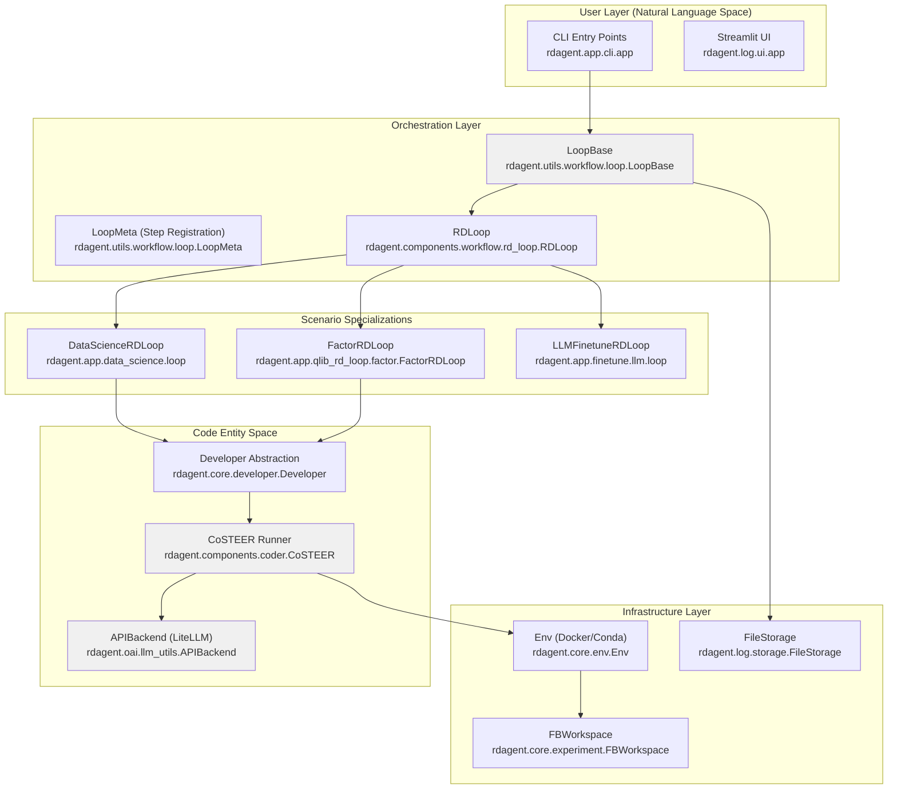

<!-- source: DeepWiki mcp.deepwiki.com · repo microsoft/RD-Agent · page 1 Overview · fetched 2026-10-26 -->

# Overview

<details>
<summary>Relevant source files</summary>

The following files were used as context for generating this wiki page:

- [.env.example](.env.example)
- [README.md](README.md)
- [docs/_static/Framework-RDAgent.png](docs/_static/Framework-RDAgent.png)
- [docs/_static/demo.png](docs/_static/demo.png)
- [docs/_static/favicon.ico](docs/_static/favicon.ico)
- [docs/_static/logo.png](docs/_static/logo.png)
- [docs/_static/scen.jpg](docs/_static/scen.jpg)
- [docs/_static/scen.png](docs/_static/scen.png)
- [docs/api_reference.rst](docs/api_reference.rst)
- [docs/conf.py](docs/conf.py)
- [docs/development.rst](docs/development.rst)
- [docs/index.rst](docs/index.rst)
- [docs/installation_and_configuration.rst](docs/installation_and_configuration.rst)
- [docs/introduction.rst](docs/introduction.rst)
- [docs/project_framework_introduction.rst](docs/project_framework_introduction.rst)
- [rdagent/app/cli.py](rdagent/app/cli.py)
- [rdagent/app/general_model/general_model.py](rdagent/app/general_model/general_model.py)
- [rdagent/app/qlib_rd_loop/factor.py](rdagent/app/qlib_rd_loop/factor.py)
- [rdagent/app/qlib_rd_loop/factor_from_report.py](rdagent/app/qlib_rd_loop/factor_from_report.py)
- [rdagent/app/qlib_rd_loop/model.py](rdagent/app/qlib_rd_loop/model.py)
- [rdagent/app/qlib_rd_loop/quant.py](rdagent/app/qlib_rd_loop/quant.py)
- [rdagent/components/workflow/rd_loop.py](rdagent/components/workflow/rd_loop.py)
- [rdagent/scenarios/qlib/proposal/quant_proposal.py](rdagent/scenarios/qlib/proposal/quant_proposal.py)
- [rdagent/utils/workflow/loop.py](rdagent/utils/workflow/loop.py)

</details>


RD-Agent is an LLM-powered autonomous research and development framework designed to automate data-driven R&D workflows. The system implements a complete "Research → Development" cycle where AI agents propose hypotheses, generate implementation code, execute experiments in isolated environments, and learn from feedback to iteratively improve solutions.

This page provides a high-level overview of the RD-Agent architecture, its core execution model, and supported application scenarios. For detailed installation instructions, see [Installation and Configuration](#1.1). For command-line usage, see [Command Line Interface](#1.2). For in-depth documentation of specific subsystems, refer to the relevant sections: [Core Architecture](#2), [Scenarios and Applications](#3), [Components and Implementation](#4), and [User Interface and Monitoring](#5).

## Purpose and Scope

RD-Agent targets data-driven research scenarios including:
- **Quantitative Finance**: Automated factor discovery and model development for algorithmic trading [rdagent/app/qlib_rd_loop/quant.py:1-40]().
- **Data Science Competitions**: End-to-end pipeline development for Kaggle and MLE-bench tasks [README.md:50-73]().
- **LLM Fine-Tuning**: Autonomous fine-tuning (FT-Agent) using the FT-Dojo methodology [README.md:31-34]().
- **Research Automation**: Extracting and implementing models/factors from academic papers and financial reports [rdagent/app/qlib_rd_loop/factor_from_report.py:61-94]().

The framework is **not** a ready-to-use production system for financial investment, but rather a research tool for automating iterative experimentation workflows. It achieves state-of-the-art results on MLE-bench (30.22% average accuracy) using a combination of reasoning models (o3) for research and development agents (GPT-4.1) [README.md:50-71]().

**Sources**: [README.md:1-91](), [rdagent/app/qlib_rd_loop/factor_from_report.py:61-94]()

## System Architecture Overview

The RD-Agent architecture consists of interconnected subsystems organized in a layered structure, bridging the gap between Natural Language research ideas and executable Code Entities.



**Architecture Layers**:

| Layer | Purpose | Key Components |
|-------|---------|----------------|
| **User Layer** | Entry points for users | CLI commands (`rdagent` via `typer`), Streamlit UI (`dsapp.py`, `app.py`) |
| **Orchestration Layer** | Workflow execution | `LoopBase` (session management), `LoopMeta` (metaclass for steps), `RDLoop` |
| **Scenario Specializations** | Domain-specific loops | `FactorRDLoop`, `ModelRDLoop`, `DataScienceRDLoop`, `LLMFinetuneRDLoop` |
| **Code Entity Space** | LLM-to-Code mapping | `APIBackend` (LiteLLM integration), `CoSTEER` (code evolution), `Developer` |
| **Infrastructure Layer** | Execution & Persistence | `Env` (sandboxing), `FBWorkspace` (file tracking), `FileStorage` (logs) |

**Sources**: [rdagent/utils/workflow/loop.py:33-115](), [rdagent/app/cli.py:37-182](), [rdagent/components/workflow/rd_loop.py:31-68]()

## Core R&D Loop Execution Model

RD-Agent implements an iterative workflow that bridges "Natural Language Space" (Hypotheses) to "Code Entity Space" (Implementation & Results).

```mermaid
sequenceDiagram
    participant User
    participant CLI["CLI<br/>rdagent.app.cli"]
    participant Loop["RDLoop<br/>rdagent.components.workflow.rd_loop"]
    participant Propose["HypothesisGen<br/>propose()"]
    participant Coder["Developer/CoSTEER<br/>develop()"]
    participant Env["Env<br/>execute()"]
    participant Eval["Evaluator<br/>feedback()"]
    
    User->>CLI: "rdagent fin_factor"
    CLI->>Loop: "run(step_n, loop_n)"
    
    loop "R&D Iteration"
        Loop->>Propose: "generate hypothesis (NL)"
        Propose-->>Loop: "Hypothesis object"
        
        Loop->>Coder: "develop(hypothesis) -> Code"
        loop "Evolution (CoSTEER)"
            Coder->>Env: "execute(workspace)"
            Env-->>Coder: "stdout/stderr/metrics"
            Coder->>Eval: "evaluate(results)"
            Eval-->>Coder: "Feedback (NL)"
            Note over Coder: Refine code based on feedback
        end
        
        Loop->>Eval: "summarize experiment"
        Loop->>Loop: "update Trace/KnowledgeBase"
    end
```

**Phase Descriptions**:

1. **Hypothesis Generation** (`propose`): LLM generates research ideas (`Hypothesis`) based on the current `Scenario` and prior `Trace` history [rdagent/components/workflow/rd_loop.py:38-42]().
2. **Coding/Development** (`coding`): The `Developer` (often `CoSTEER`) converts the hypothesis into executable code within a `FBWorkspace` [rdagent/components/workflow/rd_loop.py:55-57]().
3. **Execution** (`running`): Code is executed in an isolated `Env` (e.g., `DockerEnv`) to produce results and metrics [rdagent/app/qlib_rd_loop/factor.py:21-27]().
4. **Feedback & Summary** (`feedback`): Evaluators analyze execution logs and metrics to provide structured feedback for the next loop iteration [rdagent/components/workflow/rd_loop.py:62-66]().

**Sources**: [rdagent/utils/workflow/loop.py:85-115](), [rdagent/components/workflow/rd_loop.py:31-68](), [rdagent/app/qlib_rd_loop/factor.py:21-27]()

## Key Component Summary

### LLM Integration
The system uses `LiteLLMAPIBackend` as the default provider, enabling seamless switching between OpenAI, Azure, DeepSeek, and other backends [README.md:41](). It supports `json_mode` for structured outputs and implements a `SQliteLazyCache` to reduce costs and latency [rdagent/app/qlib_rd_loop/factor_from_report.py:42-48]().

### Workflow Session Management
`LoopBase` handles the complexity of long-running R&D processes, including:
- **Checkpointing**: Saving state to `__session__` folders for resumption [rdagent/utils/workflow/loop.py:127-129]().
- **Step Registration**: Using `LoopMeta` to automatically discover methods as workflow steps [rdagent/utils/workflow/loop.py:33-74]().
- **Parallelism**: Managing `asyncio.Semaphore` for concurrent step execution [rdagent/utils/workflow/loop.py:144-158]().

### Scenario Specializations
RD-Agent is designed to be extensible through the `Scenario` and `RDLoop` abstractions:
- **Quant Finance**: `FactorRDLoop` and `ModelRDLoop` for Qlib-based trading research [rdagent/app/qlib_rd_loop/factor.py:17-27]().
- **General Research**: `FactorReportLoop` for extracting ideas directly from PDF reports/papers [rdagent/app/qlib_rd_loop/factor_from_report.py:97-141]().
- **Data Science**: `DataScienceRDLoop` for competition-style end-to-end modeling [rdagent/app/cli.py:130-147]().

**Sources**: [rdagent/utils/workflow/loop.py:11-31](), [rdagent/components/workflow/rd_loop.py:31-68](), [rdagent/app/cli.py:82-161]()

## User Interface and Monitoring

RD-Agent provides multiple ways to monitor autonomous progress:
- **CLI**: Real-time progress bars and logs via `rdagent` commands [rdagent/utils/workflow/loop.py:161-165]().
- **Streamlit UI**: Visualize traces, experiment DAGs, and metrics using `rdagent ui` [rdagent/app/cli.py:45-62]().
- **Real-time Server**: A Flask-based backend for live monitoring via `rdagent server_ui` [rdagent/app/cli.py:65-71]().

**Sources**: [rdagent/app/cli.py:45-80](), [README.md:36]()

## Next Steps

- **[Installation and Configuration](#1.1)**: Set up your environment, Docker, and LLM API keys.
- **[Command Line Interface](#1.2)**: Learn how to launch different R&D scenarios.
- **[Core Architecture](#2)**: Understand the deep technical design of the R&D loops and environments.

---

